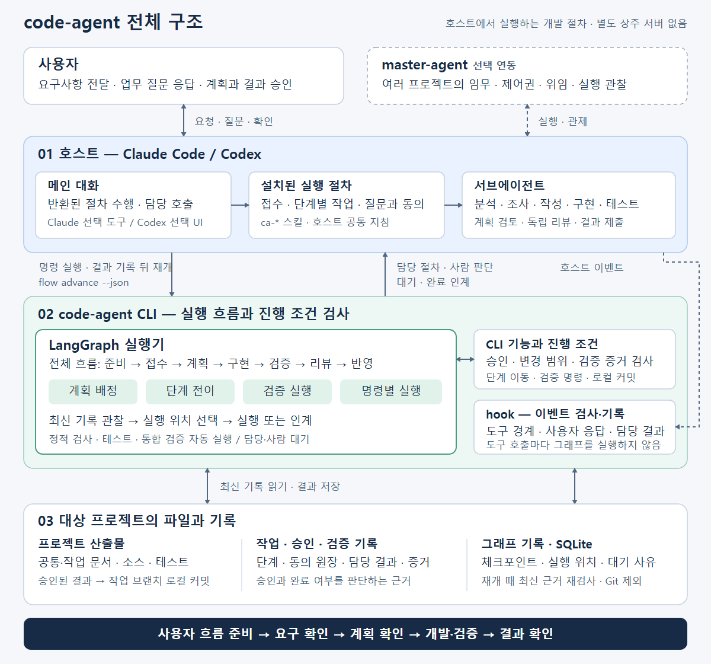
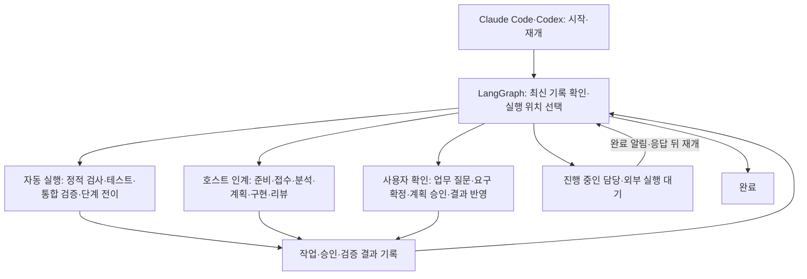

# code-agent

**요구사항을 받아 코드를 작성하고, 테스트·리뷰를 거쳐 로컬 커밋까지 진행하는 Claude Code·Codex용 개발 에이전트입니다.** 신규 개발, 기존 기능 추가·변경, 버그 수정, 리팩토링을 지원합니다. 사용자는 원하는 동작을 설명하고, 필요한 업무 질문에 답하고, 요구사항·계획·최종 결과를 확인합니다.

code-agent는 **Claude Code와 Codex에서 실행하는 개발 절차**입니다. 상주 서버를 따로 띄우지 않습니다(Codex 선택 UI의 로컬 MCP는 Codex가 필요할 때 실행합니다). 호스트별 실행 절차·서브에이전트·훅을 설치하고 같은 프로젝트의 대화에서 요구사항을 전달합니다.

준비·접수부터 분석·계획·구현·검증·리뷰·반영까지 **LangGraph 기반 실행 그래프**가 흐름을 관리합니다. 그래프가 최신 작업 기록을 읽어 실행·대기·재개 위치를 정하고, Claude Code·Codex는 지정된 담당 절차와 사용자 확인을 수행합니다. 중단된 작업은 `/ca-next`·`$ca-next`로 이어갑니다. [LangGraph 기반 실행과 재개](#langgraph-기반-실행과-재개)

오류 로그만 있으면 `/ca-fix --triage <오류 로그>`로 읽기 전용 조사를 시작합니다. 로그 특징으로 중복을 조회하고 진행 중인 동일 오류는 기존 작업을 안내합니다. 코드 수정이 필요한 신규 건만 중복 확인과 Jira 수동 생성·연결을 거쳐 fix로 접수합니다. 데이터·환경 조치는 별도로 보고하고, 근거가 부족하면 추가 증거를 요청합니다. 기존 Jira·직접 결함 신고와 신규 개발·리팩토링은 기존 접수 절차를 사용합니다. 필수 문서 누락이나 CLI·hook 차단 시에는 가능한 복구 방법과 보류를 선택지로 안내하며, 필요한 동의를 거쳐 같은 작업을 이어갑니다. [사전 판별 사용법](doc/usage.md#sentry-오류의-사전-판별) · [차단 후 계속하기](doc/usage.md#차단-후-계속하기)

`code-agent init` 한 번으로 두 호스트를 모두 준비합니다. 신규 설치의 기본은 현재 호스트 단독 실행이며, 실행 방식 변경은 호스트 밖 터미널에서 확인합니다. 기존 실행 선택과 두 호스트의 교차 검증 설정은 유지합니다.

| 실행 방식 | 실행 전 선택 | 대화에서 시작 |
|---|---|---|
| Claude Code 단독 | `code-agent execution claude` | `/ca-request <요구사항>` |
| Codex 단독 | `code-agent execution codex` | `$ca-request <요구사항>` |
| 교차 검증 | `code-agent execution both` | 사용할 호스트에서 시작 — 계획 검토·코드 리뷰를 다른 호스트가 교차 검증(두 호스트를 모두 실행할 수 있을 때만, 못 쓰면 중지로 기록하고 진행 — 설정 오류·형식 오류는 막는다) |

Codex는 설치 후 다시 열고 프로젝트 훅을 검토·신뢰해야 합니다. 업무 질문과 동의는 자동 등록된 로컬 MCP의 방향키·Enter 선택 UI로 받습니다. `code-agent doctor`와 `update`는 설치된 호스트를 인식합니다. Codex의 사용자 확인 방식과 지원 범위는 [Codex 연동](doc/codex.md)을 참고하세요. 아래 `/ca-*` 예시는 Claude 기준이며 Codex에서는 같은 이름의 `$ca-*` 실행 절차를 사용합니다. CLI 출력은 설치·실행 호스트에 맞춰 표기합니다. `/ca-fix`는 실행 명령이며 티켓 번호가 아닙니다. **작업 ID**는 code-agent의 작업 식별자, **외부 업무 식별자**는 Jira 티켓 키나 Notion 페이지 ID, **조사 ID**는 오류 사전 판별 기록의 식별자입니다. 사전 판별의 외부 연결은 현재 Jira만 지원합니다.

## 목차

- [무엇을 하는가](#무엇을-하는가)
- [동작 구조](#동작-구조)
- [LangGraph 기반 실행과 재개](#langgraph-기반-실행과-재개)
- [설치와 실행](#설치와-실행)
- [대시보드 질문·승인 연동](#대시보드-질문승인-연동)
- [업데이트](#업데이트)
- [요구사항부터 완료까지](#요구사항부터-완료까지)
- [요구 분석·설계·계획](#요구-분석설계계획)
- [검증 노드 실행](#검증-노드-실행)
- [작업 경험·발견 보고·상태 조회](#작업-경험발견-보고상태-조회)
- [명령 선택](#명령-선택)
- [문서와 결과물](#문서와-결과물)
- [문제 해결](#문제-해결)
- [code-agent 개발](#code-agent-개발)
- [상세 문서](#상세-문서)

## 무엇을 하는가

| 단계 | 에이전트가 하는 일 | 사용자가 하는 일 |
|---|---|---|
| 준비 | 요청 원문을 보관하고 공통 문서·프로젝트 설정을 확인합니다. 없으면 분석 전에 준비합니다. | 신규 프로젝트라면 추천 구성 또는 원하는 기술을 선택하고 공통 문서를 확인합니다. |
| 요구 확인 | 원문과 정리 내용을 대조하고 누락·범위·완료 조건을 확인합니다. | 필요한 업무 질문에 답하고 요구사항을 확정합니다. |
| 계획 확인 | 요구사항 분석, 영향도 조사, 설계, 작업 Task와 테스트 계획을 작성합니다. | 변경 범위·Task·실행 순서·검증 방법을 보고 계획을 승인합니다. |
| 개발·검증 | 승인된 순서로 코드·테스트를 작성하고 빌드·테스트·독립 리뷰·통합 검증을 수행합니다. | 계획 변경이나 해결할 수 없는 문제가 있을 때 판단합니다. |
| 결과 확인 | 요구사항별 결과, 변경 파일, 남은 위험과 되돌리기 방법을 정리합니다. | 결과를 확인하고 로컬 커밋을 승인합니다. |

기존 프로젝트의 언어·프레임워크·아키텍처·테스트 도구는 재사용합니다. 신규 프로젝트에는 웹·API용 JavaScript/Node.js, 자동화용 Python 또는 직접 선택을 안내합니다. 추천 구성에는 단일 애플리케이션 구조, 기능별 폴더·모듈, 기본 테스트 도구가 포함됩니다. 실제 소스와 테스트는 계획 승인 후 작성합니다.

일반 작업의 기본 판정 지점은 **요구사항 확정, 계획 승인, 결과 반영**입니다. Claude는 같은 화면의 선택 도구, Codex는 로컬 MCP 선택 UI(`code_agent.confirm`)에서 받은 실제 사용자 선택으로 확인합니다. 최초 준비에서는 POLICY 4종 확정과 필요한 준비 커밋(최초 Git 커밋 또는 기존 저장소의 도입 파일 반영)을 `setup` 확인 하나로 묶습니다. 준비가 끝난 프로젝트에서 작업마다 반복하지 않으며, 공통 문서를 변경하면 다시 확인합니다. 업무 규칙이 모호하거나 계획 변경이 필요하면 추가 질문을 합니다.

완료 범위는 작업 브랜치의 **로컬 커밋**까지입니다. 원격 push, PR/MR 생성, 서비스 배포는 자동 수행하지 않습니다.

## 동작 구조

[](doc/images/architecture.svg)

이미지를 클릭하면 확대해서 볼 수 있습니다. 호스트가 실행 절차와 서브에이전트를 수행하고, CLI 안의 LangGraph가 실행·인계·대기·재개 위치를 결정합니다. CLI와 hook은 승인·범위·증거 및 실제 응답을 확인하며, 재개 시 최신 프로젝트 기록을 다시 읽습니다. 점선의 master-agent는 선택 연동입니다.

| 구성 | 역할 |
|---|---|
| Claude Code·Codex 메인 대화 | 그래프가 반환한 실행 절차를 읽고 필요한 서브에이전트를 호출하거나 사용자에게 확인합니다. |
| LangGraph 실행기 | 준비·접수·계획·구현·검증·리뷰·반영을 연결하고 SQLite에 실행 위치·대기를 기록합니다. |
| 호스트별 실행 절차 18개 | Claude는 `.claude/skills/`, Codex는 `.agents/skills/`의 `ca-*/SKILL.md`에 접수·단계별 절차를 정의합니다. |
| 호스트별 서브에이전트 8개 | Claude는 `.claude/agents/ca-*.md`, Codex는 `.codex/agents/ca-*.toml`에 분석·조사·작성·구현·테스트·검토 역할을 정의합니다. |
| hook 등록 9개 | PreToolUse의 `hook` 1개, AskUserQuestion의 PreToolUse·PostToolUse `consent-event` 2개, Stop 1개, 리뷰어의 SubagentStart·SubagentStop `review-event` 2개입니다. 도구 경계, 실제 사용자 선택, 턴 종료, 독립 리뷰를 각각 관찰합니다. 분석·조사·설계·계획의 SubagentStart·SubagentStop `planning-event` 2개와, 대화 시작·재개·압축·비우기 뒤 진행 상태를 붙이는 SessionStart `session-event` 1개도 등록합니다. |
| `code-agent` CLI | 상태 전환, 승인·범위 검사, 검증 명령 실행, 증거 기록, 로컬 반영을 처리하고 종료합니다. 상주 서버가 아닙니다. |

위 9개 훅은 Claude 기준입니다. PreToolUse 는 MCP 도구(`mcp__.*`)의 로컬 경로 인자도 같은 규칙으로 보고, 질문 훅은 업무 질문의 답도 기록해 기록한 답이 실제 선택과 맞는지 게이트가 대조합니다. Codex는 도구 실행 전·사용자 메시지·서브 에이전트 시작과 종료·턴 종료·세션 시작의 6종 훅을 하나의 어댑터에 연결합니다. 세션 시작은 Claude와 같이 진행 상태를 붙이고 작업 임대를 넘겨받습니다. Codex의 기본 대화·MCP 경로에서 받은 업무 답은 `[Source]: 대화`로 표시돼 승인 화면에 드러납니다. 별도 대시보드 사람 채널의 답은 검증된 응답 영수증과 함께 구분해 기록합니다.

두 호스트 모두 역할을 판단(analyst·critic·reviewer)과 실행(그 밖)으로 나눠 모델·추론 강도 기본값을 둡니다(Claude opus/high·sonnet/medium, Codex gpt-6.1-sol high·medium). `code-agent model`로 현재값을 확인하고 필요하면 역할별로 변경하거나 `default`로 복원합니다. 사용자 변경값은 업데이트 후에도 유지합니다. [역할별 모델 설정](doc/codex.md#역할별-모델-기본값과-변경)을 참고하세요.

작은 기본 조사는 조사와 영향도 문서 작성을 한 담당에게 맡겨 호출을 줄입니다. 새 작업은 역할별 입력을 좁히고 선행 실행 ID만 달라진 동일 결과를 재사용합니다. [선택 기준](doc/planning.md#위임-수와-입력-범위-선택)을 참고하세요. 메인 대화가 문서 본문을 옮기거나 받아 들이지 않도록 서브에이전트 입력은 전달 파일로, 계획 문서와 결과는 staging·결과 파일로 넘기고, 구현·리뷰 담당에게 줄 context 파일은 단계를 옮기는 명령이 함께 씁니다. 토큰·추정 비용과 hook 출력·교차 실행 토큰, 계획 담당의 역할별 첫 시도 통과·규칙별 거부는 `code-agent usage`로 확인합니다.

`init`은 위 설정을 **설치만** 합니다. `code-agent.json`은 이후 도입 절차에서 준비하며, 설치가 진행 중인 작업을 종료하지 않습니다. 호스트나 개발 작업을 자동으로 시작하지 않습니다. 설치한 프로젝트에서 사용할 호스트를 실행합니다. 별도 메인 에이전트를 등록할 필요는 없습니다.

진행 중인 작업은 해당 브랜치에서 재개합니다. 다른 브랜치에서는 기존 작업을 보존한 채 준비·접수할 수 있습니다. [브랜치별 재개와 제약](doc/usage.md#브랜치를-바꾸어-작업하기)을 참고하세요.

단계 절차는 실행 절차에 있고, 승인·변경 범위·검증 결과의 통과 조건은 CLI와 hook이 검사합니다. hook은 모델의 실수를 줄이는 장치이며 로컬 사용자를 통제하는 보안 경계는 아닙니다. Claude Code의 프로젝트 실행 절차 방식은 [공식 실행 절차 문서](https://code.claude.com/docs/en/skills)에서 확인할 수 있습니다.

## LangGraph 기반 실행과 재개

전체 흐름은 **최신 기록 관찰 → 실행 위치 선택 → 자동 실행 또는 호스트 인계 → 결과 기록 → 재관찰**로 이어집니다. Claude Code·Codex 단독 실행과 master-agent 연동 모두 같은 그래프를 사용합니다.



| 그래프 | 맡는 일 |
|---|---|
| 전체 흐름 (`lifecycle`) | 준비·문서·접수·오류 사전 판별부터 결과 반영까지 재개 위치를 선택하고, 검증·통합을 실행하거나 담당·사람에게 인계합니다. |
| 계획 (`planning`) | 입력·선행 조건·재사용 가능 여부를 확인하고, 작업 선택 → 개별 배정 → 결과 판정 → 대기를 연결합니다. |
| 단계 전이 (`transition`) | 단계별 통과 조건을 검사하고, 현재 단계와 조건을 기록 직전에 다시 확인한 뒤 다음 단계로 옮깁니다. |
| 검증 (`verification`) | 정적 검사·테스트를 실행하고 결과에 따라 수정·진단·사람 판단 또는 리뷰로 연결합니다. |
| 명령별 실행 | 문서·접수·동의·리뷰·반영 등의 명령을 현재 상태 관찰 → 동작 적용 → 최신 단계 확인 순서로 처리합니다. |

호스트의 재개 진입점은 `code-agent flow advance --json`입니다. 반환된 `kind`에 따라 담당 절차(`agent`), 사람 판단(`human`), 외부 완료 대기(`wait`), 완료(`done`)를 구분합니다. 호스트는 `procedure`·`instruction`을 따르고 결과가 기록되면 `resume` 명령으로 이어갑니다. 대기 중에는 완료 알림이나 응답을 기다립니다. 사용자는 대화에서 `/ca-next`·`$ca-next`를 사용하면 됩니다. 단계 명령을 직접 실행할 때도 같은 LangGraph 실행 경계를 거칩니다.

실행 위치·대기 사유·노드 진행은 `.code-agent/graph/state.sqlite`에 저장하며, `code-agent status --json`의 `graph`에서 최신 실행을 조회합니다. 담당이나 사람을 기다릴 때는 중단 지점을 기록하고 CLI 호출을 반환하며 실행 잠금을 풉니다. 재개할 때마다 최신 작업·승인·증거를 다시 읽어 다음 동작을 결정하므로, 체크포인트만으로 승인하거나 완료 처리하지 않습니다. 중단된 외부 명령이나 Git 커밋도 성공으로 추정하지 않고 해당 기록과 복구 절차를 확인합니다.

승인·변경 범위·검증 증거의 판정은 각 CLI 기능과 hook이 맡습니다. hook은 도구 경계에서 짧게 검사·기록하며, 설치·업데이트·읽기 전용 조회는 작업 그래프와 별도로 처리합니다. 그래프별 실행 계약과 저장·복구 규칙은 [LangGraph 실행 구조](doc/langgraph.md), 단계별 통과 조건은 [프로세스 흐름도](doc/process-flow.md)에 있습니다.

## 설치와 실행

### 1. 필요한 환경

- 설치·인증을 마친 **Claude Code 또는 Codex**: 사용할 호스트의 CLI를 실행할 수 있어야 합니다.
- **Git**: 작업 브랜치, 기준 커밋, 통합 검증에 사용합니다.
- **Node.js 24.19.0 이상 24.x**: npm 방식의 code-agent 설치·실행에 필요합니다. 단일 실행 파일을 사용하면 code-agent 자체에는 별도 Node 설치가 필요 없습니다.
- 개발할 프로젝트의 실행 환경: Java, Node.js, Python 등 해당 코드의 빌드·테스트에 필요한 도구입니다.

단일 실행 파일에도 사용할 호스트와 Git, 대상 프로젝트의 실행 환경은 별도로 필요합니다. 자세한 설치 조건은 [설치 문서](doc/install.md)를 참고하세요.

### 2. code-agent 설치

아래는 이 저장소를 `C:\IdeaProjects\code-agent`에 받은 경우의 PowerShell 예시입니다. 경로는 실제 저장소 위치로 바꿉니다.

```powershell
npm install -g "C:\IdeaProjects\code-agent"
code-agent --help
```

실행 파일 배포를 사용하려면 OS에 맞는 `code-agent` 실행 파일을 PATH에 둡니다. 직접 만드는 방법은 [단일 실행 파일 빌드](doc/install.md#2-단일-실행-파일-만들기)에 있습니다.

### 3. 개발할 프로젝트에 설치하고 실행 호스트 선택

**일반 터미널에서 실행합니다.** code-agent 소스 저장소가 아니라 실제 개발할 프로젝트 폴더로 이동합니다. 폴더가 아직 없으면 먼저 만듭니다.

```powershell
cd "C:\work\my-app"
code-agent init
```

`init`은 Claude용 `.claude/skills`·`.claude/agents`·`.claude/settings.json`·`CLAUDE.md` 블록과 Codex용 `.agents/skills`·`.codex/agents`·`.codex/hooks.json`·`.codex/config.toml`의 MCP 설정·`AGENTS.md` 블록을 함께 준비합니다. 공통 설계 문서나 애플리케이션 코드를 만드는 단계는 아닙니다.

같은 폴더의 일반 터미널에서 다음 중 사용할 방식을 선택하고, 표시된 호스트를 엽니다. 실행 방식 변경에는 화면에 표시된 단어를 직접 입력하는 확인이 필요합니다.

| 실행 방식 | 선택 명령 | 호스트 열기 |
|---|---|---|
| Claude Code 단독 | `code-agent execution claude` | `claude` |
| Codex 단독 | `code-agent execution codex` | `codex` |
| 두 호스트 교차 검증 | `code-agent execution both` | 개발을 맡길 `claude` 또는 `codex` |

신규 설치에서 선택을 생략하면 현재 호스트 단독으로 진행합니다. `code-agent execution`으로 현재 설정을 확인합니다. `both`는 현재 호스트가 개발하고 상대 호스트가 계획·코드 리뷰를 교차 검증하는 경로입니다. 설치 후 호스트를 다시 열고 프로젝트·훅 신뢰 확인에서 폴더와 설치 내용을 확인합니다.

토큰 한도 등으로 호스트를 바꾸려면 이전 실행을 중지하고 `code-agent execution --json`으로 인계 상태를 확인한 뒤 `code-agent execution codex --handoff`(또는 claude)로 전환합니다. 미소비 답·열린 동의·관리 실행이 있으면 먼저 처리하도록 막습니다. 확인한 인계는 미응답 일반 질문을 취소 이력으로 남기고 임대를 풀며, 같은 브랜치에서 `/ca-next`·`$ca-next`로 기존 작업을 이어갑니다. 작업 ID·접수 유형·계획·승인은 유지하며 질문은 새 세션에서 재발행합니다. 자동 전환은 하지 않습니다. [전환과 재개 범위](doc/master-control.md#호스트-전환-인계)

master 관리 실행도 이 선택을 따릅니다. `code-agent execution both --main codex`는 Codex가 개발하고 Claude가 교차 검증하는 관리 경로입니다. Codex 관리 실행은 프로젝트·hook 신뢰가 필요하며, 확인된 thread ID로 같은 세션을 재개합니다. 실행 권한·샌드박스 제한은 [관리 실행 계약](doc/master-control.md#11-master-실행-세션의-규칙)을 따릅니다.

### 4. 요구사항 입력

**선택한 호스트의 대화 입력창에서 실행합니다.** PowerShell에 입력하는 명령이 아닙니다. Claude Code에서는 다음과 같이 입력합니다.

```text
/ca-request 주문을 등록하고 주문 번호로 조회할 수 있게 해 주세요.
```

Codex에서는 `$ca-request 주문을 등록하고 주문 번호로 조회할 수 있게 해 주세요.`로 입력합니다.

`/ca-request`·`$ca-request`는 모든 작업의 공통 접수입니다. ID를 생략하면 `WORK-0001` 형식으로 발급합니다. 티켓 ID가 있으면 `/ca-request ORD-12 요구사항`처럼 입력합니다. 명확한 작업 종류는 최초 접수에서 판단하고, 애매할 때만 묻습니다. 이미 접수한 ID는 중복 생성하지 않고, 후속 수정 요청만으로 `feature`를 `fix`로 바꾸지 않습니다. 작업 ID는 프로젝트 안에서 고유하며 서로 다른 프로젝트에서는 같아도 됩니다.

이후에는 화면에 나온 질문과 확인에 답하면 자동으로 다음 절차를 이어갑니다. `/ca-next`·`$ca-next`는 중단되거나 세션을 다시 연 작업을 재개할 때 사용합니다. 현재 위치는 `/ca-status`·`$ca-status`로 확인합니다.

### 질문에 답하는 방법

아래는 Claude의 기본 선택 화면 기준입니다. Codex에서는 로컬 MCP 선택 UI를 사용하고, 연결한 대시보드에서도 영속화한 질문·동의에 응답할 수 있습니다.

Claude 대화형 실행의 `/ca-*` 명령은 확인할 내용이 생기면 **선택형 질문 도구(`AskUserQuestion`)**를 사용합니다. 에이전트가 질문과 선택지를 만들고, 근거가 있는 추천에는 이유를 붙입니다. 선택하거나 도구의 직접 입력으로 답하면 그 답을 기록하고 같은 명령에서 이어갑니다. 질문마다 `/ca-answer`를 입력할 필요는 없습니다. `/ca-answer`는 중단된 미응답 질문을 다시 여는 명령입니다. master 관리 실행은 아래 대시보드 연동 절차로 질문·동의를 저장하고 실제 응답을 기다립니다.

초기 언어·구성은 JavaScript/Node, Python 표준 도구, TypeScript/Node, Python/FastAPI, Java/Spring Boot, Kotlin/Spring Boot, Go의 7개 후보를 제공합니다. 요청 목적과 기존 설정에 맞춰 추천하며, 기존 구성이 있으면 재사용합니다. 언어·아키텍처처럼 대안이 많은 질문은 실제 후보를 최소 5개 제시하고, 두 가지 범위 중 고르는 질문은 불필요하게 늘리지 않습니다.

선택지가 5개 이상이면 전체 목록을 먼저 보여 주고 `다른 선택지`·`앞 선택지`로 이동합니다. Claude 도구가 화면당 최대 4개 옵션을 받기 때문입니다. 취소·보류는 답으로 처리하지 않습니다. 도구를 쓸 수 없거나 거부되면 그 사실을 알리고 번호 선택지로 대화에서 업무 답을 받습니다(`[Source]: 대화`로 표시). 확정·승인은 대화 답으로 처리하지 않습니다. [Claude 질문 도구 사양](https://code.claude.com/docs/en/agent-sdk/user-input#question-format)

업무 질문의 답과 문서·요구사항 확정, 계획 승인, 결과 반영은 기록 목적이 다르지만 모두 같은 선택 화면을 사용합니다. 확정·승인에는 CLI가 준비한 질문을 그대로 표시하고 hook이 관찰한 실제 사용자 선택만 사용합니다. 채팅에 “승인”이라고 쓴 문장이나 모델이 만든 답변은 승인으로 처리하지 않습니다. 업무 질문의 답도 hook 이 실제 선택을 기록해 두고, 기록한 답이 그 선택과 다르면 다음 단계로 넘어가지 않습니다. 사용자가 대화로 직접 준 답은 `[Source]: 대화`로 표시되어 계획 승인·반영 화면에 따로 보입니다. 한도에 닿아 멈춘 재시도를 한 번 더 허용하거나 리뷰 지적을 기각하는 것도 같은 선택 화면의 사람 판단(`judgment`)으로만 기록됩니다.

레거시 프로젝트에 공통 문서가 없거나 부족하면 **소스·설정 기준으로 작성(추천) / 사용자 선택·입력으로 작성 / 기존 문서 연결** 중 작성 방식을 한 번 고릅니다. 입력한 방향이 현재 코드와 다르면 현행과 변경할 방향을 구분해 기록합니다. 문서 준비 자체가 코드 변경을 승인하지는 않습니다. 빈 저장소는 초기 구성 선택으로 문서·설정을 준비하고, 필수 문서 확정 전까지 분석을 시작하지 않습니다. 이미 문서와 설정이 준비됐다면 이 선택을 반복하지 않습니다.

## 대시보드 질문·승인 연동

선택적으로 연결한 대시보드는 초기 설정·접수·계획·개발·검증·리뷰·반영·복구·운영의 질문과 선택·승인 요청을 조회하고 응답할 수 있습니다. code-agent는 요청·실제 응답·처리 결과를 `.code-agent/interactions/`에 저장합니다. 추천안·이유·근거·직접 입력 조건을 구조화하며, 추천 표시나 기본 선택만으로 응답을 제출하지 않습니다.

연결은 기존 로컬 CLI JSON API인 `code-agent master call`을 사용합니다. `interactions`·`interaction`으로 조회하고, `interaction.respond`로 제출한 뒤 `interaction.result`로 원래 처리기의 적용 결과를 확인합니다. 일반 업무 답과 사람 승인은 구분하며, 별도로 등록한 사람 채널과 명시적 사용자 제출을 확인합니다. AI 제어 토큰만으로 사람 응답을 대신할 수 없고 기존 검증·권한·승인 규칙을 그대로 적용합니다. HTTP 서버와 화면은 master-agent에서 연결합니다.

같은 응답을 재전송해도 원래 요청·작업에 중복 적용하지 않습니다. 살아 있는 Claude·Codex 세션은 저장된 답으로 이어가며, 종료된 실행의 자동 재개는 기록된 Claude·Codex 관리 실행의 확인된 동일 세션을 지원합니다. Claude의 이미 열린 선택창은 원래 화면에서 종료해야 하고, 호스트 응답을 시작한 동의는 그 채널에서 마칩니다. 관리 기록 없는 종료 세션의 자동 복원과 토큰 소진 시 자동 호스트 전환은 지원하지 않습니다.

연결 명령, 실제 API 호출 예제, 응답 수신·적용의 구분, 지원 범위와 검증 결과는 [대시보드 인계 문서](doc/dashboard-interactions.md)에 있습니다.

## 업데이트

새 버전이 나와도 **Claude Code·Codex 를 종료하지 않고** 업데이트합니다. code-agent 는 새 버전의 **설치**와 프로젝트별 **적용**을 나눕니다.

- **설치** — 새 버전을 실행 중인 설치 폴더와 별도로 릴리스 저장소(`~/.code-agent/releases/<ID>/`)의 새 폴더에 설치하고, 검증을 마친 뒤에만 등록합니다. 설치·검증이 실패하면 아무것도 등록하지 않고 지금 버전으로 계속 동작합니다.
- **적용** — 프로젝트마다 쓰는 버전을 `.code-agent/runtime.json`에 둡니다. `code-agent` 명령·hook·선택 UI MCP 는 늘 같은 진입점을 부르고, 그 진입점이 프로젝트의 적용 버전을 골라 실행합니다. 진행 중인 작업은 끝까지 지금 버전으로 돌고, 한 프로젝트의 적용이 다른 프로젝트를 바꾸지 않습니다.

### 1. 설치 방식 확인

| 설치 방식 | 해당하는 경우 | 업데이트 방법 |
|---|---|---|
| 로컬 Git 소스에 연결된 설치 | `npm link`, 또는 위 [code-agent 설치](#2-code-agent-설치) 예시처럼 로컬 저장소 경로로 설치 | 프로젝트에서 `code-agent update` (2절) |
| npm 패키지 | Git 소스 없이 패키지로 설치 | 기존에 쓴 패키지 관리자로 새 패키지 설치 (3절) |
| 단일 실행 파일 | `code-agent(.exe)`를 PATH 에 둔 경우 | 실행 파일 교체 후 `code-agent update --templates-only` (3절) |

`Get-Command code-agent`는 실제 실행되는 명령 경로를, `npm root -g`는 전역 패키지 위치를 보여 줍니다. Windows 에서 그 아래 `code-agent` 폴더를 `Get-Item`으로 열어 `LinkType`·`Target`이 원본 저장소를 가리키면 로컬 Git 소스 설치입니다.

### 2. 로컬 Git 소스 설치의 업데이트

**일반 터미널에서, 적용할 프로젝트 폴더로 이동해 실행합니다.** code-agent 소스 저장소가 아니라 code-agent 를 설치한 개발 대상 프로젝트입니다. 하위 폴더에서 실행해도 그 Git 저장소의 루트가 대상이고, code-agent 가 설치되지 않은 폴더에서는 아무것도 쓰지 않고 멈춥니다.

```powershell
cd "C:\work\my-app"
code-agent update
```

1. 미리보기에 소스, 지금 적용 버전·적용 대기, 설치된 릴리스, 실행할 단계가 나옵니다.
2. 확인한 뒤 `update`를 그대로 입력해야 진행합니다. 확인 입력을 받을 수 없는 곳(파이프·CI, Claude Code·Codex 가 띄운 셸)에서는 멈춥니다.
3. 소스 브랜치의 upstream 커밋만 받아 새 폴더에 꺼내고 잠금 파일 기준으로 `npm ci`·빌드·검증합니다. 소스 폴더의 브랜치·작업 트리는 바뀌지 않습니다.
4. 새 버전이 이 프로젝트에 실행 절차·에이전트·hook·공통 지시를 적용하고 `doctor`로 점검합니다. 진행 중인 일이 있으면 설치까지만 하고 적용을 예약합니다(4절).

**대화 안에서 업데이트하기** — Claude Code·Codex 대화에서 "code-agent를 업데이트해 주세요"라고 요청하면 같은 화면의 확인(update 동의)을 거쳐 실행합니다. 모델이 셸에서 `code-agent update`를 직접 부르면 hook 이 거부합니다. Codex 에서는 업데이트가 네트워크와 사용자 홈의 릴리스 저장소를 쓰므로 샌드박스 밖(권한 상승)으로 실행합니다.

**여러 프로젝트에 설치했다면** 프로젝트마다 실행합니다. 이미 설치한 커밋이면 다시 빌드하지 않고 적용만 합니다.

### 3. npm 패키지·단일 실행 파일의 업데이트

- **npm 패키지** — 기존 설치에 쓴 패키지 관리자로 새 패키지를 설치합니다. code-agent 는 패키지를 직접 받지 않으므로 배포 경로·신뢰 기준은 그 패키지 관리자의 것 그대로입니다. 각 프로젝트는 다음 작업을 시작할 때 설치된 패키지를 릴리스 저장소에 복사해 적용하고, 진행 중인 작업은 복사해 둔 이전 버전으로 끝까지 진행합니다. 바로 적용하려면 진행 중인 일이 없을 때 프로젝트에서 `code-agent update --templates-only`를 실행합니다.
- **단일 실행 파일** — 릴리스 저장소를 쓰지 않아 실행 파일을 바꾸면 모든 프로젝트가 바로 새 코드로 돕니다. 진행 중인 작업이 없을 때 교체하고, 프로젝트마다 설치 파일을 반영합니다.

```powershell
cd "C:\work\my-app"
code-agent update --templates-only
code-agent doctor
```

### 4. 언제 새 버전으로 바뀌나

| 상황 | 결과 |
|---|---|
| 진행 중인 일이 없음 | 바로 적용합니다. 보고에 `적용 버전: <이전> → <새 버전>`이 나옵니다. |
| 작업·요구사항 접수·문서 준비·오류 사전 판별이 진행 중이거나, 응답·적용을 기다리는 확인이 있음 | 설치만 하고 적용을 예약합니다. 진행 중인 작업은 끝까지 지금 버전(CLI·hook·검증·실행 절차)으로 돕니다. |
| 예약한 뒤 다음 작업을 시작할 때 | 접수(`/ca-request`)·문서 준비·사전 판별·작업 시작 직전에 자동으로 적용하고 새 버전으로 엽니다. 따로 입력할 명령이나 확인은 없습니다. |

예약하면 이렇게 알립니다.

```text
새 버전 1.0.0-3d58e60bd17e 설치 완료. 현재 작업은 기존 버전(1.0.0-8845432bdd39)으로 계속 진행하며, 작업 완료 후 다음 작업부터 새 버전을 적용합니다.
  대기 사유: 진행 중인 작업 WORK-0003 (implement)
  적용 시점: 진행 중인 일이 끝난 뒤 다음 작업을 시작할 때(요구사항 접수·문서 준비·사전 판별 시작) 자동으로 — 호스트를 종료할 필요가 없습니다.
  지금 할 일: 없습니다. 바로 적용하려면 작업을 반영하거나 끝낸 뒤 code-agent update --templates-only 를 실행합니다.
```

적용은 내용이 바뀐 설치 파일만 씁니다. 적용 도중 실패하면 반영한 파일을 되돌리고 지금 버전으로 계속 동작합니다 — 다음 작업을 열 때의 적용이 실패했으면 예약도 그대로 남아 출력이 사유와 할 일을 알립니다.

### 5. 호스트를 다시 열어야 하는 경우

code-agent 명령과 hook 은 호출마다 새로 실행되므로 적용 다음 호출부터 새 버전으로 돕니다. 적용 보고의 한 줄이 다시 열지 여부를 알려 줍니다.

- `호스트를 다시 열 필요가 없습니다.` — 그대로 이어 갑니다. hook 명령과 MCP 설정은 고정 진입점을 가리켜 보통의 업데이트에서는 바뀌지 않습니다.
- `호스트를 다시 열어야 하는 것: …` — 적힌 것만 처리합니다. Codex 의 hook 등록(`.codex/hooks.json` — 다시 열고 `/hooks`에서 검토·신뢰), 선택 UI MCP 설정, 새 에이전트 파일이 바뀐 경우입니다.

대화에 이미 읽힌 실행 절차·지침은 파일이 바뀌어도 그대로입니다. 보고가 다시 읽으라고 적은 `SKILL.md`·`CLAUDE.md`·`AGENTS.md`를 읽은 뒤 이어 갑니다(실행 절차가 그렇게 진행합니다). 업데이트 뒤 `/ca-status`로 상태를 확인하고 `/ca-next`로 기존 접수·작업을 재개합니다.

### 6. 확인과 되돌리기

```powershell
code-agent version
```

이 명령을 돌린 코드, 이 프로젝트의 적용 버전·적용 대기와 사유, 설치된 릴리스, 실행 중인 선택 UI MCP 의 버전을 보여 줍니다. `code-agent status`·`doctor`에도 적용 버전 한 줄이 나옵니다.

| 하려는 것 | 명령 |
|---|---|
| 설치된 다른 릴리스로 바꾸기(되돌리기 포함) | `code-agent update --release <ID>` — ID 는 `version`의 설치된 릴리스 목록에 있습니다. 터미널 확인을 받고, 진행 중인 일이 있으면 예약합니다. 승인·증거 형식 세대가 프로젝트보다 낮은 릴리스로는 바꾸지 않습니다 |
| 고정을 풀고 진입점 번들로 돌기 | `code-agent update --bundled` (진행 중인 일이 없을 때) |
| 예약된 버전을 지금 적용하거나 설치 파일을 다시 반영 | `code-agent update --templates-only` (진행 중인 일이 없을 때 — 확인 없음) |

업데이트는 다른 hook, `CLAUDE.md`·`AGENTS.md`의 code-agent 블록 밖 내용, 역할별 모델·추론 강도 변경값을 보존합니다. 사람이 고친 실행 절차·에이전트 사본은 덮어쓰지 않고 새 내용을 `.code-agent/template-conflicts/`에 둔 뒤 `!!`로 알립니다 — 병합한 뒤 `code-agent update --templates-only`를 실행합니다. 번들에 없는 과거 `ca-*` 파일은 사용자 파일일 수 있어 지우지 않고 보고합니다. 바뀐 설치 파일은 커밋해 팀과 공유합니다.

릴리스 저장소 구조 이전 버전의 code-agent 에서 처음 업데이트할 때는 한 번만 이전 방식(설치 폴더에서 받기·빌드)으로 받습니다. 그때 떠 있던 Codex 선택 UI MCP 는 한 번 다시 열고, 마지막 `doctor`의 ✗ 때문에 '중단'으로 보고되면 `code-agent version`으로 적용 버전을 확인합니다. 자세한 동작은 [설치 문서 5절](doc/install.md#5-code-agent-update--갱신)에 있습니다.

## 요구사항부터 완료까지

기본 진행은 **같은 Claude Code·Codex 대화 안에서** 끝납니다. 사용자는 내용을 읽고 선택하며, 에이전트는 그 응답이 확인되면 이어서 작업합니다. 설치·실행 방식 선택 후의 질문·승인에는 별도 TTY가 필수는 아닙니다. 아래 표와 확인 절차는 Claude 기준이며, Codex는 같은 단계에서 `$ca-*`와 MCP 선택 UI를 사용합니다.

| 순서 | 입력할 곳 | 진행 방법 |
|---|---|---|
| 1. 접수 | Claude Code | `/ca-request <요구사항>`을 입력합니다. 원문을 저장하고 공통 문서·설정을 확인합니다. |
| 2. 초기 준비가 필요한 경우 | Claude Code | 기존 구성을 재사용하거나 신규 구성을 선택합니다. POLICY 4종과 필요한 준비 커밋의 파일을 `setup` 확인에서 함께 검토합니다. 기존 저장소의 도입 파일도 포함하며, 확인 후 같은 접수를 이어갑니다. |
| 3. 요구사항 확정 | Claude Code | 원문 대조·범위·완료 조건을 읽고 선택 화면에서 확정합니다. 확정하면 작업 브랜치를 만들고 분석을 시작합니다 — 만들 브랜치와 시작을 막을 미커밋 변경이 같은 화면에 보입니다. 수정 요청·보류도 선택할 수 있습니다. |
| 4. 분석·계획 | Claude Code | 분석 → 영향도 → 설계 → Task·테스트 계획을 이어서 작성합니다. 업무 질문이 나오면 선택 도구에서 답합니다. |
| 5. 계획 승인 | Claude Code | Task별 요구사항·파일·순서·가정을 읽고 선택 화면에서 승인합니다. |
| 6. 개발·검증 | Claude Code | 승인된 순서의 구현 → 빌드·테스트 → 독립 리뷰 → 통합 검증을 진행합니다. 계획 안의 실패·지적은 수정 후 다시 검증합니다. |
| 7. 결과 반영 | Claude Code | 영향도에서 갱신이 필요하다고 판단한 KNOWLEDGE 항목만 제안되며, 반영할 항목을 고르고 요구사항별 결과와 실제 커밋할 경로 목록을 확인하면 작업 브랜치에 로컬 커밋합니다. 고르지 않은 항목은 갱신 보류로 기록됩니다. |

확인 절차는 에이전트가 `code-agent consent prepare --action <동작> --for claude`(반려처럼 자유 문구가 필요하면 `<action.json>`)를 호출하고, 반환된 `toolInput` 전체(`questions`와 `metadata.source`)를 수정 없이 `AskUserQuestion`에 전달하는 순서입니다. PreToolUse·PostToolUse hook이 같은 세션의 질문과 응답을 관찰하면 `code-agent consent finish <ID>`가 상태를 확인하고 승인된 요청만 그 자리에서 실행합니다. 결과에는 지금 단계와 다음 할 일이 함께 나오고, 요구 확정은 작업 시작까지, 계획 승인은 첫 구현 Task 진입까지 이어집니다(`consent status <ID>` 확인 뒤 `consent apply <ID>`로 나누면 적용만 합니다). 남은 질문이 있으면 반환된 질문을 이어서 표시합니다. 확인 이후 파일·Git 상태나 플러그인 설명이 바뀌면 바뀐 경로를 안내하고 새 확인을 받습니다 — 외부 hook이 Git 무시 경로에 남기는 세션·캐시 기록은 이 검사에서 뺍니다.

`confirm`·`approve`·`deliver`를 일반 터미널에서 직접 실행할 수도 있습니다. 이 경로는 화면에 표시된 단어를 입력하는 TTY 확인을 쓰고 확정·승인만 합니다 — 작업 시작·구현 진입은 대화의 `/ca-next`가 잇습니다.

기존 저장소에 설치했을 때도 `setup baseline`은 미커밋 도입 파일을 확인받아 현재 브랜치에 준비 커밋을 만듭니다. `start`의 기준 브랜치(`--base` 또는 `git.base`)에도 도입 커밋이 있어야 합니다. 없으면 브랜치를 바꾸기 전에 안내합니다. 도입 커밋이 있는 브랜치를 기준으로 지정하거나 원래 기준에 반영한 뒤 다시 시작하세요. `deliver`는 `doc/`가 무시되어 있어도 확인한 작업 문서·증거·선택한 지식 문서를 반영하며, 다른 작업의 문서는 포함하지 않습니다.

### 개발과 검증의 기준

- **요구사항 추적:** 원문 → 구조화 요구·완료 조건·제약 → 분석 R → Task·파일·수락 기준(AC)·테스트(TC) → 실제 결과를 연결합니다. 원문 미연결과 요구사항의 Task 누락은 차단합니다.
- **계획대로 실행:** 실제 구현 순서는 승인된 `plan.sequence`를 따릅니다. 순서를 바꾸려면 계획 재제출과 재승인이 필요합니다.
- **테스트 시점:** 초기 적합성 검토는 원문·AC·예정 TC의 문서 대조입니다. 실제 테스트는 구현 후 기존 명령으로 실행합니다. 버그 수정은 구현 전에 대상 TC의 실패를 먼저 재현합니다.
- **테스트 결과:** 콘솔과 이번 실행이 생성·갱신한 JUnit 보고서를 자동 수집합니다. TC 이름만 있거나 생략·미실행·판정 불가인 결과는 성공으로 처리하지 않습니다. 사용자에게 러너별 선택을 요구하지 않습니다.
- **독립 리뷰:** `ca-reviewer`가 요구사항의 명확성·기능 위반·기존 기능에 미치는 영향·전체 테스트와 실패 케이스의 검증을 대조합니다. 영향도 문서에 지정한 호출자·공유 모듈·기존 테스트도 읽습니다. 필요한 근거가 없으면 검증 공백으로 보고합니다. 시작·완료와 결과는 hook이 기록하며 메인이 지적을 임의로 “해결” 처리할 수 없습니다. 수정 후 재검증과 새 리뷰를 받습니다.
- **실패 케이스:** 잘못된 입력·권한 거부·외부 실패 등 요구에 해당하는 상황을 검증하는 테스트입니다. 예상 오류와 보존 조건을 단언하며 테스트 자체는 통과해야 합니다. 생략·미실행은 통과가 아닙니다.
- **통합 검증:** 기준 커밋의 격리 worktree에 변경을 적용해 다시 빌드·테스트합니다. 버그 재현 테스트를 리뷰 후 보완했을 때도 격리된 기준 코드에서 실패를 재확인합니다.

## 요구 분석·설계·계획

분석·영향도·설계·계획은 전체 흐름 그래프가 해당 호스트 절차로 인계하고, 그 절차의 `planning advance`가 계획 그래프를 실행합니다. 서브에이전트의 실제 호출과 결과 제출은 호스트가 수행합니다.

신규 작업은 `planning advance`로 준비·재사용·선행 조건 확인·배정을 한 번에 진행하고(출력의 `next` 줄이 다음 행동을 알려 주며, 분석·영향도·설계는 `--chain`으로 결과가 모두 준비되면 같은 호출에서 게이트까지 지납니다) 실제 서브 에이전트 실행 결과를 확인합니다. 작은 기본 조사는 조사와 영향도 작성을 한 ca-explorer가 수행합니다. 분할 영역은 기본 3개까지 병렬 배정하며, 사용자 정의 영역에는 `planning prepare`를 사용합니다. 선행 문서는 본문 대신 판단과 파일 참조를 전달하고, 상세 내용은 `planning result <ID>`로 조회합니다. 배정 전문·문서 기준·뼈대·단계 context·역할별 `제출 전 점검`(규칙 ID)·결과 상태별 계약은 배정 파일(`assignmentFile`)에 두고, 재배정이면 직전 시도의 거부·실패 사유 전체·초안·질문의 답·바뀐 입력도 그 파일의 `직전 시도`에 실리므로 메인은 경로와 파일에 없는 사유만 넘깁니다. 담당은 두 호스트 모두 출력 문서를 staging에, 결과를 배정의 결과 파일에 쓰고 응답에는 경로 한 줄만 남기며, 수정 재배정이면 시작 hook이 현행 문서(질문·실패로 끝난 직전 시도의 초안이 있으면 그 초안)를 staging에 미리 넣어 고칠 곳만 고칩니다. 완료 hook은 계획 제출 규칙까지 `plan submit`과 같은 함수로 먼저 보므로, 검토를 마친 계획이 제출에서 뒤늦게 막히지 않습니다. 관찰된 출력 형식 오류는 같은 입력에서 한 번만 교정하고, 같은 입력의 실패는 3회·작업별 배정은 총 6회까지이며 결과 없이 끝난 고아 배정은 자동으로 정리합니다. 설계와 계획은 ca-analyst, 분할 조사 정리는 ca-writer, 독립 반박 검토는 ca-critic이 맡습니다. 미결 질문·오래된 근거·차단 지적이 있으면 진행하지 않고, critic이 막은 계획은 교차 검토보다 수정 재배정을 먼저 합니다.

새 작업의 영향도 문서는 이번 변경이 건드리는 KNOWLEDGE 항목마다 `문서 영향`(갱신·신규·삭제·이름 변경·영향 없음·충돌과 근거)을 적습니다. 영향 범위 파일에 걸린 항목을 판단하지 않으면 영향도 게이트를 넘지 못하고, 결과 반영은 갱신으로 판단한 항목만 제안으로 받습니다. 구현 전의 계획은 사실로 기록하지 않으며, 코드에서 관찰한 동작은 `관찰` 상태로 남아 승인된 업무 정책으로 쓰이지 않습니다.

계획에는 단계 안의 독립 `tasks`를 정의하고 파일 소유·의존성·수락 기준을 연결합니다. 기존 작업은 이전 형식으로 재개합니다. [계획 작업 안내](doc/planning.md)에 계약과 복구 절차를 설명합니다.

## 검증 노드 실행

전체 흐름의 검증 단계에서는 LangGraph가 정적 검사·테스트·결과 판정을 연속 처리합니다. 검증만 재개하려면 다음 명령을 사용합니다.

```powershell
code-agent verify
code-agent verify --json
```

통과하면 리뷰로 이동하고, 실패하면 수정(`repair`)·실행 문제 확인(`diagnose`)·사람 판단(`decision`)을 요청합니다. 수정 뒤 같은 명령으로 재개합니다. 입력이 같은 상태의 재시도와 한도 처리는 [사용 가이드](doc/usage.md#검증-노드-실행기)를 따릅니다.

## 작업 경험·발견 보고·상태 조회

개발 절차와 별개로 다음 작업과 외부 실행기가 쓸 정보를 남깁니다. 모두 기존 승인·게이트·쓰기 범위를 바꾸지 않습니다.

| 기능 | 내용 |
|---|---|
| 작업 경험 (`experience`, 선택) | 다시 쓸 만한 문제·실패한 시도·원인·해결·적용 조건을 그 작업 폴더의 `experience.md`에 남깁니다. 반영 준비에서 남길 것이 있을 때만 쓰고, 없어도 어떤 단계도 막지 않습니다. 확정 정책이 아니며 `검증됨`은 통과한 검증 기록과 이어질 때만 인정됩니다. 검색 결과에서는 KNOWLEDGE·반드시 적용하는 정책과 따로 표시되고, 정책으로 올리려면 지식 제안을 거칩니다. |
| 발견 보고 (`finding`) | 구현·검증 중 계획 밖에서 본 것을 분류(a 승인 범위 안 결함 · b 로컬 요구·계획 변경 · c 다른 프로젝트·공유 계약 영향 · d 무관한 개선)·근거·영향·차단 여부와 함께 남깁니다. 같은 보고는 하나로 남고, 다른 저장소는 고치지 않습니다. 보고일 뿐 권한이 아닙니다. |
| 상태 조회 (`status --json`) | 러너나 상위 조정자가 읽는 기계 판독용 상태(`code-agent.state` v1)입니다. `graph`에 최신 그래프 실행·노드·대기 상태를 담습니다. 재개 판정을 고정 코드(`ready`·`needs-human`·`reapproval-required`·`replan-required`·`ownership-conflict`·`unobservable` 등)로 내고, 실행 직전 `--expect-*`로 대조해 그 사이 상태가 바뀌었으면 종료 코드 3을 냅니다. 읽기 전용이며 프로세스 생존은 확인하지 않습니다. |

여러 프로젝트의 권한·배정·전체 복구(상위 조정자)는 이 저장소에 없습니다. 사람이 연동을 켠 프로젝트에서는 [master 연동](doc/master-control.md)으로 실행 접수·관찰·정지·재개·인계와 권한 범위의 위임 판단을 받고, 감독 프로세스가 실행의 생존 확인·실행 로그·정지·취소를 맡습니다. 켜지 않은 프로젝트의 연결 지점은 `status --json`뿐이고, 재개는 기존 명령·동의 경로가 승인·임대·한도를 다시 확인합니다. 형식과 러너가 지킬 순서는 [사용 가이드 5절](doc/usage.md#code-agent-status---json--기계-판독용-상태)에 있습니다.

## 명령 선택

### Claude Code·Codex 안에서 입력

아래는 Claude 표기이며 Codex에서는 `/ca-` 대신 `$ca-`를 사용합니다. `/ca-request`와 작업 종류별 명령을 연속으로 모두 입력할 필요는 없습니다. 하나로 접수하면 질문·확인을 거쳐 자동으로 이어가며, 중단 후 재개할 때만 `/ca-next`를 사용합니다.

| 명령 | 용도 |
|---|---|
| `/ca-request [ID] <요구사항>` | **모든 작업의 공통 접수.** 종류 판단, 원문 보관, 준비, 요구사항·계획·결과 확인을 같은 화면에서 거쳐 계속 진행합니다. |
| `/ca-feature [ID] <요구사항>` | **신규 개발·기능 추가·기능 변경**을 명시하는 진입점. 같은 접수·확인·자동 진행 절차를 `feature`로 사용합니다. |
| `/ca-fix [ID] <결함>` | 버그 수정. 공통 접수 후 실패 재현 → 수정 규칙을 적용합니다. |
| `/ca-refactor [ID] <요구사항>` | 동작을 보존하는 구조 개선. 기존 테스트를 보호합니다. |
| `/ca-next` | 중단된 접수·작업을 현재 상태에서 재개합니다. 필요한 확인도 같은 화면에서 이어갑니다. |
| `/ca-answer` | 중단된 미응답 질문을 선택 도구로 다시 열고 진행을 잇습니다. |
| `/ca-status` | 현재 위치, 막힌 이유, 다음 할 일을 확인합니다. |
| `/ca-adopt` · `/ca-docs` | 공통 문서와 프로젝트 설정을 도입·보완합니다. 접수 중 준비가 필요할 때도 같은 절차를 사용합니다. |

한 단계씩 검토하려면 `/ca-analyze`, `/ca-impact`, `/ca-design`, `/ca-plan`, `/ca-implement`, `/ca-check`, `/ca-test`, `/ca-review`, `/ca-integrate`를 사용할 수 있습니다. `/ca-next`도 같은 단계별 절차를 읽습니다.

### 일반 터미널에서 입력

| 명령 | 용도 |
|---|---|
| `code-agent init` | 현재 프로젝트에 두 호스트의 실행 절차·서브에이전트·hook 설치. 실행 방식은 `execution`으로 선택한다. 모르는 인자를 받으면 설치하지 않고 사용법을 보입니다 |
| `code-agent execution [claude\|codex\|both] [--main claude\|codex] [--handoff]` | 실행 방식 선택·인계. `--json`은 상태 조회, `--handoff`는 미소비 답·열린 동의 검사 후 인계, `both --main`은 관리 실행의 주 호스트와 교차 검증 선택입니다 |
| `code-agent master call` | 대시보드·상위 조정자의 로컬 JSON 요청·응답 API. 연결·사람 채널 등록과 호출 예제는 [대시보드 인계 문서](doc/dashboard-interactions.md)를 따릅니다 |
| `code-agent update` | 미리보기를 보고 `update`를 입력하면(TTY에서만) 로컬 Git 소스의 upstream 커밋을 릴리스 저장소의 새 폴더에 설치·검증하고 이 프로젝트에 적용한 뒤 doctor 실행 — 진행 중인 일이 있으면 설치만 하고 다음 작업부터 적용(호스트 종료 불필요) |
| `code-agent update --templates-only` | 받지 않고 적용 대기 버전을 적용하거나 지금 적용 버전의 템플릿을 다시 반영(npm 패키지 진입점이면 설치된 패키지를 들인다) |
| `code-agent update --release <ID>` · `--bundled` | 설치된 릴리스로 되돌리거나 다시 앞으로(TTY 확인) · 고정을 풀고 진입점 번들로 |
| `code-agent version` | 이 명령을 돌린 코드 · 이 프로젝트의 적용 버전·적용 대기와 사유 · 설치된 릴리스 · 실행 중인 선택 UI MCP 의 버전 |
| `code-agent doctor` | 설치 경로·실행 절차·hook·문서 상태 점검과 조치 안내 (읽기 전용 — 작업 중에도 조회할 수 있다) |
| `code-agent setup` | 기존 명령·실행 환경·Git 준비 확인. 테스트 실행 없음 |
| `code-agent setup baseline` | 준비 파일 확인 후 최초 커밋 또는 기존 저장소의 도입 커밋 생성 |
| `code-agent confirm doc all` | 공통 POLICY 4종 일괄 확정 |
| `code-agent confirm request <ID>` | 요구사항 확정 |
| `code-agent approve [--comment <메모>]` | 제출된 계획 승인 |
| `code-agent reject --comment "사유"` | 계획 반려. 요구사항 반려는 `reject request <ID> --comment "사유"` |
| `code-agent deliver` | 결과 확인 후 로컬 커밋 |
| `code-agent takeover` | 다른 세션(호스트)이 쥔 작업 진행 기록을 풀어 이 세션이 이어받게 한다 — 저쪽 세션을 멈춘 것을 확인한 뒤 |
| `code-agent flow advance --json` | 전체 흐름 그래프 실행·재개. 자동 검증·단계 전이를 수행하고 호스트가 이어갈 절차·사용자 확인·대기·완료를 반환합니다. 대화에서는 `/ca-next`·`$ca-next`가 호출합니다 |
| `code-agent verify [--json]` | 검증 그래프 실행·재개. 정적 검사·테스트 결과에 따라 리뷰 또는 수정·진단·사람 판단으로 연결합니다 |
| `code-agent status [--json]` | 진행 상태와 다음 할 일. `--json`은 기계 판독용 상태(`code-agent.state` v1 — 재개 코드·근거·`stateVersion`)이고, `--expect-state`·`--expect-work`·`--expect-attempt`가 지금과 다르면 종료 코드 3 (읽기 전용) |
| `code-agent usage [--json]` | 토큰·추정 비용·요청·도구 호출·재시도(계획 담당의 첫 시도 통과·규칙별 거부 포함)·hook 출력·교차 실행 토큰·스테이지별 문서 탐색 기록 |
| `code-agent knowledge` · `code-agent knowledge find <낱말\|키\|경로>` | KNOWLEDGE 항목의 최신성(최신·재검토 필요·갱신 보류 등) 목록 · 키·코드 경로·별칭·본문으로 항목과 POLICY 절을 찾아 줄 범위와 연결 정책을 보여 줌 (읽기 전용 — `find`는 작업 중 담당도 쓴다) |
| `code-agent experience list` · `code-agent finding list` | 작업 경험 기록(선택 — 확정 정책 아님)과 진행 중 발견 보고(보고일 뿐 권한 아님) 조회. 기록은 실행 절차가 `experience add`·`finding report`로 남깁니다 |

## 문서와 결과물

| 위치 | 내용 |
|---|---|
| `code-agent.json` | 프로젝트의 단계·변경 경계·빌드·테스트 명령 |
| `doc/architecture.md` · 컨벤션 · `doc/test-strategy.md` · `doc/quality.md` | 공통 POLICY 4종. 분석 시작 전에 확인·확정하며 기존 문서를 연결할 수 있습니다. |
| `doc/knowledge/` | 데이터 사전·API 목록·업무 규칙·기능 목록·업무 흐름(KNOWLEDGE 5종). 작업 문서가 변경 이력과 근거라면 이 문서는 현재 상태입니다. 처음에는 빈 뼈대여도 시작할 수 있고, 항목은 결과 반영에서 사람이 고른 것만 쌓입니다. 항목마다 근거 코드·테스트가 마지막 반영 뒤 바뀌었는지(`재검토 필요`)를 `code-agent knowledge`가 보여 줍니다. |
| `doc/work/<ID>/request.json` · `requirement.md` | 접수 원문, 정리된 요구사항, 원문 대조 |
| 같은 폴더의 `01`~`05`, `07` 문서 | 분석·영향도·설계·기능 명세·Task 계획·테스트 명세 |
| `08-validation.md` · `09-review.md` · `10-pr.md` | 실제 검증 결과, 관찰된 독립 리뷰 결과, 요구사항별 완료 보고·위험·되돌리기 |
| `experience.md` (선택) | 다시 쓸 만한 문제·실패한 시도·원인·해결·적용 조건. 확정 정책이 아니며 `검증됨`은 통과한 검증 기록과 이어질 때만 인정됩니다. |
| `.code-agent/` | 작업 상태, 승인 원장, 검증 증거와 로그, 진행 중 발견 보고(`work/<ID>/findings.json`). CLI가 관리합니다. |
| `.code-agent/hosts.json` · `.code-agent/execution.json` | 설치한 호스트 목록과 별도로 선택한 실행 방식. 두 호스트 설치만으로 신규 프로젝트의 교차 검증을 켜지 않습니다. |
| `.code-agent/interactions/` | 질문·선택·동의 요청과 응답 영수증·처리 결과. Git에서 제외하며 조회·응답은 CLI API를 사용합니다. |
| `.code-agent/graph/` | LangGraph 체크포인트·실행 기록(`state.sqlite`), 읽기 전용 조회용 사본(`view.json`), 실행 잠금(`run.lock`). Git·동의 대상 스냅샷·반영 커밋에서 제외합니다. |

`06-` 문서는 없습니다. 해당 산출물은 소스 코드 자체입니다. 요구사항·계획이 승인 후 바뀌면 기존 승인이 무효화되고 다시 확인해야 합니다. 최종 확인은 계획 파일·작업 문서·증거·승인 원장과 선택한 KNOWLEDGE를 포함한 실제 커밋 경로를 보여 줍니다. 존재하는 `.code-agent/version`, `.code-agent/models.json`·`.code-agent/codex-models.json`, `.code-agent/approvals/docs.jsonl`도 이 목록과 최종 커밋에 포함하므로, 이 설정·확정 파일을 반영 후 별도로 수동 커밋할 필요는 없습니다. 다른 설정·소스 파일이나 `.code-agent/` 전체를 일괄 추가하지 않습니다.

## 문제 해결

| 증상 | 확인할 것 |
|---|---|
| `init` 뒤 아무 개발도 시작되지 않음 | 정상입니다. 같은 프로젝트에서 `claude` 또는 `codex`를 열고 `/ca-request` 또는 `$ca-request`를 입력합니다. |
| `/ca-request`·`$ca-request`가 보이지 않음 | 실행 폴더와 Claude의 `.claude/skills/ca-request/SKILL.md` 또는 Codex의 `.agents/skills/ca-request/SKILL.md`를 확인합니다. 처음 설치(`init`)한 뒤라면 해당 호스트를 다시 엽니다. |
| 다른 호스트에서 실행이 막히거나 교차 검증이 필요함 | `code-agent execution`으로 현재 방식을 확인합니다. 이전 실행을 중지한 뒤 일반 터미널에서 `claude`·`codex`·`both` 중 선택하고 기존 작업을 재개합니다. |
| 수정했는데 옛 안내가 나옴 | code-agent 소스를 고친 것과 프로젝트에 설치된 절차를 바꾼 것은 별개입니다(`init`·업데이트가 `template/`을 프로젝트로 복사합니다). CLI 빌드·전역 설치 경로·프로젝트의 적용 버전(`code-agent version`)·설치 사본을 각각 확인합니다. Windows의 `Get-Command code-agent`와 `code-agent doctor`가 경로 확인에 도움이 됩니다. |
| 요구사항을 확정했는데 작업이 시작되지 않음 | 확정 결과의 시작 막힘 사유(미커밋 변경·hook 누락 등)를 정리한 뒤 `/ca-next`로 시작합니다. 확정은 남아 있어 다시 확정하지 않습니다. |
| 같은 화면의 확인이 처리되지 않음 | `consent status`(또는 `finish`)와 `doctor`에서 질문 상태·consent hook 설치를 확인합니다. `code-agent version`으로 적용 버전·적용 대기를 확인합니다. 직접 CLI 승인 명령은 일반 TTY에서도 사용할 수 있습니다. |
| 소스 갱신이 중단됨 | 출력의 중단 단계(받기·의존성 설치·빌드·검증·적용)와 소스 브랜치의 upstream 을 확인합니다. 이 프로젝트의 적용 버전은 바뀌지 않았고 지금 버전으로 계속 돕니다. 설치해 둔 적용 대기 버전만 적용하려면 `--templates-only`를 사용합니다. |
| `update`가 '설치되어 있지 않아 갱신하지 않습니다'로 멈춤 | 실행한 위치가 code-agent 를 설치한 프로젝트가 아닙니다. 적용할 프로젝트 안(하위 폴더도 됩니다)에서 다시 실행합니다. 처음 설치는 `code-agent init`입니다. |
| 새 버전이 '적용 대기'로 남아 있음 | `code-agent version`의 대기 사유(진행 중인 작업·세션·확인)를 확인합니다. 그 일이 끝나면 다음 작업을 시작할 때 적용됩니다. 바로 적용하려면 진행 중인 일이 없을 때 `code-agent update --templates-only`를 실행합니다. |
| Codex 에서 '이 셸이 새 프로세스 실행이나 설치 파일 쓰기를 막았습니다' | 다음 작업을 열 때의 적용을 Codex 샌드박스 셸이 맡았다가 막혔습니다. 보통은 그 직전의 hook 이 샌드박스 밖에서 먼저 적용하므로, `code-agent doctor`의 Codex 프로젝트·훅 신뢰 줄을 확인합니다. 지금 버전으로 계속 진행되며, 진행 중인 일이 없을 때 호스트 밖 터미널에서 `code-agent update --templates-only`로 적용할 수 있습니다. |
| 준비 또는 작업이 중단됨 | `/ca-status`의 이유와 다음 할 일을 확인합니다. 문서 미확정·미응답·계획 변경·검증 실패를 해결한 뒤 `/ca-next`로 이어갑니다. `doctor`에서 공통 문서가 아직 없다고 나오면 준비 단계에서 해결합니다. |

## code-agent 개발

code-agent 자체를 수정하는 경우 이 저장소에서 실행합니다.

```powershell
npm ci
npm run build
npm test
```

대상 프로젝트에서 로컬 개발본을 쓰려면 이 저장소에서 `npm link`를 실행한 다음, 대상 프로젝트에서 `code-agent init --cli C:/IdeaProjects/code-agent/dist/agent/cli.js`를 사용합니다. `--cli`에는 PC별 절대 경로가 들어가므로 팀 공용 설치와 구분합니다. 고쳐 빌드한 개발본은 적용 버전이 고정되지 않은 프로젝트에 바로 쓰이고, 릴리스가 고정된 프로젝트에서 쓰려면 그 프로젝트에서 `code-agent update --bundled`로 고정을 풉니다. 설치된 실행 절차 사본은 `code-agent update --templates-only`가 다시 반영합니다.

실제 모델로는 Claude 와 Codex(`codex-cli 0.160.0`) 모두 계획 담당의 분석·영향도 완료와 문서 게이트 통과를 확인했습니다(초기 동의는 합성 fixture). Codex 선택 UI는 PowerShell·CLI 0.162.1·Default 모드에서 방향키·Enter로 질문에 답하고 동의를 적용해 준비 커밋을 생성하는 데까지, 두 호스트의 동의 선택 화면은 80×24 터미널에서 질문과 선택지가 모두 보이는지까지 [실측했습니다](doc/reviews/2026-10-13-result-summary.md#실제-호스트-확인). 업데이트는 예약된 새 버전이 Claude Code 2.1.299·Codex 0.162.1(Windows 샌드박스 elevated·unelevated)에서 다음 작업을 여는 명령 직전에 적용돼 그 명령이 새 버전으로 열리는 것을 [실측했습니다](doc/reviews/2026-10-14-release-update.md). 재시도 규약·교차 검증 등 실제 호스트에서 확인하지 않은 범위는 [결과 요약](doc/reviews/2026-10-08-procedure-fix-summary.md#실제-호스트에서-확인하지-않은-것)에 있습니다. **실제 초보자 사용성은 측정하지 않았습니다.** 대형 프로젝트·사용자 정의 테스트 출력·다양한 결함의 리뷰 정확도, 노드화와 담당 배정 계약(제출 규칙 선검사·재배정 문맥·수정 배정 파일)에 따른 재시도·토큰·시간 절감량은 추가 실측 대상입니다. 변경 경위와 검증 결과는 [문서·검증 이력](doc/reviews/README.md)에 기록합니다.

## 상세 문서

| 문서 | 읽을 내용 |
|---|---|
| [LangGraph 실행 구조](doc/langgraph.md) | 전체 그래프·호스트 인계·SQLite·중단 후 재개 계약 |
| [프로세스 흐름도](doc/process-flow.md) | 접수부터 반영까지 단계·게이트·동의·hook·Claude/Codex 차이·파일과 모듈 지도. 기능을 바꿀 때 함께 갱신 |
| [계획 작업 안내](doc/planning.md) | 서브 에이전트 배정·병렬 조사·입력 변경·독립 검토·Task 실행 |
| [외부 의존 계약](doc/dependency-contracts.md) | 선행 계약의 Git 근거 전달·변경 감지·사람 답과 구분한 계약 재인용 |
| [사용 가이드](doc/usage.md) | 단계별 실행, 질문·승인, 명령과 만들어지는 파일, 상태 조회·경험·발견 형식, 예외와 복구 |
| [설치 문서](doc/install.md) | npm·실행 파일 설치, 빌드, 갱신, 제거 |
| [Codex 연동](doc/codex.md) | Codex 설치·신뢰, 훅 이벤트, 선택 UI, 역할별 모델 기본값 |
| [master 연동](doc/master-control.md) | (선택) 상위 조정자의 실행 접수·관찰·정지·재개·인계 통신 계약, 위임 권한과 판단 기록 |
| [대시보드 질문·동의 연동](doc/dashboard-interactions.md) | 전체 단계 영속 질문, 추천·직접 입력, 별도 사람 채널 API와 같은 세션 재개 |
| [요구사항 규격](doc/requirement.md) | 원문 대조, 접수 데이터, 확정·반려 |
| [설계](doc/design.md) | 단계 전환, 변경 경계, 승인·증거 모델, 문서 모델, 외부 실행기와의 경계 |
| [플러그인](doc/plugins.md) | 선택적으로 연결하는 외부 도구 |
| [문서·검증 이력](doc/reviews/README.md) | 변경 경위와 검증 결과 기록 |
