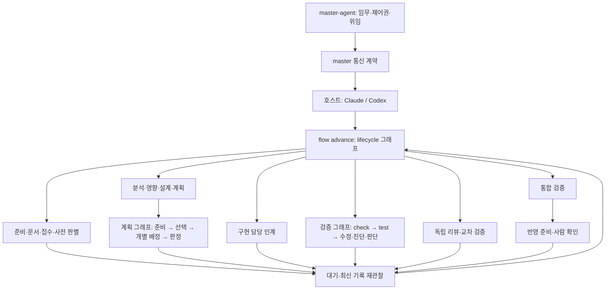

# LangGraph 실행 구조

code-agent의 전체 작업 흐름은 LangGraph로 실행한다. master-agent는 여러 프로젝트의 임무·제어권·위임을 관리하고, code-agent는 한 프로젝트의 준비·접수·계획·구현·검증·리뷰·반영을 관리한다. 단독 Claude·Codex 실행도 같은 그래프를 사용한다. 승인·증거·hook의 판정은 도메인 서비스가 담당한다.

## 실행 계층

master의 무인 호스트 지원 범위는 [기능 협상](master-control.md#3-기능-협상--hello)을 따른다.

| 그래프 | 실행 책임 | 도메인 서비스 |
|---|---|---|
| `lifecycle` | 준비부터 반영까지 재개 위치 선택, 자동 검증·통합, 담당·사람·외부 실행 대기 | 상태 조회, 준비·접수, 단계별 절차 |
| `planning` | 준비 → 작업 선택 → 개별 배정 → 최종 판정 → 대기 | 계획 파일 잠금, 입력 해시, 재사용, 재시도 한도, 고아 관찰, 배정 기록 |
| `transition` | 현재 단계의 게이트 → 기록 직전 재검사 → 커서 변경 | 단계별 요구·문서·승인·증거 검사 |
| `verification` | 정적 검사·테스트 실행과 판정, 수정·진단·사람 판단·리뷰 인계 | 검증 명령, 회차·예산, 증거 묶임 |
| 명령별 그래프 | 관찰 → 도메인 동작 적용 → 최신 커서 확인 | 문서·접수·사전 판별·동의·계획 단건 배정·되감기·리뷰·반영 |

도메인 함수는 기존 게이트와 기록 계약을 유지한다. hook은 도구 권한·응답·담당 결과를 짧게 검사하고 기록한다. 도구 호출마다 LangGraph를 기동하지 않는다. 설치·릴리스 교체와 읽기 전용 조회는 작업 그래프의 실행 대상이 아니다. 릴리스 교체는 별도의 런타임 잠금과 동의 경로로 처리한다.

## 호스트의 실행 계약

`code-agent flow advance --json`은 `code-agent.flow` v1을 반환한다.

| 필드 | 의미 |
|---|---|
| `graph.runId`·`graph.threadId` | 이번 호출과 계속되는 그래프 흐름의 식별자 |
| `node`·`phase`·`action` | 실행 위치, 작업 단계, 인계 동작 |
| `kind` | `agent`: 담당 절차, `human`: 사람 판단, `wait`: 외부 완료 대기, `done`: 완료 |
| `procedure`·`instruction` | 실제 호스트에 설치된 절차 파일과 수행 지시 |
| `contextFile`·`agent` | 구현 담당에게 넘길 자료 경로·호스트별 담당 이름 |
| `detail` | 검증 수정·진단·한도 등의 인계 근거 |
| `resume` | 결과 기록·응답 뒤 다시 호출할 명령 |

호스트는 반환된 절차를 수행하고 결과가 기록되면 그래프를 다시 호출한다. `wait`를 반복 조회하지 않는다. 계획의 배정 전 선택, 업무 질문, 요구 확정·계획 승인·반영 동의는 해당 절차를 따른다. `planning advance --chain`이 이미 게이트를 지났으면 `next`를 다시 실행하지 않는다. 수동 단계 명령도 같은 LangGraph 실행 경계를 사용한다.

## SQLite와 기록의 역할

`.code-agent/graph/state.sqlite`는 공식 `SqliteSaver`의 체크포인트와 실행·노드 관찰 기록을 저장한다. saver는 Node 내장 `node:sqlite` 어댑터를 사용한다. 런타임·의존성 설치 조건은 [설치 문서](install.md#1-두-가지-설치)에 있다.

- 도메인 기록: 기존 `.code-agent/work/`, 승인 원장, 동의, 담당 결과, 검증 증거가 권한과 완료의 근거다.
- 체크포인트: 실행 위치·경로·대기 사유를 보관한다. 사용자 응답이나 승인 원장을 대체하지 않는다.
- `graph_runs`·`graph_events`: 호출별 성공·대기·실패·중단과 노드 진행을 관찰한다. `status --json`의 `graph`에서 최신 실행을 조회한다.
- `view.json`: 실행기가 원자적으로 발행하는 관찰 사본이다. 조회는 이 파일만 읽으므로 SQLite WAL 보조 파일을 만들지 않는다. 권한·재개 판정에는 쓰지 않는다.
- 그래프 디렉터리는 Git·동의 대상 스냅샷·반영 커밋에서 제외한다. 승인되지 않은 추적 변경이 생기지 않는다.

`graph/run.lock`은 프로젝트의 그래프 실행을 직렬화한다. 담당·사람을 기다릴 때는 `interrupt`를 남기고 호출이 반환되며 잠금을 푼다. 실행 중에는 hook과 master가 각각의 짧은 도메인 잠금으로 결과·응답·정지 요청을 기록할 수 있다. 실행 중인 그래프가 있으면 릴리스를 바꾸지 않는다.

## 재개와 중단

운영 명령은 매번 START에서 최신 기록을 읽는다. 외부 효과가 있는 노드의 체크포인트를 임의로 재생하거나 `update`·`goto`를 입력받지 않는다. 중단 뒤 배정은 기존 배정 ID·실행 관찰로, 검증은 현재 증거와 회차로, 동의 적용은 해당 동의 기록과 영수증으로 판정한다. SQLite 커밋과 외부 프로세스·Git 커밋 사이의 분산 트랜잭션을 가정하지 않는다. 부분 적용·실행 불명 상태는 성공으로 추정하지 않고 기존 복구 경로를 따른다.

단계 게이트와 커서 기록 사이에도 입력이 바뀔 수 있어, 전이 그래프는 기록 직전에 게이트와 커서를 다시 검사한다. 계획의 자동 되감기 허용은 한 그래프 호출의 준비 노드에서 한 번만 판정한다. DB 형식 버전이 다르면 덮어쓰지 않고 중단한다. 프로젝트 상태 형식 세대는 4이며 낮은 세대의 릴리스로 적용을 되돌리지 않는다.

## master 관제·통제

master는 [기능 협상](master-control.md#3-기능-협상--hello)으로 실행 계약을 확인하고 [상태·이벤트](master-control.md#6-이벤트heartbeat재동기화)로 그래프 진행을 관찰한다. 정지·제어권 변경은 [실행 통제 규약](master-control.md#7-실행-상태와-정지취소재개)을 따른다. 체크포인트 ID만으로 승인하거나 재개할 수 없다.
