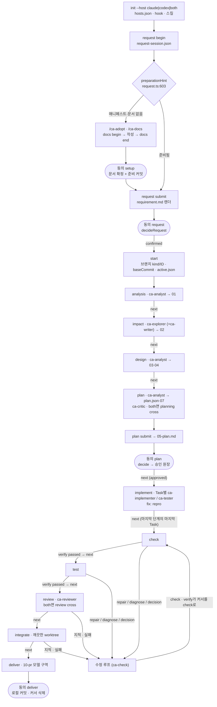
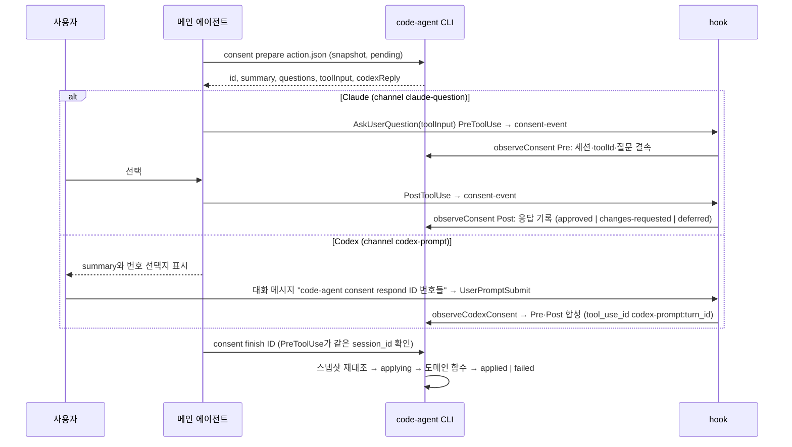
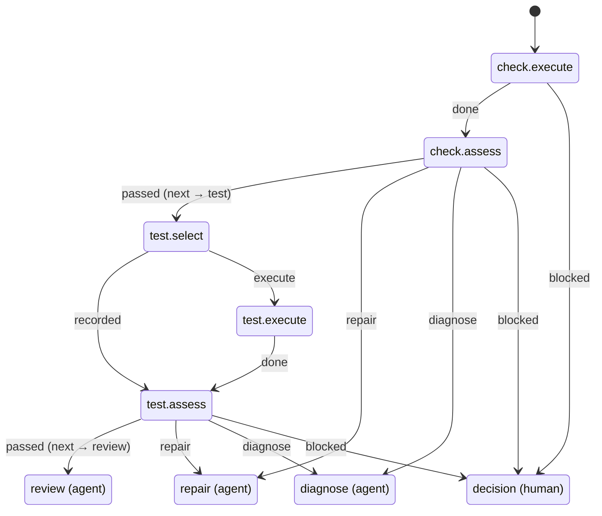

# code-agent 프로세스 흐름도

이 문서는 현재 동작을 정리한 지도다. 기준은 커밋 `c4f3fbf`(2026-10-07)이다. 코드가 정본이므로 문서와 코드가 다르면 코드가 맞고, 이 문서를 고친다.
표의 `file:line`은 위 커밋 기준이다. 줄 번호가 어긋나면 함께 적은 함수 이름으로 찾는다. 경로의 기준은 `src/agent/`이고, `core/`는 `src/core/`, `template/`·`doc/`는 저장소 루트의 같은 폴더다.
이 문서는 현재 동작만 적는다. 결함으로 판정된 동작과 개선안은 [2026-10-07 감사 기록](reviews/2026-10-07-dual-host-process-audit.md)에 있다.

**읽는 순서(에이전트용)** — §2에서 바뀌는 칸을 찾고, §3에서 그 행을 읽은 뒤, §9로 파일을 연다. 이어서 사람 확인(§4)·hook(§5)·호스트 차이(§7)에 걸리는지 본다. 이 문서에 없는 동작은 추측하지 말고 코드를 연다.

## 1. 목적과 갱신 규칙

**목적**은 세 가지다. 개발 에이전트(Claude·Codex)가 코드를 다시 분석하는 시간을 줄이고, 단계·게이트·hook을 잘못 기억해 생기는 오판과 재시도를 줄이며, 변경이 어느 흐름에 영향을 주는지 먼저 판단하게 하는 것이다.

**근거 수준** — 기본은 코드 판독이다. §5의 등록표와 판정 일부는 2026-10-07에 sandbox에서 직접 확인했다(`init --host both` 설치 결과, `codex-event`·`hook`·`stop`·`session-event`에 이벤트를 넣은 결과). 같은 날 검증 단계에서 `init` 호스트 합집합(§7), 세션 없는 상태의 `hook` 판정(§4.1), `git add -f`의 `.gitignore *` 무시(§8)도 sandbox에서 다시 확인했다. 그 밖에 실제 호스트에서 확인하지 않은 동작은 "미확인"이라고 적는다.

### 1.1 변경 → 갱신 대응표

| 바뀐 코드 | 갱신할 섹션 | 함께 맞출 중복 정의 |
|---|---|---|
| `layout.ts` `PHASES`·`AFTER_IMPLEMENT`·`STOP_PHASES` (20-43) | §2, §3 | `commands.ts` `PHASE_LABEL`·`PHASE_COMMAND`(94-122), `template/claude/skills/ca-next/SKILL.md:14-25` 표 |
| `commands.ts` `start`·`next`·`back`·`requireValidatable`·`abort` | §2, §3, §3.3 | 각 단계 스킬의 "자리 확인" 문장 |
| `request.ts` 접수·확정, `docsCommands.ts`·`bootstrap.ts` 준비 | §3.1, §4 | `ca-request`·`ca-adopt`·`ca-docs` SKILL.md |
| `init.ts` hook 등록(186-189, 223-233)·`HOOK_MATCHER`(19) | §5, §7 | `doctor.ts:174` hook 목록, `doctor.ts:244-261`, `update.ts:99` hook 출력, `doc/codex.md:39-45` 이벤트 표, `README.md` 동작 구조 표, `doc/install.md:37`, `doc/usage.md:12` |
| `codexHook.ts` | §4.2, §5.2, §7 | `template/CODEX.block.md`, `template/codex/ca-answer.md` |
| `consent.ts` `ActionSchema`(28-36)·`preview`(258-305)·`applyLocked`(466-509) | §4 | `ca-answer/SKILL.md:44`, `ca-answer/reference.md`, `template/codex/ca-answer.md:16` 동작 목록 |
| `hook.ts` `decide`·`MODEL_SUBCOMMANDS`(89-114) | §5.3, §5.4 | `template/CLAUDE.block.md`, `hook.ts:412-419` 거부 문구 |
| `planning.ts`·`planningState.ts`·`planningHook.ts` | §6.1 | `doc/planning.md` 역할 표, 단계 스킬 1~6항 |
| `verificationFlow.ts`·`validate.ts`·`evidence.ts` | §3.2 check~integrate, §6.2 | `ca-check/SKILL.md` 노드 처리 목록 |
| `review.ts`·`reviewHook.ts`·`crossCheck.ts` | §3.2 review, §6.3, §7 | `ca-review/SKILL.md`, `ca-plan/SKILL.md:27` |
| `deliver.ts`·`knowledge.ts` | §3.2 deliver, §8 | `ca-integrate/SKILL.md` |
| `hosts.ts` `codexText`(64-82) | §7 | 치환 대상 문장: `hosts.ts:78-80`의 리터럴이 `ca-analyze`·`ca-impact`·`ca-design`·`ca-plan` SKILL.md와 `ca-analyst`·`ca-explorer`·`ca-writer` 에이전트 원문과 글자 그대로 같아야 치환된다 |
| 상태·산출물 경로(`layout.ts`, `handoff.ts`, `deliveryPaths`) | §8 | `.gitignore` 블록(`init.ts:191-192`), `baselineFiles`(`bootstrap.ts:40-62`) |
| 새 파일·모듈 이동 | §9 | — |
| 스킬·서브에이전트 추가·삭제 | §7, §9 | 설치 수(`README.md` 동작 구조 표, `doc/codex.md` 설치 대상 표, `doc/install.md`, `doc/usage.md:188`), `ca-next/SKILL.md` 표, `init.ts`의 Codex 설치 안내 문구. 서브에이전트는 `hosts.ts` `ROLE_NAMES`(10)·`codexText` 역할 정규식(65)과 `modelPolicy.ts` `AGENTS`(5)도 고치고, 계획·리뷰 담당이면 `init.ts:228-231`·`doctor.ts:181` matcher도 고친다 |

**갱신 절차** — 코드 변경과 같은 커밋에서 해당 행과 `file:line`을 고치고, §10에 한 줄을 남긴다. 확인하지 못한 동작은 쓰지 않거나 "미확인"으로 표시한다.

## 2. 전체 흐름 한 장

둥근 칸(`([ ])`)은 사람의 동의다(§4). 새 작업의 기본 동의는 `setup`(최초 준비 때만), `request`, `plan`, `deliver`다. 상황에 따라 `docs`(공통 문서만 다시 확정할 때, `preparationHint` `request.ts:609`), `repro-log`(fix에서 로컬 재현이 안 될 때), `abort` 등이 더해진다(§4.1).

## 3. 스테이지별 표

**공통 전제** (`commands.ts:516-524`) — `next`는 매번 AI-DLC 미진행, 유효한 커서와 `baseCommit`(`requireWork` 158-171), 공통 문서 확정, 요구 확정(`request.ts:350-378`), 답 없는 질문 0(`requireAnswers` 184-193)을 확인한다. analysis~plan에서는 `planningProblems`와 `planningDocumentProblems`도 본다. 게이트에 걸린 `next`는 `Stop`을 던지고 커서는 그대로 둔다.

### 3.1 커서가 생기기 전

| 단계 | 진입 조건 | 담당 | CLI | 산출 | 넘어가는 조건 |
|---|---|---|---|---|---|
| 준비 | 매니페스트가 없거나, 공통 문서가 미확정이거나, 문서 세션이 열려 있다(`preparationHint` `request.ts:603-612`) | 메인 `/ca-adopt`·`/ca-docs`, 서브 `ca-surveyor`·`ca-writer` | `docs recommend·begin·setup·link·end` 등, `survey`, `manifest check`, 동의 `setup` | `code-agent.json`, POLICY 4종(`doc/*.md`), KNOWLEDGE 빈 뼈대(`doc/knowledge/*`, `docs begin`이 만든다 `docsCommands.ts:151,167-177`), `approvals/docs.jsonl`, 준비 커밋. `approvals/docs.jsonl`은 준비 커밋 대상(`baselineFiles` `bootstrap.ts:45-49`)에 없고 첫 반영 커밋에 들어간다(`deliver.ts:324`) | `request submit`의 매니페스트 검사(`request.ts:417-426,645`), `start`의 `requireDocs`(`commands.ts:276`)와 `requirePreparedBranch`(`bootstrap.ts:75-94`) |
| 접수 | `request begin`(`request.ts:428-489`). 문서 세션 열림·AI-DLC·진행 중 작업(같은 ID 포함)·다른 ID 접수·종류 변경이면 거부한다. ID를 생략하면 진행 중인 접수의 ID를 쓰고, 없으면 작업 폴더·확정 원장이 없는 첫 `WORK-0001` 형식(4자리) ID를 발급한다(437-443) | 메인 `/ca-request`(서브 없음) | `request begin`·`request`·`request submit`, 동의 `request` | `doc/work/<ID>/request.json`(모델), `requirement.md`(코드 렌더 785), `approvals/<slug>/request.jsonl` | `decideRequest`가 보여 준 바이트 해시로 `confirmed`를 기록한다(`request.ts:811-893`) |
| start | 요구 확정, 문서 세션 없음, AI-DLC 없음, 매니페스트 있음, 공통 문서 확정, 다른 ID 접수 없음(`commands.ts:266-295`) | 메인(스킬이 호출) | `start <지시서>` | 브랜치 `<kind>/<ID>`, `baseCommit`(새 브랜치는 기준 끝, 기존 브랜치는 merge-base, 333-341), `questions.md`, `active.json`(phase=analysis, planningVersion=1, 354), 접수 세션 삭제(356) | 같은 작업이면 상태만 출력한다. 다른 작업이 진행 중이면 거부한다(297-306). fix는 오류 로그 절이 필요하다(308) |

접수 세션 동안 모델은 `doc/work/<ID>/` 안에만 쓸 수 있고, `requirement.md`는 코드만 쓴다(`hook.ts:307-322`).

### 3.2 커서 단계 (`PHASES` `layout.ts:20-31`)

| 단계 | 담당 (메인 / 서브) | CLI | 산출 | 게이트 (`next`) | 실패 시 |
|---|---|---|---|---|---|
| analysis | `/ca-analyze` / `ca-analyst`(role analysis) | `planning advance` 외, `next` | `01-requirements.md`, `questions.md` | `requireRequirements`: 01 형식과 원문 대조(`commands.ts:531-533`, 196-212) | advance가 `blocked`이면 질문에 답하거나 입력을 고친다. 형식 오류는 `repair`(1회) |
| impact | `/ca-impact` / 기본은 `ca-explorer`(explore)와 `ca-writer`(synthesis). `planning advance`가 impact 작업을 처음 등록할 때 요구 R이 1~3개, 조사 파일이 12개 이하, 합계 96,000바이트 이하면 `ca-explorer` 단독(impact)(`planning.ts:71-79`) | 같음 | `02-analysis.md` | 조사 결과가 current이고 사실 충돌이 없다(`planningState.ts:205-210`). `analysisProblems`(534-538) | 같음. 사실 충돌은 조사를 다시 돌린다 |
| design | `/ca-design` / `ca-analyst`(design) | 같음 | `03-design.md`, `04-functional.md` | `designProblems`와 `functionalProblems`(539-546) | 같음 |
| plan | `/ca-plan` / `ca-analyst`(plan)와 `ca-critic`(critic). 두 호스트 설치 시 `planning cross` | `planning advance·cross`, `plan submit`, 동의 `plan` | `plan.json`, `07-test-spec.md`, `<target>.plan.json`, `05-plan.md`(렌더 1286-1289), 승인 원장 | `reviewedPlanProblems`(critic이 본 plan.json과 제출본이 같다), 계획 존재, 승인 `approved`(547-558) | 반려되면 `ca-plan`의 반려 절차로 원인 작업을 다시 배정하고 재제출한다 |
| implement | `/ca-implement` / `ca-implementer`, 테스트 단계는 `ca-tester`(`handoff.ts:43-44`) | `context --file`, `repro`(fix), `next` | 계획 파일 | 승인 유지, 현재 Task 파일 존재, 같은 단계의 다음 Task로 이동. 단계가 끝나면 `missingPlannedFiles`, fix의 test 단계는 `reproMissing`을 본 뒤 다음 단계나 check로 간다(559-598) | `Stop`이면 빠진 파일을 다시 맡긴다. 승인이 stale이면 재제출·재승인한다 |
| check | `/ca-check` / 수정은 `ca-implementer` | `verify --json [--retry]`(단계만 돌릴 때는 `check`) | `<target>.verify.json`, `08-validation.md`, `.code-agent/log/` | `stageProblems(check)`(600-602, `evidence.ts:452-519`) | verify 노드 `repair`·`diagnose`·`decision`(§6.2) |
| test | `/ca-test` / TC 코드가 없을 때 `ca-tester` | `verify --json`(또는 `test`) | 같은 증거, `testCases` | `stageProblems(test)`: ⑦의 모든 TC가 `passed`(`evidence.ts:499-510`) | 같음. 수정 뒤 `check`부터 다시 |
| review | `/ca-review` / `ca-reviewer` | `review`, `context --file`, 두 호스트면 `review cross --by <다른 호스트>` | `<target>.review.json`, `09-review.md` | `reviewProblems`(`review.ts:379-461`) | 계획 안 지적은 수정 루프 → `check` → 새 회차. 계획 밖 지적은 질문 또는 재계획 |
| integrate | `/ca-integrate` / 없음 | `integrate` | `integrate` 실행 기록, `integrationTestCases` | `stageProblems(integrate)`: 통합 TC 전부 passed, fix면 재현 테스트 트리가 일치(615-617, `evidence.ts:479-487`) | 수정 루프. `prepare` 실패는 매니페스트·환경 문제로 보고한다 |
| deliver | `/ca-integrate` 3절 / 없음 | 동의 `deliver`(사람은 TTY `deliver`) | `10-pr.md` 모델 3절, `knowledge.proposal.md`(선택), 로컬 커밋 | `next`로는 끝나지 않는다(618-623). `deliverProblems`(`deliver.ts:189-232`), 작업 브랜치(401-409), 사람 확인(419) | `Stop`이면 커밋하지 않는다. `back`은 거부한다(`commands.ts:763-768`) |

**hook의 쓰기 범위** (`decideWrite` `hook.ts:444-540`, 작업 커서가 있을 때) — 지시서·`05-plan.md`·`08-validation.md`는 언제나 거부한다(447-471). 관찰 흐름의 계획 출력 문서는 메인 쓰기를 거부한다(474). 그 밖의 작업 폴더는 어느 단계에서든 허용한다(475-477). refactor는 추적 중인 기존 테스트 파일을 거부한다(481-490). analysis~plan에서는 작업 폴더 밖을 거부한다(492-497). implement부터는 제출된 계획과 `approved` 승인이 있어야 하고(498-508), implement에서 계획에 tasks가 있으면 현재 Task 파일만 허용한다(509). implement와 그 뒤 단계 모두 파일이 속한 단계 판정(512-521), fix의 재현 순서(548-568), 동결·고쳐 쓰기 한도(587-617), 경계·계획 대조(532-538)를 적용한다.

### 3.3 커서 이동

| 명령 | 방향 | 조건 | `stages.jsonl`의 `by` |
|---|---|---|---|
| `next` | 한 칸 앞. implement 안에서는 Task·단계 단위로 움직인다 | §3.2 게이트 | `next` |
| `back <단계>` | 뒤로만. `deliver`는 대상이 아니고, deliver에서는 실행 자체를 거부한다 | `commands.ts:758-789`. hook은 모델의 `back`을 허용한다(`hook.ts:94`). "사용자 지시 시에만"은 스킬 규칙이다 | `back` |
| `check`·`verify`(check 진입) | test·review·integrate에서 check로 되감는다 | `REWINDABLE`(633), `requireValidatable`(655-658) | `next`(656) |
| 동의 `deliver` | 커서 삭제 | 커밋 성공(`deliver.ts:424-425`) | `deliver` |
| 동의 `abort` | 커서 삭제, 작업이 없으면 접수 세션 삭제 | `commands.ts:708-722`. 문서·원장·계획은 남는다 | `abort` |

## 4. 사람 확인 지점

### 4.1 동의 동작 (`consent.ts:28-36`, 제목은 62-67)

| action | 제목 | 준비(preview 258-305) | 적용(applyLocked 491-505) | 사람의 직접 CLI 대체 |
|---|---|---|---|---|
| setup | 초기 설정 확정 | `confirmDoc(all)`과 `setupBaseline`의 확인 문구 | 둘을 차례로 실행 | `confirm doc all` + `setup baseline` |
| docs | 공통 문서 확정 | `confirmDoc(kind)` | 같음 | `confirm doc <종류>` |
| baseline | 기준 커밋 생성 | `setupBaseline` | 같음 | `setup baseline` |
| request | 요구사항 확인 | `decideRequest`(reject면 comment 필수) | 같음 | `confirm request <ID>` · `reject request <ID> --comment` |
| plan | 작업 계획 확인 | `decide` | 같음 | `approve` · `reject --comment` |
| deliver | 결과와 로컬 커밋 확인 | `deliver`를 두 번 캡처하고 `knowledgeChoices`를 만든다 | `deliver` | `deliver` |
| knowledge-prune | 지식 문서 정리 | `pruneCandidates` | `knowledgePrune` | `knowledge prune` |
| model | 에이전트 모델 변경 | `validateModelChange` + 표 | `setModel` | `model <역할\|all> <모델>` |
| abort | 작업 진행 종료 | `status` | `abort` | `abort` |
| plugin-add · plugin-remove | 플러그인 등록·제거 | `previewPlugin*` | `pluginAdd` · `pluginRemove` | `plugin add` · `plugin remove` |
| update | code-agent 업데이트 | `previewSourceUpdate` | `updateFromSource` | `update` |
| repro-log | 오류 로그 근거로 수정 진행 | `approveLogBasis` | 같음 | 없음 |

- 직접 CLI의 사람 확인은 명령마다 다르다. `confirm doc`·`confirm request`·`reject request`·`approve`·`reject`·`setup baseline`·`deliver`·`plugin add`는 `confirmOnTerminal`(`tty.ts:76-90`)이 TTY에서 확인 단어 입력을 요구한다. `model` 변경·`plugin remove`·`knowledge prune`은 TTY만 요구한다(`requireTerminal` `tty.ts:55-63`, `models.ts:102`, `plugins/commands.ts:422`, `knowledgeCommands.ts:217`). `abort`(`commands.ts:708-722`)와 `update`(`sourceUpdate.ts`)에서는 TTY 확인 호출을 찾지 못했다.
- 동의 적용 중에는 준비 때 캡처한 문구와 같은 확인만 통과한다(`consent.ts:485-487`).
- 작업·접수·문서 세션 중에 모델이 셸에서 이 동작들을 직접 부르면 hook이 거부한다(§5.4). 세션이 없으면 hook은 `.code-agent`·키 자리 언급만 막으므로(§5.3 3단계) `init`·`update`·`approve`·`setup baseline` 같은 명령도 hook을 지난다(2026-10-07 sandbox 확인). 이때는 위의 TTY 확인과 각 명령의 전제 검사만 남는다.

### 4.2 응답 관찰 — 호스트별

**결속 규칙** (`consent.ts:362-434`, `510-515`)
- 서브에이전트(`agent_id` 있음)의 질문은 거부한다(372).
- 첫 Pre가 `sessionId`·`channel`·`cwd`를 정한다(391-395). 다른 채널·다른 세션·다른 작업 경로면 거부한다(382, 385, 386).
- Pre의 질문은 준비된 질문과 deep-equal이어야 한다(389).
- Post는 결속된 toolId 하나만 한 번 소비한다(397-402). 시간 초과·추가 질문·메모가 붙은 응답은 승인으로 보지 않는다(405-409).
- `finish`·`apply`는 hook이 같은 `session_id`를 요구한다(510-515). 적용 직전에 스냅샷을 두 번 재대조한다(476, 480).
- 중단된 `applying`은 `failed`로 처리하고 다시 실행하지 않는다(470-473).
- Codex 응답 형식은 `^code-agent consent respond <36자 id> [1-3](,[1-3]){0,3}$`다(`codexHook.ts:35`). 이벤트에 `turn_id`가 있어야 하고(36), 질문 수와 선택 수가 같아야 한다(39).

## 5. hook 등록표

### 5.1 Claude — `.claude/settings.json` (`init.ts:223-233`, sandbox 확인)

| 이벤트 | matcher | 하위 명령 | 처리 | 판정·기록 | 실패 시 |
|---|---|---|---|---|---|
| PreToolUse | `Write\|Edit\|MultiEdit\|NotebookEdit\|Bash\|PowerShell\|Read\|Grep\|Glob` | `hook` | `runHook`→`decide`(`hook.ts:620`, 178) | deny JSON | 예외면 exit 2로 막는다(635-639) |
| PreToolUse | `AskUserQuestion` | `consent-event` | `observeConsent` Pre | 질문 결속 | exit 2(`consent.ts:516-519`) |
| PostToolUse | `AskUserQuestion` | `consent-event` | `observeConsent` Post | 응답 기록 | exit 2 |
| Stop | 없음 | `stop` | `decideStop`(`stopHook.ts:22-54`) | implement~integrate에서 계획 밖 변경이나 미응답 질문이 있으면 `{decision:block}`을 1회 낸다 | 언제나 exit 0(57-69) |
| SubagentStart·Stop | `ca-reviewer` | `review-event` | `observeReviewer`(`reviewHook.ts:36-92`) | review 단계가 아니면 아무것도 하지 않는다(41). Start: 회차 리뷰어 등록. Stop: 형식 검사 후 `## 지적` 재작성 | `subagentExitCode`(31-33): SubagentStop이면서 기록된 실패이거나 `stop_hook_active`면 0, 그 밖(Start 실패 포함)은 2 |
| SubagentStart·Stop | `ca-analyst\|ca-explorer\|ca-writer\|ca-critic` | `planning-event` | `observePlanner`(`planningHook.ts:46-154`) | §6.1 | 같음 |
| SessionStart | 없음 | `session-event` | `sessionAnchor`(`sessionHook.ts:16-48`) | 작업 4줄·접수 3줄·문서 세션 2줄의 상태를 stdout에 낸다. AI-DLC 경고가 있으면 1줄을 더한다(19). 진행 중인 것이 없으면 출력 없음 | 언제나 exit 0 |

### 5.2 Codex — `.codex/hooks.json` (`init.ts:186-189`, sandbox 확인)

다섯 이벤트가 matcher 없이 모두 `code-agent codex-event` → `runCodexHook`(`codexHook.ts:102-123`) → `codexHook`(61-96)로 들어간다.

| 이벤트 | 처리 | 실패 시 |
|---|---|---|
| PreToolUse | `Bash`·`PowerShell`·`apply_patch`(55)만 판정하고 그 밖은 `{}`를 낸다(63). `apply_patch`는 `patchPaths`의 모든 경로를 `Edit`로 `decide`에 넘긴다(70-77). 셸은 Windows면 `shell: powershell` 규칙으로 판정한다(69). `agent_id`는 넘기지 않는다 | deny JSON(111-114) |
| UserPromptSubmit | `observeCodexConsent`(33-52). `code-agent consent respond`로 시작하지 않는 메시지는 무시한다 | 예외면 stderr와 exit 2(120-121, 형식 오류 메시지로 sandbox 확인). 이때 Codex의 동작은 미확인 |
| SubagentStart·Stop | `commonAgentName`(`ca_x`→`ca-x`)으로 바꾼 뒤 transcript 없이 `observePlanner`와 `observeReviewer`에 넘긴다(84-88). 결과는 `last_assistant_message`만 본다. 관찰 대상이 아니면 `{}`·exit 0(진행 중 작업 없는 SubagentStop으로 sandbox 확인) | 예외면 기록된 실패·`stop_hook_active`를 가리지 않고 언제나 exit 2(120-121). 이때 Codex가 담당을 이어 실행하는지는 미확인 |
| Stop | `decideStop` → `{decision:"block"}`(91-93) | `{}`, exit 0(115-119) |

### 5.3 PreToolUse 판정 순서 (`decide`, `hook.ts:178-223`)

1. 셸 명령 검사(182-184): 관찰 명령(`consent-event`·`planning-event`·`review-event`·`codex-event`)을 부르면 거부한다. `consent apply·finish`는 세션 결속을 확인한다.
2. 모드 결정(186-198): 작업 > 문서 세션 > 접수 세션 > 없음. 상태를 읽지 못하면 `decideUnreadable`(230-244).
3. 모드가 없으면 `decideOutside`(255-274): 셸은 키 자리·`.code-agent` 경로 언급만, 읽기는 키 자리만, 쓰기는 키 자리·`:` 경로·`.code-agent`·`.claude`·`.codex`·`.agents`·`doc/work/*/requirement.md`만 거부한다. 저장소 밖 쓰기는 관여하지 않는다(270-272).
4. 셸이면 `decideBash`(387-421): 키 자리 언급과 AI-DLC 실행 언급을 먼저 거부한다(388-394). 연결·리다이렉트·줄바꿈·`$(`(56)를 거부하고, PowerShell이면 작은따옴표 밖의 `(){}@$`와 큰따옴표 안의 `$`도 거부한다(62-71). 모델 명령(§5.4), 선언된 build·test·commands(문서·접수 세션 제외), 읽기 전용 git(`status·diff·log·show`, 목록 보기 `git branch`, `-o`·`--output`·`--no-index` 제외)만 허용한다.
5. 읽기 도구는 키 자리(`~/.code-agent/credentials.json`)만 막는다(205-208).
6. 쓰기는 `guardRepo`·`streamGuard`를 거친 뒤 모드별로 판정한다: 작업은 `decidePlanner`(staging, 428-442) → `decideWrite`(444-540), 접수는 `decideRequestWrite`(307-322), 문서 세션은 `decideDocWrite`(352-364).

### 5.4 모델이 셸로 부를 수 있는 `code-agent` 명령 (세션·작업 중)

- 허용(`hook.ts:89-129`, 접두어 일치)
  - `start`·`next`·`back`·`context`·`read`·`status`·`plan submit`·`planning prepare·advance·status·result·dispatch·repair·cancel·cross`·`docs *`·`survey`·`manifest check`·`request *`
  - `plugin list`·`repro`·`check`·`test`·`verify`·`review *`·`integrate`
  - `consent prepare <파일>`·`consent status·apply·finish <id>`, `model`·`model --host <호스트>`(조회만), `setup`(조회만), `help`, 인자 없는 `code-agent`
- 그 밖은 모두 거부한다. 그중 `abort`·`approve`·`reject`·`confirm`·`model` 변경·`deliver`·`plugin add·remove`·`update`·`knowledge prune`·`setup baseline`은 §4.1 동의로 실행한다. `init`·`usage`·`doctor`·`knowledge`(목록)·`plugin example`은 동의 동작이 없고 사람이 직접 실행한다.

## 6. 오케스트레이션

### 6.1 계획 작업 (analysis·impact·design·plan, `planningVersion=1`)

| 역할 | 단계 | 담당(Claude / Codex) | 출력 | 선행(dependsOn) |
|---|---|---|---|---|
| analysis | analysis | `ca-analyst` / `ca_analyst` | `01-requirements.md` | 없음 |
| explore | impact | `ca-explorer` | 없음(facts만) | analysis |
| impact | impact | `ca-explorer` | `02-analysis.md` | analysis |
| synthesis | impact | `ca-writer` | `02-analysis.md` | explore 전체 |
| design | design | `ca-analyst` | `03-design.md`·`04-functional.md` | impact 또는 synthesis |
| plan | plan | `ca-analyst` | `plan.json`·`07-test-spec.md` | design |
| critic | plan | `ca-critic` | 없음 | plan |

근거: 단계 매핑 `planning.ts:14`, 담당 `planningState.ts:15`(Codex 이름은 `hosts.ts:11`), 출력 `planningState.ts:175-178`, 선행 `planning.ts:61-64`.

**배정 — `planning advance`** (`planning.ts:226-251`)
1. 계획 단계가 아니면 거부한다. 전체 처리는 `<target>.planning.json.lock` 잠금 안에서 한다(`wx`, 2초 기한, 38-57).
2. 이 단계의 기본 작업 중 빠진 것만 등록한다(`defaults` 66-89, `prepareState` 94-133).
3. 작업마다 다음 순서로 판정한다.
   - 현재 결과가 유효하면(`taskCurrent`, `planningState.ts:154-161`) `reused`.
   - 실행 중이면 `waiting`.
   - 같은 입력으로 실패했으면 `blocked`.
   - 동시 실행 한도(기본 3, 최대 4)에 닿았으면 `blocked`.
   - 교정 대기면 `repairState`(201-219), 그 밖은 `dispatchState`(159-176)로 배정한다. 둘이 던진 `Stop`은 그 작업의 `blocked` 사유가 된다(245).
4. `dispatchState`는 선행 결과가 current이고 차단 지적·관련 미결 질문이 없으며 입력 파일이 있어야 배정한다(`readyProblems` `planningState.ts:162-173`). synthesis는 조사 사실 충돌도 없어야 한다(164). 같은 `inputHash`의 시도는 3회까지다(171). `repairState`는 교정 1회만 허용하고 입력 해시가 그대로여야 한다(203-205).
5. `action`을 정한다(250): 배정이 있으면 `dispatch`, 대기가 있으면 `wait`, 남은 문제가 있으면 `blocked`, 없으면 `ready-for-gate`.
6. CLI는 배정 전문을 `.code-agent/work/<ID>/handoff/<dispatchId>.md`에 쓰고 요약과 `assignmentFile`만 출력한다(`handoff.ts:89-110`).

입력 해시(`taskHash` 137-146)에 들어가는 것은 작업 정의, `baseCommit`, 매니페스트 해시, 입력 파일 해시, `CLAUDE.md`·`AGENTS.md` 해시(기본 작업의 `contextVersion` 2), 선행 결과 해시, 관련 질문이다. 관련 질문(147-153)은 범위(`[Requirements]`)가 없거나, 작업의 `questionIds`에 있거나, 요구 번호가 겹치는 질문이다. 답이 달린 질문도 내용째 들어가므로 답을 적으면 해시가 바뀐다.

**관찰 — SubagentStart·Stop** (`planningHook.ts:46-154`)
- 공통 전제: `session_id`·`agent_id`가 없으면 오류다(50).
- Start: 실행 중인 같은 담당 종류의 배정이 있으면 담당을 등록하고, 후보가 하나일 때만 `dispatchId`를 연결한다(52-58).
- Stop은 다음 순서로 처리한다.
  1. 결과 수신: Claude는 `SubagentHandback`(transcript), 없으면 `last_assistant_message`를 쓴다(12-29).
  2. 스키마 실패: 원본을 보존하고 `needs-correction`으로 둔다. 교정을 이미 썼으면 `failed`다(64-88).
  3. 식별 검사: `taskId`·`dispatchId`·`inputHash`·담당 종류가 맞지 않으면 기록 없이 오류다(91).
  4. 내용 검사(96-112): 입력 해시와 선행 조건을 다시 확인한다. 근거는 inputs와 선행 근거 안이어야 한다. completed는 근거가 있고 질문이 없어야 하며, 출력 집합이 배정과 정확히 같아야 한다.
  5. 기록: completed면 staging 본문 또는 `content`를 정식 문서로 원자 쓰기하고 staging을 지운다(125-128). 질문은 코드가 번호를 매겨 `questions.md`에 붙인다(129-139).
  - 4·5에서 걸리면 그 시도를 `failed`로 기록한다(147-151). 2에서 `needs-correction`·`failed`를 기록한 경우와 4·5의 실패는 `RecordedFailure`라(153) Claude hook은 SubagentStop에서 exit 0을 낸다. 2에서 배정을 특정하지 못하거나 입력이 바뀐 경우(75, 77), 3의 식별 실패(91), 출처(transcript) 검증 실패(15-20)는 기록 없는 일반 오류라 `stop_hook_active`가 아니면 exit 2다(`reviewHook.ts:31-33`).

**게이트**
- `planningProblems`(`planningState.ts:193-213`): 단계별 필수 역할마다 결과가 하나이고 current이며 차단 지적이 없어야 한다. impact 이후에는 조사가 current이고 사실 충돌이 없어야 한다. plan에서는 교차 검토 조건(181-191)도 본다.
- `planningDocumentProblems`(`planningValidation.ts:22-46`): 확인 필요·TODO·TBD 표시가 없어야 하고, `파일:줄` 근거가 실재해야 한다. AC에는 내용이, BR에는 `파일:줄` 또는 답이 달린 Q 번호 근거가 있어야 한다.
- `reviewedPlanProblems`(`planningValidation.ts:11-19`): 제출된 계획이 작업 폴더의 `plan.json`(관찰된 plan 담당이 쓴 초안)과 같은 해시여야 한다. plan 게이트와 승인(`commands.ts:549,1317`)이 본다.

### 6.2 검증 노드 — `verify` (`verificationFlow.ts:79-179`)

**진입 노드** (134-144) — 매 호출마다 상태로 다시 계산한다.
- 커서가 review이고 check·test 증거가 유효하면 `review`.
- 커서가 test이고 check가 유효하면 `test.select`.
- 그 밖에는 `requireValidatable('check')`로 커서를 check로 되감는다. 현재 회차의 check 기록이 있고 증거 묶임이 맞으면 `check.assess`, 아니면 `check.execute`.
- `--retry`는 언제나 `check.execute`부터 다시 실행한다.
- `verify`는 커서가 check·test·review·integrate일 때만 돈다(130-132).
- `check.execute`는 같은 기준 커밋의 증거가 이미 한도+1 회차에 닿았고, 환경 오류로만 막힌 것이 아니며, 계획·매니페스트 묶임이 맞으면 실행하지 않고 `blocked`로 간다(86-91).

**판정 `assess`** (59-76)
- 문제가 없으면 `next()`를 부르고 `passed`.
- 선언된 환경 오류로만 막혔으면(`environmentBlocked`, `evidence.ts:404-408`) `diagnose`.
- `rounds ≥ fixLimit+1`이면 `blocked`. `fixLimit`은 증거에 고정된 `fixRounds`이고 없으면 매니페스트 값이다(`evidence.ts:416-418`).
- error·not-run 실행이 있거나, test에서 passed·failed가 아닌 TC가 있으면 `diagnose`.
- 그 밖은 `repair`.

**회차 정책 `check()`** (`validate.ts:478-514`)
- fix에서 재현 테스트 트리가 바뀌었으면 재현을 먼저 갱신한다(483-485).
- 트리가 그대로이고 직전 회차가 끊겼거나 환경 오류로만 막혔으면 같은 회차를 쓴다.
- 그 밖에는 실행 전에 `rounds+1`을 저장한다(491-504).
- `overFixLimit`(실패한 채 한도 초과, `evidence.ts:420-427`)이면 실행을 거부한다. 끊긴 회차와 환경 오류 재실행은 예외다(494).
- `fixRounds` 기본값은 2이고, 증거를 처음 만들 때 고정된다(`validate.ts:122`).

**실행 규칙**
- `runWorkflow`(`core/workflow.ts:22-51`)는 program 노드만 연속 실행하고 agent·human 노드에서 인계를 반환한다. 전이는 32회까지다.
- 이력은 `<target>.verification-flow.json`에 남는다.
- 재개 명령은 노드별로 다르다: diagnose → `verify --retry`, review → `/ca-review`, decision → `/ca-answer`, 그 밖 → `verify`(174).
- CLI 종료 코드는 review면 0, 그 밖은 1이다(`cli.ts:253-258`).

### 6.3 리뷰와 교차 검증

**리뷰 회차**
1. `review`(`openRound`, `review.ts:228-318`)가 회차를 연다. check·test가 통과해 있어야 하고, 기준·계획·매니페스트가 바뀌었으면 회차를 리셋한다. 마지막 회차와 트리가 같으면 새 회차를 거부한다(253-258). 회차 수 상한은 없다.
2. `ca-reviewer`가 실행되면 hook이 결과를 기록한다(§5).
3. 동결된 테스트 파일은 review 단계에서 마지막 회차가 지금 기준·계획·매니페스트 위에 있고, 그 파일을 가리키는 관찰된(리뷰어 또는 교차 리뷰) "계획 안·열림" 지적이 있을 때 풀린다(`findingOpensFile` `review.ts:332-369`). 이 경우 `used` 기록을 남기고, 그 지적 줄은 이후 지울 수 없다(`review.ts:439-446`). 다른 탈출구는 계획 재승인이다 — `planHash`가 바뀌면 증거가 통째로 무효라 동결도 풀린다(`hook.ts:587-591`).

**교차 검증 (both 설치 전용, `crossRequired` = `hosts.json`에 호스트 2개, `review.ts:167-169`)**

| 지점 | 명령 | 전제 | 실행 | 기록 | 게이트 |
|---|---|---|---|---|---|
| 계획 | `planning cross --by <호스트>` (`crossCheck.ts:177-231`) | `crossRequired`, plan 단계, critic 결과가 completed이고 current | `handoff/cross-critic.md`를 쓰고 다른 호스트의 `ca-critic`을 실행 | `planning.json`의 `cross`(잠금 안), 질문은 `questions.md` | `crossCriticProblems`: 현재 critic `dispatchId`와 일치하고 completed이며 차단 지적 0, 또는 unavailable |
| 리뷰 | `review cross --by <호스트>` (116-165) | `crossRequired`, `requireValidatable('review')`, 열린 회차가 있고 그 회차의 트리·계획·매니페스트가 지금과 일치 | 다른 호스트의 `ca-reviewer` | `review.json`의 `last.cross`, ⑨ `## 교차 지적`(X 번호) | `reviewProblems` 413-421: completed이면서 문서가 기록과 같거나, unavailable |

**다른 호스트 실행** (`runOtherHost` 60-95)
- Claude: `claude -p <prompt> --agent <역할> --model <modelOf: models.json 값, 없으면 opus> --output-format json --setting-sources project --permission-prompts none --allowedTools Read,Grep,Glob`
- Codex: `codex exec -s read-only -C <root> --ephemeral -m <model> -c model_reasoning_effort="<r>" -o <tmp> "<developer_instructions>\n\n---\n\n<prompt>"`
- 시간 제한은 기본 20분이다(`CODE_AGENT_CROSS_TIMEOUT_MIN`).
- 실행 파일 위치는 `hostCommand`(`hosts.ts:29-47`)가 이 순서로 찾는다: `CODE_AGENT_*_BIN` → Windows `%APPDATA%\npm\node_modules`의 Node 진입점 → PATH. Windows에서 PATH로 찾은 `.cmd`·`.bat`는 거부한다(`core/build.ts:305-307`).

**실패 처리**
- 실행 불가(파일 없음·오류·0 아닌 종료·`is_error`·결과 없음)는 `HostUnavailable`로 중지를 기록하고 게이트를 통과시킨다.
- 결과 형식 오류는 `Stop`이고 다시 실행해야 한다(155-159, 211-215).

## 7. Claude와 Codex 차이

| 설치 | `hosts.json` | 교차 검증 |
|---|---|---|
| `--host claude` | `["claude"]` | 요구하지 않는다(`crossCriticProblems`·`reviewProblems`가 건너뛴다) |
| `--host codex` | `["codex"]` | 요구하지 않는다 |
| `--host both`, 또는 기존 설치에 다른 호스트 추가 | `claude`·`codex` 둘 다(순서는 이전 기록이 먼저) | `planning cross`·`review cross`를 요구한다. 실행할 수 없으면 중지로 기록하고 통과한다 |

`init`은 `hosts.json`에 이전 기록과 이번 호스트의 합집합을 쓴다(`init.ts:163-167`). 이전 기록이 없으면 Claude PreToolUse hook이 있는지로 이전 호스트를 판정한다. 그래서 Claude 프로젝트에 `--host codex`를 더하면 both가 된다(`hosts.json`이 있을 때와 지운 뒤 모두 sandbox 확인). 반대로 both 설치에 `init --host claude`를 다시 실행해도 `hosts.json`은 둘 다로 남는다(sandbox 확인). 호스트를 줄이려면 `hosts.json`을 사람이 고친다(`doc/codex.md:74`).

두 호스트를 같은 작업에 동시에 쓰지 않는다는 규칙은 문서에만 있다(`doc/codex.md:55`). 동의는 첫 응답 관찰(Pre) 때 채널·세션·작업 경로에 묶이므로(`consent.ts:382-395`), 응답을 받기 시작한 뒤 호스트를 바꾸면 동의를 다시 준비해야 한다.

| 항목 | Claude | Codex | 근거 |
|---|---|---|---|
| 설치 위치 | `.claude/skills`·`.claude/agents/*.md`·`.claude/settings.json`·`CLAUDE.md` | `.agents/skills`·`.codex/agents/*.toml`·`.codex/hooks.json`·`AGENTS.md` | `hosts.ts:83-105`, `init.ts:180-203` |
| 스킬 본문 | 번들 원본 | `codexText` 정규식 변환. `ca-answer`만 `template/codex/ca-answer.md`로 바꾼다 | `hosts.ts:64-90` |
| 서브에이전트 이름 | `ca-analyst` | `ca_analyst`(배정의 `hostAgents.codex`) | `hosts.ts:11`, `planning.ts:182` |
| 모델 기본값 | 모두 opus, 변경값은 `.code-agent/models.json` | `gpt-6.1-sol`. analyst·critic·reviewer는 high, 나머지는 medium. 변경값은 `.code-agent/codex-models.json` | `models.ts:25`, `modelPolicy.ts:16-25` |
| 파일 읽기 | Read·Grep·Glob(키 자리만 막음) | 셸의 `code-agent read <파일> [시작] [줄 수]` | `hook.ts:205-208`, `hosts.ts:81` |
| 파일 쓰기 판정 | Write·Edit·MultiEdit·NotebookEdit | `apply_patch`의 각 경로를 `Edit`로 판정 | `codexHook.ts:70-77` |
| 계획 담당 출력 | staging 파일 + `{path, staged}`. `agent_id`로 담당에게만 연다 | artifacts `{path, content}`. staging은 열리지 않는다 | `hook.ts:428-442`, `hosts.ts:78-80` |
| 담당 결과 수신 | `SubagentHandback` 또는 `last_assistant_message` | `last_assistant_message`만 | `planningHook.ts:12-29`, `codexHook.ts:86` |
| 동의 응답 | AskUserQuestion Pre·PostToolUse (`claude-question`) | 사용자 메시지 + UserPromptSubmit (`codex-prompt`) | §4.2 |
| 세션 시작 상태 주입 | SessionStart `session-event` | 미등록 | `init.ts:233`, `init.ts:187` |
| 서브에이전트 hook 실패 코드 | SubagentStop의 기록된 실패·`stop_hook_active`면 0, 그 밖 2 | 예외면 언제나 2 | `reviewHook.ts:31-33`, `codexHook.ts:120-121` |
| 토큰 사용량 집계 | `usage` 지원 | 미지원 | `doc/codex.md:78` |
| 교차 검증 대상일 때 실행 형태 | `claude -p … --agent` | `codex exec -s read-only …` | `crossCheck.ts:68-79` |

## 8. 상태·산출물 파일 지도

`.code-agent/`는 코드만 쓴다. 모델의 도구 쓰기는 모드와 관계없이 hook이 막는다(`stateGuard` `hook.ts:337-345`). 세션이 없을 때는 셸 명령의 `.code-agent` 경로 언급도 막고(276-283), 세션·작업 중에는 셸 허용 목록(§5.4)이 쓰기 명령을 막는다.

| 경로 | 쓰는 곳 | 읽는 곳 | git |
|---|---|---|---|
| `active.json` | `saveActive`(`layout.ts:144-150`): start·next·back·check 되감기. 삭제는 deliver·abort | 모든 명령·hook | 무시(`init.ts:191-192`) |
| `request-session.json` · `docs-session.json` | `request begin` · `docs begin/end` | hook 모드 판정, start | 무시 |
| `hosts.json` · `version` | init | `selectedHosts`, update·doctor | 준비 커밋(`bootstrap.ts:45-46`). `version`은 반영 커밋에도 들어간다(`deliver.ts:321`) |
| `models.json` · `codex-models.json` | 동의 `model` | `modelOf`·`codexModelOf` | 준비·반영 커밋 |
| `approvals/<slug>.jsonl` | `recordDecision`(계획 승인·반려 해시 사슬) | `checkApproval`(`core/approval.ts:342-387`) | 반영 커밋 |
| `approvals/<slug>/request.jsonl` · `<target>-<seq>.plan.json` | `recordRequestDecision` · 승인 스냅샷(`core/approval.ts:438`) | `requestState` · `stale-plan` diff | 반영 커밋 |
| `approvals/docs.jsonl` | `confirmDoc` | 문서 게이트 | 반영 커밋 |
| `consents/<uuid>.json` · `apply.lock` | consent prepare·hook·apply | consent | 무시 |
| `work/<ID>/<target>.plan.json` | `plan submit` | `loadWork` | 반영 커밋 |
| `work/<ID>/<target>.planning.json` (+`.lock`) | planning 명령·planning hook·`planning cross` | 계획 게이트, `approvalDocsHash`(`work.ts:49-56`) | 반영 커밋 |
| `work/<ID>/<target>.verify.json` | repro·check·test·integrate | `stageProblems` | 반영 커밋 |
| `work/<ID>/<target>.verification-flow.json` | verify | verify 재개 | 반영 커밋 |
| `work/<ID>/<target>.review.json` | review·review-event·review cross | `reviewProblems`, 동결 해제 | 반영 커밋 |
| `work/<ID>/handoff/` (`<dispatchId>.md`, `context.md`, `cross-critic.md`) | planning advance·dispatch·repair·context --file·planning cross | 서브에이전트 | 폴더 안 `.gitignore *`(`handoff.ts:22-28`)가 있지만, 반영은 `git add -f`로 `work/<ID>`를 폴더째 추가하므로(`deliver.ts:318,348`) handoff 파일도 커밋된다. `git add -f -- <폴더>`가 안쪽 `.gitignore *`를 무시하는 것은 2026-10-07 sandbox git 실험으로 확인했다. `handoff.ts:21`의 주석("`.gitignore`로 뺀다")과 다르다 |
| `log/stages.jsonl`, `log/`(검증 로그) | `logStage`, `runSpecs` | `usage`(집계 전용, 판정에는 쓰지 않음) | 무시 |

| `doc/work/<ID>/` 파일 | 작성 주체 | 비고 |
|---|---|---|
| `request.json`, `consent-action.json` | 메인 | 접수 초안, 동의 동작 |
| `requirement.md` | `request submit` 렌더 | 모델 쓰기 거부 |
| `questions.md` | start 생성. 메인·planning hook·`planning cross`가 추가한다 | 미응답이 있으면 `next`·Stop이 막는다 |
| `01`·`02`·`03`·`04`·`07`, `plan.json` | 관찰된 계획 담당(hook이 기록) | 메인 쓰기 거부(`hook.ts:474`). 승인 묶음(`stale-docs`) |
| `05-plan.md` · `08-validation.md` | plan submit · check/test/integrate 렌더 | 모델 쓰기 거부 |
| `09-review.md` | 회차 구역은 review, `## 지적`은 review-event, `## 교차 지적`은 review cross | 게이트가 기록과 대조한다. 회차 구역은 문자열 일치, 지적 절은 `normalizeFindings` 정규화 뒤 비교(`review.ts:152-161,409`) |
| `10-pr.md` | `요약`·`확인 방법`·`위험·되돌리기` 3절은 메인(`deliver.ts:47`), trace 블록은 deliver | 위조는 deliver가 다시 렌더 |
| `knowledge.proposal.md` | 메인(선택) | deliver 동의에서 항목별로 고른다 |
| `.staging/<dispatchId>/` | Claude 계획 담당 | 완료하면 hook이 지운다(`planningHook.ts:127`). 실패·교정 대기 배정의 것은 남는다(`planning.ts:22-23`). 폴더 안 `.gitignore *`(`planning.ts:25-29`)가 있지만 반영의 `git add -f`가 `doc/work/<ID>`를 폴더째 추가하므로(`deliver.ts:326,348`) 남은 staging도 커밋된다(handoff와 같은 git 동작) |

공통 문서의 기본 경로는 POLICY가 `doc/architecture.md`·`conventions.md`·`test-strategy.md`·`quality.md`, KNOWLEDGE가 `doc/knowledge/data-dictionary.md`·`api-catalog.md`·`business-rules.md`다(`schemas.ts` defaultPath 44·126·179·236·292·317·342). 매니페스트로 다른 경로를 연결할 수 있다(`docs link`). KNOWLEDGE는 deliver 동의에서 고른 항목만 코드가 키 단위로 바꾸거나 추가한다(`deliver.ts:262-275`, `knowledge.ts:120-127`). 작업 커서가 있는 동안 모델은 작업 폴더와 승인된 계획 파일 밖을 쓸 수 없으므로(§3.2 hook의 쓰기 범위), 계획 파일로 잡히지 않은 공통 문서에 작업 결과가 넘어가는 길은 이 선택 반영뿐이다. 삭제는 `knowledge prune` 동의로만 한다.

## 9. 코드 모듈 지도

| 단계·기능 | 파일 (`src/agent/` 기준) |
|---|---|
| CLI 진입·hook 하위 명령 분기 | `cli.ts`(hook 168-178, 명령 182-396) |
| 설치·갱신·점검 | `init.ts`, `hosts.ts`, `assets.ts`, `update.ts`, `sourceUpdate.ts`, `doctor.ts`, `models.ts`, `modelPolicy.ts` |
| 준비·공통 문서 | `docsCommands.ts`, `docs.ts`, `schemas.ts`, `setup.ts`, `bootstrap.ts`, `survey.ts` |
| 접수 | `request.ts`, `intakeTrace.ts` |
| 커서·게이트·context | `commands.ts`, `work.ts`, `layout.ts`, `git.ts`, `tree.ts` |
| 작업 문서 검사 | `workDocs.ts`, `sourceTrace.ts`, `questions.ts`, `planningValidation.ts` |
| 계획 오케스트레이션 | `planning.ts`, `planningState.ts`, `planningHook.ts`, `handoff.ts` |
| 계획 형식·승인 원장·경계 | `core/plan.ts`, `core/approval.ts`, `core/gate.ts`, `core/manifest.ts`, `core/workOrder.ts` |
| 검증 | `validate.ts`, `evidence.ts`, `testResults.ts`, `testReports.ts`, `core/build.ts` |
| 검증 노드 | `verificationFlow.ts`, `core/workflow.ts` |
| 리뷰·교차 검증 | `review.ts`, `reviewHook.ts`, `crossCheck.ts`, `blocks.ts` |
| 반영·지식 | `deliver.ts`, `knowledge.ts`, `knowledgeCommands.ts` |
| 동의 | `consent.ts`, `tty.ts` |
| hook | `hook.ts`, `stopHook.ts`, `sessionHook.ts`, `codexHook.ts` |
| 기타 | `aidlc.ts`(AI-DLC 공존), `usage.ts`·`prices.ts`(사용량), `plugins/`, `read.ts`(`code-agent read`), `stop.ts`(`Stop` 예외), `core/exemplar.ts`(참조 코드), `core/atomic.ts`(`writeAtomic`), `core/types.ts`(공통 타입) |
| 절차 템플릿 | `template/claude/skills/ca-*/SKILL.md`(+`criteria.md`·`legacy.md`·`contract.md`·`reference.md`), `template/claude/agents/ca-*.md`, `template/CLAUDE.block.md`, `template/CODEX.block.md`, `template/codex/ca-answer.md` |

단계 스킬은 `ca-next/SKILL.md:14-25` 표를 따른다. 서브에이전트 사용처는 다음과 같다.
- `ca-surveyor`: adopt·docs
- `ca-writer`: adopt·docs·synthesis
- `ca-analyst`·`ca-explorer`·`ca-critic`: 계획
- `ca-implementer`: implement·check 수정
- `ca-tester`: implement 테스트 단계·test
- `ca-reviewer`: review

## 10. 변경 이력

| 날짜 | 변경 | 기준 커밋 | 대상 섹션 |
|---|---|---|---|
| 2026-10-07 | 최초 작성. 코드 판독과 sandbox(`init --host both` 설치, `hook`·`codex-event`·`stop`·`session-event` 이벤트 주입, git 실험)로 확인했고, 별도 검증자가 진술 24곳을 코드에 맞춰 고쳤다 | `c4f3fbf` | 전체 |
