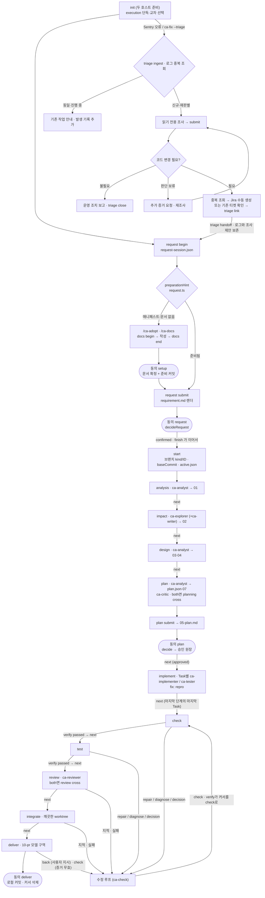
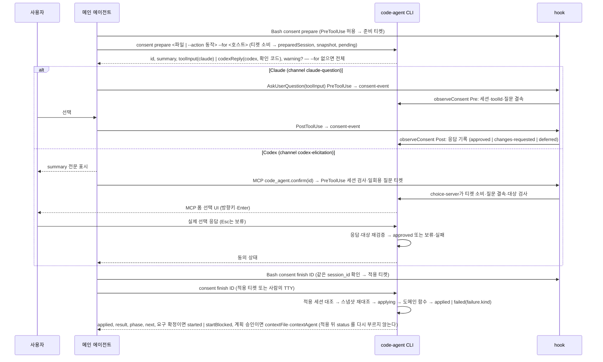
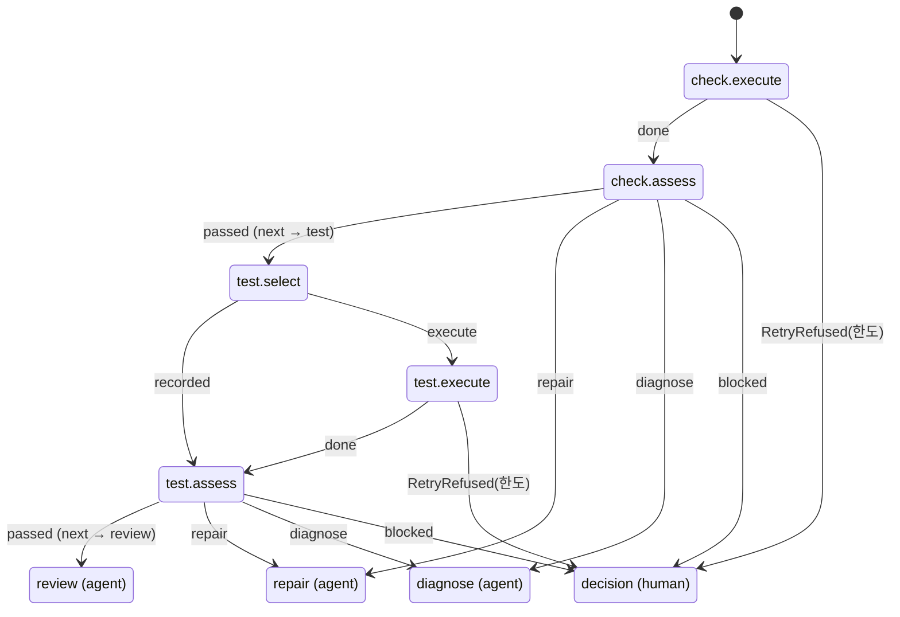

# code-agent 프로세스 흐름도

이 문서는 현재 동작을 정리한 지도다. 내용은 §10 마지막 행까지의 현재 동작이다. 코드가 정본이므로 문서와 코드가 다르면 코드가 맞고, 이 문서를 고친다.
표의 `file:line`은 커밋 `2c97a43` 기준이다. 다만 `planning.ts`·`planningState.ts`·`planningHook.ts`·`planningValidation.ts`·`stagedChecks.ts`·`codexHook.ts`·`crossCheck.ts`·`handoff.ts`의 `file:line`은 커밋 `c38c5bf` 기준이다(`commands.ts` 등 다른 모듈은 `2c97a43` 기준 그대로다). 다음은 줄 번호 없이 함수 이름으로 인용한다 — `review.ts`·`reviewHook.ts`·`crossCheck.ts`·`crossRecord.ts`·`reviewJudgment.ts`(§6.3), `consent.ts`·`hook.ts`·`codexHook.ts`·`sessionHook.ts`·`cli.ts`(진입점)·`cliMain.ts`(명령)·`consentTicket.ts`·`consentState.ts`·`answers.ts`·`snapshotCache.ts`·`consentReceipts.ts`·`retryGrant.ts`(§4·§5), `commands.ts`(`nextHint`·`status`·`start`·`requireValidatable`·`back`)·`hook.ts`·`request.ts`(`preparationHint`·`startBlockers`)·`deliver.ts`·`sessionHook.ts`·`hosts.ts`·`hostText.ts`·`reentry.ts`·`lease.ts`·`failureHint.ts`의 해당 부분, 그 밖에 `2c97a43` 뒤에 더하거나 고친 인용(§10 의 각 행). `template/`·`doc/` 인용의 줄 번호는 HEAD 기준이고(`src/test/finalReverify.test.ts`의 '흐름도의 줄 인용' 시험이 §10 앞의 인용마다 그 줄의 글을 `CITED_LINES` 표와 대조한다 — 줄이 밀리면 인용과 표를 함께 고친다), 줄이 자주 움직이는 표·문단은 절 이름(예: `ca-next` 의 '멈춘 자리별 재개')으로 인용한다. 줄 번호가 어긋나면 함께 적은 함수·절 이름으로 찾는다. 경로의 기준은 `src/agent/`이고, `core/`는 `src/core/`, `template/`·`doc/`는 저장소 루트의 같은 폴더다.
이 문서는 현재 동작만 적는다. 결함으로 판정된 동작과 개선안은 [감사 기록](reviews/2026-10-07-dual-host-process-audit.md)에 있다. 지적마다의 처리 상태(반영·일부·범위 밖·보류와 다음 배정)는 [절차 보완 결과 요약](reviews/2026-10-08-procedure-fix-summary.md)에 있다.

**읽는 순서(에이전트용)** — §2에서 바뀌는 칸을 찾고, §3에서 그 행을 읽은 뒤, §9로 파일을 연다. 이어서 사람 확인(§4)·hook(§5)·호스트 차이(§7)에 걸리는지 본다. 이 문서에 없는 동작은 추측하지 말고 코드를 연다.

## 1. 목적과 갱신 규칙

**목적**은 세 가지다. 개발 에이전트(Claude·Codex)가 코드를 다시 분석하는 시간을 줄이고, 단계·게이트·hook을 잘못 기억해 생기는 오판과 재시도를 줄이며, 변경이 어느 흐름에 영향을 주는지 먼저 판단하게 하는 것이다.

**근거 수준** — 기본은 코드 판독이다. §5의 등록표와 판정 일부는 sandbox에서 직접 확인했다(`init --host both` 설치 결과, `codex-event`·`hook`·`stop`·`session-event`에 이벤트를 넣은 결과). `init` 호스트 합집합(§7), 세션 없는 상태의 `hook` 판정(§4.1), `git add -f`의 `.gitignore *` 무시(§8)도 sandbox에서 확인했다. 그 밖에 실제 호스트에서 확인하지 않은 동작은 "미확인"이라고 적는다.

### 1.1 변경 → 갱신 대응표

Codex 관리 실행의 `master/codexTransport.ts`·`codexPermissions.ts`는 §4.2·§5.4·§8·§9와 `doc/dashboard-interactions.md`의 host-permission 계약·지원 범위, `doc/master-control.md`의 실행 인자, README·codex, interaction 스키마·소비 경로, STATE_SCHEMA를 함께 맞춘다.

| 바뀐 코드 | 갱신할 섹션 | 함께 맞출 중복 정의 |
|---|---|---|
| `core/fileOperations.ts`·`agent/fileOperations.ts`, 계획 `operation`·`from`, `nativeQuestionEvidence.ts`, 계획 되돌림 전달 상태 | §3.1, §4.3, §6.1, §6.4, §9 | `core/plan.ts` 두 계획 형식·경계·완료 판정·Task 소유·검증/반영 경로, `ca-analyze/criteria.md`·`ca-plan/criteria.md`, `doc/planning.md`·`doc/usage.md`, `ca-next`·`ca-status`, `runtimeSelect.STATE_SCHEMA` |
| `interaction*.ts`, `master/control.ts`·`observe.ts`·`recovery.ts`·`nativeSession.ts`, `choiceServer.ts`, `consent.ts`·`answers.ts`의 대시보드 사람 채널 | §3.2, §4.2, §4.3, §5.4, §6.0, §8, §9 | `doc/dashboard-interactions.md` 계약·지원표, `master/protocol.ts` 명령·이벤트 ↔ `doc/master-control.md`, `ca-answer/dashboard.md`·Claude/Codex 스킬 진입 문장, `STATE_SCHEMA`, `runtimeSelect.pendingInteractionMarker` ↔ `runtimeApply.busyReasons` |
| `branchCursor.ts`·`layout.ts`의 브랜치 진행 커서 | §3.1, §5.3, §8, §9 | `doc/usage.md`·`doc/install.md`·`doc/codex.md`·`doc/design.md`, CLI·hook의 커서 선택, 임대 경로·동의 스냅샷·버전 적용 표지·모델 변경 제한·상태 형식 세대 |
| `dependencyContracts.ts`·계획 등록/입력·`answers.ts`·`work.ts`의 외부 계약 | §4.3, §6.1, §8, §9 | `doc/dependency-contracts.md`·`doc/planning.md`·`doc/master-control.md`, Claude·Codex 답 지침, 상태 형식 세대. 등록·재인용 명령은 hook 허용 목록에 있고 읽기 전용 임대 예외에는 없다 |
| `graph/` 실행기·전체 흐름·계획·전이, `core/workflow.ts`, `cliMain.ts` 실행 경계 | §3.3, §6, §8, §9 | `doc/langgraph.md`, `ca-next` 재개 절차, Claude·Codex 공통 블록, `stateView.ts` 그래프 관찰, master `hello.execution`·`graph.changed`, `runtimeSelect.ts` 상태 세대·실행 잠금, 동의 스냅샷·반영 제외 경로 |
| `package.json` `engines.node`·`doctor.ts` 런타임 검사·`scripts/build-bin.js` 빌드 전제 | §7 | `package-lock.json` 루트 engines, `assets.ts` 자원 오류 안내, `AGENTS.md`, `README.md`, `doc/install.md`·`doc/usage.md`·`doc/design.md`의 Node 범위. npm 실행·SEA 내장 Node·SEA 빌드는 같은 범위를 쓴다 |
| `layout.ts` `PHASES`·`AFTER_IMPLEMENT`·`STOP_PHASES` (20-43) | §2, §3 | `phaseInfo.ts` `PHASE_LABEL`·`reentry.ts` `PHASE_SKILL`, `template/claude/skills/ca-next/SKILL.md:14-25` 표, §3.2 표의 단계 칸(`docSync.test.ts`가 `PHASES`와 순서까지 대조) |
| `commands.ts` `start`·`next`(implement 의 Task 완료 판정 `untouchedTaskFiles` 포함)·`back`·`requireValidatable`·`abort`·`advancePassedIntegrate`(통과한 `integrate` 뒤 deliver 로), `handoff.ts` `stageHandoff`(`next`·`review`·계획 동의 적용이 쓰는 context 파일) | §2, §3, §3.3 | 각 단계 스킬의 "자리 확인" 문장(직전 `code-agent` 출력에 스테이지가 있으면 status 를 다시 부르지 않는다), `ca-implement` 1·5항, `ca-review` 2항, `ca-integrate` 2절, `ca-plan` 끝 |
| `commands.ts` `nextHint`(판정 순서 — 선택창 질문 → AI-DLC → 요구 → 문서 질문 → 승인 무효 `reentryHint` → 검증 한도 `verifyLimitHint` → `failureHint` → 스테이지)·`status` | §3, §3.2 `다음:` 의 원천 | `ca-next/SKILL.md` '멈춘 자리별 재개' 표, `ca-status/SKILL.md` 원인별 안내 줄, `stateView.ts` 재개 판정 순서(§3.2 기계 판독용 재개 판정). 원인별 안내의 원천은 원인을 판정한 모듈이다(검증 — 이 함수의 check·test 갈래, 리뷰·교차 — `reviewProblems`·`crossCriticProblems`, 계획 배정 — `planning advance`) |
| `reentry.ts`(`reentryHint`·`staleEarliest`·`PHASE_SKILL`)·`failureHint.ts` | §3.2 실패 시, §3.3 | 승인 무효 문장(`nextHint`·`next`(implement 이후 모든 스테이지 — 스테이지 게이트보다 먼저)·`requireValidatable`·`requireReproable`·`hook.ts` `decideWrite`가 같은 문장), 단계 스킬 9개의 되감기 예외 문장(승인 무효), `failureHint`가 읽는 기록 꼴(`planning.json` 시도의 `failure`, `consents/<UUID>.json` `failure`)과 `GUIDE_KEYS`의 동의 원인 키(`detail`) |
| `hostText.ts`(표기 함수 `skill`·`skillFile`·`agentName`·`askVia`·`viaShell`·`shellLabel`·`fileToolsHint`·`readVia`·`readToolVia`·`editVia`, 판정 `notationFor`) | §7 CLI 출력 표기 | `SKILL_NAMES` ↔ `template/claude/skills` 디렉터리, `ROLE_NAMES` ↔ `template/claude/agents`(`hostText.test.ts`), 호출 지점 — `cliMain.ts` `useNotation`, hook 진입 `withNotation`(Claude 하위 명령은 claude, `codexHook`은 codex). CLI·hook 의 사용자 문구는 스킬·도구 이름을 리터럴로 쓰지 않고 이 함수들을 부른다 — 파일·확인 화면에 기록되는 문자열(⑧·⑨·⑩, 원장, 동의 `confirmations`, `setupStatus`)은 리터럴을 유지한다 |
| `lease.ts`(`leaseDecision`·`leaseGuard`·`sessionStartLease`·`releaseLease`·`leaseLine`) | §5.3, §7, §8 | `hook.ts` `LEASE_FREE`(임대를 보지 않는 읽기 전용 명령)·`decideTool`의 임대 자리(동의 티켓 발급 전), `consent.ts` `SNAPSHOT_EXCLUDED`(`lease.json*`), `init.ts` `GITIGNORE_LINES`, `sessionHook.ts` `progress`, `codexHook.ts` SessionStart 분기(같은 `sessionStartLease`), `ca-next` 재개표의 다른 세션·넘겨받기 행 |
| `request.ts` 접수·확정, `workIdentity.ts` 최초 ID·종류 보존, `docsCommands.ts`·`bootstrap.ts` 준비 | §3.1, §4, §8, §9 | `ca-request`·`ca-feature`·`ca-fix`·`ca-refactor`·`ca-adopt`·`ca-docs` SKILL.md, `doc/usage.md`, `commands.ts` 시작·`work.ts` 종류 대조, `init.ts` 무시 경로·상태 형식 세대 |
| `triage.ts`·`triageState.ts`·`errorFingerprint.ts` 사전 판별·Jira 수동 연결·fix 인계 | §2, §3.1, §5.3, §8, §9 | `ca-fix/SKILL.md`·`triage.md`, `ca-request`·`ca-next` 진입, `hook.ts` 조사 쓰기 범위, `request.ts`·`commands.ts`·`docsCommands.ts` 동시 시작 거부 |
| `init.ts` hook 등록(`initClaude`·`initCodex` — Codex PreToolUse 의 `|| exit 2`, Windows 명령 `codexWindowsCommand`·옛 꼴 점검 `codexWindowsProblem`)·`HOOK_MATCHER`(`mcp__.*` 포함)·`CLAUDE_HOOKS`·`CODEX_EVENTS`·`hookInstallProblems`·`requireStartHooks` | §5, §7 | §5.1·§5.2 등록표(`docSync.test.ts`가 임시 저장소에 `init --host both` 한 `.claude/settings.json`·`.codex/hooks.json`과 대조), `doctor.ts` hook 목록(같은 `CLAUDE_HOOKS`·`CODEX_EVENTS`를 읽는다), `update.ts` hook 출력, `doc/codex.md` 이벤트 표, `README.md` 동작 구조 표, `doc/install.md`, `doc/usage.md` hook 수·init 표 |
| `codexHook.ts`(알려진 비파일 도구 `KNOWN_NON_FILE_TOOL`, SessionStart 의 진행 상태·임대 넘겨받기) | §4.2, §5.2, §7 | `template/CODEX.block.md`, `template/codex/ca-answer.md` |
| `codexTrust.ts`(doctor 의 Codex 프로젝트·hook 신뢰 — `config.toml` 읽기만) | §5.2, §7, §9 | `doc/codex.md`·`doc/install.md`의 신뢰 절차와 doctor 표 |
| `consent.ts` `ActionSchema`(`CONSENT_ACTIONS`, `judgment` 포함)·`preview`·`applyLocked`·`observeConsent`(검사 순서)·실패 기록(`failure`·`consentGuide`)·`consentStatus`(`failure`·`warning`·Codex 확인 코드)·`SNAPSHOT_EXCLUDED` | §4 | §4.1 표의 action 칸(`docSync.test.ts`가 `CONSENT_ACTIONS`와 대조), `ca-answer/SKILL.md` 동작 준비 절·준비 절차 6항, `ca-answer/appendix.md` 필드 표·예시, `template/codex/ca-answer.md` 동작 목록(`consentBinding.test.ts` T-J-3 이 세 곳을 `CONSENT_ACTIONS`와 대조한다). 동의 제목은 `consentState.ts` `CONSENT_TITLES` 하나다 |
| `consent.ts` `renderConsentOutput`(`--for` 출력에서 빼는 필드)·`AFTER_APPLY`(흐름을 멈추는 동작의 적용 뒤 `next`)·`enterImplement`(계획 승인 적용 뒤 구현 진입)·`startConfirmed`(요구 확정 적용 뒤 작업 시작 — 판정·화면 안내는 `request.ts` `confirmStartsWork`·`confirmStartNotice`), `commands.ts` `nextStep`(적용 뒤 `next`) | §4.2, §3.1, §3.3 | `ca-answer/SKILL.md` 1·3·5·6·7항(읽는 필드 `toolInput`·`toolInput.questions`·적용 결과 `{status, result, phase, next}`, 계획 승인의 `contextFile`·`contextAgent` — `ca-implement` 1항·`ca-plan` 끝도 읽는다, 요구 확정의 `started`·`startBlocked` — `ca-request` 끝이 읽는다), `template/codex/ca-answer.md` 1·2·4항(`id`·`summary`·MCP 동의 상태·`phase`·`next`), `status`의 `다음:`(`nextHint` — `nextStep`과 같은 값이다) |
| `screenText.ts`(`QUESTION_ROWS`·`excerpt`·`questionScreenProblem`), `consent.ts` `questions`·`writeFullText`·`askScreenProblem`, `choiceServer.ts` `confirmChoice`의 폼 안내·`askChoice` 크기 검사 | §4.2, §5.1, §8 | `ca-answer/SKILL.md` 2절 질문 줄 수·동의 2항, `template/codex/ca-answer.md` 동의 2항, `choiceServer.ts` `ask` 도구 설명의 줄 수, `doc/codex.md` 사용자 확인, `doc/usage.md` 내부 처리 3항 |
| `consentTicket.ts`(준비·적용 티켓, 준비 인자 문법 `splitCommandArgs`·`parsePrepareArgs`·`INLINE_ACTIONS`)·`consentState.ts`(색인·열린 동의·적용 잠금 확인)·`answers.ts`(업무 답 관찰)·`snapshotCache.ts`·`consentReceipts.ts`·`retryGrant.ts`(사람 허용) | §4, §5.3, §6.4, §8 | 티켓 명령 꼴(`consentCommandOf`)과 `hook.ts` `isModelCommand`의 `consent` 허용 꼴, `cliMain.ts` consent 분기. `INLINE_ACTIONS`는 `ca-answer/SKILL.md` 동작 준비 절의 인라인 목록과 `template/codex/ca-answer.md` 인라인 문장의 목록과 같다(`consentOutput.test.ts`). 준비 인자 형식을 바꾸면 hook(`consentCommandOf` — 문법이 틀린 명령에는 티켓을 내지 않는다)과 CLI 가 같은 함수를 쓰는지, `PREPARE_UNOBSERVED`·`PREPARE_USAGE` 문구, `ca-answer/SKILL.md` 1항과 `template/codex/ca-answer.md` 1항의 명령 꼴도 함께 본다. 업무 답 규칙(`answers.ts`, `questions.ts`의 `[Source]`)은 `ca-answer/SKILL.md` 1·3절과 `template/codex/ca-answer.md` 업무 질문 문단. 허용 키 표(`grantTarget`)는 `GRANT_STEP`과 같아야 한다 — 키를 더하면 기록 파일·범위·잠금 안 재확인을 표에 함께 정한다 |
| `cli.ts`(hook 하위 명령 지연 로드·`hookFailureExit`)·`cliMain.ts`(명령 — `init`·`doctor`·`update`는 받는 인자 밖이면 사용법과 함께 멈추고 `--help`·`-h`는 사용법만 낸다, `optionsOnly`. 모르는 명령은 사용법 전문 대신 가까운 명령과 `help <명령>`을 안내하고(`unknownCommand`), `help <명령>`은 `USAGE`에서 그 명령의 줄만 낸다(`commandUsage`)), `hook.ts`·`codexHook.ts`·`request.ts`의 지연 로드(`consent.ts`·이벤트별 모듈·`init.ts`) | §5, §6.4 hook 종료 코드, §9 | 새 hook 하위 명령은 `HOOKS`와 `retryPolicy.ts` `hookFailureExit` 표에 함께 더한다. 분기 안의 지연 `require` 실패도 같은 표로 끝나야 한다 — 가드를 `try`로 감싸 통과시키지 않는다(`hookLoad.test.ts` 지연 로드 실패 행). hook 경로 모듈(`hook`·`codexHook`·`stopHook`·`sessionHook`과 그 import)에서 명령 모듈을 정적으로 import 하지 않는다 — `hookLoad.test.ts`의 금지 목록(`HEAVY`)·실행 경로·로드 실패 표가 대조한다 |
| `runtimeSelect.ts`(적용 버전 선택 `selectRuntime`·위임 계약 `RUNTIME_KEY`·`SELF_ENV`·`RELEASE_ID`·상태 형식 세대 `STATE_SCHEMA`·`BUSY_FILES`·`releaseHome`·`entryScript`·npm 패키지 진입점 `entryPackage`·여는 셸 명령 `OPENING_COMMAND`·적용 대기 `pendingSwitch`)·`cli.ts`(위임·복구 명령 `RECOVERY`), `releaseStore.ts`(릴리스 설치 — Git 소스 `installGitRelease`·npm 패키지 사본 `installPackageRelease`·`packageRelease`, 검증 `verifyRelease`·설치 잠금 `lockStore`·중단된 설치 정리 `sweepStaging`), `runtimeApply.ts`(적용 `applyHere`·예약 `reserve`·진행 중인 일 `busyReasons`·템플릿 반영 `applyTemplates`·다시 열기 안내 `hostGuidance`·설치 확인 `requireInstalled`), `runtimeGate.ts`(다음 작업 관문 `atNextWork`·hook 의 적용 `applyBeforeOpening`·적용 보고 `APPLY_NOTE`·패키지 들이기 `adoptAtNextWork`·`version`·update 갈래 `runUpdate`), `hook.ts` `decide`의 여는 명령 적용, `sourceUpdate.ts`(미리보기·`updateFromSource`·`runReleaseApply`·샌드박스 안내 `SANDBOX_BLOCKED`), `core/atomic.ts` `writeIfChanged`(`init.ts`·`choiceConfig.ts`의 설치 파일), `choiceServer.ts` `handlersFor`(호출마다 적용 버전의 처리기) | §3.1 버전 적용 관문, §4.1 update 행, §5.1 PreToolUse 행, §5.3 3단계·티켓 항목, §5.4, §7 실행 중인 세션 행, §8, §9 | 위임 계약(`runtimeSelect.ts` 머리말 — 이미 설치된 진입점이 새 릴리스를 부르는 규약이라 그대로 둔다. 승인·증거·작업 기록의 형식을 바꾸면 `STATE_SCHEMA`를 올린다), `busyReasons` ↔ `BUSY_FILES`, `requireInstalled` ↔ `init.ts`가 쓰는 설치 기록(`.code-agent/version`·`hosts.json`)과 hook 등록(`installedHook`), 관문을 지나는 명령(`cliMain.ts` `opening` — `request begin`·`docs begin`·`triage begin·ingest·reassess`·`start`) ↔ `runtimeSelect.ts` `OPENING_COMMAND` ↔ `reserve`·`version`의 적용 시점 문장, `hostGuidance` ↔ `doc/install.md` 5절 '호스트를 종료하지 않는다' 표·`doc/codex.md` 갱신 절·§7 '새 버전 적용 뒤의 실행 중인 세션' 행, `hook.ts` `SOURCE_UPDATE`와 막는 깃발·`MODEL_SUBCOMMANDS`·`LEASE_FREE`의 `version`, `init.ts` `GITIGNORE_LINES`(`runtime.json`·`runtime.lock`·`template-conflicts/`), `bootstrap.ts` `baselineFiles`·`deliver.ts` `deliveryPaths`(`templates.json`), `consent.ts` `AFTER_APPLY.update`, `ca-next`·`ca-status`·`ca-answer`(Claude 7항·`template/codex/ca-answer.md`)의 update 문장, `cliMain.ts` `USAGE`·`UPDATE_USAGE`, `doctor.ts` 3b·3c, `doc/install.md`·`doc/usage.md` 업데이트 절 |
| `hook.ts` `decide`(티켓 발급)·`decideTool`·`decideMcp`·`readDenied`·`aliasGuard`·`decideOutside`(열린 동의 창·소스 업데이트·hook 설정)·`decideDocWrite`·`MODEL_SUBCOMMANDS`·`readOnlyRoleGuard`(`READ_ONLY_ROLES`) | §5.3, §5.4 | `template/CLAUDE.block.md`, `decideBash` 거부 문구, 읽기 전용 담당의 정의 파일 `tools`(`ca-critic`·`ca-reviewer` — `hookPaths.test.ts`가 대조). `ca-surveyor`는 `Write`가 있지만 초안 자리(`layout.ts` `SURVEY_DRAFTS` — 문서 세션이 만들고 지운다) 바로 아래 `.md`만 쓴다 — `ca-docs` 2절·`ca-surveyor.md`·`ca-writer.md` 입력 문장과 맞춘다. `help <명령>`을 여는 `isModelCommand`·`LEASE_FREE` |
| `planning.ts`·`planningState.ts`·`planningHook.ts`·`planningChain.ts`·`planningRules.ts`(규칙 식별자 `RULES`·`ruled`·`submitChecklist`) | §6.1 | `doc/planning.md` 역할·action 표, 규칙 식별자 — 검사 문구의 `ruled("…")`와 `RULES`가 서로 빠짐없이 같다(`planningRetry.test.ts`), 결과 상태별 계약(`statusContract`)과 완료 hook 의 `RES-*` 검사, 계획 스킬 2항의 `## 직전 시도` 문장, 결과 파일 이름(`planningState.ts` `RESULT_FILE` — `hook.ts` `decidePlanner`가 여는 staging 이름)과 계획 담당 소개 문장(`ca-analyst`·`ca-explorer`·`ca-writer`·`ca-critic`), `planningChain.ts` `planningNextLine` 표(action별 다음 행동의 원천 — `planningChain.test.ts`), 연쇄 거부의 `questions`(`commands.ts` `OpenQuestionsStop` — `requireAnswers`가 던질 때만), 연쇄 출력의 지금 스테이지(`chain.to` — `ca-analyze`·`ca-impact`·`ca-design` 5항, `ca-next` 3항), 단계 스킬 2·3·4항(네 스킬이 같은 글자 — `templateText.test.ts`, advance `action`을 바꾸면 4항의 요지도), `ca-plan/contract.md:10,16`(질문 출처·수정 피드백), `ca-plan/SKILL.md` 4-1항·반려 절차와 `crossCriticProblems` 문구(고칠 작업은 지적 내용으로 정한다), `ca-next/SKILL.md:31`(재개 때 실행 중 배정 확인 — 시작 hook 출력이 없을 때도 잡는다)·`:75`(되감기 예외 셋)·'멈춘 자리별 재개' 표의 `stale`·`rewind-required` 행, `sessionHook.ts`(실행 중 배정 요약), `handoff.ts` `handoffPlanning`(배정 요약의 `previous`). 연쇄(`--chain`)는 program 게이트(analysis·impact·design)만 잇는다 — 사람 확인(계획 제출·승인)을 잇지 않고 실패·거부에서 자동으로 다시 시도하지 않는다 |
| `lock.ts` | §6.1, §8 | 리뷰 기록·동의 적용·작업 임대가 같은 잠금을 쓴다 — 호출자별 `ageReclaim`·`display`·문구 |
| `stagedChecks.ts`, `planningValidation.ts`(`planRuleProblems` 포함)·`workDocs.ts`의 게이트 함수, `sourceTrace.ts`·`requirementFields.ts`(근거·출처 줄 파서) | §6.1 관찰 6단계·게이트 | 게이트 함수를 바꾸면 계획 담당 완료 hook의 문서 검사도 함께 바뀐다(같은 함수). 제출 규칙은 `plan submit`과 plan 완료 hook 이 `planRuleProblems` 하나를 쓴다. 01 형식 검사(`parseRequirements`)와 원문 추적(`sourceTrace`)은 `requirementFields.ts` 하나로 근거·출처 줄을 읽는다. 문구의 규칙 식별자는 `planningRules.ts` `RULES`에 있어야 하고, 담당 지침의 같은 규칙(`ca-analyze`·`ca-impact`·`ca-design`·`ca-plan`의 `criteria.md`, `ca-writer.md`)과 맞춘다 |
| `verificationFlow.ts`·`validate.ts`·`evidence.ts`·`repairHandoff.ts`·`testFiles.ts`, `core/build.ts` `CommandResult`, `tree.ts` `partialTreeHash`, `testResults.ts`·`testReports.ts`, `retryPolicy.ts` 검증 절 | §3.2 check~integrate, §6.2, §6.3 리뷰 회차, §8 | `ca-check/SKILL.md` 노드 처리 목록·↺ 수정 루프 2항과 `ca-implementer.md` 수정 루프(`repairFile`), TC 인식 규칙(`testResults.ts` `TC_ID`·`tcToken`, 보고서 이름 `reportSnapshot`)과 `ca-tester.md` TC 표기 문장·`ca-test/tc-names.md` 러너 표, `ca-check`·`ca-test`·`ca-integrate`·`ca-implement`·`ca-fix` 재시도 문장과 `ca-review` 5항, `ca-tester.md` 동결 문장, 장시간 실행 정본 문장(`ca-check`·`ca-test`·`ca-integrate`·`ca-implement` 4곳 글자 그대로) |
| `review.ts`·`reviewHook.ts`·`crossCheck.ts`·`crossRecord.ts`·`reviewJudgment.ts` | §3.2 review, §5.1·§5.2 리뷰어 행, §6.3, §7, §8 | `ca-review/SKILL.md` 4-1·4-2·끝, `ca-plan/SKILL.md` 4-1. 리뷰 회차 한도는 `evidence.ts` `reviewRoundUsageOf` 하나다(§6.2·§6.3). 표 규칙(`reviewResultProblems`)과 표 칸 정규화(`normalizeReviewTable`)는 hook·교차가, 읽기(`review.ts` `parseFindings`)는 게이트가 쓴다 — `ca-reviewer.md` 출력 표(열·상태 값·경로 규칙)와 맞춘다. 사람 판단 네 함수(`previewWaiveFinding`·`waiveFinding`·`previewCrossStop`·`recordCrossStop`)는 동의 `judgment`가 부른다(`ca-answer` 세 곳의 목록과 함께 연결) |
| `deliver.ts`·`knowledge.ts` | §3.2 deliver, §8 | `ca-integrate/SKILL.md` 3절 2항·`ca-integrate/knowledge.md`(제안 형식 — 필드 이름·`삭제`·`대체`·업무 정책의 구분·상태 값이 `knowledge.ts` `entryFields`·`entryOp`·`proposalCheck`와 같은 글자). 반영 제외 규칙(`deliveryExcludes`·`isDeliveryExcluded` — handoff·staging·경험·발견 초안 자리(`layout.ts` `draftFile`)·작업 상태 폴더의 `*.lock`)은 커밋·커밋 뒤 대조·동의 미리보기가 같이 쓴다 |
| `knowledgeIndex.ts`(요청 시 인덱스 `buildIndex`·검색 `search`·반드시 적용하는 업무 정책 `mandatoryPolicies`·컨벤션 `[필수]` 줄·최신성 `freshness`·문서 영향 판단 `DOC_DECISIONS`)·`knowledgeImpact.ts`(impact 게이트 `docImpactProblems`·반영 범위 `proposalScope`·`지식 제안:` 줄 `proposalHint`)·`knowledgeCommands.ts`(`knowledge`·`knowledge find`)·`plugins/defaults.ts` `relevantDocSections` | §3.2 impact·deliver, §5.4, §6.1 게이트, §8 | `schemas.ts` `FEATURES`·`FLOWS`·`BUSINESS_RULES` 안내와 02 `docImpact` 절(별칭 포함), `contextRender.ts` 문서 영향 표 예시·참고 문서 절·`FIND_HINT`(절 이름 `참고 문서`는 `ca-analyze/criteria.md`·`ca-design`·`ca-impact`의 `legacy.md`가 부른다), `KNOWLEDGE_KINDS` 종류 목록(`ca-docs` 인자·표·종류 줄, `ca-adopt`, usage·design 의 문서 표·`docs skeleton` 종류), `ca-impact/criteria.md` 문서 영향 줄, `ca-implementer.md`·`ca-reviewer.md`의 필수·권장 충돌 기준(`[필수]`·구분 필수), `hook.ts` `MODEL_SUBCOMMANDS`·`LEASE_FREE`의 `knowledge find`, `usage.ts` 문서 탐색, `doc/plugins.md` context.docs 기본 구현. 최신성은 안내뿐이다 — 승인 해시·게이트·계획 입력 해시에 넣지 않는다 |
| `experience.ts`·`experienceCommands.ts`(작업 경험 — ID·버전·상태 판정·검색·`experience add·list·show`)·`findings.ts`(발견 보고 — 정체·버전·분류 경로·`finding report·list`)·`stateView.ts`(`status --json` — 스키마·`RESUME_CODES`·`stateVersion`)·`workAttempt.ts`(시도 식별자)·`sensitiveText.ts`(민감 정보·로그 전문 검사) | §3.2 기계 판독용 재개 판정·hook의 쓰기 범위, §5.3, §5.4, §8, §9 | `hook.ts` `MODEL_SUBCOMMANDS`(`experience`·`finding`)·`LEASE_FREE`(`status --json …`·`experience list·show`·`finding list`)·`decideWrite`의 `experience.md` 거부 문구, `layout.ts` `experienceFile`·`draftFile`·`findingsFile`, `deliver.ts` `deliveryExcludes`(초안 자리), `cliMain.ts` `USAGE`·`status` 옵션, `commands.ts` `status`의 `발견:`·`작업 경험:` 줄, `contextRender.ts` 참고 문서의 경험 절·`knowledgeCommands.ts` `knowledge find` 경험 블록(정책 결과와 따로 센다), `ca-check/SKILL.md` ↺ 수정 루프 3항·`ca-integrate/SKILL.md` 3절 3항의 명령 문장(`stateView.test.ts`가 두 호스트 사본을 대조), `doc/usage.md` 5절 상태 조회 칸·재개 코드 표(`RESUME_CODES`와 같은 순서)·경험·발견 형식. 재개 판정 순서는 `nextHint`(질문 → 승인 무효 → 검증 한도 → 실패 안내)를 따르고 그 앞에 관측 불가·소유·대기를 둔다 — `nextHint`를 바꾸면 이 순서도 본다. 경험·발견은 승인 해시·계획 입력·검증 묶임·게이트에 넣지 않는다 |
| `master/*`(연동 계약 `protocol.ts`·제어 `control.ts`·실행 `runs.ts`·`supervisor.ts`·위임 `delegation.ts`·인계 `handover.ts`·사람 설정 `admin.ts`·PC 신뢰 `trust.ts`·페어링 `pairing.ts`·관리 호스트 준비 `hostProfile.ts`·작업에 고정한 실행 방식 `workExecution.ts`·hook 가드 `runGuard.ts`), `consent.ts` `decideDelegatedConsent`·`delegationView`·`applyLocked`의 위임 갈래, `answers.ts` `delegated` 행·답 출처 `delegated`·`relayed`, `consentReceipts.ts` `delegation` | §4.2 결속 규칙, §4.3, §5.1 SessionStart 행, §5.3(가드·3단계), §5.4, §8, §9 | 계약 문서 `doc/master-control.md`의 명령·오류 코드·정책 표·동작 목록·실행 상태(`master.test.ts`가 `protocol.ts`와 대조), 동의 동작의 분류(`CONSENT_ACTIONS` ⊆ `DELEGABLE_ACTIONS` ∪ `HUMAN_ONLY_ACTIONS` — 같은 시험. 동의 동작을 더하면 둘 중 하나로 정한다), `runGuard.ts`(hook 경로)는 순수 모듈 `protocol.ts`만 import 한다(`hookLoad.test.ts` 금지 목록 밖), `workExecution.ts`(hook 경로 — `hosts.ts`·`hook.ts`가 부른다)는 `layout.ts`·`runGuard.ts`와 `protocol.ts` 타입만 import 한다, 실행 세션 규칙 `supervisor.ts` `MASTER_SYSTEM_RULES` ↔ `runGuard.ts` `masterRunNote`·`masterRunGuard` 문구, `hook.ts` `decideTool`의 가드 자리·`decideOutside`의 `MASTER_CONTROL_COMMAND`, `cliMain.ts` `status`의 세션 기본값(`masterRun`), `consent.ts` `SNAPSHOT_EXCLUDED`(`master`), 키 자리(`trust.ts` 신뢰 키·`pairing.ts` `tokenDir`·`interactionHuman.ts` `humanChannelDir`)는 `storeDir()` 아래 — hook 키 자리 차단이 덮는다(`masterPairing.test.ts`), 페어링이 받지 않는 필드(`pairing.ts` `FORBIDDEN`) ↔ 계약 문서 페어링 절. 승인·답 기록의 형식을 바꾸면 `runtimeSelect.ts` `STATE_SCHEMA`를 올린다 |
| `hosts.ts` `codexText`(문장째 치환 `CODEX_SENTENCES` — `templateText.test.ts`가 원문이 Claude 템플릿에 있고 Codex 사본에 남지 않는지 대조) | §7 | 장시간 실행 정본 문장(`ca-check`·`ca-test`·`ca-integrate`·`ca-implement`)과 교차 4-1 문장(`ca-review`·`ca-plan`)은 문장째 치환한다 — 원문이 글자 그대로 같아야 걸리고, 어긋나면 `hostNotation.test.ts`가 Codex 사본의 `Bash`·`600000ms`로 잡는다. 역할 정규식은 `hostText.ts` `ROLE_NAMES`로 만든다. 담당 호출 문장(Agent 도구를 `run_in_background: false`로 부르게 하는 정본 문장 — 계획 스킬 4개 2항·`ca-review`·`ca-implement`·`ca-test`·`ca-check`·`ca-docs`·`ca-adopt`와 이전 버전 절차 `legacy.md`의 담당 호출)은 Codex 사본에서 결과를 기다리는 문장으로 바뀐다(`templateText.test.ts`가 담당을 부르는 줄마다 대조한다). 계획 담당의 쓰기 도구는 에이전트 본문이 아니라 배정 `instructions`(`editVia`)에 있어 치환하지 않는다. 교차 명령의 권한 상승 치환(`셸: \`code-agent (review|planning) cross --by claude\``)은 `ca-review`·`ca-plan` 4-1의 `` Bash: `code-agent … cross --by codex` `` 가 `Bash:`·`--by` 치환을 거친 글자에 맞춘다 |
| `crossEnv.ts`(교차 자식 표지·`runtimeHost`), hook 진입점(`runStopHook`·`runSessionHook`·`runReviewHook`·`runPlanningHook`·`codexHook`) | §5, §6.3, §7 | 교차 자식(`CODE_AGENT_CROSS`)에서 통과하는 hook 목록(`CROSS_CHILD_PASS_EVENTS`), 교차 자식의 진행 명령·쓰기 거부(`hook.ts` `crossChildGuard` — 문구 `CROSS_CHILD_DENY`, 읽기 전용 명령 목록 `CROSS_CHILD_READONLY`. 작업 임대도 같은 문구를 쓴다). 교차 자식에서 여는 `code-agent` 명령을 바꾸면 `CROSS_CHILD_READONLY`와 §5.3 0단계를 함께 고친다 |
| `crossCheck.ts` `crossInvocationArgs` | §6.3 다른 호스트 실행 | `doctor --cross`의 점검 목록(`crossFlags`)은 이 인자에서 만든다 — 따로 맞출 것이 없다 |
| `retryPolicy.ts` `POLICIES`·`LIMITS`·`GRANT_STEP`·`TIMING`·`GUIDE_KEYS`·`GUIDE_VARIANTS`·판정 함수, `lock.ts`, `crossEnv.ts`, `hostText.ts` | §6.4(표는 생성 블록 — `renderRetryPolicyTable()` 출력으로 다시 붙인다), 연결된 판정 지점의 §4·§5·§6.1~§6.3 | §6.4 생성 블록(`docSync.test.ts`가 바이트 대조), 안내 문구 자리표시와 `GUIDE_KEYS`·`GUIDE_VARIANT_KEYS`(`retryPolicy.test.ts`가 대조 — 기본 문구를 `guidance()`로 렌더하지 않는 원인은 `UNRENDERED_GUIDES`에 실제 문구의 원천과 함께 적는다), 카운터 이름표 `COUNTER_LABEL`(다른 모듈은 정의하지 않고 import 한다), `crossFailureText`의 Codex 배너 식(Codex exec 배너 라벨·전사 라벨 `CODEX_TURN`·오류 줄 꼴이 바뀌면), `hostText.ts` `SKILL_NAMES`·`ROLE_NAMES`(템플릿 폴더·`hosts.ts` `ROLE_NAMES`와 같아야 한다 — `hostText.test.ts`가 대조). `docSync.test.ts`는 표에 렌더되는 값만 대조하므로 §6.4 산문에 숫자를 쓰지 않는다 |
| `usage.ts`(`usageReport`·`commandKey`·`skillReadKey`·`transcripts` — `subagents/` 아래 하위 폴더의 `agent-*.jsonl` 포함)·`codexUsage.ts`(`readCodexLog` — 0.161.0 기록 꼴, `unwrapShellArgv` — 셸 래퍼 벗기기)·`retryReport.ts`(옛 기록은 `crossAttemptsOf`·`legacyPlanningAttempts`·단수 `reviewer`, 계획 담당 측정은 `planning.json`의 시도·`agents[].returns`·`returnedRules`) | §7 토큰 사용량 행, §8 읽기만 하는 행, §9 | `doc/usage.md` usage 절, `doc/codex.md` 사용량 문단, `scripts/evaluate-full-flow.cjs`(`usageData`·`retry`)·`summarize-evaluations.cjs`. 측정은 기록을 읽기만 한다 — 쓰거나 배정 입력·스킬로 돌려보내지 않는다 |
| `hookLog.ts`(hook 출력 기록 `noteHookOutput`·`noteSubagentReturn`·같은 사유 확인 `blockedBefore`)와 그것을 부르는 hook 진입(PreToolUse 거부·Stop 차단·질문 도구 exit 2·담당 되돌림·SessionStart 주입·Codex 출력), `stopHook.ts` `STOP_LIST_LIMIT` | §5.1 hook 출력 기록·Stop 행, §5.2 Stop 행, §8 | `usage.ts` hook 출력 절, `doc/usage.md` 사용량 절 |
| `modelPolicy.ts` `ROLE_POLICY`·`TIER_DEFAULTS`·`CLAUDE_EFFORTS`·`CLAUDE_NO_EFFORT`, `models.ts`, `prices.ts` | §4.1 model 행, §6.3 다른 호스트 실행, §7 모델 기본값 행(`docSync.test.ts`가 `ROLE_POLICY`·`TIER_DEFAULTS`와 대조), §8 `models.json` 행 | `template/claude/agents/ca-*.md` 머리말 `model`·`effort`(`modelPolicy.test.ts`가 대조), `doc/codex.md` 역할별 모델 표(같은 테스트가 대조), `doc/design.md` 모델 문단, `ca-answer/reference.md`·`template/codex/ca-answer.md` 모델 예시, `retryPolicy.ts` `CROSS_PATTERNS.config`·`crossFailureText`(모델·강도 오류 문구, Codex 배너 라벨), `doc/usage.md` 단가표. 단가표(`prices.ts`)에는 번들 claude-api 스킬 표에 값이 있는 모델만 넣는다 |
| 상태·산출물 경로(`layout.ts`, `handoff.ts`, `deliveryPaths`) | §8 | `.gitignore` 블록(`init.ts` `GITIGNORE_LINES`), `baselineFiles`(`bootstrap.ts:40-62`) |
| `executionMode.ts`·`executionCommands.ts`·`executionHandoff.ts`, `master/hostProfile.ts`·`hostHandoff.ts`·`workExecution.ts`, `init.ts` 공개 초기화 | §5.4, §6.3, §7, §8, §9 | CLI 사용법, README 실행 표, install·usage·codex, 계획·리뷰 교차 게이트, bootstrap·deliver 설정 경로, `executionMode.test.ts`. master 가 고른 실행 방식(`submit` `execution` → 실행·작업 기록의 `execution`)을 판정하는 곳 — `hosts.ts` `crossEnabled`, `hook.ts` 단독 호스트 가드, `hostProfile.ts` `requireResumeProfile`, `executionCommands.ts` 인계 — 과 `doc/master-control.md` §3·§4·§11·§12(`masterCodex.test.ts`·`executionHandoff.test.ts`) |
| 새 파일·모듈 이동 | §9 | — |
| `template/**` 문장(늘리거나 옮김) | §9 절차 템플릿 | `src/test/templateBudget.test.ts` 파일별·흐름 합계(Claude·Codex) 예산 — 넘기면 필요할 때만 읽는 보조 문서로 옮기거나 근거를 `doc/reviews`에 남기고 `BUDGET`을 고친다(`node scripts/template-sizes.cjs --suggest`) |
| 스킬·서브에이전트 추가·삭제 | §7, §9 | 설치 수(`README.md` 동작 구조 표, `doc/codex.md` 설치 대상 표, `doc/install.md`, `doc/usage.md:228`), `ca-next/SKILL.md` 표, `init.ts`의 Codex 설치 안내 문구. 서브에이전트는 `hostText.ts` `ROLE_NAMES`(정본 — `hosts.ts`가 다시 내보내고 `codexText` 역할 정규식도 이것으로 만든다)와 `modelPolicy.ts` `AGENTS`·`ROLE_POLICY`도 고치고, 계획·리뷰 담당이면 `init.ts:228-231`·`doctor.ts:181`의 SubagentStart·Stop matcher도 고친다 |

**갱신 절차** — 코드 변경과 같은 커밋에서 해당 행과 `file:line`을 고치고, §10에 변경당 한 줄(바뀐 것의 요지와 커밋 — 경위·지적별 처리·검증 결과는 `doc/reviews/` 기록에)을 남긴다. 확인하지 못한 동작은 쓰지 않거나 "미확인"으로 표시한다.

## 2. 전체 흐름 한 장

둥근 칸(`([ ])`)은 사람의 동의다(§4). 새 작업의 기본 동의는 `setup`(최초 준비 때만), `request`, `plan`, `deliver`다. 상황에 따라 `docs`(공통 문서만 다시 확정할 때, `request.ts` `preparationHint`), `repro-log`(fix에서 로컬 재현이 안 될 때), `judgment`(한도 추가·지적 기각·교차 중지), `abort` 등이 더해진다(§4.1).

## 3. 스테이지별 표

**공통 전제** (`commands.ts:516-524`) — `next`는 매번 AI-DLC 미진행, 유효한 커서와 `baseCommit`(`requireWork` 158-171), 공통 문서 확정, 요구 확정(`request.ts:350-378`), 답 없는 질문 0(`requireAnswers` 184-193)을 확인한다. analysis~plan에서는 `planningProblems`와 `planningDocumentProblems`도 본다. 게이트에 걸린 `next`는 `Stop`을 던지고 커서는 그대로 둔다.

### 3.1 커서가 생기기 전

**버전과 질문 상태** — `version`은 프로젝트 적용 버전과 설치 완료·적용 대기 버전을 구분한다. 예약 당시 사유와 현재 진행 중인 일을 따로 표시하며, 완료된 질문의 낡은 기록은 `interaction list`로 정리한다. 실제 진행 중인 일이 끝나면 호스트 밖 터미널에서 `update --release <ID>`로 적용하거나 다음 작업을 열 때 자동 적용한다. `status`는 문서 질문과 선택창의 응답 대기·보류·받은 답 처리 대기·답변 확인된 낡은 기록을 구분한다. 답이 확인된 기록만 남으면 재응답을 요구하지 않는다.

**접수 식별 유지** — 작업 ID·feature/fix/refactor 종류는 최초 접수 요구로 정하고 `.code-agent/identities/`에 보존한다. 후속 수정·검증 실패·접수 종료로 종류를 바꾸지 않는다. 같은 ID의 접수 재개는 기록을 재사용하고, 다른 브랜치에 보관된 ID는 그 브랜치에서 재개하도록 거부한다. 자동 발급도 보존된 ID를 건너뛴다. 기록이 없는 설치는 기존 세션·지시서·초안·작업 커서·종류별 로컬 브랜치를 대조하며 종류가 충돌하면 중단한다. 지시서 읽기·시작·재제출도 같은 종류 대조를 사용하며 계획 파일을 읽지 못했다는 이유로 종류 검사를 생략하지 않는다.

**브랜치별 재개** — 이름 있는 Git 작업은 현재 HEAD의 브랜치와 일치할 때만 활성으로 읽는다. 다른 브랜치의 작업은 보존하고 현재 브랜치의 도입·접수를 허용한다. `init --host codex`는 설치만 하며 설정을 만들거나 기존 커서를 지우지 않는다. `code-agent.json`은 도입 절차에서 준비한다. 기존 브랜치로 돌아오면 그 커서와 승인·검증 기록을 다시 사용한다. 같은 브랜치의 설정 누락·손상은 복구 제한을 유지한다. 접수·문서 준비 세션은 checkout 단위이므로 끝낸 뒤 브랜치를 전환하며, 동시 실행은 별도 worktree를 사용한다. 버전·모델 변경은 다른 브랜치에 보관한 작업도 진행 중으로 본다.

**미응답 준비 질문의 재개** — 같은 ID의 새 요청·오류 원문은 초안에 보존한 뒤 ca-docs의 미응답 업무 질문을 실제 질문 도구로 제시한다. 테스트 기준과 품질 기준은 각각 제안 내용·근거와 `제안 기준 사용 / 항목 수정 / 보류`를 받는다. 특정 문구를 입력하라는 보고만으로 끝내지 않는다. 이미 준 답·선택과 대기 중인 질문은 중복해서 묻지 않는다. 업무 답 후 문서 확정·준비 커밋 동의는 별도다.

**용어** — 사용자 안내의 실행 명령(`/ca-fix` 등), 작업 ID(내부 작업), 외부 업무 식별자(Jira 티켓 키·Notion 페이지 ID), 조사 ID(사전 판별 기록)를 구분한다. `skill`·`SKILL.md`는 호스트의 기술 명칭이며 업무 식별자가 아니다. 사전 판별의 외부 연결은 현재 Jira 전용이다.

**버전 적용 관문** — 다음 작업을 여는 명령(`request begin`·`docs begin`·`triage begin·ingest·reassess`·`start`)은 적용이 예약된 새 버전(§4.1 update)이 있고 진행 중인 일이 없으면 그 릴리스를 먼저 적용하고 같은 명령을 새 버전으로 다시 실행한다. 세션 파일은 프로젝트 실행 잠금(`runtime.lock`) 안에서 만들어 버전 전환과 새 작업의 시작이 엇갈리지 않는다(`runtimeGate.ts` `atNextWork`). 모델이 셸로 이 명령을 부르면 그 직전의 PreToolUse hook 이 같은 적용을 먼저 한다(§5.3 — `applyBeforeOpening`). 호스트는 hook 을 셸 샌드박스 밖에서 돌려(§7) 샌드박스 셸이 쓰지 못하는 `.agents/`·`.codex/` 사본도 반영된다. 적용 보고는 `log/runtime-applied.json`에 남겨 그 명령이 새 버전으로 한 번 내고 지운다. 적용은 내용이 바뀐 설치 파일만 쓴다(`writeIfChanged` — 줄바꿈만 다른 사본은 그대로). 적용이 실패하면(셸이 자식 프로세스나 `.codex/`·`.agents/` 쓰기를 막은 Codex 샌드박스 포함 — `SANDBOX_BLOCKED` 안내) 반영한 파일을 되돌리고 지금 버전으로 시작하며 예약은 그대로 둔다. 진입점이 npm 패키지면 예약 대신 그 패키지를 본다 — 고정이 없거나 마지막으로 들인 패키지(`runtime.json` `adopted`)와 다른 패키지가 설치돼 있으면 그 패키지를 릴리스 저장소에 복사해 적용하고 같은 명령을 다시 실행한다(사람이 `--release`로 고른 버전은 새 패키지가 설치될 때까지 둔다, `adoptAtNextWork`). code-agent 가 설치되지 않은 폴더에는 패키지를 들이지 않는다(`requireInstalled`).

**Sentry 사전 판별** — 기존 Jira가 없는 Sentry 오류 또는 명시적 `ca-fix --triage` 요청은 개발 접수 전에 `triage ingest <입력JSON>`으로 프로젝트·로그 원문과 선택 release·base를 받아 조사한다. 조직·Sentry ID는 필수가 아니며 출처 기반 begin도 지원한다. `errorFingerprint.ts` v1은 이벤트·요청·추적 ID와 ISO 시각을 정규화하되 오류 코드·숫자·스택을 일괄 제거하지 않는다. 예외와 스택이 있어야 자동 중복으로 인정한다. 동일 오류는 발생 기록을 누적하고 새 Jira·수정 실행을 생략한다. 유사 후보는 비교 근거가 있어야 Jira로 진행한다. 조회·신규 조사 예약은 같은 로컬 잠금 안에서 수행한다. 상태는 `triageState.ts`, 명령은 `triage.ts`다. 증상·기대 동작을 필수로 받지 않고 메인이 로그·발생 버전·저장소 코드와 문서를 읽어 사실·가설·원인 분류와 코드 변경 필요 여부를 따로 작성한다. 데이터·외부 장애도 코드 보완이 필요할 수 있다. `submit`은 로그·판별 형식, 근거의 실재 경로·줄 인용과 수정 제안을 검사하고 파일 해시를 기록한다. 로그 원문은 첫 제출 뒤 바꾸지 않는다. 불필요는 운영 조치를 보고 close, 판단 보류는 추가 증거를 요청한다. 둘 다 Jira 준비·연결·fix 인계를 거부한다.

코드 변경 필요인 경우에도 중복 미조회(`unchecked`)면 `triage jira`·`link`·`handoff`를 거부한다. `jira`는 추적 표지가 있는 본문을 렌더하고, 사람이 기존 티켓을 확인하거나 새 Jira를 생성한다. CLI는 외부 API를 호출하지 않는다. `link <KEY> <URL>`은 키·HTTPS browse URL 일치와 기존 연결 일치를 검사하며 원격 티켓의 실재는 인증하지 않는다. `handoff`는 근거 해시를 다시 확인하고 로그 원문·보고서·미확정 수정 제안을 작업 폴더에 복사해 Jira 키로 fix 접수를 연다. 사람의 요구 확인·계획 승인과 재현·검증은 그대로 적용한다. 원문은 로그이고, 조사 제안은 배경·추적 주석으로 구분한다. 기존 작업 폴더는 덮어쓰지 않고, 같은 Sentry 출처의 인계 기록은 새 티켓 생성을 막는다. Jira 연결 뒤 근거가 바뀌면 기존 티켓을 보존하고 조사 결과를 재검토한다(조사를 닫고 그 티켓으로 직접 fix 접수 가능). `close`는 기록을 보존하고 조사 커서만 닫는다. 작업 시작은 fixing, 중단은 paused, 로컬 반영은 awaiting-deployment로 연결한다(반영 중 코드 변동 경고는 paused). `deployed <ID> <버전> <근거>`는 사람이 확인한 배포를 기록하며 원격 검증은 하지 않는다. 수정 배포 버전의 재발은 새 조사로 열고 버전 관계가 불명확하면 확인을 요청한다. `reassess`는 사유를 보존하고 닫힌 판정을 재검토한다. `attach`는 동일 원인을 기존 기록에 연결하고 신규 실행을 생략한다.

조사 중에는 다른 접수·작업·문서 세션을 시작하지 않는다. `status`와 Claude 세션 요약은 조사 재개 위치를 알린다. 기존 Jira·직접 결함 신고의 fix 접수와 feature·refactor는 사전 판별을 요구하지 않는다.

| 단계 | 진입 조건 | 담당 | CLI | 산출 | 넘어가는 조건 |
|---|---|---|---|---|---|
| 준비 | 매니페스트가 없거나, 공통 문서가 미확정이거나, 문서 세션이 열려 있거나, 준비 커밋이 없다(`preparationHint` — 매니페스트 없이 문서 세션이 열려 있으면(`ca-adopt` 도중) `/ca-adopt` 로 설정·문서를 마저 쓰고 `docs end`(작업·접수 없는 `status` 도 이것을 접수 안내보다 먼저 낸다 — 문서 세션 중에는 `request begin` 이 거부된다). 확정이 필요하면 기준 커밋을 보고 `setup`(문서 확정 + 준비 커밋)·`docs`(문서만)·`baseline`(준비 커밋만) 동의 하나를 고른다. git 저장소가 아니거나 작업 중이면 준비 커밋은 보지 않는다) | 메인 `/ca-adopt`·`/ca-docs`, 서브 `ca-surveyor`·`ca-writer` | `docs recommend·begin·setup·link·end` 등, `survey`, `manifest check`, 동의 `setup`. 문서 세션의 쓰기 범위는 `docs begin` 때의 매니페스트로 `docs-session.json` `writable`에 고정한다(`doc/` 밖은 `.md`만, `docs link`로 연결한 문서만 더해진다) | `code-agent.json`, POLICY 4종(`doc/*.md`), KNOWLEDGE 빈 뼈대(`doc/knowledge/*`, `docs begin`이 만든다 `docsCommands.ts:151,167-177`), `approvals/docs.jsonl`, 준비 커밋. `approvals/docs.jsonl`은 준비 커밋 대상(`baselineFiles` `bootstrap.ts:45-49`)에 없고 첫 반영 커밋에 들어간다(`deliver.ts:324`) | `request submit`의 매니페스트 검사(`request.ts:417-426,645`), `start`의 `requireDocs`(`commands.ts:276`)와 `requirePreparedBranch`(`bootstrap.ts:75-94`) |
| 접수 | `request begin`(`request.ts:428-489`). 문서 세션 열림·AI-DLC·진행 중 작업(같은 ID 포함)·다른 ID 접수·종류 변경이면 거부한다. ID를 생략하면 진행 중인 접수의 ID를 쓰고, 없으면 작업 폴더·확정 원장이 없는 첫 `WORK-0001` 형식(4자리) ID를 발급한다(437-443). 새 접수이고 작업 브랜치가 아직 없는데 미커밋 변경(`startBlockers`)이 있으면 `시작 전 정리 필요:` 경고 줄을 붙인다(거부하지 않는다 — 접수 중 `status`도 같은 줄). `request.json`의 `target`은 하나다(초안 스키마 `.max(1)`) | 메인 `/ca-request`(서브 없음) | `request begin`·`request`·`request submit`, 동의 `request` | `doc/work/<ID>/request.json`(모델), `requirement.md`(코드 렌더 785), `approvals/<slug>/request.jsonl` | `decideRequest`가 보여 준 바이트 해시로 `confirmed`를 기록한다(`request.ts:811-893`) |
| start | 실행 중인 호스트의 hook 설치와 설치 기록(`requireStartHooks` — 실행 호스트가 `hosts.json`에 없으면 거부, 파일이 없으면 보지 않는다. 다른 설치 호스트의 누락·판별 불가는 경고만), 요구 확정, 문서 세션 없음, AI-DLC 없음, 매니페스트 있음, 공통 문서 확정, 다른 ID 접수 없음(`commands.ts:266-295`). 진행 중 확인 뒤·브랜치 전환 앞에서 대상이 여럿인 지시서를 거부하고(이미 시작한 작업은 그대로 잇는다), 새 작업 브랜치면 미커밋·미추적 변경을 거부한다(`startBlockers` — 작업 폴더·`.code-agent`·지시서·준비 커밋에 담을 도입 파일 제외, 이미 있는 브랜치는 보지 않는다) | 동의 `request` 적용(`finish`)이 이어서 부른다(§3.3). TTY 확정 뒤·시작이 막힌 뒤에는 메인(스킬이 호출) | `start <지시서>` | 브랜치 `<kind>/<ID>`, `baseCommit`(새 브랜치는 기준 끝, 기존 브랜치는 merge-base, 333-341), `questions.md`, 업무 답 시작 행(`writeAnswerBaseline`, §4.3), `active.json`(phase=analysis, planningVersion=1, 354), 접수 세션 삭제(356) | 현재 브랜치에서 같은 작업이면 상태만 출력하고 다른 작업이면 거부한다. 시작할 브랜치에 보관된 작업이 있어도 덮어쓰지 않고 재개를 안내한다. fix는 오류 로그 절이 필요하다 |

접수 세션 동안 모델은 `doc/work/<ID>/` 안에만 쓸 수 있고, `requirement.md`는 코드만 쓴다(`hook.ts:307-322`).

### 3.2 커서 단계 (`PHASES` `layout.ts:20-31`)

**단계별 사용자 결정** — 메인은 질문·대기 전에 `ca-answer/reference.md`의 단계별 선택 표를 읽는다. 준비·접수·사전 판별, 아래 전체 단계, 재개·조회별로 결정 조건·선택 후보·답 후 연결을 정의한다. 정상 진행과 이미 정해진 일에는 질문을 추가하지 않는다. 새 결정은 내용·근거·선택지·결과를 제시하고 질문 도구로 받으며, 도구 부재·거부 때는 연결을 복구한 뒤 같은 질문을 선택 UI로 표시한다. Codex의 consent respond는 일반 업무 질문의 대체 형식이 아니다. 정적 지침 대조만으로 실제 호스트의 질문 UI 호출을 검증했다고 보지 않는다.

| 단계 | 담당 (메인 / 서브) | CLI | 산출 | 게이트 (`next`) | 실패 시 |
|---|---|---|---|---|---|
| analysis | `/ca-analyze` / `ca-analyst`(role analysis) | `planning advance [--chain]` 외, `next` | `01-requirements.md`, `questions.md` | `requireRequirements`: 01 형식과 원문 대조(`commands.ts:531-533`, 196-212) | advance 출력의 `next` 줄(action별 한 줄, 실패는 원인의 `guidance()`)을 따른다 — `blocked`이면 질문에 답하거나 입력을 고친다. 형식 오류는 `repair`(1회) |
| impact | `/ca-impact` / 기본은 `ca-explorer`(explore)와 `ca-writer`(synthesis). `planning advance`가 impact 작업을 처음 등록할 때 요구 R이 1~3개, 조사 파일이 12개 이하, 합계 96,000바이트 이하면 `ca-explorer` 단독(impact)(`planning.ts:78-85`) | 같음 | `02-analysis.md` | 조사 결과가 current이고 사실 충돌이 없다(`planningState.ts:474-479`). `analysisProblems`(534-538), 새 작업(`knowledgeVersion`)은 `docImpactProblems` — 02 `## 문서 영향` 표(판단·근거)와 영향 범위의 파일을 근거로 든 지식 항목의 판단 | 같음. 사실 충돌은 조사를 다시 돌린다 |
| design | `/ca-design` / `ca-analyst`(design) | 같음 | `03-design.md`, `04-functional.md` | `designProblems`와 `functionalProblems`(539-546) | 같음 |
| plan | `/ca-plan` / `ca-analyst`(plan)와 `ca-critic`(critic). 교차 실행 선택 시 `planning cross` | `planning advance·cross`, `plan submit`, 동의 `plan`(`finish`가 승인을 적용하면 커서를 구현으로 옮기고 첫 Task 의 context 파일을 쓴다) | `plan.json`, `07-test-spec.md`, `<target>.plan.json`, `05-plan.md`(렌더 1286-1289), 승인 원장 | `reviewedPlanProblems`(critic이 본 plan.json과 제출본이 같다), 계획 존재, 승인 `approved`(547-558) | 반려되면 `ca-plan`의 반려 절차로 원인 작업을 다시 배정하고 재제출한다 |
| implement | `/ca-implement` / `ca-implementer`, 테스트 단계는 `ca-tester`(`handoff.ts:43-44`) | `next`(구현 Task 로 옮기면 그 Task 의 context 파일도 쓴다), 없을 때 `context --file`, `repro`(fix) | 계획 파일 | 승인 유지, 현재 Task의 파일 작업 결과(생성·수정 대상 존재, 삭제 대상 부재, 이동 대상 존재·원본 부재), Task 의 계획 파일이 **모두** 기준 커밋과 같으면 거부(`untouchedTaskFiles` — 새 파일·일부만 그대로는 막지 않는다, `precondition`·카운터 없음), 같은 단계의 다음 Task로 이동. 단계가 끝나면 `missingPlannedFiles`, fix의 test 단계는 `reproMissing`을 본 뒤 다음 단계나 check로 간다(559-598) | `Stop`이면 빠진 파일을 다시 맡긴다. 승인이 stale이면 재제출·재승인한다 |
| check | `/ca-check` / 수정은 `ca-implementer` | `verify --json [--retry]`(단계만 돌릴 때는 `check`) | `<target>.verify.json`, `08-validation.md`, `.code-agent/log/` | `stageProblems(check)`(`evidence.ts` `stageProblemEntries`) | verify 노드 `repair`·`diagnose`·`decision` — 원인별 카운터(§6.2, 규약 §6.4) |
| test | `/ca-test` / TC 코드가 없을 때 `ca-tester` | `verify --json`(또는 `test`) | 같은 증거, `testCases`, `testFreeze` | `stageProblems(test)`: ⑦의 모든 TC가 `passed` + 동결 뒤 바뀐 kind:test 파일 없음(`testFreezeProblems`) | 같음. 수정 뒤 `verify`로 check부터 다시 |
| review | `/ca-review` / `ca-reviewer` | `review`(회차를 열며 리뷰어의 context 파일도 쓴다), 두 호스트면 `review cross --by <다른 호스트>` | `<target>.review.json`(리뷰어 실행·교차 시도는 회차마다 append-only), `09-review.md` | `reviewProblems`(`review.ts`) | 계획 안 지적은 수정 루프 → `verify` → 새 회차(리뷰 회차 3회까지, §6.3) — 같은 회차는 다시 리뷰하지 않는다. 계획 밖 지적은 질문 또는 재계획. 의견이 갈리거나 범위 밖이면 사람 판단(동의 `judgment` `waive-finding`, §6.3 사람 판단) |
| integrate | `/ca-integrate` / 없음 | `integrate`(통과면 커서를 deliver 로 옮긴다) | `integrate` 실행 기록, `integrationTestCases`, `.code-agent/log/worktree.lock`(실행 중) | `stageProblems(integrate)`: 통합 TC 전부 passed, 동결 뒤 바뀐 kind:test 파일 없음, fix면 재현 테스트 트리가 일치 | 수정 루프. prepare 실패·중단은 환경으로 분류하고 같은 회차 재실행 2회, 코드 결함은 같은 코드 재실행 거부(§6.2) |
| deliver | `/ca-integrate` 3절 / 없음 | 동의 `deliver`(사람은 TTY `deliver`) | `10-pr.md` 모델 3절, `knowledge.proposal.md`(새 작업은 `지식 제안:` 줄이 고른 키 — 02 의 갱신 줄과 02 에서 판단하지 않은 계획 파일 관련 항목, 이전 작업은 선택), 로컬 커밋, ⑩ 코드 구역의 `문서 영향`(새 작업) | `next`로는 끝나지 않는다(618-623). `deliverProblems`(`deliver.ts:189-232`), 작업 브랜치(401-409), 사람 확인(419) | `Stop`이면 커밋하지 않는다. 사용자 지시가 있으면 `back`으로 되감고(준비해 둔 deliver 동의는 무효), 사람이 계획 파일을 고쳐 증거 묶임이 깨졌으면 `check`·`verify`가 check 로 되감는다(`다음:`도 반영 동의 대신 이 길을 보인다 — `nextHint` deliver 갈래의 `evidenceBroken`). TTY 확인 뒤 커서·게이트를 다시 대조한다. 커밋은 handoff·staging·작업 상태 폴더의 `*.lock`을 뺀다(`deliveryExcludes`). 커밋이 실패하면 고른 KNOWLEDGE 갱신을 스테이지에서 내리고 원래 내용으로 되돌린다(`restoreKnowledge`). 02 에서 갱신을 선언하고 적용하지 않은 키는 결과에 `문서 갱신 보류`로 적고 문서는 그대로 둔다(`knowledge` 목록이 보류로 보인다). 커밋 중 계획 파일이 바뀌면(pre-commit hook 등) 결과에 경고한다(되돌리지 않는다). ⑩ 검증 절·커밋 메시지에 교차 검증·사람 판단 줄이 붙는다(§6.3) |

**`다음:` 의 원인별 안내** (`nextHint`) — 판정 순서는 선택창 질문의 응답·처리 또는 낡은 기록 정리 → AI-DLC 차단 → 요구 미확정 → 미응답 질문 → implement 이후의 승인 무효(`reentryHint` — 관찰 흐름은 낡은 계획 작업의 가장 앞 단계로 `back` → 그 단계 스킬로 재실행 → `plan submit` → `plan` 동의, 낡은 작업이 없으면 지금 자리에서 `plan` 동의. 옛 흐름의 `stale-docs`·`stale-order`는 '계획을 바꿔야 하면 / 그대로면' 두 갈래, 그 밖은 그 자리 동의 — 승인은 스테이지를 요구하지 않고 증거 묶임은 문서 해시를 보지 않는다) → check·test 의 검증 한도(`verifyLimitHint`) → `failureHint`(관찰 흐름 analysis~plan 의 배정 실패·고아를 원인 이름표와 배정 ID 로 `planning advance` 에 이끄는 한 줄, deliver 진입 뒤 마지막 deliver 동의의 실패를 `guidance(class, {detail})` 로) → 스테이지 문구(관찰 흐름 analysis~design 은 `planning advance`, plan 은 critic 뒤 교차 계획 검토가 남았으면 그 줄(`crossCriticProblems`) 아니면 `planning advance`, check·test 는 진입 명령 `verify --json` — 지금 회차의 실행만 보고(앞 회차의 통과로 '검증 통과'를 내지 않는다), 검증 명령이 code-agent 기록을 바꿔 되돌린 실행이 지금 회차에 있으면(단계 필터 없이 — test 의 기록 변경 뒤 `verify --retry`·`check`가 같은 코드 재실행으로 거부해 커서가 check 에 서도) 그 단계 게이트의 stop 문제 전부(기록 변경 문장 `stateGuardText`와 동결 뒤 바뀐 테스트 등)를 전제 안내 `guidance("precondition")`로 — verify 의 Stop 과 같은 목록, 지금 회차 실행이 통과여도 게이트(`stageProblemEntries` — `next`가 보는 것)가 남으면 '검증 통과' 대신 verify 가 하는 일(다시 돌려도 남는 문제는 전제 안내 `guidance("precondition")` — verify 의 Stop 과 같은 문장, 검증 뒤 계획 파일이 바뀌었으면 `verify --json`, 그 밖의 대조는 `verify --json --retry`), 이 회차의 test 를 아직 돌리지 않았으면 'N회차 test 를 아직 돌리지 않음 — `verify --json`', 진단(diagnose) 노드면 verify 결과의 재개 명령과 같은 `verify --json --retry`, review 는 `reviewProblems` 첫 줄 — 교차 원인 문구 포함(한도로 거부될 지점은 실행 명령 없이 사람 판단만), integrate 는 진입 명령, deliver 는 증거 묶임이 깨졌으면 `verify --json` 의 check 되감기)다. 미응답 질문 줄은 답 출처를 확인할 수 없는 질문이 있으면 그 ID 와 받는 길(`unverifiedAnswerHint`)을 붙인다. 검증 한도 줄은 카운터마다 사람 선택지(한 번 더 허용 `judgment retry-grant <키>` · 재계획 · abort, 총 회차는 허용 없이, 리뷰를 열지 않고 쓴 리뷰 회차는 허용 대신 `NO_REVIEW_CHOICES`, 지적 기각은 열린 지적이 있을 때만)를 붙인다. `next`도 implement 이후에는 스테이지 게이트보다 먼저 같은 승인 무효 문장으로 멈춘다. 원인 문구는 원인을 판정한 모듈이 렌더한 것이라 같은 상태에서 직전 명령과 무관하게 같다(`verification-flow.json`·교차 시도의 class 를 따로 읽지 않는다). 분류는 모두 `precondition`이고 카운터와 무관하다.

**기계 판독용 재개 판정** (`stateView.ts`, `status --json`) — 같은 판정을 고정 코드로 낸다. 순서는 관측 불가(커서·승인 원장·계획 기록·질문·요구 원장을 읽지 못함, 지원하지 않는 버전, 잠금 없이 `applying`으로 남은 동의 적용) → 작업 없음 → 소유(다른 세션의 신선한 임대 `ownership-conflict`, 읽지 못한 임대는 관측 불가) → 대기(같은 PC 의 동의 적용 잠금, 실행 중으로 기록된 계획 배정) → AI-DLC → 요구 미확정 → 질문 → 열린 동의(응답 대기는 `needs-human`, 응답된 것은 `consent-apply`) → 승인 무효(`none`은 사람, `rejected`는 계획 수정, 낡은 계획 작업이 있으면 `replan-required`, 아니면 `reapproval-required`) → check·test 검증 한도(`limit-reached`) → 차단으로 보고된 발견 b·c(`needs-human` — 게이트는 막지 않는다) → deliver(`needs-human`) → `ready`. 기한을 넘긴 배정·실패·고아와 `failureHint`는 이유로만 붙는다. `--expect-*`가 지금과 다르면 판정을 `observed`에 두고 `stale-request`(종료 코드 3)를 낸다. master 실행 세션(`CODE_AGENT_MASTER_RUN`)에서 `--session` 없이 부르면 그 실행 기록의 세션으로 임대를 본다(자기 임대는 `self` — 소유 충돌이 아니다). 파일·카운터·임대를 쓰지 않는다(git 은 `GIT_OPTIONAL_LOCKS=0`).

**hook의 쓰기 범위** (`decideWrite` `hook.ts:444-540`, 작업 커서가 있을 때) — 지시서·`05-plan.md`·`08-validation.md`는 언제나 거부한다(447-471). 작업 경험 기록 `experience.md`는 `experience add`만 쓴다 — 도구 쓰기를 거부하고 초안 자리를 알린다(초안 자리는 쓸 수 있다). 관찰 흐름의 계획 출력 문서는 메인 쓰기를 거부한다(474). 그 밖의 작업 폴더는 어느 단계에서든 허용한다(475-477). refactor는 추적 중인 기존 테스트 파일을 거부한다(481-490). analysis~plan과 deliver에서는 작업 폴더 밖을 거부한다(492-497, deliver는 그 바로 뒤 — 반영 단계는 사람이 확인하는 트리다). implement부터는 제출된 계획과 `approved` 승인이 있어야 하고(498-508), implement에서 계획에 tasks가 있으면 현재 Task 파일만 허용한다(509). implement와 그 뒤 단계 모두 파일이 속한 단계 판정(512-521), fix의 재현 순서(548-568), 쓰기 한도(`writeBlockReason` — 고쳐도 다음 회차가 거부될 때만)·테스트 동결(테스트가 실제로 돈 실행부터 — 결과 인식·코드 결함·시간 초과·선언된 환경 문구, 수집 수정 1회 예외)(`freezeReason`, §6.2), 경계·계획 대조(532-538)를 적용한다.

**차단 복구 선택** — CLI·hook 거부 시 메인은 `ca-answer/reference.md`의 차단 복구에 따라 원문 사유·현재 상태·기존 지시를 확인한다. 허용된 도움말·상태 조회와 이미 선택한 방향은 재확인 없이 이어가고 새 결정만 실제 질문 도구로 묻는다. Claude는 AskUserQuestion, Codex는 MCP 선택 UI를 호출한다. Codex의 UI 부재·거부는 설치·호스트 지원을 점검하며 번호 나열을 UI 완료로 보고하지 않는다. 담당은 거부를 메인에 보고한다. 문서 누락은 작성·기존 문서 연결·보류, 미확정은 문서 동의·보류다. 이미 시작한 작업의 문서 보완은 작업 ID·지시서·대상·기준 브랜치·단계를 작업 폴더에 보존하고 abort 동의 후 커서만 닫아 준비한다. 같은 지시서로 다시 시작하여 필요한 분석·계획·승인을 검증하며 원래 단계로 건너뛰지 않는다. 접수 중 준비는 원문과 ID를 유지한다. 권한·외부 hook 차단은 원인 점검이나 사용자 환경 조치로 연결하고 자체 동의로 해제하지 않는다. 거부 동작을 우회하거나 재시도 한도를 늘리지 않는다. 사용자 취소·보류는 반복 질문 없이 존중한다.

질문 UI의 표시 실패는 사용자 미응답·보류와 구분한다. 연결 복구 뒤 같은 질문을 다시 표시하며, 번호 입력 요청으로 대체하지 않는다. 이미 업무 답 원장에 관찰된 동일 호출의 답이 있으면 `interaction list`로 낡은 native 대기를 정리한다(§4.3). 미응답에 consume·complete를 요구하지 않는다.

### 3.3 커서 이동

`next`는 전이 그래프에서 현재 단계 게이트를 검사하고 기록 직전에 다시 검사한 뒤 커서를 옮긴다. 전체 재개는 §6.0을 따른다.

| 명령 | 방향 | 조건 | `stages.jsonl`의 `by` |
|---|---|---|---|
| `next` | 한 칸 앞. implement 안에서는 Task·단계 단위로 움직인다 | §3.2 게이트 | `next` |
| 동의 `request` 적용(`finish`) | 접수 → analysis(작업 시작) | 확정(반려 아님)을 적용했고 진행 중인 작업이 없고 그 ID 를 접수 중이면(`confirmStartsWork`) 접수 세션의 기준 브랜치·대상으로 `start`를 부른다(`startConfirmed` — 상태 줄 없는 짧은 출력이 결과의 `started`). 동의 화면에 만들 작업 브랜치·기준과 시작을 막을 미커밋 변경을 싣는다(`confirmStartNotice`). 시작이 막히면 확정만 남기고 결과의 `startBlocked`(사유)·`next`(`code-agent start <지시서>`)를 낸다. `apply`·진행 중인 작업의 재확정은 시작하지 않는다 | `start` |
| 동의 `plan` 적용(`finish`) | plan → implement(첫 Task) | 승인(반려 아님)을 적용했고 커서가 plan 이면 `next`를 부른다(`enterImplement`). 게이트가 막으면 옮기지 않고 결과의 `next`가 그 자리 할 일이다. `apply`와 지난 자리의 재승인(승인 무효 재진입)은 옮기지 않는다 | `next` |
| `integrate`(통과) | integrate → deliver | 이 회차 통합 실행이 있고 `stageProblems(integrate)`가 비면 `next`를 부른다(`advancePassedIntegrate`). 다른 사유(질문·AI-DLC 등)로 막히면 옮기지 않고 `deliver 로 넘기지 못했습니다`와 사유를 붙인다 | `next` |
| `planning advance --chain` | analysis·impact·design 에서 결과가 모두 준비돼 `ready-for-gate` 일 때만 같은 호출로 `next`(한 칸 앞)를 한 번 부른다. 다음 단계 배정은 하지 않는다 | §3.2 게이트(거부면 exit 1, 커서 그대로) | `next` |
| `back <단계>` | 뒤로만. `deliver`는 대상이 아니다. deliver에서도 되감고, 준비해 둔 반영 동의가 무효가 된다는 줄을 더한다(`backNotes`) | `back`. hook은 모델의 `back`을 허용한다(`MODEL_SUBCOMMANDS`). "사용자 지시 시에만"은 스킬 규칙이다 — 예외는 승인 무효의 재진입(`다음:`의 `reentryHint`), 계획 `planning advance`의 `rewind-required`·`rewind.auto: true`(같은 사유에 한 번, §6.1), deliver 의 수정 요청(사용자 확인 뒤)이다 | `back` |
| `check`·`verify`(check 진입) | test·review·integrate에서 check로 되감는다. deliver는 증거 묶임(`bindingProblems`)이 깨졌을 때만(`evidenceBroken`) — 맞으면 `back check` 안내와 함께 거부한다 | `REWINDABLE`, `requireValidatable`, `verify`(deliver 도 받는다) | `next` |
| 동의 `deliver` | 커서 삭제 | 커밋 성공(`deliver.ts:424-425`) | `deliver` |
| 동의 `abort` | 커서 삭제, 작업이 없으면 접수 세션 삭제 | `commands.ts:708-722`. 문서·원장·계획은 남는다 | `abort` |

`start`·`next`·`back`은 옮긴 뒤 전체 `status` 대신 옮긴 자리 요약(`movedStatus` — 작업·스테이지 흐름, implement 면 단계·Task, 계획 밖 변경 10개까지, `status`와 같은 `다음:`)을 낸다. 문서 확인·hook 경고·교차 안내 같은 나머지는 `status`가 낸다.

구현 Task 로 옮긴 `next`, 회차를 연 `review`, 구현으로 옮긴 계획 승인 적용은 담당에게 넘길 context 파일(`handoff/context.md`)도 쓰고 `담당`·`전문` 줄(동의 결과는 `contextAgent`·`contextFile`)을 낸다(`stageHandoff`) — 메인은 `context --file`을 따로 부르지 않는다. `next`가 review 로 옮긴 자리는 아직 회차가 없어 쓰지 않는다. context 를 만들지 못하면 이동은 그대로 두고 `context --file`로 다시 쓰라는 줄을 낸다.

## 4. 사람 확인 지점

### 4.1 동의 동작 (`consent.ts` `ActionSchema`·`CONSENT_ACTIONS`, 제목은 `consentState.ts` `CONSENT_TITLES`)

| action | 제목 | 준비(`preview`) | 적용(`applyLocked`) | 사람의 직접 CLI 대체 |
|---|---|---|---|---|
| setup | 초기 설정 확정 | `confirmDoc(all)`과 `setupBaseline`의 확인 문구 | 둘을 차례로 실행 | `confirm doc all` + `setup baseline` |
| docs | 공통 문서 확정 | `confirmDoc(kind)` | 같음 | `confirm doc <종류>` |
| baseline | 기준 커밋 생성 | `setupBaseline` | 같음 | `setup baseline` |
| request | 요구사항 확인 | `decideRequest`(reject면 comment 필수) | 같음 | `confirm request <ID>` · `reject request <ID> --comment` |
| plan | 작업 계획 확인 | `decide` | 같음 | `approve` · `reject --comment` |
| deliver | 결과와 로컬 커밋 확인 | `deliver`를 두 번 캡처하고 `knowledgeChoices`를 만든다 | `deliver` | `deliver` |
| knowledge-prune | 지식 문서 정리 | `pruneCandidates` | `knowledgePrune` | `knowledge prune` |
| model | 에이전트 모델 변경 | `validateModelChange` + 표. 진행 중인 작업(접수 세션부터 반영 `deliver`·종료 `abort` 전까지 — `models.ts` `workInProgress`)이 있으면 질문을 내기 전에 거부한다(`requireNoWorkInProgress` — `precondition`의 `model-in-work` 문구: 작업 ID·단계와 "작업을 반영(deliver)하거나 종료(abort)한 뒤 바꾸세요". 정의 파일·변경값 파일은 커밋되는 설치 파일이라 작업 중 변경은 그 작업의 계획 밖 변경이 된다). 강도만 바꾸거나 기본값으로 되돌려도 같고, 조회(값 없는 `code-agent model`·`--host`)는 작업 중에도 연다 — 그때 표의 변경 줄은 같은 `model-in-work` 문장과 작업이 끝난 뒤의 방법이다(`modelsTable`). 작업이 없을 때 준비·승인한 동의도 적용 시점(`applyLocked`, 스냅샷 대조 앞)에 다시 보고, 그사이 작업이 시작됐으면 적용하지 않고 대상 변경(`consent-target-changed`, kind `target`)으로 폐기한다. 스냅샷에 `모델 정책` 상태(`modelPolicyFingerprint` — 등급·기본값·강도 미지원 규칙)를 묶어, 준비 뒤 CLI 의 정책이 바뀌면 `consent-target-changed`로 거부된다. 지문은 그 시점에 도는 CLI가 계산하므로 셸의 code-agent와 hook 명령이 다른 빌드여도 거부되며, 거부 문구에 두 설치본을 확인하라는 안내가 붙는다(`requireConsentSnapshot`) | `setModel` | `model <역할\|all> <모델\|default> [--reasoning\|--effort 강도]` |
| abort | 작업 진행 종료 | `status` | `abort` | `abort` |
| plugin-add · plugin-remove | 플러그인 등록·제거 | `previewPlugin*` | `pluginAdd` · `pluginRemove` | `plugin add` · `plugin remove` |
| update | code-agent 업데이트 | `previewSourceUpdate`(소스·적용·적용 대기 버전과 실행 순서 — 소스 폴더·실행 중인 설치 폴더·다른 프로젝트는 바꾸지 않는다) | `updateFromSource`(upstream 의 확정 커밋을 릴리스 저장소의 새 폴더에 설치·검증한 뒤 그 릴리스가 이 프로젝트에 스스로 적용 — 진행 중인 일이 있으면 적용 예약, 실패하면 등록·적용 없이 지금 버전 그대로) | `update`(`updateFromSourceConfirmed` — 호스트 표지(`hostMarked`)가 있는 셸은 거부, 미리보기를 보이고 TTY `update` 입력). 이미 설치한 릴리스 고르기 `update --release <ID>`(`updateToReleaseConfirmed` — 같은 확인), 고정 풀기 `update --bundled`. npm 패키지 설치는 받지 않는다(미리보기가 패키지 관리자로 설치하라고 안내) — 설치된 패키지는 다음 작업을 열 때나 `update --templates-only`가 릴리스로 복사해 적용한다. 대상은 실행 위치가 속한 git 저장소의 루트이고, `--install-only`를 제외한 적용 갈래는 code-agent 가 설치되지 않은 폴더(설치 기록 `.code-agent/version`·`hosts.json`도 두 호스트의 hook 등록도 없음)는 아무것도 쓰지 않고 멈춘다(`requireInstalled` — 처음 설치는 `init`). 화면 확인은 `update --install-only` 또는 `update --release <ID>`에 `--preview --json`으로 문구·해시를 읽고 `--shown-hash <해시> --json`으로 실행한다. 설치 전용은 프로젝트 없이 릴리스만 등록하며 호스트 표지·해시 불일치는 쓰기 전에 거부한다(§5.4) |
| repro-log | 오류 로그 근거로 수정 진행 | `approveLogBasis` | 같음 | 없음 |
| judgment | 사람 판단 기록 | 공통 검증(`kind` ∈ retry-grant·waive-finding·cross-stop, `comment` 필수·500자, waive-finding 의 `id`, cross-stop 의 `name` ∈ review·planning) 뒤 `budgetReport`(`retryGrant.ts`)·`previewWaiveFinding`·`previewCrossStop`(`reviewJudgment.ts`) | `grantRetry`·`waiveFinding`·`recordCrossStop` — 각 함수가 소유 기록의 잠금 안에서 소진·지적·지점 전제를 다시 본다 | 없음 |

- 직접 CLI의 사람 확인은 명령마다 다르다. `confirm doc`·`confirm request`·`reject request`·`approve`·`reject`·`setup baseline`·`deliver`·`plugin add`와 소스 `update`(`updateFromSourceConfirmed` — 미리보기 뒤 `update`, `--templates-only`는 제외)·`update --release <ID>`(`updateToReleaseConfirmed`. 이 둘은 호스트 표지가 있는 셸이면 TTY 여부와 관계없이 먼저 거부한다 — `HOST_SHELL_UPDATE`, 동의 적용의 `terminalCaller`와 같은 규칙)는 `confirmOnTerminal`(`tty.ts:76-90`)이 TTY에서 확인 단어 입력을 요구한다. `model` 변경·`plugin remove`·`knowledge prune`은 TTY만 요구한다(`requireTerminal` `tty.ts:55-63`, `models.ts` `setModel`, `plugins/commands.ts:422`, `knowledgeCommands.ts:217`). `model` 변경은 TTY를 묻기 전에 진행 중인 작업부터 보고 거부한다(`validateModelChange` — 동의와 같은 `model-in-work` 문구, exit 1). `abort`(`commands.ts:708-722`)에서는 TTY 확인 호출을 찾지 못했다. `judgment`는 직접 CLI 대체가 없다(`repro-log`와 같다).
- 동의 적용 중에는 준비 때 캡처한 문구와 같은 확인만 통과한다(`applyLocked`의 `withInteraction` 어댑터 — 첫 확인 전 불일치는 대상 변경, 앞선 확인 뒤 불일치는 적용 실패로 기록, §4.2).
- 작업·접수·문서 세션 중에 모델이 셸에서 이 동작들을 직접 부르면 hook이 거부한다(§5.4). 세션이 없으면 hook은 `.code-agent`·키 자리·hook 설정 파일 언급(Windows 의 글자 그대로의 별칭 포함)과 소스 `code-agent update`·적용 버전 고르기(부르는 꼴과 무관 — `SOURCE_UPDATE`. 버전을 고르는 깃발(`--bundled`·`--release`·`--apply-release`·`--trigger`·`--consent`·`--install-only`·`--shown-hash`·`--preview`) 없는 `--templates-only`만 연다)를 막고, 응답·적용을 기다리는 동의가 있으면 30분 동안 그 동의를 준비·응답한 세션의 셸을 code-agent 명령과 읽기용 git 으로 좁힌다(§5.3 3단계). 그 밖의 `init`·`approve`·`setup baseline` 같은 명령은 hook을 지나 위의 TTY 확인과 각 명령의 전제 검사만 남는다.

### 4.2 응답 관찰 — 호스트별

**대시보드 사람 채널** — 기존 로컬 `master call`의 `interaction.*` API로 일반 답과 동의를 구분한다. TTY에서 등록한 별도 Ed25519 사람 채널·소유 세대·명시적 제출·요청 버전·문맥·만료를 검사한다. 동의는 준비 세션과 전문 해시·변경 후보를 추가 대조하고 같은 `applyLocked` 도메인 검사를 거쳐 `dashboard-human` presence를 남긴다. 일반 답은 승인으로 올리지 않고 hook `observed` 기록을 만들지 않는다. 수신과 적용은 별도 영수증이며 첫 응답만 수락한다. Codex 관리 실행의 Git 명령 권한은 별도 `host-permission`으로 저장하고, 서명된 단건 응답만 원래 살아 있는 thread·turn·RPC에 전달한다. 권한 전달과 실제 명령 완료는 따로 기록하며 업무 동의로 대신하지 않는다. [대시보드 계약](dashboard-interactions.md)이 정본이다.

관리 실행 기록 없는 종료 세션은 `master recover <요청ID>`가 원래 호스트 대화 파일의 UUID·프로젝트·주 세션을 확인하고 호스트 밖 TTY에서 종료 확인을 받는다(`--json`은 조회만). 원래 질문의 서명 대상·실제 응답은 유지하고 별도 복원 연결로 같은 세션의 재개를 한 번만 예약한다. 기존 작업 ID·접수 종류·승인·권한·검증 게이트는 보존한다. 원본이 없거나 다른 임대·실행·소유 세대·미완료 동의가 있으면 복원하지 않는다. 복원 기록은 과거 실행 성공이나 새로운 승인 증거가 아니다. 상세 계약은 대시보드 문서의 복원 절차를 따른다.

문서 연결 질문은 같은 작업의 원래 질문 모두에 기존 출처 검사를 통과한 답이 있고 questions.md 해시가 바뀌면 미수신 요청만 superseded로 닫는다. 질문 삭제·출처 미확인 답은 대기를 풀지 않는다. 이미 받은 서명 답은 보존하고 문서 적용 때 원본을 다시 검사한다. 원래 문서의 답으로 대시보드 사람 응답·승인을 합성하지 않는다.

Codex의 `init`·`update --templates-only`는 `.codex/config.toml` 관리 블록에 로컬 MCP 선택 서버를 등록한다. 사용자 설정과 전역 설정은 유지한다. 선택 UI 관리 블록이 있는 설정 파일은 기존 저장소의 준비 커밋에도 포함하며 확인 화면에 파일 경로를 표시한다. Windows 샌드박스에서 원장의 표시 이름을 OS로 조회하지 못하면 환경값 또는 미확인 표기를 사용한다. 이 이름은 승인 여부·신원 증명에 쓰지 않는다. Git 커밋이 포함된 적용은 `.git` 쓰기 권한을 갖춘 셸에서 시작한다.

**결속 규칙** (`consent.ts` `observeConsent`·`applyLocked`·`consentCommandGuard`, `consentTicket.ts`, `hook.ts` `decide`)
- Codex 선택 UI는 프로젝트 `.codex/config.toml`에 등록한 `choice-server` MCP의 `ask`(업무 질문)·`confirm`(동의)이다. `confirm`은 ID만 받아 PreToolUse가 발급한 `question-<ID>.json` 티켓을 한 번 소비하고 준비 세션·작업 경로·질문·대상 해시를 표시 전후 검증한다. 서버가 클라이언트의 폼 응답을 직접 받아 원장에 `codex-elicitation` 출처로 기록한다. 도구 호출 인자에 답을 넣을 수 없다. 취소·거절은 보류, 전송 오류·잘못된 답은 실패다. UI 미지원·설치 누락은 doctor와 재설치·재시작으로 안내하며 번호 나열로 대체 완료를 보고하지 않는다. `codex-prompt`는 사용자가 명시적으로 요청한 대화 입력 호환 경로다.
- **선택 화면 크기** (`screenText.ts`, `consent.ts` `questions`·`writeFullText`) — Claude 질문 창과 Codex 폼은 화면 높이를 넘는 질문을 스크롤 없이 자른다(Claude 2.1.296 은 앞뒤를 잘라 중간만, Codex 0.162.1 폼은 `message`+필드 제목을 위에서부터 그리고 넘치는 줄과 선택지를 밀어낸다 — PTY 실측). 그래서 prepare 가 요약과 문서 변경 후보 전부를 `consents/confirm-<내용 해시 12자>.md`에 쓰고 기록에 `fullText`로 남기며, 질문에는 앞부분(최종 확인은 제목 포함 6줄, 문서 변경 선택이 붙으면 3줄과 선택 2개·`… 외 N개`, 후보 질문은 4줄 — 한 줄은 76칸에서 `…`로 자른다)·`… 이하 N줄 생략`·`전문: <경로>`·질문 줄만 싣는다(내용이 다 들어가면 경로 줄을 생략). 결과는 `QUESTION_ROWS`(10줄, 80×24 터미널에 선택지 3개와 함께 들어가는 크기) 안이다. `fullText`가 없는 이전 기록은 요약 전문을 질문에 싣는다(이미 낸 질문과 deep-equal 이 유지된다). Codex `confirm` 폼의 `message`는 짧은 조작 안내 한 줄이다 — 요약은 대화와 전문 파일에 있다. 모델이 쓰는 업무 질문은 질문 본문 10줄·선택지(Claude 는 이름+설명) 3줄을 넘으면 표시 전에 돌려보낸다(Claude PreToolUse `consent-event` exit 2, Codex `ask` 오류 — 폼을 열지 않는다).
- Git 설정 스냅샷은 브랜치 추적 설정과 명령 실행 환경에서 주입한 현재 저장소·하위 경로(`safe.directory=<root>`·`<root>/*`, 출처 `command line:`)를 제외한다. Windows 경로는 대소문자·구분자를 정규화해 비교한다. 설정 파일에 저장한 신뢰 경로, 다른 경로·전체 경로(`*`)의 신뢰, 사용자·커밋·훅 설정은 계속 비교한다. 실제 Git 실행 환경과 설정 파일은 바꾸지 않는다.
- **준비 인자** — `consent prepare <파일> | --action <동작> [--id] [--kind] [--spec] [--for claude|codex]`(깃발 순서·따옴표 무관). 자유 문구가 없는 동작(`INLINE_ACTIONS` — setup·docs·baseline·request·plan·deliver·knowledge-prune·abort·update·repro-log)만 인라인으로 받고, 반려·model·plugin-add·plugin-remove·judgment 는 JSON 파일이다. 문법은 hook(`consentCommandOf`)과 CLI 가 같은 함수(`splitCommandArgs`·`parsePrepareArgs`)로 본다 — 문법이 틀린 명령에는 hook 이 티켓을 내지 않고 CLI 는 티켓을 꺼내기 전에 사용법으로 멈춘다. `--for`는 티켓의 호스트와 같아야 하고(다르면 거부) 기록의 `form`이 되어 그 동의의 prepare·status·finish CLI 출력에서 그 호스트가 쓰지 않는 필드를 뺀다(`renderConsentOutput` — Claude 는 `questions`·`codexReply`, Codex 는 `questions`·`toolInput`. 함수 반환은 전체 그대로라 Codex 응답 관찰·hook 은 바뀌지 않는다). `consent finish`가 적용하면 결과에 `phase`·`next`(status 의 `다음:`과 같은 값 `nextStep`, 흐름을 멈추는 deliver·abort·update·model·플러그인·knowledge-prune 은 고정 문구 `AFTER_APPLY`)를 더한다.
- **준비 티켓** — hook 이 `code-agent consent prepare …`(셸 연결자·리디렉션·치환 없는 정확한 꼴, 인자 글자와 무관 — 문법만 본다)를 허용하면 그 세션을 `.code-agent/consents/tickets/prepare.json`(저장소당 하나, 가장 최근 것만)에 적는다(`issueTicket`, 루트는 `findRepoRoot` — 하위 폴더 세션도 저장소 루트). CLI `consent prepare`는 15분(`TIMING.consentTicketTtlMs`) 안의 티켓을 rename 으로 가로채 소비해야 준비하고, 기록에 `preparedSession`(세션·호스트)과 `format: 2`·`workId`를 남긴다(`PREPARE_UNOBSERVED`). 두 세션이 동시에 준비하면 결속이 어긋나 거부된다(fail-closed). 프로세스 안에서 `binding` 없이 부른 준비(테스트 fixture)와 이전 기록은 `preparedSession`이 없어 이전 규칙(첫 Pre 가 세션을 정함)을 따른다.
- **적용 티켓** — hook 이 `code-agent consent apply|finish <UUID>`를 허용하면 `apply-<UUID>.json` 티켓을 낸다. CLI 적용은 그 티켓이나 호스트 표지(`CLAUDECODE`·`CODEX_MARKERS`)가 없는 TTY(`terminalCaller`)가 있어야 하고(`APPLY_UNOBSERVED`), 준비 세션이 있는 동의는 응답을 관찰한 세션의 티켓이나 TTY만 받는다(스냅샷 대조보다 먼저 — 남의 시도가 동의를 폐기하지 못한다). `consentCommandGuard`는 `sessionId ?? preparedSession.id`와 셸 세션을 대조한다 — 기록은 티켓·CLI 와 같은 저장소 루트(`findRepoRoot`)에서 읽어 하위 폴더에서 연 세션도 적용 티켓을 받는다.
- `observeConsent` 잠금 안의 검사 순서: 채널 → 상태(`pending`) → 준비 세션(세션·채널) → 세션 → 작업 경로 → 스냅샷. 앞의 다섯 거부는 기록을 폐기하지 않는다. 서브에이전트(`agent_id`)의 질문은 거부한다.
- 첫 Pre가 `sessionId`·`channel`·`cwd`를 정한다. Pre의 질문은 준비된 질문과 deep-equal이어야 한다.
- Post는 결속된 toolId 하나만 한 번 소비한다. 시간 초과·추가 질문·메모가 붙은 응답은 승인으로 보지 않는다.
- 적용은 스냅샷을 한 번 재대조한다(플러그인 동작만 설명 대조 뒤 한 번 더 — `pluginPreview`). 중단된 `applying`은 `failed`로 처리하고 다시 실행하지 않는다.
- `finish`는 상태가 `approved`·`applied`가 아니면 `status`와 같은 값을 `summary` 없이 돌려준다(요약은 준비 결과에서 한 번 보인다). 적용하면 `{status, result, phase, next}`이고, 요구 확정 적용은 진행 중인 작업이 없고 그 ID 를 접수 중이면 작업을 시작해 `started`(막히면 `startBlocked`)를 더하고(§3.3), 계획 승인 적용은 커서가 plan 이면 구현으로 옮기고 첫 Task 의 context 파일 경로·담당(`contextFile`·`contextAgent`)을 더한다(§3.3). `apply`는 적용 결과만 낸다.
- Codex 대화 입력 호환 경로의 응답 형식은 `^code-agent consent respond <36자 id> [1-3](,[1-3]){0,3}( <확인 코드 6자>)?$`다(`observeCodexConsent`). 새 기록(`format: 2`)은 `codexReply` 마지막 질문 끝의 확인 코드(지금 질문 묶음 해시 앞 6자, `codexReplyCode`)를 요구한다 — 없거나 다르면 UserPromptSubmit 이 막고 사유를 보인다. 코드는 prepare·status 출력에 실려 모델도 보는 값이라, 요약을 줄이다 마지막 질문·코드 줄까지 빠뜨리는 실수를 막을 뿐 사람이 입력했다는 증명은 아니다(`codex exec resume`으로 코드를 붙여 보내도 통과한다 — 같은 한계). 이전 형식 기록은 코드 없이 받는다. 이벤트에 `turn_id`가 있어야 하고, 질문 수와 선택 수가 같아야 한다. Claude `toolInput`은 바뀌지 않는다.
- 동의 잠금 `consents/apply.lock`은 공통 `acquireLock`(나이 회수 없음 — 같은 PC 의 죽은 pid 만 회수, 살아 있는 주인은 CLI 2초·hook 10초 대기)이다. 잠금을 살아 있는 프로세스가 쥔 동안 hook 은 모든 모드에서 저장소 안을 가리키는 쓰기 도구를 거부한다(`consentLockHeld` — 저장소 밖 쓰기는 동의 스냅샷과 무관해 막지 않는다. 거부 문구에 잠금 경로와, 실행 중인 code-agent 가 없으면 사람이 지운다는 안내가 있다).
- 세션 밖에서 응답·적용을 기다리는 동의(색인 `consents/index.json`의 `open`, 30분 `TIMING.consentOpenWindowMs`)가 있으면 그 동의를 준비·응답한 세션(색인 항목의 `session` — 응답 뒤 `sessionId`, 그 전 준비 세션)의 셸을 code-agent 명령과 읽기용 git 으로 좁힌다. 다른 세션은 좁히지 않는다 — 그 세션의 쓰기는 스냅샷 대조가 폐기로 잡는다(세션이 기록되지 않은 옛 동의는 모든 세션을 좁힌다). 유효기간으로 동의를 무효화하지는 않는다(스냅샷·세션 결속이 대신한다). 그래서 창이 풀린 뒤에도 답하지 않은 동의는 `pending`으로 남고, 프로세스 안에서 동의 함수를 직접 부르는 조작(`node -e`)은 그때와 열린 동의가 없을 때 막지 못한다 — 오래 둔 동의는 쓰지 말고 새로 준비한다.
- **master 위임 판단** (`consent.ts` `decideDelegatedConsent`·`delegationView`, `master/delegation.ts` `decideConsent`) — 사람이 TTY 에서 준 권한(`master grant`) 범위의 routine 판단만, master 실행 세션이 준비했고 그 실행이 끝난 `pending` 동의에, master 가 본 내용 해시(`shownHash` — 요약·선택지)가 지금과 같을 때 받는다. 사람의 응답이 시작된 동의·사람만 하는 동작(`HUMAN_ONLY_ACTIONS`)·`requireVerifiedApproval` 프로젝트는 받지 않는다. 판단을 `.code-agent/master/decisions.jsonl`에 먼저 남기고, 승인은 같은 `applyLocked`(스냅샷 재대조·확인 화면·도메인 함수)로 적용한다 — 원장 presence 는 `master-delegation`·`verified: false`(문구에 '사람 응답 아님'), 동의 기록의 `channel`·`delegation`과 반영 영수증의 `delegation`에 판단 ID 가 남는다. 수정 요청·보류는 사람 응답과 같은 `response-change`·`response-defer`이고 실패 기록에 판단 이유 전문이 남는다. 위임 수정 요청으로 닫힌 동의는 그 동의를 준비한 master 실행 세션의 이어 실행만 다시 준비하러 시작할 수 있다(사람의 수정 요청은 사람 경로). 관찰 기록(`observed`)·TTY 확인은 만들지 않는다([master 연동](master-control.md) §8).
- 동의 스냅샷에서 `consents/`·`log/`·`lease.json*`·`master/`·`interactions/`(`SNAPSHOT_EXCLUDED`)을 뺀다 — 응답을 기다리는 동안 hook·CLI·master 감독이 쓰는 자체 기록이 열린 동의를 깨지 않는다. 업무 답 기록(`work/<ID>/answers.jsonl`)은 남긴다(§4.3). 제어 경로 **아래**의 링크는 따라가지 않고 `link:<대상>`으로 해시하고(Git 이 그 아래 파일을 나열해도 링크 하나로), 제어 루트·제어 파일·문서 경로 자체나 조상이 링크면 거부한다. 파일 내용 해시는 (size·mtime·ctime·ino) 캐시(`snapshot-cache.json`, 2초 안 변경·ctime 0 은 캐시하지 않는다)로 재사용한다 — 값은 캐시 없이 구한 것과 같다.

**실패 기록** — 대상 변경·응답 거부·적용 실패는 `ConsentRecord.failure{class, kind, at, detail}`로 남고(`status` 값은 늘지 않는다), 출력 `failure.guide`(`consentGuide`)는 갈래마다 다르고 문구 원천은 재시도 규약이다(대상 변경은 `consent-target-changed` 기본 문구, 승인이 아닌 응답은 그 원인의 `response-*` 변형, 적용 실패는 `consent-apply-failed` — `status` 의 `다음:`(`failureHint`)도 같은 문구). 같은 동의로 다시 묻거나 적용하지 않는다. 같은 동작의 최근 종료 기록 둘이 모두 대상 변경이면 다음 준비 결과에 `warning`(외부 hook·편집기·빌드 확인)을 붙인다 — 준비를 막지 않는다.

| kind | class | 상태 | 언제 | 안내 |
|---|---|---|---|---|
| `target` | consent-target-changed | failed | 응답 관찰·적용 때 스냅샷 불일치, 플러그인 설명 변경, 적용 때 **첫 확인 전** 확인 화면 불일치(업그레이드로 화면이 바뀐 경우) | 바뀐 것을 알리고 새로 준비 |
| `response-change` | consent-target-changed | changes-requested | `수정 요청` | 고칠 내용을 업무 질문으로 받아 고친 뒤 새로 준비 |
| `response-defer` | consent-target-changed | deferred | `보류` | 멈추고 다시 묻지 않는다 |
| `response-none` | consent-target-changed | failed | 명시적 선택 없음(시간 초과·추가 질문·메모), 일부 미응답 | 미응답으로 두고 다시 묻지 않는다 |
| `response-invalid` | consent-target-changed | failed | 질문 불일치, 선택지 밖 응답 | CLI 질문 그대로 새로 준비 |
| `apply` | consent-apply-failed | failed | `applying` 잔존, 앞선 확인을 하나 이상 통과한 뒤의 화면 불일치, 도메인 함수 실패 | 상태 확인 뒤 새로 준비 |

### 4.3 업무 질문 답 관찰 (`answers.ts`)

작업 ID가 없는 접수 전·완료 후 Claude 질문은 해당 프로젝트의 검증된 주 세션 원본에서 동일 세션·호출·질문·선택지와 구조화된 답을 대조한다. 사전 입력·보류·오류·다른 세션·하위 담당의 결과는 증거로 쓰지 않는다. 읽기 전용 상태 조회는 확인된 낡은 기록을 `recoverable`로 구분하고, `interaction list`·`next`·버전 적용은 동기화해 `superseded`로 닫는다. 새 답·승인·업무 문서를 합성하지 않으며, 원본이 없거나 불명확하면 대기를 유지한다. 확인된 낡은 기록만으로 버전 적용을 막지 않는다.

- 새 결정은 전 단계에서 실제 선택 UI로 받는다. 단독 실행은 호스트 질문 도구, 관리 실행은 연결된 대시보드 화면을 사용한다. 질문 저장·번호 나열은 UI 표시가 아니다. `interaction publish`는 사람 채널·소유 세대·만료를 확인하고, 연결이 없으면 대기를 저장하지 않고 호스트 UI·연결 복구를 안내한다.
- Claude native 질문은 Pre의 사전 답만 거부하고 Post 입력에 호스트가 추가한 answers는 거부 사유로 쓰지 않는다. 답은 같은 세션·호출·질문의 실제 tool_response에서만 읽는다. 같은 질문·선택지의 Pre/Post 업무 답 원장이 있는 낡은 native 대기는 동기화에서 superseded로 닫으며, HEAD가 달라져도 과거 관찰만 확인하고 새 답·승인·문서 반영을 만들지 않는다. 받은 대시보드 답은 보존한다.
- Codex 폼 표시·응답 오류는 `presentation.state: failed`로 기록하고 연결 복구 뒤 같은 질문을 재표시한다. 사용자 취소·보류는 자동 재표시하지 않는다. 문서 질문은 묶음별 키로 발행해 반복 조회가 다른 묶음을 폐기하지 않는다. 일부 답으로 자동 묶음이 달라지면 원래 질문 모두의 확인된 답 또는 같은 세션·현재 문맥의 최신 요청을 확인한 뒤 이전 묶음을 닫는다.

- 영속 질문은 모든 단계에서 `interaction publish`로 발행한다. 추천·이유·근거·입력 조건을 구조화하고 실제 답이 없으면 기본값으로 진행하지 않는다. `source: questions`의 답은 질문 원문 해시를 검사한 뒤 `dashboard-human` 답 원장과 Source를 함께 쓴다. 이 답은 호스트 관찰·승인과 구별하며 질문이나 답을 바꾸면 출처 검증에 실패한다. 살아 있는 호스트는 같은 세션에서 `consume`·`complete`로 처리 결과를 기록한다.

- 기존 계약 재인용은 `planning reuse-answer <Q번호> <계약ID> <항목키>`가 기록한다. `contract` 행은 질문 본문·답·검증된 계약 묶음 해시에 묶이고 출처는 `contract`(사람 응답 아님)다. `[Source]: 기존 계약 …` 문자열만으로 인증하지 않으며 답·질문·원문·사본 변경과 상충은 `unverified`다. 기록 이후 Source를 대화로 바꾸어 우회하지 못한다. 실제 관찰 답과 권한 있는 master 답의 경로는 유지한다. [계약 인계](dependency-contracts.md)를 따른다.

- Claude 의 업무 `AskUserQuestion`(동의 질문이 아닌 것)을 `consent-event` hook 이 `.code-agent/work/<ID>/answers.jsonl`(반영 커밋에 들어간다)에 기록한다 — Pre 는 `ask` 행, Post 는 같은 세션·호출·질문의 `ask`가 있고 미리 채운 답이 아닐 때만 `answer` 행. 서브에이전트 질문·작업 없는 질문은 기록하지 않는다. 관찰 실패는 질문을 막지 않는다(stderr). `start`가 시작 행(`writeAnswerBaseline`)을 쓴다.
- 판정(`answerSources`, 답이 있는 질문만): 시작 행이 없으면 `legacy`(이전 작업) → 시작 행의 접수 답(확정 지시서의 "접수 때 정한 것" `- A:` 값과 같았던 답)이면 `intake` → 같은 Q 번호(질문 도구의 `header`·`question` 앞부분의 `Q<n>`)로 관찰된 응답과 첫 줄(선택지 글자면 그 문장도, NFC·공백·끝의 `(추천)`·따옴표 정규화)이 같으면 `observed` — Q 번호 없는 질문 호출의 응답은 어느 질문에도 맞추지 않는다 → `[Answer]:` **뒤**의 마지막 `[Source]:` 줄이 `대화`로 시작하면 `conversation` → 그 밖은 `unverified`.
- `unverified`는 답이 없는 것과 같이 막는다: `next`·`plan submit`·승인(`requireAnswers`), Stop hook(`(답 출처 미확인)`), 반영(`deliverProblems`), `status` 다음 줄, 계획 배정의 관련 질문(`readyProblems`).
- 계획 승인·반영 확인 화면에 답 출처 절(`formatAnswerSources` — 출처별 수와 `대화` 답의 이름·답)을 싣는다. 판정 입력(`questions.md`·`answers.jsonl`·확정 지시서)은 모두 동의 스냅샷 안이라, 동의를 준비한 뒤 업무 질문을 하면 그 동의는 대상 변경으로 폐기된다.
- Codex 는 업무 답을 관찰하지 않는다(사용자 메시지 원문도 기록하지 않는다) — Codex 에서 받은 답은 모두 `[Source]: 대화`로 적어 화면에 드러난다.
- master 연동(`master/delegation.ts` `answerQuestions`)은 사람이 준 권한 범위에서만 `[Answer]:` 칸을 채우고 `[Source]: master 위임|전달 <판단 ID>`와 `delegated` 행(actor ai·human, 답 해시·판단·권한·제어자·세대)을 남긴다. 판정은 `observed` 다음에 그 행과 답 해시가 같으면 `delegated`(위임 판단 — 사람 응답 아님)·`relayed`(master 경유 사람 답 — 관찰 안 됨)이고, 확인 화면의 답 출처 절에 `대화` 답과 함께 이름·답이 실린다. 답을 고치면 해시가 달라져 그 출처가 사라진다([master 연동](master-control.md) §8).

## 5. hook 등록표

### 5.1 Claude — `.claude/settings.json` (`init.ts:334-344`, sandbox 확인)

| 이벤트 | matcher | 하위 명령 | 처리 | 판정·기록 | 실패 시 |
|---|---|---|---|---|---|
| PreToolUse | `Write\|Edit\|MultiEdit\|NotebookEdit\|Bash\|PowerShell\|Read\|Grep\|Glob\|mcp__.*` | `hook` | `runHook`→`decide` | deny JSON. 허용한 동의 준비·적용 명령은 티켓을 낸다(§4.2). 허용한 다음 작업을 여는 명령은 그 직전에 예약된 새 버전을 적용한다(§3.1, §5.3) | 예외면 exit 2로 막는다 |
| PreToolUse | `AskUserQuestion` | `consent-event` | `runConsentHook` — 동의 질문은 `observeConsent` Pre, 업무 질문은 화면 크기 검사(`askScreenProblem`, §4.2) 뒤 `observeAnswerEvent`(§4.3) | 질문 결속 / 업무 질문 기록 | 동의 질문은 exit 2, 화면을 넘는 업무 질문은 exit 2(사유를 stderr 로), 업무 질문 관찰 실패는 stderr 만 남기고 0 |
| PostToolUse | `AskUserQuestion` | `consent-event` | 같은 분기 — `observeConsent` Post / `observeAnswerEvent` | 응답 기록 | 같음 |
| Stop | 없음 | `stop` | `decideStop`(`stopHook.ts`) | 준비·접수·전체 단계에서 마지막 응답의 선택지 없는 특정 문구 입력 요구를 검사한다(`questionPresentation.ts`). implement~deliver에서는 계획 밖 변경·미응답도 검사한다(`STOP_PHASES`). 문제가 있으면 `{decision:block}`을 1회 낸다. 목록은 10줄(`STOP_LIST_LIMIT`)까지 싣고 나머지는 개수만 적는다. 같은 세션에서 글이 같은 사유로 이미 막았으면(hook 출력 기록) 다시 막지 않는다 — 목록이 바뀌면 다시 막는다 | 언제나 exit 0 |
| SubagentStart·Stop | `ca-reviewer` | `review-event` | `observeReviewer`(`reviewHook.ts`) | review 단계가 아니면 아무것도 하지 않는다. 회차마다 append-only 실행 기록 — Start: 완료된 회차는 무시 기록(`completed-round`), 받아들인 실행이 끝나지 않았으면 동시 호출로 무시(15분 넘으면 고아로 보고 새 실행), 같은 agent 의 끝난 실행 재개는 새 실행, 호출 한도(회차당 2) 초과는 무시. Stop: 표 규칙(`reviewResultProblems`) 검사 후 `## 지적` 재작성 — 걸리면 한 번 되돌림 → 기록(§6.3). 기록 전 판정 실패(리뷰 도중 트리·계획 변경, transcript 문제 등 — 담당이 고칠 수 없다)는 그 실행에 `failure: hook-failure`로 기록한다(`recordHookFailure` — 게이트가 고아 기한까지 "실행 중"에 갇히지 않고 새 호출을 받는다) | `subagentExit`(`runReviewHook`): SubagentStop에서 기록 전의 형식 되돌림(`ReturnToReviewer`)과 기록하지 못한 판정 실패는 `stop_hook_active`가 아니면 2, 기록된 실패(무시된 실행·hook 판정 실패 기록 포함)·`stop_hook_active`면 0. Start 실패와 이벤트를 알 수 없는 입력(깨진·읽지 못한 stdin)은 2 |
| SubagentStart·Stop | `ca-analyst\|ca-explorer\|ca-writer\|ca-critic` | `planning-event` | `observePlanner`(`planningHook.ts:335-357`) | §6.1 | `subagentExit`(§6.4, `runPlanningHook` 358-366): SubagentStop에서 기록 전의 되돌릴 수 있는 실패(형식·식별·내용)와 기록하지 못한 판정 실패는 `stop_hook_active`가 아니면 2, 기록된 실패·`stop_hook_active`면 0. Start 실패와 이벤트를 알 수 없는 입력(깨진·읽지 못한 stdin)은 2 |
| SessionStart | 없음 | `session-event` | `sessionAnchor`(`sessionHook.ts`, `progress` — Codex SessionStart 도 같은 함수를 Codex 표기로 부른다, §5.2) | 머리 줄(이어갈 때의 `ca-next` 스킬 이름 포함)과 작업 1줄·접수 2줄·문서 세션 1줄의 상태를 stdout에 낸다 — 이어가는 방법은 설치 지침 블록에도 있어 되풀이하지 않는다. 작업 중 응답·적용을 기다리는 동의가 있으면 그 제목과 '준비한 세션에서만 적용' 줄을 더한다(`openConsentLine`). 입력 `source`가 `compact`·`clear`이고 진행 중인 것이 있으면 ca-answer 절차를 다시 읽으라는 한 줄을 붙인다(`withReread` — 스킬 공통 문단은 "이 대화에서 아직 읽지 않았거나 압축·비워진 뒤라면 읽는다"). 진행 중인 것이 없어도 응답·적용을 기다리는 동의(색인의 열린 창 — `consentState.ts` `openConsent`, 도입 뒤 setup·update·model·플러그인 등)가 있으면 머리 줄·동의 제목 줄과 함께 그 한 줄을 낸다. 설치 호스트의 hook 이 빠졌으면 진행 상태와 무관하게 경고 한 줄을 붙인다(`hookInstallWarning`). 계획 배정이 running으로 기록돼 있으면 그 목록과 안내 한 줄을 더한다(`runningPlanning` — 입력 `source`가 startup·resume·clear·fork면 `planning cancel <ID>` 뒤 advance, 그 밖은 advance의 stale·cancel 안내). AI-DLC 경고가 있으면 1줄을 더한다. 입력 `session_id`가 있으면 작업 임대를 이 세션으로 넘겨받고(`source`가 `compact`면 넘겨받지 않는다 — 압축은 세션 ID 가 그대로인 같은 대화라, 새로 연 세션에 넘어간 임대를 아직 열린 이전 세션이 압축만으로 되찾지 않게 한다), 같은 작업의 다른 세션이었으면 작업 줄 뒤에 `이 세션이 작업 진행 기록을 넘겨받았습니다` 한 줄을 붙인다 — 넘겨받은 그 호출에서만이다. 이미 이 세션이 쥔 임대를 압축·재개 뒤 갱신할 때는 남아 있는 `previous`를 다시 알리지 않는다. 다른 호스트(Codex)가 쥔 신선한 임대, 또는 압축 때 다른 세션이 쥔 신선한 임대면 넘겨받지 않고 이 세션의 진행 명령이 거부된다는 `takeover` 안내 줄(`sessionStartLease`). 진행 중인 것·기다리는 동의·hook 누락이 모두 없으면 출력 없음. master 실행 세션(`CODE_AGENT_MASTER_RUN`)이면 그 실행의 규칙 줄(사람이 보지 않음·일반 질문 영속화·동의 준비까지·승인 기록을 만들지 않음·정지 요청 뒤 보고)을 붙인다(`masterRunNote`). 루트는 `findRepoRoot`(하위 폴더에서 연 세션도 저장소 루트 — Stop hook 도 같다) | 언제나 exit 0 |

hook 하위 명령은 진입점 `cli.ts`가 그 hook 의 모듈만 지연 로드한다(`HOOKS`). `hook`(`hook.ts`)은 `consent.ts`(commands·deliver·validate·sourceUpdate 그래프)를 셸 명령이 `code-agent consent apply|finish ` 꼴일 때만 읽고(세션 결속 가드), `request.ts`는 `init.ts`를 접수 시작 때만, `runtimeGate.ts`(적용 그래프)는 다음 작업을 여는 명령에 적용할 것이 있을 때만 읽는다 — 도구 호출마다 도는 PreToolUse 경로는 명령 모듈을 읽지 않는다(`hookLoad.test.ts`가 hook·codexHook·stopHook·sessionHook 그래프의 금지 목록과 실행 경로를 본다. SessionStart(`session-event`·`codex-event`의 SessionStart 분기)만 hook 누락 경고 때문에 `init.ts`를 읽는다). `consent-event`가 읽는 `consent.ts`는 judgment 소유 모듈(`retryGrant.ts`·`reviewJudgment.ts`)을 그 동작의 준비·적용 때만 읽는다(`judgmentModules`). 모듈 로드·stdin 읽기 실패는 `hookFailureExit(hookFailureInput(...))` 표로 끝낸다 — `hook`과 동의 질문(`metadata.source`가 `code-agent:`, 또는 stdin 을 못 읽음)은 exit 2, 업무 질문·Stop·SessionStart·SubagentStop 은 0, 담당 hook(`planning-event`·`review-event`)은 SubagentStop 만 0 이고 SubagentStart 와 이벤트를 알 수 없는 입력(읽지 못함·깨진 JSON·필드 없음)은 2(진입 함수가 깨진 stdin 을 `subagentExit`로 끝내는 것과 같다). 분기 안의 지연 로드(`consent apply|finish` 가드의 `consent.ts`, Codex 의 이벤트별 모듈)가 실패해도 같은 표다 — 적용 가드는 막고(Claude exit 2·Codex deny), Codex 동의 응답은 2, Codex Stop·담당 이벤트는 0. Claude 설정에는 셸 `|| exit 2` 래핑을 하지 않는다(Windows PowerShell 5.1 에서 `||`가 구문 오류라 hook 이 매번 비차단 실패가 된다) — 설정 누락·hook 미실행은 SessionStart·`status`·시작 게이트(`requireStartHooks`)·doctor 가 드러낸다.

**hook 출력 기록** — hook 이 모델에게 낸 글(PreToolUse 거부, Stop 차단, 질문 도구 exit 2, 계획 담당·리뷰어 되돌림(SubagentStop exit 2), SessionStart 주입 — Codex 의 PreToolUse 거부·Stop 차단·SessionStart 주입 포함)은 `.code-agent/log/hooks.jsonl`에 호스트·이벤트·종류·도구·세션·글자 수·글의 해시 앞 12자만 남는다(`hookLog.ts` — 글은 남기지 않는다, `.code-agent/`가 있을 때만, 2MB 넘으면 `.old`로 밀어낸다, 쓰기 실패는 삼킨다). `usage`가 세고, 판정에 쓰는 곳은 Stop 의 같은 사유 재차단 억제뿐이다.

교차 실행이 띄운 자식(환경 `CODE_AGENT_CROSS`)에서는 `stop`·`session-event`·`review-event`·`planning-event`가 아무것도 하지 않고 0을 낸다(`crossEnv.ts` `crossChild`). `hook`(PreToolUse)은 진행 명령·쓰기를 먼저 거부하고(§5.3 0단계) 그 밖은 그대로 판정한다. `consent-event` 판정은 그대로다.

### 5.2 Codex — `.codex/hooks.json` (`init.ts:236-256`, codex-cli 0.161.0 확인)

여섯 이벤트가 matcher 없이 모두 `code-agent codex-event` → `runCodexHook` → `codexHook`로 들어간다. PreToolUse 항목만 비Windows 명령을 `<명령> codex-event || exit 2`로 감싸고(프로세스가 판정 전에 죽으면 막는다), 나머지 다섯은 감싸지 않는다 — UserPromptSubmit 을 감싸면 설치가 깨졌을 때 사용자가 아무 말도 못 한다.

- **Windows 명령** — Windows 용 `commandWindows`는 Codex 가 `powershell.exe -NoProfile -Command`로 돌린다(0.161.0 실측). Windows PowerShell 5.1 은 마지막 네이티브 명령의 exit 2 를 1 로 바꿔 내므로 종료 코드를 직접 넘긴다(`codexWindowsCommand`) — PreToolUse 는 `cmd /c code-agent codex-event; if ($LASTEXITCODE -ne 0) { exit 2 }`(실패·node 없음을 2 로 닫는다), UserPromptSubmit 은 `cmd /c code-agent codex-event; exit $LASTEXITCODE`(동의 응답 실패 2 는 막고, 깨진 설치는 사용자 메시지를 막지 않는다), 나머지 넷은 `cmd /c code-agent codex-event`다. `--cli` 설치는 `cmd /c code-agent` 자리가 `node "<cli>"`다. `cmd /c`는 PowerShell 이 PATH 의 npm 셋 중 `code-agent.ps1`을 골라 실행 정책 Restricted 에서 막히는 것을 피한다.
- **설치 점검** — 설치된 `commandWindows`가 이 꼴과 다르면 doctor 가 그 이벤트 줄을 ✗ 로 짚고 `code-agent update --templates-only --host codex`가 고친다(`codexWindowsProblem` — `commandWindows`가 없으면 Codex 가 `command`를 그대로 PowerShell 로 돌리므로 그 `command`가 기대 꼴과 같은 이벤트(`--cli` 설치의 Stop·Subagent·SessionStart)는 짚지 않는다. 사유는 이벤트별이다 — PreToolUse·UserPromptSubmit 은 종료 코드, `--cli` 없는 설치는 `code-agent.ps1`과 실행 정책). 다른 이벤트는 있는데 일부만 없는 옛 설치(SessionStart 없는 설치 등)의 빠진 이벤트 줄도 같은 명령을 안내하고(우리 이벤트가 하나도 없을 때만 `init --host codex`), 두 안내 모두 진행 중인 작업이 있으면 작업이 끝난 뒤로 미룬다(`.codex/hooks.json`을 다시 쓰는 것이 계획 밖 변경이다).
- **신뢰** — Codex 는 프로젝트 신뢰와 hook 검토·신뢰가 둘 다 있어야 프로젝트 hook 을 돌린다 — `codex exec`는 신뢰되지 않은 hook 을 알리지 않고 건너뛴다(0.161.0 실측, doctor 의 `Codex 프로젝트 신뢰`·`Codex 훅 신뢰` 줄 — `codexTrust.ts`가 `config.toml`을 읽기만 한다. 저장소 자체 항목만 신뢰로 보고, 상위 폴더 항목만 있으면 Codex 가 적용하는지 확인하지 못해 '확인 필요'다. hook 신뢰 기록은 키가 저장소 경로이거나 그 아래 경로로 시작할 때만 이 저장소의 것으로 본다 — 앞부분이 같은 형제 저장소의 기록은 아니다).
- **종료 코드** — Codex 는 hook 의 exit 2 와 stderr 사유를 막음으로 받는다(0.161.0 — PreToolUse·UserPromptSubmit 은 실제 호출로 확인) — code-agent 는 PreToolUse 판정 실패를 거부 JSON 으로 막고 exit 2 는 판정 전 프로세스 실패의 닫힘으로만 쓰며, UserPromptSubmit 은 동의 응답 실패를 exit 2 로 막는다.
- **지연 로드** — `codexHook.ts`는 `hook.ts`(와 그것이 읽는 `lease.ts`·`work.ts`)만 정적으로 읽고, 이벤트별 모듈은 그 분기에서 읽는다 — Subagent 는 `planningHook`·`reviewHook`, Stop 은 `stopHook`, SessionStart 는 `sessionHook`(hook 누락 경고의 `init.ts` 포함), UserPromptSubmit 은 `code-agent consent respond`로 시작하는 메시지일 때만 `consent.ts`(사용자 메시지마다 도는 이벤트라 일반 메시지는 동의 그래프를 읽지 않는다).

| 이벤트 | 처리 | 실패 시 |
|---|---|---|
| PreToolUse | `Bash`·`PowerShell`·`apply_patch`와 `mcp__*`(MCP 도구 — Claude 와 같은 `decideMcp`)만 판정한다. 셸은 Windows 에서도 `tool_name: "Bash"`, `tool_input.command`에 PowerShell 스크립트로 온다(0.161.0 실측 — `PowerShell` 이름은 오지 않는다). 그 밖의 도구는 `{}`를 내고, 작업·접수·문서 세션 중이면 이름을 `.code-agent/log/codex-tools.json`에 센다(`noteUnknownCodexTool` — doctor 가 "Codex 미판정 도구"로 알린다. 하위 에이전트 조율 도구 `collaboration…`은 파일을 쓰지 않아 세지 않는다 — `KNOWN_NON_FILE_TOOL`). `apply_patch`는 `patchPaths`의 모든 경로를 `Edit`로 `decide`에 넘긴다. 셸은 Windows면 `shell: powershell` 규칙으로 판정한다. `host: "codex"`를 넘기고(티켓의 호스트), 하위 에이전트 안의 호출이면 `agent_id`와 `agent_type`(`commonAgentName`)도 넘긴다(0.161.0 실측 — `session_id`는 부모와 같다) — 읽기 전용 담당의 쓰기 거부(§5.3 0단계)와 계획 담당의 staging 판정(§5.3 6)이 쓴다. 권한 상승 여부는 PreToolUse 입력에 없다(PermissionRequest 에만 있고, 등록하지 않는다) | deny JSON. 입력을 읽지 못해도 deny JSON(`hookFailureExit`) |
| UserPromptSubmit | `observeCodexConsent`. `code-agent consent respond`로 시작하지 않는 메시지는 무시하고 아무것도 쓰지 않는다(업무 답은 관찰하지 않는다 — `[Source]: 대화`, §4.3) | 동의 응답의 예외만 stderr와 exit 2(Codex 가 메시지를 막고 사유를 보인다). 그 밖의 메시지 판정 실패는 `{}`·exit 0(작업 경로가 없는 이벤트 포함) |
| SubagentStart·Stop | `commonAgentName`(`ca_x`→`ca-x`)으로 바꾼 뒤 transcript 없이 `observePlanner`(`host: "codex"` — 되돌리지 않고 바로 기록)와 `observeReviewer`(`host: "codex"` — 표 규칙 위반은 되돌리지 않고 바로 형식 오류로 기록)에 넘긴다. 결과는 `last_assistant_message`만 본다. 관찰 대상이 아니면 `{}`·exit 0(진행 중 작업 없는 SubagentStop으로 sandbox 확인) | 예외면 기록 여부와 관계없이 stderr에 사유를 남기고 `{}`·exit 0(`subagentExit` codex, `runCodexHook`) — Codex 담당은 되돌리지 않는다(0.161.0 바이너리에 SubagentStop exit 2 이어가기 문구가 있으나 확인하지 않아 쓰지 않는다) |
| Stop | `decideStop` → `{decision:"block"}`. Claude와 같은 질문 제시 검사와 구현 이후 상태 검사를 수행한다 — 목록 상한과 같은 세션·같은 사유 재차단 억제도 같다 | `{}`, exit 0(`runCodexEvent`) |
| SessionStart | Claude `session-event`와 같은 `sessionAnchor(…, "codex")`를 Codex 표기로 렌더해 `hookSpecificOutput.additionalContext`로 낸다(§5.1 — 진행 상태·실행 중 계획 배정·압축·비우기 뒤 ca-answer 다시 읽기 `.agents/skills/ca-answer/SKILL.md`·hook 누락 경고·AI-DLC). 진행 중인 것이 없으면 `{}`. 작업이 있으면 작업 임대를 이 세션으로 넘겨받는다(`sessionStartLease(…, "codex")` — Claude SessionStart 와 같은 규칙: `source`가 `compact`면 넘겨받지 않고, 다른 호스트·다른 세션이 쥔 신선한 임대는 넘겨받지 않으며 그 줄을 붙인다). codex-cli 0.162.1 은 `source`에 `startup`·`resume`·`clear`·`compact`·`fork`를 싣고 수동·자동 압축 뒤에도 부르며 `additionalContext`를 다음 모델 호출에 developer 메시지로 넣는다(소스 `hooks.rs` 시험, 실제 TUI `/compact` 확인). `codex resume`은 같은 `session_id`다(0.161.0 실측) | 임대 기록 실패는 삼킨다. 그 밖의 예외(깨진 상태 파일, `sessionHook` 로드 실패)는 stderr 에 사유, `{}`·exit 0(`hookFailureExit`) |

교차 실행이 띄운 Codex 자식(`CODE_AGENT_CROSS`)에서는 Stop·SubagentStart·SubagentStop·UserPromptSubmit·SessionStart가 `{}`로 통과한다(`CROSS_CHILD_PASS_EVENTS`). PreToolUse는 `decide`를 거치므로 Claude와 같이 진행 명령·`apply_patch`를 거부하고(§5.3 0단계) 그 밖은 그대로 판정한다.

**질문 제시 교정의 범위** — 두 호스트의 Stop은 활성 작업·접수·문서 세션이 있고 `last_assistant_message`가 들어올 때, 따옴표로 감싼 특정 문구로 답·입력하라는 요청에 목록 항목이 둘 미만이면 한 번 교정을 요청한다. 인용 로그·코드 블록·동의 응답 안내 줄은 제외한다. `stop_hook_active`이면 재차 막지 않는다. 이는 특정 누락 형태의 보조 검사이며 모든 질문의 의미·후보 적합성·UI 호출 여부를 증명하지 않는다. 실제 질문 도구가 없으면 사유와 연결 복구 방법을 안내하고 복구 후 선택 UI로 표시한다. 사용자 취소·보류는 반복하지 않는다.

### 5.3 PreToolUse 판정 순서 (`decide`, `hook.ts:178-223`)

작업 모드는 현재 브랜치의 커서만 적용한다. 보관 중인 다른 브랜치의 설정·계획을 읽지 않으며, 일반 모드에서도 상태·원장·hook 설정 보호는 유지한다. detached HEAD에는 이름 있는 브랜치의 커서를 적용하지 않는다. 브랜치 없는 이전 커서는 저장소 단위로 유지하고, HEAD·커서가 손상되어 구분할 수 없으면 통과시키지 않는다.

CLI·hook 거부의 판정은 유지한다. 호스트의 메인은 차단된 동작을 중지하고 §3.2의 차단 복구를 따른다. 허용된 도움말·상태 조회와 이미 선택한 방향의 진행은 재확인 없이 수행하고 새 결정만 질문한다. 선택 도구는 메인이 호출하며 CLI·hook이 사용자 대신 복구를 선택하거나 승인하지 않는다.

셸 명령 맨 앞의 `code-agent.cmd`는 `code-agent`와 같은 명령으로 판정한다(`decide`). 인자는 그대로 유지하며 교차 자식·읽기 전용 담당·작업 임대·동의 세션 결속·티켓 발급까지 같은 검사를 거친다. 임의 실행 경로·셸 래퍼·다른 확장자를 허용 목록에 추가하지 않는다.

접수 전 사전 판별 커서가 있으면 `decideTool`은 제품 코드 쓰기·일반 셸 실행을 거부한다. 모델 쓰기는 증거 전달용 `.code-agent/log/triage-input.json`과 현재 조사의 `draft.json`만 허용하며 Jira 연결 뒤에는 이것도 닫는다. 조회·조사·triage 명령과 읽기용 git만 열고 다른 접수·개발 명령은 막는다. MCP 로컬 파일은 같은 경로 판정을 받고, 알려진 쓰기 동사의 외부 MCP는 거부한다. Jira 생성은 사람이 수행한다. `triage status [ID]`는 상태를 바꾸지 않는 임대 제외 명령이고 나머지 triage 명령은 상태를 바꾼다. hook은 도구 이름·경로·명령 꼴을 보는 사고 방지 장치이며 외부 서비스 권한을 대체하지 않는다.

master 실행 세션(감독이 호스트 환경에 넣은 `CODE_AGENT_MASTER_RUN=<runId>`의 실행 기록이 있고 세션 ID 가 같을 때)이면 `decideTool`이 가장 먼저 `masterRunGuard`(`master/runGuard.ts`)를 본다 — 정지·취소 요청이 있거나 끝난 실행이면 모든 도구를 막아 보고 뒤 턴을 끝내게 하고(협력 정지), 질문 도구는 동의 준비까지만 하라고 돌려보내며, `code-agent master`·`takeover`를 막는다. 표지가 없는 세션은 이 판정을 지나지 않는다. 허용이면 아래 판정을 그대로 탄다([master 연동](master-control.md) §11).

Codex 관리 실행은 `codexHook`의 도구 분류 전에 같은 가드를 적용한다. 기록된 실행과 도구 이벤트의 세션 ID가 다르면 거부하며, 기본 질문 도구·MCP ask·confirm은 영속 질문 또는 동의 준비 후 대기로 안내한다.

0. 교차 실행 자식(`CODE_AGENT_CROSS`)이면 쓰기 도구와, 읽기 전용 목록(`read <파일>`·`status`·`survey`·`planning status`·`help`, 인자 없는 `code-agent` — 연결·리다이렉트·치환 문자 없이) 밖의 `code-agent` 명령을 `CROSS_CHILD_DENY`로 거부한다(`crossChildGuard`). 작업 임대를 읽거나 쓰지 않는다. 다른 호스트의 읽기 전용 실행(Claude `--allowedTools Read,Grep,Glob`, Codex `-s read-only`)과 별개다.
   - 읽기 전용 담당(`ca-critic`·`ca-reviewer` — `READ_ONLY_ROLES`)의 쓰기 도구와 상태를 바꾸는 `code-agent` 명령(임대가 보는 진행 명령 — `leaseGated`)도 같은 자리에서 거부한다(`readOnlyRoleGuard`). `ca-surveyor`도 같지만 초안 자리(`doc/.survey/` 바로 아래 `.md` — `SURVEY_DRAFTS`) 쓰기만 연다 — 초안 본문이 메인 대화를 거쳐 writer 프롬프트로 다시 출력되지 않게 경로만 넘긴다. 그 쓰기도 뒤의 모드 판정(문서 세션 `decideDocWrite`)을 그대로 지난다. 담당은 입력 `agent_type`으로 가린다 — 두 호스트 모두 하위 에이전트 안의 호출에 `agent_id`·`agent_type`을 싣는다(claude 2.1.293·codex-cli 0.161.0 실측, Codex 는 `ca_x`를 `commonAgentName`으로 바꾼다). 정의 파일의 `tools`와 별개로 hook 이 막는다.
   - `mcp__*` 도구는 상태를 읽기 전에 `decideMcp`로 간다 — 경로 키(`path`·`file_path`·`uri`·`relative_path`·`pathInProject` 등, 한 단계 아래 객체까지)의 값을 도구 이름의 쓰기 동사(write·edit·create·…)에 따라 `Write`·`Read` 입력으로 이 판정 전체를 다시 탄다. 동사는 도구 이름을 `_`·`-`·camelCase 경계로 나눈 낱말로 맞춘다(`compute`·`read_output_file`의 `put` 같은 부분 문자열은 쓰기가 아니다 — `mcpWrites`). 로컬 파일 서버(`fs`·`filesystem`·`files`·`file-system`·`local-file(s)`)는 모든 경로를, 프로젝트 상대 경로 키(`relative_path`·`pathInProject`·`project_path` — `MCP_PROJECT_KEYS`)는 서버 이름과 무관하게 저장소 기준 상대 경로도, 그 밖의 서버는 저장소·키 저장소 안과 사용자 수준 호스트 설정 파일(`userHostConfig` — 다른 이름 포함)을 가리키는 절대 경로·`file://`만 판정한다(원격 서비스의 경로 인자를 막지 않으면서, 이름이 파일 서버가 아닌 로컬 쓰기 서버도 그 설정 파일을 쓰지 못한다). 경로 인자가 없는 도구는 판정하지 않는다.
   - 쓰기 도구는 모든 모드에서 먼저 동의 적용 잠금(`consentLockHeld` — 저장소 안 대상만)과 Windows 이름 끝 점·공백(`aliasGuard`)을 본다. 로컬 관리 공유·장치 경로(`\\localhost\C$\…`·`\\?\UNC\…`·`\\.\C:`)는 드라이브 경로로 접어 판정한다(`foldWindowsAlias` — 이 PC 로 보는 이름은 `localhost`·PC 이름과 이 PC 의 네트워크 주소, IPv6 리터럴 이름 `0--1.ipv6-literal.net` 포함). 이름으로 접지 못한 UNC(FQDN·사용자 공유 등)는 쓰기 판정에서 공유 쪽 가장 가까운 기존 조상부터 (dev, ino)를 저장소 루트와 견주어 저장소 안인지 본다(`shareInside`, win32 — 공유에 닿지 못하면 저장소 밖).
   - 판정이 허용이고 셸 명령이 정확한 꼴의 동의 준비·적용이면 티켓을 낸다(`decide` — §4.2). 작업 임대로 거부된 명령에는 티켓이 없다(아래 7).
   - 판정이 허용이고 하위 에이전트 밖의 셸 명령이 다음 작업을 여는 명령(`OPENING_COMMAND` — 연결자·리디렉션·치환 없이)이며 적용 대기(`pendingSwitch`)나 npm 패키지 진입점이 있으면 그 직전에 적용한다(`applyBeforeOpening`, §3.1). 진행 중인 일이 있으면 적용하지 않고, 실패해도 판정은 바꾸지 않는다 — 그 명령의 관문이 다시 시도하고 사유를 알린다.
1. 셸 명령 검사(182-184): 관찰 명령(`consent-event`·`planning-event`·`review-event`·`codex-event`)을 부르면 거부한다. `consent apply·finish`는 세션 결속을 확인한다(`consentCommandGuard` — 그 꼴의 명령일 때만 `consent.ts`를 읽는다).
2. 모드 결정(186-198): 작업 > 문서 세션 > 접수 세션 > 없음. 상태 경로의 루트는 `findRepoRoot(CLAUDE_PROJECT_DIR ?? cwd)`다 — 하위 폴더에서 연 세션도 저장소 루트의 작업·세션·열린 동의·적용 잠금을 본다(CLI·티켓·Codex 와 같은 루트). 상태를 읽지 못하면 `decideUnreadable` — 읽기, `code-agent.json` 쓰기, 셸의 `code-agent manifest check`·`status`·`help`와 `code-agent read <파일>`(연결자 없이 — Codex 의 읽기 길)만 연다. 거부 문구의 읽기·쓰기 도구는 호스트 표기다(`readVia`·`editVia`).
3. 모드가 없으면 `decideOutside`: 셸은 키 자리 언급, 이 세션이 준비·응답한 동의가 응답·적용을 기다릴 때 code-agent 명령·읽기용 git 밖의 명령(30분, `openConsent` — 다른 세션의 동의는 좁히지 않는다), `.code-agent` 경로(`mentionsState`), hook 설정 파일(`.claude/settings(.local).json`·`.codex/hooks.json`·`.codex/config.toml` — `mentionsHostConfig`(`HOST_CONFIG`), 연결자 없는 `code-agent read <파일>`은 연다 — 문구의 읽기 도구는 `readToolVia`), 소스 update·적용 버전 고르기(`code-agent  update`·`npx code-agent update`·`cli.js update` 같은 꼴도 — `SOURCE_UPDATE`, 버전을 고르는 깃발 없는 `--templates-only`만 제외), master 제어 명령(`code-agent master …` — `trust`·`untrust`·`call` 포함, `MASTER_CONTROL_COMMAND`, 러너와 사람의 터미널이 부른다)을 거부한다. 앞의 둘은 Windows 의 글자 그대로의 별칭(대소문자, 이름 끝의 점·공백 `.code-agent./`, 8.3 짧은 이름 `CODE-A~1`·`CLAUDE~1\SETTIN~1.JSO`, `./`, 폴더 이름 뒤의 NTFS 스트림 표기 `.claude::$INDEX_ALLOCATION\`·`.code-agent:$I30:$INDEX_ALLOCATION/`, `<이름>\..\` — hook 설정 파일은 겹친 `a\b\..\..\` 까지 되풀이해 접은 꼴도)도 본다 — 와일드카드·변수로 조립한 이름은 잡지 못한다. 읽기는 키 자리만(`readDenied`), 쓰기는 키 자리·사용자 수준 hook 설정(`~/.claude/settings(.local).json`·`~/.codex`(또는 `CODEX_HOME`)`/hooks.json`·`config.toml` — 셸 언급 거부와 같은 파일, `userHostConfig`. 같은 파일의 다른 이름 — NTFS 스트림 표기(`settings.json::$DATA`·`:$DATA`·`:<이름>`, 폴더의 `::$INDEX_ALLOCATION`), 긴 경로 접두, 로컬 관리 공유, 이름 끝 점·공백, 대소문자, 8.3 짧은 이름, `..`, 세션 작업 경로·저장소 루트 기준 상대 경로 — 는 이름을 접고(`foldStreams`·`foldWindowsAlias`) 실제 경로로 풀어 견주며, 이름으로 접지 못한 별칭(하드 링크·이름으로 모르는 UNC)은 파일이 있으면 (dev, ino), 없으면 부모 폴더의 (dev, ino)와 파일 이름으로 견준다. Codex `apply_patch` 는 패치 경로마다 같은 판정을 받는다)·`:` 경로·`.code-agent`·`.claude`·`.codex`·`.agents`·`doc/work/*/requirement.md`만 거부한다. 그 밖의 저장소 밖 쓰기는 관여하지 않는다. `rm -rf .claude` 같은 폴더 단위 명령은 막지 않는다(시작 게이트·SessionStart·doctor 가 드러낸다).
4. 셸이면 `decideBash`(387-421): 키 자리 언급과 AI-DLC 실행 언급을 먼저 거부한다(388-394). 연결·리다이렉트·줄바꿈·`$(`(56)를 거부하고, PowerShell이면 작은따옴표 밖의 `(){}@$`와 큰따옴표 안의 `$`도 거부한다(62-71). 모델 명령(§5.4), 선언된 build·test·commands(문서·접수 세션 제외), 읽기 전용 git(`status·diff·log·show`, 목록 보기 `git branch`, `-o`·`--output`·`--no-index` 제외)만 허용한다. 거부 문구는 허용 범위 한 줄에 원인이 맞는 갈래만 덧붙인다(`bashDenied` — 연결·리다이렉트 문자면 그 규칙, 머리가 `code-agent`면 받는 하위 명령 목록과 동의 문장, git 이면 읽기 규칙, 선언 명령의 첫 낱말이면 같은 실행 파일의 선언만 — 120자가 넘는 선언은 앞부분과 글자 수로 줄인다(`screenText.ts` `shortCommand`, 검증 요약·⑧ 단계 문제 줄도 같다. 전문은 `code-agent.json`과 실행 로그에 있다)).
5. 읽기 도구는 키 자리(`~/.code-agent/credentials.json`)만 막는다(`readDenied` — 상태 읽기 실패 모드도 같다). 경로·`glob`·`pattern`의 맨 앞 `~`는 홈으로 풀어 판정한다(`expandTilde` — Claude Code 의 Read·Grep·Glob·Write 와 MCP 파일 서버가 `~`를 홈으로 풀어 실행하고, 호스트가 정규화하지 않는 필드가 있다). 쓰기 판정(`repoPath`·`insideStore`)과 MCP 경로 인자도 같다. Grep 의 `glob`·Glob 의 `pattern` 정적 접두(첫 와일드카드 구성요소 앞)와 키 파일 이름도 보고, 검색(Grep·Glob)은 키 저장소의 상위 폴더 자체도 거부한다.
6. 쓰기는 `guardRepo`·`streamGuard`를 거친 뒤 모드별로 판정한다: 작업은 `decidePlanner`(staging — 실행 중인 그 배정의 계획 담당만 쓰고 그 담당은 staging 밖을 쓰지 않는다. 두 호스트 같다) → `decideWrite`, 접수는 `decideRequestWrite`, 문서 세션은 `decideDocWrite`(`doc/`·`code-agent.json`과, `docs-session.json` `writable` 안의 `.md`만 — 범위가 없는 이전 형식 세션은 지금 매니페스트로 계산하되 `.md`만).
7. **작업 임대**(`lease.ts`, 작업 모드에서 4·6의 기존 판정이 허용일 때만 — 기존 거부가 언제나 먼저다) — 진행 명령(모델 명령 중 `LEASE_FREE` 읽기 전용 목록 밖: `status`(`--json`·대조·식별 옵션 포함)·`context`·`read`·`survey`·`planning status·result`·`model` 조회·`setup`·`doctor`·`consent status`·`takeover`·`docs` 조회·`request` 형식·`knowledge find`·`experience list·show`·`finding list` 등은 보지 않는다 — `experience add`·`finding report`는 기록을 쓰므로 본다)과 쓰기에서 임대를 본다. 세션이 없으면 보지 않는다. 임대가 없거나 다른 작업이면 이 세션이 잡고, 같은 주인(호스트와 세션이 모두 같다 — 두 호스트 모두 하위 에이전트의 hook 이 부모 `session_id`를 싣는다, 실측)이면 1분마다 마지막 활동을 갱신한다. 재개(Claude `--resume`·`--continue`·압축, Codex `resume`)도 같은 `session_id`라(실측) 두 터미널이 같은 세션을 이어 열면 임대 보유자가 하나로 보인다 — 임대는 그 둘을 가르지 못한다. 다른 세션이 쥔 신선한 임대(마지막 활동 30분 안)는 거부한다(`precondition` — 같은 명령을 다시 실행해도 같고, 사용자 확인 뒤 `code-agent takeover`). 30분이 지났거나 `takeover`로 풀린 임대는 이 세션이 넘겨받는다(`previous`). 기록(잠금 `lease.json.lock` — `acquireLock` hook 대기·쓰기)이 실패해도 막지 않고 처음 읽은 값으로 판정한다. 예외 하나: 동의 주인 세션(1단계 `consentCommandGuard`가 확인한 `consent apply|finish <id>`)의 적용은 다른 세션이 쥔 임대로 거부하지 않는다 — 사람이 그 세션에서 승인했고, 다른 창을 연 것만으로 확인 지점이 늘지 않게 한다(임대가 비었거나 자기 것이면 평소처럼 잡거나 touch 한다). 교차 실행 자식은 0단계가 먼저 막고, 임대를 읽거나 쓰지 않는다.

### 5.4 모델이 셸로 부를 수 있는 `code-agent` 명령 (세션·작업 중)

업데이트의 대시보드 확인 경로(`--install-only`·`--shown-hash`·`--preview`)는 모델 명령이 아니다. `SOURCE_UPDATE` 차단은 세션 밖에서도 이 깃발을 검사하며 `--templates-only`와 섞어도 거부한다. 호스트 밖 실행기가 미리보기 `lines`를 사람이 확인하도록 보인 뒤 그 `shownHash`로 실행한다. 설치 전용은 프로젝트 없이 릴리스만 등록하고, `--release <ID>` 화면 확인은 기존 `runReleaseApply`의 `release` 경로로 적용·예약한다. 미리보기는 읽기 전용이며 호스트 표지는 `policy-forbids`, 해시 불일치는 `stale-state`로 쓰기 전에 거부한다. 확인 기록은 PC 저장소의 `update-confirmations.jsonl`에 `createdBy: {actor, channel: tty|dashboard, shownHash}`로 남긴다.

질문 문서만 작성해 두고 사용자 결정을 기다리지 않는다. 메인은 호스트 선택 UI를 호출하거나, 사람 채널이 연결된 대시보드에 `interaction publish`로 발행한다. `interaction list`는 동일 호출의 기존 업무 답 관찰 근거로 낡은 native 대기를 정리하며 응답·승인 기록을 합성하지 않는다.

Codex 관리 실행의 start·verify·repro에 필요한 Git 쓰기 권한은 로컬 app-server의 단건 승인 요청으로 연결한다. `on-request`·`user` 승인 경로를 쓰며 기존 hook·업무 단계·검증 게이트를 유지한다. 직접 Git 변경·복합 셸·네트워크·다른 프로젝트의 권한 요청은 이 경로에서 허용하지 않는다. 승인 전에는 실행하지 않고 거절·만료·정지·문맥 변경·연결 종료에는 허용을 재사용하지 않는다.

`execution --json`은 인계 상태의 읽기 전용 조회다. 실행 방식·주 호스트 변경과 `--handoff`는 호스트 밖 TTY에서만 확인한다. 단독 실행 방식의 호스트가 아닌 세션의 쓰기는 hook 이 막는다. 지금 작업에 master 가 고른 실행 방식이 있으면 `execution.json`보다 그 선택으로 판정하고, 인계(`--handoff`)를 안내한다. 관리 Codex의 PreToolUse는 일반 판정 대상이 아닌 도구와 MCP confirm도 먼저 실행 가드로 검사하며, thread ID 미확정·불일치 상태에서 진행하지 않는다.

영속 질문 명령 `interaction publish <파일>`·`consume <ID>`·`complete <ID> <파일>`·`list`를 허용한다. 앞의 셋은 메인 PreToolUse의 일회성 세션 티켓이 필요하다. `master human`·`master recover`·`master trust`·`master untrust`·외부 적용 실행기 `interaction drain`은 모델 명령이 아니다. Codex MCP ask도 PreToolUse 티켓으로 발행 세션을 묶는다. Claude 일반 단일 선택은 Pre/Post 호출 ID로 첫 응답을 관찰한다. 구조화된 추천·다중 선택은 공통 발행 경로를 사용한다.

- 허용(`hook.ts:106-139`, 접두어 일치)
  - `start`·`next`·`back`·`context`·`read`·`status`·`plan submit`·`planning prepare·advance [--chain]·status·result·dispatch·repair·cancel·cross`·`docs *`·`survey`·`manifest check`·`request *`
  - `plugin list`·`knowledge find <낱말|키|경로...>`(읽기 전용 — 작업 임대를 보지 않는다)·`repro`·`check`·`test`·`verify`·`review *`·`integrate`
  - `status --json [--expect-state|--expect-work|--expect-attempt|--session|--run-id <값>]`(읽기 전용), `experience add <초안>·list [--all]·show <EXP-ID>`·`finding report <초안>·list [--json] [--work <ID>]`(add·report 는 이 작업의 기록 파일만 쓰고 쓰기 경계·승인·한도를 바꾸지 않는다. `experience.md` 는 도구 쓰기를 `decideWrite`가, `findings.json` 은 상태 폴더라 `stateGuard`가 막는다)
  - `consent prepare <파일> | --action <동작> …`·`consent status·apply·finish <id>`, `model`·`model --host <호스트>`(조회만), `setup`·`execution [--json]`(조회만), `doctor [--host <claude|codex|both>] [--cross]`(읽기 전용 조회 — 순서 무관), `takeover`(작업 임대 해제 — 사용자 확인은 스킬 규칙), `help [<명령>]`(명령 하나의 사용법 줄), `version [--json]`(이 명령을 돌린 코드·프로젝트 적용·적용 대기 버전·설치된 릴리스·실행 중인 선택 UI MCP 조회 — 읽기 전용, 작업 임대를 보지 않는다), 인자 없는 `code-agent`
- 그 밖은 모두 거부한다. 그중 `abort`·`approve`·`reject`·`confirm`·`model` 변경·`deliver`·`plugin add·remove`·`update`(설치·적용 버전 고르기 — 세션 밖의 `--templates-only`는 §5.3 3단계)·`knowledge prune`·`setup baseline`은 §4.1 동의로 실행한다. `init`·`usage`·`knowledge`(목록 — `find`는 위 허용)·`plugin example`은 동의 동작이 없고 사람이 직접 실행한다. `master`(연동 설정·위임 권한·인계는 사람의 터미널, `call`·`supervise`는 master 러너)는 세션 안팎 모두 거부한다(세션 밖은 §5.3 3단계). 거부 문구의 셸·파일 도구 이름은 호스트 표기다(`viaShell`·`fileToolsHint`·`readVia`·`readToolVia`·`editVia`).

## 6. 오케스트레이션

### 6.0 전체 실행 그래프

전진의 질문 게이트는 미응답과 받은 답의 처리를 구분해 안내한다. 미응답은 선택 UI, 표시 실패는 연결 복구 후 재표시, 수신된 답은 원래 세션의 consume·complete로 연결한다. 표시 실패를 보류나 결정 완료로 처리하지 않는다.

영속 질문의 미응답·보류는 `human-input`, 수신한 일반 답은 `consume-interaction` 인계로 이어진다. 작업 ID 없는 설정·운영도 같은 판정을 쓴다. 응답 적용 실행기는 종료가 확인된 기존 Claude·Codex 관리 세션이나 사람이 원본을 대조해 복원한 동일 세션을 한 번 이어 실행하도록 예약하며, 정지·취소·인계·종료 미확인 상태에서는 재시작하지 않는다. 기존 작업 ID·종류·재시도 한도·승인 게이트는 유지한다.

`flow advance --json`은 준비·문서·접수·사전 판별과 모든 `PHASES`의 재개 위치를 결정한다. 호스트 인계·SQLite·잠금·중단 후 재개는 [LangGraph 실행 구조](langgraph.md), master 통신·정지·제어권은 [master 연동](master-control.md)이 정본이다. 단계별 게이트는 §3, 계획·검증 내부 흐름은 아래 절을 따른다.

### 6.1 계획 작업 (analysis·impact·design·plan, `planningVersion=1`)

**파일 작업 계약** — `files[].operation`은 `create`·`modify`·`delete`·`move`이며 생략은 생성·수정이다. 이동은 `from` 원본과 `path` 대상을 명시하고 Task는 대상 `path`를 소유한다. 분석에서도 후보 배열로 `plan preflight <JSON>`을 실행해 기준 커밋의 원본·대상, 단계·scope·preserve를 검사한다. 계획 제출에서도 같은 검사를 한다. 승인·쓰기 경계·검증·반영은 원본과 대상을 모두 포함하며 삭제는 부재, 이동은 원본 부재와 대상 존재로 완료를 검사한다. `plan apply-files`는 승인된 구현 Task의 삭제·이동만 수행하며 덮어쓰기·디렉터리 삭제·링크 경유를 거부한다. 내용 수정·테스트·리뷰는 별도로 필요하다.

**되돌림 전달 확인** — 완료 hook이 같은 담당에게 교정을 요청하면 사유·초안과 `returnPending`을 보존한다. 후속 완료가 관찰되기 전에는 `planning advance`가 이를 표시한다. 메인이 담당 종료를 확인한 경우 `planning cancel <ID>`로 배정을 회수하고 재배정한다. 회수된 전달 실패는 내용 실패와 구분하며 입력별 첫 전달 복구만 총 배정 한도에서 분리한다. 같은 입력의 전달 실패가 반복되면 자동 배정을 막고 호스트 경로 점검을 안내한다. 일반 취소와 내용 실패의 한도는 유지한다.

**지식 키** — 백틱으로 감싼 키는 내부 공백을 포함해 하나의 식별자로 읽는다. 정의·참조·문서 영향 표에서 같은 키를 사용하며 이름 변경은 필수 조건이 아니다.

**외부 의존 계약** — `planning contracts <계약.json>`은 계획 잠금 안에서, 실행 중 배정이 없는 계획 단계에만 등록한다. `dependencyContracts.ts`가 지정 파일의 Git 커밋·현재 바이트·SHA256·원문 항목과 같은 키의 충돌을 대조하고 `.code-agent/work/<ID>/dependency-contracts.json`에 사본을 쓴다. `inputFiles`는 이 사본을 모든 담당에게 주고 배정의 `externalContracts`는 출처를 전달한다. 원본 저장소 탐색·수정 권한은 없다. `hashInput`·`readyProblems`와 `approvalDocsState`가 원본·사본을 재검증해 입력 변경과 승인 무효에 반영한다. 없는 자료나 의미상 모순은 질문 대상이다. 계약 미사용 작업의 해시는 유지한다.

**결과·계획 사전 점검** — 단일 `결과: <resultFile>` 줄 앞뒤의 설명은 허용한다. 복수 포인터는 거부하며 경로·소유권·스키마·입력 해시·크기 검사는 그대로다. 판단·질문·지적은 결과 JSON에 기록한다. `submitChecklist`는 각 Task의 R → AC → 실행 가능한 TC 연결과 기능 단언·절차 구분을 안내한다. `testSpecProblems`는 AC 없는 TC와 명백한 전체 테스트 통과 자기참조 TC를 거부하고, `planRuleProblems`의 작업별 AC 검사는 완료 hook과 제출에서 같은 함수를 쓴다.

`advancePlanning`은 `graph/planning.ts`의 준비 → 작업 선택 → 개별 배정 → 판정 → 대기 그래프를 실행한다. 각 배정은 최신 계획을 파일 잠금 안에서 다시 검사한다. 자동 되감기 허용은 준비 노드에서 한 번만 소비한다. 배정 이후 중단되면 다음 호출이 기록된 배정을 관찰하므로 같은 효과 노드를 체크포인트에서 재생하지 않는다.

| 역할 | 단계 | 담당(Claude / Codex) | 출력 | 선행(dependsOn) |
|---|---|---|---|---|
| analysis | analysis | `ca-analyst` / `ca_analyst` | `01-requirements.md` | 없음 |
| explore | impact | `ca-explorer` | 없음(facts만) | analysis |
| impact | impact | `ca-explorer` | `02-analysis.md` | analysis |
| synthesis | impact | `ca-writer` | `02-analysis.md` | explore 전체 |
| design | design | `ca-analyst` | `03-design.md`·`04-functional.md` | impact 또는 synthesis |
| plan | plan | `ca-analyst` | `plan.json`·`07-test-spec.md` | design |
| critic | plan | `ca-critic` | 없음 | plan |

근거: 단계 매핑 `ROLE_PHASE` `planningState.ts:31`(`planning.ts:21`이 `PHASE`로 재수출), 담당 `planningState.ts:16`(Codex 이름은 `hostText.ts` `codexAgentName` — `hosts.ts`가 다시 내보낸다), 출력 `planningState.ts:439-442`, 선행 `planning.ts:68-71`.

**배정 — `planning advance`** (`advancePlanning` `planning.ts:405-480`)
1. 계획 단계가 아니면 거부한다. 잠금 밖에서 모든 작업의 current 판정을 한 번 돌려 메모를 채운 뒤(411), 전체 처리를 `<target>.planning.json.lock` 잠금 안에서 한다(`mutatePlanning` 48-64). 잠금은 공통 `acquireLock`(`lock.ts`, `ageReclaim`)이다 — 주인 `{pid, host, at, nonce}`를 적고, 같은 PC의 죽은 주인과 주인 기록 없는 오래된 잠금은 같은 호출에서 회수한다(stderr 한 줄). 살아 있는 주인은 CLI 2초·hook 10초(`TIMING`) 기다린 뒤 "같은 명령을 한 번만 다시 실행" Stop, 다른 PC·주인 불명은 곧바로 사람에게 넘기는 Stop이다(문구에 잠금의 저장소 상대 경로). 잠금 안에서 처음 쓸 때 `retry.since`를 기록한다(58).
2. 이 단계의 기본 작업 중 빠진 것만 등록한다(`defaults` 73-97, `prepareState` 102-141). 새로 만드는 analysis·design 작업은 존재하는 업무 규칙 KNOWLEDGE(`businessRuleFiles` `planningState.ts:500-511`)를 inputs에 넣는다. 이미 있는 작업은 그대로다. 새 작업은 `contextVersion` 4 다 — analysis·design 의 공통 POLICY 입력은 아키텍처·컨벤션뿐이다(3부터. explore·synthesis 와 같다. 테스트 전략·품질 기준은 plan·critic 이 읽는다 — `inputFiles` `planningState.ts:273-294`). 그래서 두 문서를 고쳐도 analysis·design 결과는 낡지 않는다. 4 는 지침·context 가 읽으라고 주는 파일도 입력에 넣는다(`supportFiles` 247-267): design·plan·critic 의 참조 표준 파일, critic 의 계획 `files`가 가리키는 기존 파일, refactor plan·critic 의 TC id 가 있는 기존 테스트 — 담당이 인용할 수 있고, 바뀌면 결과가 낡는다. 저장소 밖·`.code-agent`·`doc/work`·`..` 경로와 없는 파일은 넣지 않는다. 버전은 작업 정의에 남으므로 진행 중이던 작업(3 이하)의 입력 해시는 그대로다.
3. 고아 정리(`sweepOrphans` 163-175) — 마지막 시도가 running인 모든 작업을 `orphanState`(§6.4, 관찰 정보는 `runView` `planningState.ts:366-388`)로 판정한다. 연결된 담당이 모두 끝났는데 running이면 확실한 고아라 `orphaned`(`failure.class: dispatch-orphan`)로 표시하고 같은 호출에서 다시 배정한다. 시작이 관찰되지 않은 채(배정 시각과 그 뒤 관찰된 마지막 담당 시작·종료 중 늦은 시각부터) 또는 시작이 관찰된 채 기한이 지나면 의심 고아(`stale`)다. 이 정리는 동시 한도보다 먼저다.
4. 되감기 판정(`rewindOf` 349-374) — 앞 단계 작업 중 current가 아닌 것이 있으면 메모를 모두 버리고 다시 계산해 확정한 뒤, 배정 없이 `rewind`를 낸다. `phase`는 가장 앞 단계, `command`는 `code-agent back <단계>`, `tasks[].staleBecause`는 `staleCauses`(`planningState.ts:398-434`)의 항목별 이유(입력 파일·질문과 출처·선행 결과·기준 커밋·code-agent.json·호스트 지침·출력 문서)다. 같은 사유 키(단계 + 작업별 낡은 원인)의 첫 회만 `auto:true`이고 `retry.rewinds`(최근 20개)에 남긴다. analysis까지 되감거나 원인이 기준 커밋·code-agent.json·호스트 지침이면 `notice`를 붙인다.
5. 이 단계 작업마다 다음 순서로 판정한다(429-468).
   - 현재 결과가 유효하면(`taskCurrent`, `planningState.ts:330-337`) `reused`.
   - 실행 중이면 3의 판정대로 `stale`(의심 고아) 또는 `waiting`.
   - 같은 입력으로 failed면 `blocked` — `class`는 시도의 `failure.class`(같은 입력 실패 한도를 다 썼으면 `same-input-repeat`, 이때 `reasons` 둘째 줄도 재배정 안내 대신 그 한도 안내다), `counter`는 `sameInput`.
   - 마지막 두 시도가 모두 출처(transcript) 확인 실패로 고아(`failure.kind: source`)면 `blocked`(`class: hook-failure`) — 담당이 고칠 수 없는 hook·환경 원인이라 자동으로 다시 배정하지 않는다. 명시 `planning dispatch`는 받는다.
   - 동시 실행 한도(기본 3, 최대 4)에 닿았으면 `blocked`(`class: precondition`).
   - 교정 대기면 `repairState`(310-332), 그 밖은 `dispatchState`(251-276)로 배정한다. 직전 시도가 `orphaned`·`failed`·`needs-input`이면 새 배정에 `previous`(`previousOf` `planning.ts:343-359`)를 싣는다 — 상태·원인·사유(1,000자, 문제가 여럿이거나 그보다 길면 잘리지 않은 `problems` 전체), 마지막 완료 뒤 남은 초안 경로(`drafts`), 실패로 기록된 질문(`questions`), 답이 달린 직전 질문(`answered`), 바뀐 입력(`changed` — `inputChanges`). 완료 hook이 기록한 실패는 Claude에서 exit 0이라 메인에게 보이지 않고, 메인이 그 내용을 다시 설명하지 않게 하기 위해서다. 한도 거부(`RetryRefused`)는 그 `class`·`counter`로, 그 밖의 `Stop`은 `precondition`으로 `blocked`에 싣는다.
6. `dispatchState`는 선행 결과가 current이고 차단 지적·관련 미결 질문이 없으며 입력 파일이 있어야 배정한다(`readyProblems` `planningState.ts:338-351` — 답은 있는데 출처를 확인할 수 없는 질문은 `미결 질문`이 아니라 `답 출처 미확인 Q<n>`과 받는 길로 적는다). 배정은 두 호스트 모두 staging 을 열고 `resultShape.artifacts`를 `{path, staged}`로 낸다 — 지침 문장의 쓰기 도구만 CLI 표기다(`stagedInstruction` — 수정 재배정이면 staging 에 현행 문서나 직전 초안이 미리 놓인다고 알린다). 배정에는 결과 상태별 계약(`statusContract` 374-381 — completed 는 출력 전체·근거, needs-input 은 질문 하나 이상과 그 요구 ID 목록·쓰던 문서는 초안으로, failed 는 사유)이 실린다. 완료 hook 의 `RES-STATUS`·`RES-QREQ`·`RES-OUTPUT` 검사와 같은 내용이다. 결과 JSON 도 배정의 `resultFile`(`<작업 폴더>/.staging/<dispatchId>/result.json`)에 쓰고 최종 응답은 `결과: <resultFile>` 한 줄이다(`resultInstruction` — 쓰기 도구가 없는 critic 이나 쓰기가 거부되면 JSON 을 최종 응답으로). 결과 본문이 메인 대화를 거치지 않는다. synthesis는 조사 사실 충돌도 없어야 한다(256). 실행 중인 자기 작업은 동시 한도 대신 실행 중·stale 문구로 거부한다(261-265). 한도는 `planningDispatchDecision`(§6.4)이 판정한다 — 같은 `inputHash`의 failed(`sameInput`, 취소·고아는 세지 않는다)와 `retry.since` 이후의 작업별 배정(`taskTotal`, 취소·고아 포함). 사람 허용은 동의 `judgment retry-grant`(`taskTotal`·`sameInput`, `id` 는 계획 작업 ID)가 `grantPlanningRetry`를 불러 소진된 카운터에만 `retry.grants`로 기록한다(범위는 `grantScope` — 같은 입력은 지금 입력 해시). 같은 작업을 다시 준비해도 시도 기록이 남으므로, 작업 총 배정 한도에 닿은 작업에 남는 길은 사람 허용(총 배정 +3)이나 작업 종료(abort)다. `repairState`는 교정 1회만 허용하고 입력 해시가 그대로여야 하며 같은 입력 실패 한도만 본다(교정은 같은 시도다).
7. `action`을 정한다(473): `rewind-required` → `dispatch` → `stale` → `wait` → `blocked` → `ready-for-gate`. `running`·`orphaned`·`stale`·`cancel`·`rewind`·`feedback`은 해당할 때만 싣는다. `feedback[]`(`feedbackOf` 380-399)은 이 단계 이하 작업과 현재 critic의 교차 검토가 낸 차단 지적이고, `citedTask`·`citedPhase`는 근거 문서를 낸 작업일 뿐 원인이 아니다 — 차단 지적으로는 되감지 않는다.
8. CLI는 배정 전문을 `.code-agent/work/<ID>/handoff/<dispatchId>.md`에 쓰고 요약과 `assignmentFile`만 출력한다(`handoff.ts` `handoffPlanning`). 요약의 담당 이름은 지금 호스트가 부를 것만이다 — Claude 는 `agent`, Codex 는 `agent`와 `hostAgents.codex`, 표기를 정할 수 없으면 `hostAgents` 전체. 배정 ID 는 `assignmentFile` 이름에 있어 싣지 않는다. `previous`가 있으면 배정 파일에 `## 직전 시도`(상태·거부·실패 사유 — 이 부분만 고친다, staging 에 놓인 직전 초안, 직전 질문의 답, 실패로 기록된 질문, 바뀐 입력)를 쓰고 요약에는 `dispatchId`·`status`·`class`·`detail`·`drafts`만 싣는다(`summaryOf`). 배정 파일에는 그 역할·작업 종류에 걸리는 규칙만 고른 `## 제출 전 점검`(`planningRules.ts` `submitChecklist` — 규칙 식별자와 요구 ID·출력 경로·로그 유무를 코드가 채운다)도 쓴다. 계획 CLI 출력(`advance`·`dispatch`·`repair`·`status`·`result`)은 최상위 키마다 한 줄(값은 들여쓰지 않은 JSON)이고 빈 배열은 뺀다(`planningJson` — `problems`는 남긴다). CLI 출력에는 다음 행동 한 줄 `next`가 더해진다(`planningChain.ts` `planningNextLine` — 기존 키·`problems`는 그대로). 계획 스킬은 action별 행동을 이 줄로 따른다: 배정(`assignmentFile`만 넘김, 여럿이면 함께, 교정은 형식만), `stale`·`cancel`(재시도 규약 `dispatch-orphan` 문구), `wait`(반복 조회 금지·끝난 호출의 `planning cancel`), 되감기(`rewind.auto`면 알림 뒤 사용자 지시 없이, 아니면 보고), 막힘(원인과 행동을 함께 적은 항목은 그 두 줄, 사유 하나면 원인의 `guidance()` 기록 변형, 막힌 작업 없이 교차 계획 검토만 남았으면 그 줄(`crossCriticProblems` — `planning cross --by` 명령이나 사람 판단) 뒤 advance, 그 밖은 일반 문구), 게이트(analysis~design `code-agent next`, plan 은 `plan submit`), 차단 지적(막힌 작업이 없으면 수정 피드백 재배정을 먼저 안내하고 고친 뒤 advance, 그 밖은 덧붙임). 문구는 호스트 중립이다. `--chain`이면 analysis·impact·design 의 `ready-for-gate`에서 같은 호출로 `next()`를 한 번 시도하고 결과를 `chain{from, gate: passed|rejected, to?, reason?, questions?}`에 싣는다(최상위 `phase`는 advance 를 돌린 단계이고, 통과하면 지금 스테이지는 `chain.to`다. `questions`는 답 없는·출처 미확인 질문 때문에 거부됐을 때만 — `next()`가 `requireAnswers`의 `OpenQuestionsStop`을 던졌을 때 — 싣는다. AI-DLC·문서·요구 확정 거부는 질문이 열려 있어도 `reason`만이다) — 다음 단계 배정은 하지 않고(다음 절차의 1항이 연다), plan 은 잇지 않으며(계획 제출·승인은 사람 확인), 다른 action·실패·거부에서는 게이트를 시도하지 않고 자동으로 다시 시도하지 않는다. 거부면 exit 1 이다. `--chain` 호출의 안내는 모두 `--chain`을 유지한다. `planning dispatch·repair` 단건 출력에도 `next`(재사용이면 advance, 아니면 담당 호출)가 더해진다. `planning status`(218-236)는 작업마다 실행 관찰(`run`)·낡은 이유(`staleBecause`)·사용량(`budget`)을 더한다(읽기 전용 — 고아 표시를 저장하지 않는다). 상세 조회 `planning result <ID>`는 기록된 문서 파일과 글자가 같은 본문을 `{path, hash, chars, inFile: true}`로 줄인다(`detailArtifact` — 파일이 없거나 다르면 본문을 싣는다).

입력 해시(`hashInput` `planningState.ts:304-326`, `taskHash`는 그 값)에 들어가는 것은 작업 정의, `baseCommit`, 매니페스트 해시, 입력 파일 해시, `CLAUDE.md`·`AGENTS.md` 해시(기본 작업의 `contextVersion` 2 이상), 선행 결과 해시, 관련 질문이다. 직렬화 객체는 이전 `taskHash`와 키 순서까지 같고 질문은 고정 투영(`hashedQuestion` 279-283)으로 넣으므로 갱신만으로 진행 중 작업의 결과가 낡지 않는다(골든 값은 `planning.test.ts`가 고정한다). 관련 질문(`questionApplies` 272-277)은 작업의 `questionIds`에 있거나, 검증된 출처가 있으면 출처 작업과 그 후손(dependsOn을 거쳐 출처에 닿는 작업)이고, 출처가 없으면 범위(`[Requirements]`)가 없거나 요구 번호가 겹치는 질문이다. 검증된 출처(`questionOrigin` 264-267)는 `[Origin]` 줄이 질문을 쓴 코드(완료 hook·교차 검토)가 `planning.json` `questionOrigins`에 남긴 값과 같고 그 작업이 상태에 있을 때만이다 — 메인이 직접 적은 `[Origin]`은 출처 없는 규칙으로 떨어진다. 답이 달린 질문도 내용째 들어가므로 답을 적으면 해시가 바뀐다. 새 시도는 해시의 부품(`inputParts` — 입력 파일이 50개 이하면 파일별 해시 포함)을 함께 기록해 낡은 이유를 항목별로 보인다.

**명령 1회 범위 메모** (`withPlanningCache` `planningState.ts:131-135`) — 계획 명령·완료 hook 한 번 안에서 파일 sha와 questions.md 본문은 `(mtimeNs, size, ino)` stat 검증 메모로, `git ls-files`는 root별 메모로, 입력 해시는 판정 메모로 재사용한다. 판정 메모는 `mutatePlanning` 진입과 쓰기 뒤에 버리고, 되감기는 메모를 모두 버린 값으로만 확정한다. 범위 밖(`next`·`plan submit` 게이트 포함)에서는 매번 새로 계산한다.

**관찰 — SubagentStart·Stop** (`observePlanner` `planningHook.ts:335-357`)
- 공통 전제: `session_id`·`agent_id`가 없으면 오류다(339). 갱신은 hook 잠금 대기(`TIMING.hookLockWaitMs`)로 `mutatePlanning` 안에서 한다.
- Start: 실행 중인 같은 담당 종류의 배정이 있으면 담당을 등록하고, 후보가 하나일 때만 `dispatchId`를 연결한다(342-348). 후보 배정마다(결과 파일 자리 때문에 출력 문서가 없는 explore·critic 도) 잠금 뒤 staging 폴더와 그 `.gitignore`를 만들고(`openStaging`), 정식 출력 문서가 이미 있거나(되감기·수정 피드백 재배정) 직전 시도의 초안이 남아 있으면 그 배정의 staging 자리에 미리 넣는다(`seedStaging` `planning.ts:50-66` — 초안이 현행 문서보다 우선이고, 마지막 완료 뒤의 초안만 쓴다(`latestDrafts`). 교정 시도와 이미 있는 staging 파일은 건드리지 않는다. 담당은 고칠 곳만 고친다) — 배정(CLI)이 만들지 않는다. Windows Codex 샌드박스 셸이 만든 폴더는 그 작업 공간의 첫 `apply_patch` 전에 생기면 `apply_patch`로 쓸 수 없게 남기 때문이다(0.162.1 실측). hook 은 샌드박스 밖에서 돈다.
- Stop은 잠금 밖 준비(`prepareStop` 96-118 — 결과 수신 29-50(최종 응답의 단일 `결과: <경로>` 줄이 실행 중인 그 담당 종류 배정의 `resultFile` 자리일 때만 그 파일을 결과로 읽는다. 다른 자리·없는 파일은 형식 오류다 — `pointedResult`), 파싱, staging 읽기와 그 역할의 문서 검사, 해시 메모) 뒤 잠금 안에서 판정한다(`decideStop` 151-329). 판정은 값으로 돌려준다(예외면 저장하지 않으므로 되돌림 횟수·고아 기록을 남기려고). `return`(기록 없이 같은 담당에게 되돌림)은 Claude(`host: "claude"`)에서 `stop_hook_active`가 아니고 그 담당의 되돌림(`agents[].returns`)이 한도 전일 때만이다. 되돌릴 때 그때까지 판정한 `SubagentHandback` 수(`agents[].judgedHandbacks`)를 남기고, 다음 Stop은 그 뒤의 보고만 본다(없으면 `last_assistant_message`) — 되돌린 옛 보고를 다시 판정하지 않는다. 시도를 `orphaned`로 둘 때(2~4)는 같은 시도에 연결된 다른 미완료 담당이 없을 때만이다(`orphanLinked` 136-139 — `orphanState`와 같은 기준). 순서:
  1. 같은 id·세션의 담당이 없으면 무시하고, 이미 끝난 담당이면 기록된 실패("이미 처리한 완료 이벤트입니다")다(154-155).
  2. 출처(transcript) 검증 실패는 되돌리지 않는다 — 담당 기록(`agents[].failure`)에 남기고 연결된 running 시도를 `orphaned`로 둔다(`failure.kind: source`, 174-180).
  3. 형식 오류(JSON·스키마·크기, 182-225): 식별 필드가 이미 running이 아닌 시도를 가리키면 4와 같은 늦은 결과다. 배정을 특정할 수 없으면 연결 시도가 있을 때 한 번 되돌리고(식별 필드 안내), 아니면 연결 시도를 `orphaned`로 기록한다. 실행 중 단계·입력이 바뀌었으면 시도를 `cancelled`로 둔다. 되돌릴 수 있으면 되돌리고(스키마 오류는 `경로: 메시지` 줄로 — 최대 20줄, `resultIssues`), 아니면 `needs-correction`(교정을 이미 썼거나 결과가 크기 한도 500,000자를 넘어 원본을 보존하지 않으면 `failed`)과 `failure.class: agent-format-error`를 기록한다.
  4. 식별(227-242): `taskId`·`dispatchId`·`inputHash`·담당 종류·시작 시각이 배정과 맞지 않을 때 — 보고한 시도가 이미 running이 아니면(취소·고아·교체·종료) 담당의 시작 연결과 상관없이 늦은 결과다. 담당 기록만 남기고 시도는 건드리지 않으며, 담당의 연결(`dispatchId`)을 보고한 시도로 옮긴다(재배정 뒤 늦게 시작해 새 배정에 연결됐던 담당이 새 배정을 고아로 만들지 않게). 연결 시도가 더는 running이 아니거나 시작이 보고한 배정보다 먼저여도 늦은 결과다. 그 밖(복사 오류)은 한 번 되돌린 뒤, 그다음은 연결 시도를 `orphaned`로 둔다(같은 입력 실패에 세지 않는다).
  5. 실행 중 단계·입력 변경과 선행 조건 문제(244-253)는 시도를 `cancelled`(`failure.class: dispatch-orphan`)로 둔다.
  6. 내용 검사는 문제를 모두 모은다 — staging 읽기, 근거가 inputs·선행 근거(선행 결과의 근거·`facts[].source`·`findings[].source` 경로) 안이고 실재하는지(`RES-SCOPE`), completed의 근거·질문과 질문 없는 needs-input(`RES-STATUS`), 질문 요구 범위(`RES-QREQ`), 출력 집합(`RES-OUTPUT`), 교정 보존, 그리고 그 역할의 결정적 문서 검사(`stagedDocumentProblems`, 아래 게이트). 문구에는 규칙 식별자(`[ID]`, `planningRules.ts` `RULES`)가 붙고 문서 문제는 경로·줄·문제 표현을 싣는다. 문제가 있으면 한 번 되돌리고(교정 시도의 문서 검사 실패는 되돌리지 않는다. 되돌린 규칙 식별자는 측정용으로 `agents[].returnedRules`에 남는다), 아니면 `failed`와 `failure.class: agent-content-error`를 기록하고 이 배정의 초안과 형식·요구 범위가 맞는 질문(`pendingQuestions` — `questions.md`에 쓰지 않는다)을 시도에 남긴다. 미완료(needs-input·failed) 결과의 artifacts 는 거부하지 않고 초안으로만 남긴다(`keepDrafts` `planningHook.ts:69-87` — 출력 경로이고 이 배정의 staging 자리에 실제로 있는 것만. 정식 문서로 옮기지 않는다).
  7. 기록(298-328): completed면 staging 본문 또는 `content`를 정식 문서로 원자 쓰기하고 staging을 지운다. 질문은 코드가 번호를 매기고 `[Origin]: <작업 ID>`를 붙여 `questions.md`에 붙이고, 출처를 `planning.json` `questionOrigins`에도 기록한다. 담당이 `failed`로 반환했으면 `failure`를 남긴다. 담당에 `finished`·`endedAt`을 적는다.
  - 기록한 실패는 `PlanningFailure`(`RecordedFailure`), 되돌림은 `ReturnToAgent`로 던진다(354-355). 종료 코드는 §5.1·§5.2와 같다 — Claude는 `subagentExit`, Codex(`host: "codex"`)는 되돌리지 않고 언제나 0이다.

**게이트**
- `planningProblems`(`planningState.ts:457-483`): 단계별 필수 역할마다 결과가 하나이고 current이며 차단 지적이 없어야 한다. 앞 단계 역할이 낡았으면 `planning advance`가 되감을 단계를 알려 준다고 덧붙인다. impact 이후에는 조사가 current이고 사실 충돌이 없어야 한다. plan에서는 교차 검토 조건(`crossCriticProblems` 445-455)도 본다 — critic 의 최신 결과에 차단 지적이 있으면 그 판의 교차 검토는 요구하지 않는다(고친 판의 critic 이 새 지점이다. 실행 중·완료·중지된 지점은 그대로 본다).
- `planningDocumentProblems`(`planningValidation.ts:91-140`, 주석은 줄 번호를 지키며 비운다): 확인 필요·TODO·TBD 표시가 없어야 하고(`DOC-PENDING` — 문서마다 줄과 표현을 최대 5개), `파일:줄` 근거가 실재해야 한다(`DOC-REF` — 줄마다. URL·JDBC 주소의 `호스트:포트`(`//` 뒤·`@` 뒤)와 지시서 `## 오류 로그`에 있는 로그를 백틱·코드 블록으로 인용한 부분(`logQuoteRanges`)은 저장소 근거로 보지 않는다. 그 밖의 백틱 `src/a.ts:10`은 그대로 검사한다. 이름만 맞는 파일이 저장소에 있으면 그 경로를 알린다). AC에는 내용이 있어야 한다. 업무 규칙(`businessRuleProblems` 54-84): `## 업무 규칙`에서 BR 로 시작하는 줄이 정의이고 정의마다 `파일:줄`·답이 달린 Q 번호·업무 정책 문서(`business-rules`)의 BR 키 중 하나가 그 줄에 있어야 한다. 같은 BR 의 중복 정의는 거부한다. 정의가 아닌 줄(AC·예외 등)은 그 줄에 근거가 있거나 가리킨 BR 이 모두 근거 있는 정의일 때만 통과한다 — 정의 없는 BR 은 `정의되지 않은 업무 규칙`이다.
- 완료 hook이 같은 게이트 함수를 staging 본문에 먼저 돈다(`stagedDocumentProblems` `stagedChecks.ts:17-49`, 문서 덮어보기 `DocOverlay`): analysis는 01 형식·원문 추적, impact·synthesis는 `analysisProblems`·`docImpactProblems`(새 작업), design은 `designProblems`·`functionalProblems`, plan은 07 `testSpecProblems`와 plan.json의 스키마·tasks·AC·요구 커버리지·남은 질문(`planShapeProblems` `planningValidation.ts:148-155`)과 제출 규칙 — 순서·경로·preserve·검증 명령 파일·fix·refactor 규칙(`planRuleProblems` 162-249, staging 의 07 을 덮어 본다) — 을 `planDraftProblems`(252)로 함께 보고, 각 출력의 `planningDocumentProblems`다. `plan submit`은 같은 두 함수를 쓰므로 완료 hook 을 지난 같은 초안이 제출에서 뒤늦게 걸리지 않는다. `next`·`plan submit`의 최종 게이트는 그대로 다시 본다(그 사이 바뀐 문서·질문·critic·기준 상태). analysis 의 01 형식(`parseRequirements` — `REQ-FORMAT`)과 원문 추적(`sourceTrace` — `REQ-TRACE`)은 근거·출처 줄을 같은 파서(`requirementFields.ts`)로 읽는다: 목록 기호·강조 표기(`**근거**:`)를 받고, 인용은 따옴표 안만(뒤 `(REQ-1)` 같은 주석은 인용이 아니다), 한 블록의 `출처:` 줄은 모두 읽으며, 출처 ID 는 `REQ|DONE|CON-<숫자>`만 받는다(대소문자·하이픈이 다르면 형식 오류). 인용이 원문을 덮었는지는 양쪽이 글자·숫자가 아닌 자리의 쉼표·마침표 같은 좁은 문장부호만 무시하고 본다 — 소수점·음수·비교 연산자·경로·버전이 빠지면 계속 누락이다.
- `reviewedPlanProblems`(`planningValidation.ts:13-21`): 제출된 계획이 작업 폴더의 `plan.json`(관찰된 plan 담당이 쓴 초안)과 같은 해시여야 한다. plan 게이트와 승인(`commands.ts:549,1317`)이 본다.

### 6.2 검증 노드 — `verify` (`verificationFlow.ts` `verify`·`assess`)

`core/workflow.ts`는 각 검증 노드와 조건부 간선을 LangGraph로 구성한다. `verify`는 진입 판정부터 프로젝트 그래프 잠금 안에서 실행하고 SQLite에 체크포인트·노드 이벤트를 남긴다. 담당·사람 노드에서는 실행하지 않고 인계와 interrupt를 반환한다.

원인 분류·카운터·한도·판정 함수는 `retryPolicy.ts` 검증 절이 정본이다(§6.4). 증거를 그 입력으로 바꾸는 것은 `evidence.ts` `verifyView`(상태·카운터·예산)·`roundState`·`reviewRoundUsage`다. `check()`·`verify`·hook·`status`·`context`가 같은 함수로 판정한다.

**진입 노드** — 매 호출마다 상태로 다시 계산한다.
- 커서가 review이고 check·test 증거가 유효하면 `review`.
- 커서가 test이고 check가 유효하면 `test.select`. 이 회차의 test 시작 표지가 남아 있으면(끊긴 test) 앞 기록을 판정하지 않고 `test.execute`로 간다.
- 그 밖에는 `requireValidatable('check')`로 커서를 check로 되감는다. 현재 회차의 check 기록이 있고 증거 묶임이 맞으면 `check.assess`, 아니면 `check.execute`.
- `--retry`는 언제나 `check.execute`부터 다시 실행한다. 판정에는 쓰지 않는다 — 같은 코드 재실행은 `--retry`든 `code-agent check` 직접 호출이든 같은 카운터를 쓴다.
- `verify`는 커서가 check·test·review·integrate일 때만 돈다.
- `check.execute`는 회차 판정을 `check()` 한 곳에 맡긴다. `check()`가 한도로 거부하면(`RetryRefused`, class `limit-exceeded`) `decision`이고, 그 밖의 거부(전제 미충족 등)는 사유 그대로 Stop이다. `test.execute`도 같다 — 끊긴 test 의 같은 코드 재실행을 다 썼으면(`runTests`의 `sameRoundDecision` 거부) 예외가 아니라 `decision`(failure·budget·resume)이다.

**상태** (`verifyState`·`roundStateOf`) — 실행마다 `runClass`로 가른다: 통과, 결함(환경이 아닌 failed), 환경(선언 문구·실행 파일 없음·실행 실패·원인 미상 error·플러그인 not-run), 시간 초과, 전제(선언 없는 not-run, 검증 명령이 code-agent 기록을 바꿔 되돌린 실행 — 원인 `guard`). 실패 TC는 결함이다. 회차 상태는 `code-defect > precondition > interrupted > environment > result-unconfirmed > passed` 순으로 고른다.
- 회차에 실행·시작 표지가 하나도 없으면 기록 없이 끊긴 회차(`emptyRound`)다.
- test·통합 검증의 시작 표지(`retry.started`)만 남았으면 `interrupted`다.
- 그 회차에 test 기록이 없으면 앞 회차의 마지막 test 상태를 이어받는다 — 실패한 test 뒤 test를 건너뛰고 고쳐도 고쳐 쓰기를 쓴다.
- 같은 회차 재사용(`check()`)이 지운 test·통합 검증의 상태는 `retry.wiped`에 남는다. 지운 test는 그 뒤 test가 돌 때까지 마지막 test 상태이고(다음 회차도 이어받는다), 지운 통합 검증은 그 회차에만 든다. 그 단계가 다시 돌면 끝 저장에서 지운다 — test를 끊거나 환경으로 실패시킨 뒤 `check`로 지우고 고쳐도 고쳐 쓰기를 쓴다.

**판정 `assess`** — `stageProblemEntries`가 게이트 문제마다 종류를 붙인다. stop은 다시 돌려도 남는 것(승인·계획 밖 변경·없는 계획 파일·보존 테스트·동결 뒤 바뀐 테스트·재현 기록), rerun은 다시 돌리면 맞춰지는 것(증거 없음·묶임 네 줄·회차 불일치·⑧ 불일치·integrate의 재현 트리), result는 실행 결과(실패한 실행·확인되지 않은 TC)다.
- 문제가 없으면 `next()`를 부르고 `passed`.
- stop 문제가 있거나 상태가 `precondition`(명령 미선언·기록 변경)이면 노드 없이 Stop이다(`검증 전제가 맞지 않습니다` — 사람 확인 멈춤이라 결과 JSON 이 없다).
- 실행이 모두 통과했고 rerun 문제만 남았으면(검증 명령이 계획 파일을 고침·⑧·회차) `diagnose`, class `precondition`이다. 재개는 `verify --retry`(check부터 다시)다 — ⑧만 어긋났으면 `--retry` 없는 `verify`는 `check.assess`부터 들어가 ⑧을 다시 렌더하지 않는다. 다시 돈 회차는 통과 뒤 변경이라 고쳐 쓰기를 쓰지 않는다.
- 그 밖은 `verifyNode`가 노드를, `nodeCounter`가 decision의 소진 카운터를 정한다.

| 상태 | 조건 | 노드 | 소진 카운터 |
|---|---|---|---|
| code-defect | 고쳐 쓰기와 총 회차가 남음 | repair | — |
| code-defect | 그 밖 | decision | 고쳐 쓰기 소진이면 fix, 아니면 totalRounds |
| environment·interrupted | 같은 코드 재실행이 남음 | diagnose | — |
| environment·interrupted | 그 밖 | decision | rerun |
| result-unconfirmed | 같은 코드 재실행이 남았거나, (수집 수정이나 고쳐 쓰기가 남았고 총 회차가 남음) | diagnose | — |
| result-unconfirmed | 그 밖 | decision | 고치는 길을 막은 카운터(수집 수정이 남았으면 totalRounds) |

**회차 정책 `check()`** (`nextRoundDecision`) — 실행 전에, 아무것도 쓰기 전에 한 곳에서 판정한다. 거부는 `RetryRefused`(exit 1)다.

| 직전 상태 | 기록 없이 끊김 | 트리 변경 | 결과 | 거부 |
|---|---|---|---|---|
| 증거 없음 | — | — | 새 회차(first) | — |
| 아무것 | 예 | 아니오 | 같은 회차 재사용, 같은 코드 재실행 +1 | 재실행 소진 |
| 아무것 | 예 | 예 | 새 회차(fix) — 끊긴 뒤 고친 것은 고쳐 쓰기다 | 고쳐 쓰기·총 회차 소진 |
| passed | 아니오 | 아니오 | 같은 회차 재사용(카운터 없음) | — |
| passed | 아니오 | 예 | 새 회차(review, 통과 뒤 변경) — 고쳐 쓰기를 쓰지 않는다 | 리뷰 회차·총 회차 소진 |
| code-defect | 아니오 | 아무것 | 새 회차(fix) — 같은 코드의 `--retry`도 고쳐 쓰기다 | 고쳐 쓰기·총 회차 소진 |
| environment·interrupted | 아니오 | 아니오 | 같은 회차 재사용, 재실행 +1 | 재실행 소진 |
| environment·interrupted | 아니오 | 예 | 새 회차(fix) | 고쳐 쓰기·총 회차 소진 |
| result-unconfirmed | 아니오 | 아니오 | 같은 회차 재사용, 재실행 +1 | 재실행 소진 |
| result-unconfirmed | 아니오 | 예 | 수집 수정이 남았으면 새 회차(collect), 아니면 fix | 고쳐 쓰기·총 회차 소진 |
| precondition | 아니오 | 아니오 | 거부 — 선언 없는 명령·검증 명령의 기록 변경은 다시 돌려도 같다(`PRECONDITION_SAME_TREE`, 기록 변경이면 거부 문구가 `stateGuardText`) | — |
| precondition | 아니오 | 예 | 새 회차(fix) | 고쳐 쓰기·총 회차 소진 |

- 같은 회차 재사용은 그 회차의 check·test·integrate 실행 기록을 모두 비운다 — test도 다시 돈다. 지운 test·통합 검증의 상태는 `retry.wiped`로 남긴다(위 상태). 새 회차는 `rounds+1`과 원인(`retry.causes`)을, 재사용은 재실행 수(`retry.reruns`)를 실행 전에 저장하고 ⑧도 함께 렌더한다.
- fix의 격리 재현 갱신은 다음 회차가 허용된 뒤에만 한다.
- 카운터: 고쳐 쓰기(`fixRounds`, 증거를 처음 만들 때 고정), 수집 수정(fix 작업은 0 — 재현부터 언다), 같은 코드 재실행·통합 검증 재실행(회차당), 리뷰 회차(`review.json` 회차와 통과 뒤 변경으로 연 검증 회차 중 큰 값 — `reviewRoundBudget`. 리뷰를 열지 않은 '통과 → 수정 → verify' 반복도 리뷰 회차를 쓰고, `review.json`이 지워져도 검증 기록 쪽 수가 남는다. 한도·허용은 `review.json` 값), 총 회차(1+고쳐 쓰기+리뷰+수집 — 구성 한도의 합이라 옛 증거의 유예 밖에서는 먼저 닿지 않는다). 통과 뒤 변경 거부의 원래 원인은 마지막 리뷰 회차에 기각되지 않은 열린 지적이 있으면 `blocking-finding`, 없으면 `code-defect`(`reviewOpenFindings`). 한도 값은 `LIMITS`와 §6.4 표가 정본이다. 사람이 한도를 늘리는 길은 동의 `judgment retry-grant`(`retryGrant.ts` — 고쳐 쓰기·재실행·통합 재실행·재현은 `verify.json` `retry.grants`, 리뷰 회차는 검증 단계(check·test·review·integrate) 어디서든 `review.json` `grants` — 지금 묶임의 리뷰 기록에 연 회차가 없으면(`reviewOpened`) 받지 않는다, 범위는 코드가 지금 회차·테스트 트리에서 정한다)이고, 그 밖은 재계획·재승인·abort다. 총 회차는 사람 허용으로 늘리지 않는다 — 그 한도 문구는 허용 선택지를 빼고 낸다(`limitExceededText`의 `no-grant` 변형, hook·`다음:`·check 의 남은 회차 줄도 같다). 리뷰를 열지 않은 채 통과 뒤 변경으로 리뷰 회차를 다 쓰면 check 거부의 기록에 `kind: no-review`를 달고, verify 의 decision(`no-review` 변형)·hook 쓰기 거부(`writeBlockReason`)·`다음:`(`exhaustedHint`)·허용 거부가 같은 세 선택지(`NO_REVIEW_CHOICES` — 바꾼 계획 파일을 사람이 되돌려 통과한 트리로 돌아간 뒤 `next`로 리뷰 받기 · 재계획·재승인 · abort)를 싣는다 — 허용·지적 기각을 싣지 않는다. 리뷰를 열었고 열린 지적이 없으면 회차 추가만 싣는다(지적 기각 없음). 되돌린 트리는 마지막 통과 트리와 같아 같은 트리 재사용(카운터 없음)으로 통과한다. 허용은 ⑧ `## 사람 허용` 절과 ⑩ 검증 절·커밋 메시지의 `사람 판단` 줄에 드러난다.

**같은 회차 재실행 — test·integrate** (`sameRoundDecision`) — `runTests`는 이 회차의 test 기록이나 시작 표지가 있으면, `integrate`는 이 회차의 통합 검증 기록이나 시작 표지가 있으면 회차를 열지 않고 다시 돈다. 직전이 passed면 그대로, environment·interrupted·result-unconfirmed면 재실행 카운터(통합은 `integrateRerun`)를 쓰고, code-defect·precondition이면 거부한다(같은 코드로 다시 돌리지 않는다).

**환경 분류** (`runSpecs`, `environmentMatch`) — 실패한 실행 출력에 선언 문구(`environmentErrors`)가 있어도, 같은 실행의 결과(콘솔 결과 줄과 새 보고서 파일의 모든 testcase, TC id 유무와 무관)에 실패가 하나라도 있으면 환경이 아니다. 재현(`repro`)만은 문구만으로 환경이다 — 재현에서 환경으로 보는 것은 재현을 인정하지 않는 엄격한 쪽이다. 실행 원인은 `VerifyRun.cause`(timeout·spawn·missing-tool·environment, `CommandResult.timedOut`·`notFound`)로 남는다. 통합 검증의 prepare 실패는 결과(failed)를 그대로 두고 원인만 environment로 단다. 콘솔 출력 속 JUnit XML은 `<?xml` 선언이 있을 때만 읽고, 보고서 탐색이 2만 항목·깊이 12에서 끊기면 실행 기록(`reportScan`)과 출력에 남긴다.

**동결** — kind:test 파일은 테스트가 실제로 돈 test 실행부터 언다: 결과가 인식된(TC 결과 줄이 있는) 실행, 코드 결함·제한 시간 초과·선언된 환경 문구로 끝난 실행(`freezingTestRun` — 걸려 멈춘 테스트를 지우거나 약하게 고치는 길을 닫는다). 실행 파일 없음·실행 실패·명령 미선언처럼 테스트가 돌지 않은 실행과 결과 미확인(exit 0) 실행은 얼리지 않는다. fix는 재현부터 언다(`testFrozen`). 그때의 파일별 바이트 해시를 증거의 `testFreeze`에 굳히고 test·integrate 게이트가 대조한다(`testFreezeProblems`, stop). 결과 미확인 회차에는 수집 수정 1회 동안 kind:test 파일이 열린다(`collectWindowOpen`, fix는 없다). 새 회차를 열 때 `rebaseTestFreeze`가 수집 수정 회차의 변경 전부와 ⑨ 지적으로 연 파일(`review.json` `used`)만 기준에 받아들이므로 게이트는 `review.json`을 읽지 않는다. ⑨ 지적으로 연 파일은 리뷰 회차마다 한 번만 받아들인다(`testFreeze.rebased[].reviewRound`) — hook은 review 단계의 열린 지적에만 그 파일을 열므로, 같은 리뷰 회차 안에서 check로 되감긴 뒤 다시 바뀐 것은 hook을 거치지 않은 변경이다. `check` 출력은 ⑦ TC id가 계획 파일 어디에도 없으면 `!!` 줄로 미리 알린다(막지 않는다). 파일에서 id 를 찾는 경계는 결과 인식(`TC_ID`)과 같고(`tcToken` — `TC-6_empty`는 있고 `TC-1a`는 TC-1 이 아니다), `TC_3`·`TC3`·`tc-3`·`TC-3a`처럼 인식되지 않는 표기로만 있으면 그 표기와 고칠 표기를 함께 알린다(`tcNearMisses`). test 결과의 미확인 줄도 같은 안내를 단다.

**hook 쓰기 차단** (`freezeReason`) — `writeBlockReason`은 고쳐도 다음 회차가 거부될 때만(`nextRoundDecision`의 트리 변경 판정과 같다) 계획 파일 쓰기를 전부 거부하고, 막은 카운터(고쳐 쓰기·리뷰 회차·총 회차)의 문구를 낸다. 그다음 동결을 본다(⑨ 지적·수집 수정 창이 열쇠). `status`의 `다음:` 한도 줄도 증거로 같은 판정을 한다(`verifyLimitHint`).

**검증 명령의 기록 보호** (`runSpecs`의 `guardedStateFiles`) — 검증 명령은 모델이 쓴 테스트 코드를 실행하므로 `.code-agent`를 고칠 수 있다(hook 은 모델 도구의 쓰기만 막는다). `review.json`·`planning.json`은 명령 실행 전 바이트와 대조해 바뀌었으면(지움 포함) 실행 전 내용으로 되돌리고 그 실행을 증거로 받지 않는다 — 리뷰 회차·교차 지점·사람 판단을 지워 한도를 피하는 길을 닫는다. 그 실행은 실행마다 원인 `guard`(`outcome: error`, 되돌린 파일 `guarded`)로 남고 `runClass`가 전제 미충족(`precondition`)으로 본다 — 그 출력으로 TC 결과를 읽지 않고 테스트를 얼리지 않는다(재현이면 재현 시도로 기록하고 멈춘다) — 그래서 게이트는 그 회차·단계의 ⑦ 미확인 줄('TC id 를 남기세요')을 싣지 않는다(틀린 할 일이다. 고친 뒤 새 회차에서 다시 대조한다). 게이트(`stageProblemEntries`의 stop 문제)·`verify`(노드 없는 Stop)·`status`의 `다음:`(그 단계 게이트의 stop 문제 전부 — verify 의 Stop 과 같은 목록)·같은 코드 재실행 거부(check·test·integrate)가 같은 한 문장(`stateGuardText` — 되돌린 파일, 증거로 받지 않음, 같은 코드로는 다시 돌리지 않음, 계획 안에서 고친 뒤 `verify`)을 쓴다. 고친 뒤의 `verify`는 트리가 바뀌어 새 회차(fix)로 돈다. `verify.json`은 끝 저장이 메모리 사본으로 다시 쓴다. 그 밖의 `.code-agent` 파일(동의 기록·티켓 등)은 대조하지 않는다 — 검증 명령이 그것들을 고치는 것은 막지 못한다(`doc/design.md` 한계).

**시작 표지와 실행 중 보호** — test·통합 검증은 명령을 돌리기 전 저장(⑧ 렌더 포함)에 `retry.started`(phase·round·pid·host·at)를 넣고 끝 저장에서 지운다. 통합 검증은 이 저장을 임시 worktree를 만든 **뒤**에 한다 — 만들지 못해 멈추면 재실행 카운터·표지를 남기지 않는다. 남아 있으면 그 실행은 끊긴 것이다. 표지의 실행이 아직 돌면(같은 PC면 살아 있는 pid, 다른 PC면 나이가 명령 한도×3+10분 안) `check`·`test`는 멈춘다(`requireNotRunning`).

**통합 검증 표지·잔여 worktree** (`claimWorktree`) — 통합 검증과 격리 재현은 카운터를 기록하기 **전에** 체크아웃마다 하나인 `.code-agent/log/worktree.lock`(pid·host·at·id·target·phase·round·worktree)을 원자 생성으로 쥔다. 다른 실행이 돌고 있으면 아무것도 쓰지 않고 멈춘다. 낡은 표지는 회수 가드(`worktree.lock.reclaim`, `lock.ts` `acquireLock`) 안에서 다시 읽어 본 표지 그대로일 때만 회수한다 — 둘이 같은 낡은 표지를 회수해 둘 다 쥐는 경합을 막는다. 그 worktree는 이 체크아웃의 것이고 실제로 남아 있을 때만 지우고 보고한다. 임시 worktree 이름은 `code-agent-integrate-<체크아웃 키 8자>-XXXXXX`이고(`checkoutKey`: 실제 경로의 sha256, Windows는 소문자), 쥔 뒤 `git worktree list`에서 자기 키 접두어의 것만 지운다. 다른 체크아웃의 것과 이전 버전 이름(`code-agent-integrate-XXXXXX`)은 지우지 않고 결과에 보고한다. 표지를 `verify.json`에 두지 않는 이유는 실행 중인 명령의 끝 저장이 표지를 덮기 때문이다.

**재현 시도** (`repro`) — 같은 테스트 트리로 재현하지 못했으면(결과 미확인·전제) 다시 돌리지 않는다. 같은 트리의 환경·중단 재실행과 서로 다른 트리의 시도에 한도가 있다(`reproRerun`·`reproAttempt`). 시도는 실행 전에(격리 재현은 임시 worktree를 만든 뒤에) `retry.repro`에 기록하고, 끝난 원인은 트리별로(`retry.repro.classes`) 남긴다 — 뒤 트리의 시도 기록(`reproAttempt`)이 덮어도 이미 재현하지 못한 트리를 끊긴 시도로 보지 않는다. 재현을 보거나 사람이 로그 근거를 확인하면(`approveLogBasis`) 시도 카운터를 비운다. 격리 재현 갱신이 실패해도 증거의 `treeHash`는 바뀌지 않는다(`carryForRepro`).

**이행** — `retry`가 없는 옛 증거는 `verifyRetryOf`가 추정한다(직전 회차가 모두 통과면 review, 그 밖과 기록 없는 회차 다음은 fix, 총 회차 한 회차 유예). 원래 그 파일을 쓰는 명령이 다음에 저장할 때 기록한다. 옛 규칙보다 엄격해지는 판정은 하나다: 마지막 회차가 실행 기록 없이 끊긴 뒤 코드를 고치면 고쳐 쓰기를 쓴다(옛 규칙은 마지막으로 기록된 실행을 봤다). 진행 중 작업이 여기서 막히면 사람 판단으로 넘긴다. 부분 트리 해시는 파일 바이트로 계산한다 — 유효한 UTF-8 파일은 값이 같고, 바이너리 계획 파일이 있는 진행 중 작업은 검증을 한 번 다시 받는다.

**실행 규칙**
- `runWorkflow`(`core/workflow.ts:22-51`)는 program 노드만 연속 실행하고 agent·human 노드에서 인계를 반환한다. 전이는 32회까지다.
- 이력은 `<target>.verification-flow.json`에 남는다.
- 결과에 `failure`(class·at·detail·origin·counter)와 `budget`(fix·collect·rerun·integrateRerun·reviewRounds·totalRounds 각각 key·used·limit·left·exhausted)이 붙는다. CLI `verify --json`은 `budget`을 남은 회차 한 문장(`budgetText`)으로 내고 `problems`를 이은 것뿐인 `failure.detail`은 뺀다(`verificationJson` — 카운터별 값은 증거·노드 이력에 남는다). 텍스트 출력은 `원인:`·`남은 회차:` 줄을 더한다. verify 가 부른 check·test 요약에는 결과 줄(`remainingNote` — 다음 할 일·남은 회차)을 싣지 않는다(`task`·`budget`이 한 번 말한다). `next`가 check·test 증거로 거부하면 사유 뒤에 `status`와 같은 `다음:` 줄을 붙인다(`requireEvidence` — 실패 뒤 단계 명령 대신 `verify --json`으로 이끈다).
- 실패 로그 꼬리(`tail` — 실패 40줄, 통과 5줄)는 줄마다 300자, 합쳐 4,000자까지다(`tailOf` — 넘는 줄·앞줄은 생략 표시). 전문은 `.code-agent/log/`의 로그 파일이다.
- `task`는 원인별 안내다: diagnose는 원인 문구(`guidance`), decision은 한도 문구, repair는 노드 문구다(남은 회차는 `budget` 한 곳).
- repair 면 코드가 수정 배정 파일을 써서 결과의 `repairFile`(`.code-agent/work/<ID>/handoff/repair-<회차>.md`, `repairHandoff.ts` `writeRepairHandoff`)로 낸다 — 실패한 명령·로그 경로, 문제, 로그 꼬리에 경로가 나온 계획 파일, 실패 TC → AC → 계획 Task·파일, 고칠 수 있는 계획 파일, 고칠 수 없는 테스트(동결·refactor 기존 테스트), 남은 회차. 메인은 이 경로와 맡길 파일만 수정 담당에게 넘기고 같은 원인에 닿는 계획 파일은 한 담당에게 묶는다(`ca-check` ↺ 2항). 범위·동결은 그대로 hook·증거가 정한다 — 이 파일은 범위를 넓히지 않는다. 쓰지 못해도 검증 결과는 그대로다.
- `integrate`의 결과 줄(`remainingNote`)은 환경·시간 초과·결과 미확인에 `integrate` 변형 문구를 쓴다 — 같은 회차는 `code-agent integrate`로 다시 돌고 통합 검증 재실행을 쓴다(`verify --retry`는 check로 되감아 같은 코드 재실행을 쓰고 그 회차 기록을 지운다).
- 재개 명령은 노드별로 다르다: diagnose → `verify --retry`, review → `ca-review` 스킬, decision → `ca-answer` 스킬(호스트 표기 `skill()` — Claude `/ca-review`, Codex `$ca-review`), 그 밖 → `verify`. `verify`는 deliver 에서도 받는다(증거 묶임이 깨졌으면 check 로 되감는다, §3.3).
- CLI 종료 코드는 review면 0, 그 밖은 1이다(`cliMain.ts` `runCommand`의 verify 분기).

### 6.3 리뷰와 교차 검증

리뷰 응답은 기존 지적 표·`- 없음` 또는 `{findings, checked}` JSON이다. `findings`에는 같은 표/없음 규칙을 적용하고 `checked`는 계획 파일 경로와 AC 번호 목록만 허용한다. 추가 키·자유 설명·계획 밖 검토 경로는 거부한다. `normalizeReviewTable`이 구조와 지적을 모두 확인한 뒤 기존 표로 정규화한다. `- 없음`과 실제 지적을 함께 쓴 응답은 정규화로 숨기지 않는다. 설명을 붙일 때는 JSON으로 분리하고 자유 산문을 표 뒤에 붙이지 않는다.

이 절의 인용은 함수 이름 기준이다. 기록 타입과 접근 함수는 `crossRecord.ts`, 사람 판단 기록은 `reviewJudgment.ts`다.

**리뷰 회차**
1. `review`(`openRound`, `review.ts`)가 회차를 연다. check·test가 통과해 있어야 하고, 기준·계획·매니페스트가 바뀌었으면 회차를 리셋한다(사람 허용·사람 판단도 함께 버린다). 마지막 회차와 트리가 같으면 새 회차를 거부한다. 회차는 계획 파일별 바이트 해시(`files`)도 남긴다 — 게이트는 보지 않고 다음 회차의 재검토 범위만 정한다. 리뷰 회차는 3회까지다(`review.json` `limit`, 그 묶임의 첫 회차에 고정, 사람 허용으로 +1). 넘으면 `openRound`가 거부하고(`리뷰 회차 한도 N회를 모두 썼습니다`) `check()`도 리뷰 수정 회차를 거부한다. 검증 쪽(`check()`·hook·`status`·허용) 예산은 통과 뒤 변경으로 연 검증 회차도 센다(`reviewRoundBudget`, §6.2) — `openRound`는 `review.json` 회차만 본다(리뷰를 받는 길은 막지 않는다). `limit`이 없는 옛 기록은 이미 3회차 이상이면 한 회차 유예를 받고, 다음 `openRound`가 한도를 고정한다. 리뷰 회차 판정은 `reviewRoundUsageOf` 하나이고, `openRound`는 stale → 같은 트리 거부 → 한도 순으로 잠금 밖에서 한 번, `review.json` 잠금 안에서 다시 읽은 기록으로 한 번 더 판정한 뒤 저장한다(이전 최상위 필드 — 한도·허용·사람 판단·교차 기록·`used` — 를 그대로 잇는다).
2. **모든 `review.json` 쓰기는 `mutateReview`다** — `<review.json>.lock`(`acquireLock`, CLI 2초·hook 10초 대기, 죽은 주인·주인 없는 10분 잠금 회수) 안에서 다시 읽고 고친 뒤 회차마다 옛 필드(`reviewer`·`cross` — 파생 사본, `syncLegacyRound`)를 다시 쓰고, ⑨ 가 있으면 같은 잠금 안에서 회차 구역을 다시 렌더한다. 다른 호스트를 실행하는 동안은 잠그지 않는다.
3. **리뷰어 실행**(`observeReviewer`, §5) — 회차마다 append-only `reviewers[]`. 한 회차에 받아들인(무시되지 않은) 끝나지 않은 실행은 많아야 하나다.
   - SubagentStart: 같은 실행의 중복 이벤트는 무시한다. 같은 agent 의 끝난 실행을 다시 시작하면(재개) 새 실행(`resumed`)이다. 그 회차에 유효한 결과가 있으면 `ignored: completed-round`, 받아들인 실행이 끝나지 않았으면 `ignored: concurrent`(먼저 **시작한** 실행만 결과가 된다), 그 실행이 15분(`TIMING.reviewerOrphanMs`)을 넘겼으면 그것을 `ignored: orphaned`로 두고 새 실행을 받는다. 리뷰어 호출(무시되지 않은 실행과 고아)이 한도(회차당 2, 사람 허용 +1)에 닿았으면 `ignored: run-limit`.
   - SubagentStop: 무시된 실행의 결과는 `ignored.result`에만 남기고 기록된 실패다. 기록 전에 판정이 실패하면(리뷰 도중 트리·계획 변경 등) 그 실행에 `failure: hook-failure`를 남긴다 — 끝나지 않은 실행으로 남아 게이트가 고아 기한까지 막히지 않고, 새 호출(호출 한도 안)을 받는다. 결과는 기록 **전에** 판단이 아닌 표 칸을 정규화하고(`normalizeReviewTable` — 범위 칸은 계획 대조 값으로 다시 쓰고, 계획 파일 칸의 백틱·`./`·역슬래시·끝 줄번호는 걷어 줄번호가 붙은 위치를 지적 칸 앞으로 옮기며, 상태 칸의 영어·동의어는 `열림`·`해결`로) 표 규칙(`reviewResultProblems` — 표 모양·id·다섯 칸·id 중복·상태 `열림`·`해결`·계획 파일 칸의 경로 꼴·범위 칸과 계획 대조)으로 검사한다. 걸리면 Claude 는 `stop_hook_active`가 아닐 때 같은 담당에게 한 번 돌려보내고(exit 2, `returns`), 그 밖(Codex 는 바로)은 `failure: agent-format-error`로 기록한다 — 새로 부를 수 있다. 통과하면 결과를 기록하고 ⑨ `## 지적`을 다시 쓴다.
   - 유효 결과(`effectiveReviewer`)는 무시·실패가 아닌 완료 실행 중 표 규칙을 지킨 첫 실행이다. 옛 기록(`reviewer`만 있음)의 완료 결과가 표 규칙에 걸리면 유효하지 않아(호출 1회로 센다) 리뷰어를 다시 부를 수 있다.
   - **재검토 범위**(`roundChanges`) — 2회차부터 직전 회차와 마지막 회차가 모두 `files`를 남겼고 직전 회차에 유효 결과가 있으면 `review` 출력과 `context` ⑨ 절이 직전 회차 뒤 바뀐 계획 파일(20개까지 이름, 나머지는 개수)과 직전 회차 F 지적 줄을 싣는다. 리뷰어는 바뀐 파일·그 호출자·테스트와 직전 지적의 수정 여부부터 대조하고, 바뀌지 않은 계획 파일은 직전 판정을 이어받아 바뀐 것이 닿을 때만 다시 읽는다(`ca-reviewer.md`). 하나라도 없으면(옛 기록·직전 결과 없음) 범위를 싣지 않고 전부 다시 본다. 게이트는 그대로다.
   - 같은 회차는 다시 리뷰하지 않는다 — 지적은 고친 뒤 새 회차에서 다시 받는다. ⑨ 회차 구역에는 재호출·실패·무시가 있을 때만 `### 실행 기록`, 사람 판단이 있을 때만 `### 사람 판단`이 붙는다(옛 기록은 바이트가 같다).
4. 동결된 테스트 파일은 review 단계에서 마지막 회차가 지금 기준·계획·매니페스트 위에 있고, 그 파일을 가리키는 관찰된(유효한 리뷰어 결과 또는 완료된 교차 리뷰) "계획 안·열림" 지적이 있을 때 풀린다(`findingOpensFile`). 사람 판단으로 기각한 지적은 열쇠가 되지 못한다. 이 경우 `used` 기록을 남기고(`mutateReview`), 그 지적 줄은 이후 지울 수 없다(`reviewProblems`). 다른 탈출구는 계획 재승인이다 — `planHash`가 바뀌면 증거가 통째로 무효라 동결도 풀린다(`hook.ts` `freezeReason`). 결과 미확인 회차의 수집 수정 1회 동안은 kind:test 파일이 열린다(fix 는 재현부터 얼어 있어 없다). 동결 뒤 바뀐 파일은 test·integrate 게이트가 증거(`testFreeze`)로 다시 대조한다. ⑨ 지적으로 연 파일(리뷰 회차마다 한 번)과 수집 수정 회차의 파일은 다음 check 가 새 회차를 열 때 기준을 갱신하므로 게이트는 `review.json`을 읽지 않는다.
5. **게이트**(`reviewProblems`) — 마지막 회차의 기준·계획·매니페스트·트리, 유효한 리뷰어 결과(없으면 실행 중·멈춘 실행·호출 한도·옛 결과의 표 규칙 위반·형식 오류 기록 중 맞는 안내), ⑨ `## 지적` = 유효 결과, 회차 구역 = 렌더, 교차 지점(아래), 열린 지적·상태 값·계획 밖·범위 칸 — 사람 판단으로 기각한 지적은 세지 않는다. 상태 값·범위 칸 검사는 손으로 쓴 문서를 위한 방어로 남는다(기록된 결과는 hook 이 기록 전에 같은 규칙으로 걸렀다).

**사람 판단** (`reviewJudgment.ts` — 동의 `judgment`의 `waive-finding`·`cross-stop`이 부르는 네 함수 `previewWaiveFinding`·`waiveFinding`·`previewCrossStop`·`recordCrossStop`. 공통 검증은 동의 `preview`가 먼저 한다(§4.1). 리뷰어 호출·교차 지점·설정 오류·형식 교정·리뷰 회차의 한도 추가는 `judgment retry-grant` — `reviewBudgets`·`planningCrossBudgets`의 행을 `mutateReview`·`mutatePlanning`으로 `grants`에 남긴다(같은 키는 지금 단계가 파일을 정한다))
- `waive-finding`: review 단계는 F(유효한 리뷰어 결과)·X(완료된 교차 결과) 번호, plan 단계는 현재 critic 지점의 교차 계획 검토 차단 지적. 게이트를 막는 지적(열림·계획 밖·상태 값 오류·범위 칸 불일치)만 기각한다(`waiveVerdict`). 표의 줄은 남고 `review.json` `waivers`(계획은 `planning.json` `crossWaivers`)에 기록한다. 리뷰 기각은 기록한 회차에만 적용되고, 다음 회차에는 출처·id·경로가 같고 범위 칸과 지적 칸(공백 차이 제외, `detailHash`)까지 같을 때만 이어진다. 다르면 게이트가 `(n회차 사람 판단과 지적 내용이 다릅니다 — 다시 판단)`을 붙여 막는다. 교차 리뷰 프롬프트에는 앞 회차의 교차 기각을 참고로만 싣는다.
- `cross-stop`: 두 호스트 설치에서 열린 지점에 막힌 시도(설정 오류·형식 오류·샌드박스·시간 초과·끊긴 실행)가 있을 때만(계획은 질문을 다 답한 needs-input, 차단 지적 없는 실패 완료도). 사람 중지 시도(`mode: human`, `class: cross-stop`)를 더하고 ⑨ `## 교차 지적`을 중지 줄로 쓴다. 사람 중지 지점은 다시 실행하지 않는다.

**교차 검증 (`execution.json`의 `mode: both`, 정책 파일이 없으면 `hosts.json`에 호스트 2개. master 가 지금 작업·실행에 실행 방식을 골랐으면 그 선택이 먼저다 — `master/workExecution.ts`)**

| 지점 | 명령 | 전제 | 실행 | 기록 | 게이트 |
|---|---|---|---|---|---|
| 계획 | `planning cross --by <호스트>` (`crossCritic`) | `crossRequired`, plan 단계, critic 결과가 completed이고 current. 지점 = critic 배정(`criticDispatchId`) | `handoff/cross-critic.md`(질문을 다 답한 needs-input 시도가 있으면 `## 이전 교차 검토의 질문과 답`, 다른 critic 지점의 마지막 완료 교차에 지적이 있으면 `## 고치기 전 판의 교차 검토 지적` — 사람이 기각한 것은 표시)를 쓰고 다른 호스트의 `ca-critic`을 실행 | `planning.json` `crossAttempts`(append-only, 승인 해시 밖)와 파생 사본 `cross`(게이트와 같은 보기의 첫 completed — `syncLegacyPlanning`). 질문은 끝 기록 잠금 안에서 `questions.md`에 — `[Requirements]`에는 결과 원소에서 뽑은 요구 키만(없으면 critic 요구), `[Origin]: <critic 작업>`과 `questionOrigins` 기록(답은 critic만 낡게 한다), 쓴 번호를 `outcome.questionIds`에. 결과 검사: JSON·스키마(질문 본문 구조 필드 포함)·근거 범위·지적 id 중복·질문 없는 needs-input | `crossCriticProblems`: 현재 critic 지점의 보기(`planningCrossView` — 질문을 모두 답한 needs-input 은 `answered-input`으로 열린 지점)가 중지면 통과, 완료면 질문 대기·실패(사람 중지가 없으면)·기각되지 않은 차단 지적 0, 실행 중·열림이면 막고 열림은 직전 실행 원인과 안내(`crossHintText` — 리뷰 게이트와 같은 문구, 안내가 사유를 싣으면 '직전 실행:' 뒤에는 라벨만 — `crossLastRun`)를 붙인다. advance 의 수정 피드백(`feedbackOf`)도 같은 보기의 완료 결과에서 차단 지적을 고른다 |
| 리뷰 | `review cross --by <호스트>` (`crossReview`) | `crossRequired`, `requireValidatable('review')`, 열린 회차가 있고 그 회차의 트리·계획·매니페스트가 지금과 일치. 지점 = 회차 | 다른 호스트의 `ca-reviewer`(프롬프트: X 번호, 계획 파일 목록, 직전 회차의 교차 결과, 그 결과가 있으면 직전 회차 뒤 바뀐 계획 파일의 재검토 범위(`changedSincePrevious`), 앞 회차 교차 기각 참고) | `review.json` 회차의 `crossAttempts`(append-only)와 파생 사본 `cross`, ⑨ `## 교차 지적`(X 번호) — **마지막 회차일 때만** 다시 쓴다 | `reviewProblems`: 게이트 쪽 고아 보기(`orphanView`)를 거친 지점이 completed면 문서 = 기록, stopped면 통과, running·open이면 막고 open은 `crossPointHint`의 직전 실행 원인과 안내(`crossHintText` — 안내가 사유를 싣으면 '직전 실행:' 뒤에는 라벨만, `crossLastRun`)를 붙인다. 안내의 `--by`는 지점 호스트(`pointHost`) |

**시도와 지점** — 시도마다 `{n, host, caller, mode(review·correct·preflight·human), startedAt, endedAt, pid, machine, model, class, kind, detail, result, normalized, rawPath, logPath, consent, usage}`를 남긴다. 시작 기록과 끝 기록은 각각 짧은 잠금 안에서 하고(리뷰 `mutateReview`, 계획 `mutatePlanning`), 다른 호스트를 실행하는 동안은 잠그지 않는다 — 그 사이 기록된 리뷰어 결과·`used`가 보존된다. 지점 상태(`crossPointState`)·판정(`crossPointDecision`)·예산(`crossBudgets`)·안내(`crossPointHint`)는 `retryPolicy.ts`다(§6.4).
- 시작 기록: 지점 호스트(`pointHost` — 다른 호스트를 실제로 띄운 첫 review·correct 시도. 사전 판정 `preflight`·사람 중지는 고정하지 않는다)와 다른 `--by`는 거부한다. 옛 기록(배열 없음)의 완료 결과가 지금 표 규칙에 걸리면 배열을 만들 때 그 원문을 `handoff/cross-review-r<회차>-1-raw.md`로 옮겨(`rawPath`, 시도의 `result`에도 남긴다) 처음부터 다시 실행하지 않고 형식만 교정한다(원문이 없는 옛 `cross.error`는 처음부터). 끝 기록 없는 시도는 같은 PC 의 죽은 pid 이거나 제한 + 5분이 지났으면 끊긴 실행(`cross-timeout`·`interrupted`)으로 닫아 저장한다(`orphanView` — 게이트는 같은 보기를 저장하지 않고 쓴다). 그 밖의 끝나지 않은 시도가 있으면 실행 중이라 거부한다(`precondition`, kind `cross-busy` — 잠금 고착이 아니다). 완료 지점은 거부하고(재실행으로 지적을 지우는 길이 없다 — 첫 completed가 이기고 중지가 완료를 덮지 않는다), 사람 중지 지점도 거부한다. 사람이 아닌 중지 지점은 지점 한도 안에서 다시 실행한다(게이트를 강하게만 한다). 지점 시도(review·correct)가 한도(3, 사람 허용 +1)에 닿으면 거부한다 — 중지 지점이면 중지대로 진행한다고 안내한다. 직전 실패가 형식 오류면 원문이 있을 때 형식 교정(`correct`)으로 돈다. 끊긴 시도를 닫은 뒤 거부(지점 한도·사전 판정)하면 닫았다는 알림을 거부 문구 앞에 붙인다(닫은 기록은 저장된다).
- 실행 전 판정(`crossPreflight`): `claude`를 띄울 차례인데 셸에 Codex 샌드박스 표지(`CODEX_SANDBOX`·`CODEX_SANDBOX_NETWORK_DISABLED=1`)가 있으면 잠금 전에 연결을 한 번 확인한다(`crossNetProbe` — 자식 없이 같은 프로세스의 worker 가 `net.connect`해 단일 실행 파일도 같다. worker·공유 메모리를 준비하지 못하거나 답이 없으면 결과가 `worker-…`라 거부하지 않는다. 대상은 `api.anthropic.com:443`, `HTTPS_PROXY`·`https_proxy`가 있으면 그 프록시, `TIMING.crossNetProbeMs`). 연결이 `EACCES`·`EPERM`으로 거부되면(Windows Codex 샌드박스의 네트워크 차단 꼴 — 실측) 띄우지 않고 `preflight` 시도(`host-sandbox-denied`, 사유 끝에 `연결 확인 <호스트:포트> <결과>`)를 남긴 뒤 권한 상승을 안내한다(exit 1 — 중지가 아니다). 그 밖의 결과(연결됨·`ECONNREFUSED`·시간 초과 등)면 claude 를 띄운다 — Codex 가 권한 상승해 돌린 셸에도 `CODEX_SANDBOX_NETWORK_DISABLED=1`이 남으므로(실측) 표지만으로 막지 않는다. 같은 사유의 사전 거부가 마지막 시도면 다시 쌓지 않고 같은 거부만 낸다(`repeatedPreflight` — 지점 시도에 세지 않는 거부라 기록이 끝없이 늘지 않게). 사람이 셸 설정의 `CODE_AGENT_CROSS_PREFLIGHT=off`로만 끈다.
  - 표지가 없어도 Codex가 부른(`runtimeHost` codex) `--by claude`의 네트워크 오류는 같은 지점에서 몇 번째든 실행 불가가 아니라 `host-sandbox-denied`(`sandbox-network`, 사유에 그 사실을 붙인다 — `crossSandboxSuspect`)로 막는다. 지금 부른 쪽을 판별하지 못하는 재실행(호스트 표지가 없는 셸 — 사람의 터미널, 두 호스트 표지가 섞인 셸)도 그 지점의 앞선 시도를 Codex 가 불렀거나(`caller` codex) Codex 샌드박스가 막았으면(`sandbox-network`·`preflight`) 같다 — 사유의 덧붙임은 'Codex 에서 부른 claude 지점의 네트워크 오류'다. Codex 에서 부른 적이 없는 지점을 표지 없는 셸에서 실행한 네트워크 오류는 실행 불가다.
  - 첫 번째는 권한 상승해 같은 명령을 안내하고, 권한 상승 안내 뒤(그 지점의 앞선 `sandbox-network` 시도나 사전 판정 거부 뒤)에 다시 나면 실제 네트워크 문제일 수 있으니 사용자에게 알려 지시를 받으라고 안내한다(`recordedVariant` — 지점 시도가 남았으면 `network-repeat`: 사용자가 네트워크를 확인하면 같은 명령을 다시 실행하고, 진행하기로 정하면 `judgment cross-stop`. 다 썼으면 `network-exhausted`: `judgment cross-stop` 또는 `retry-grant crossPoint`). 이렇게 사람에게 넘긴 지점의 게이트 줄·`다음:`은 실행 명령을 앞세우지 않고 안내 뒤에 '사용자가 네트워크를 확인한 뒤 다시 실행할 명령'으로 싣는다(`crossRecord.ts` `crossGateHandoff`·`crossRerunAfterUser` — 다 쓴 지점은 명령을 싣지 않는다). 실행 불가 기록으로 넘기지 않으므로 사람 확인 없이 중지가 기록되지 않는다. 이 시도는 지점 시도(review·correct)라 지점 한도에서 멈춘다.
  - 사람이 아닌 중지로 이미 게이트를 지난 지점의 재실행이 샌드박스 제한으로 끝나면 사람 판단(`judgment cross-stop`은 중지 지점을 받지 않는다)을 싣지 않는 `stopped` 변형과 '이전 중지 기록대로 진행'을 낸다. Claude 메인이 부른 `--by codex`의 네트워크 오류와, Codex 메인이 불렀어도 네트워크가 아닌 실행 불가(미설치·인증·사용 한도·서비스 장애)는 실행 불가로 중지를 기록하고 진행한다.
- 끝 기록: 다시 읽은 기록에서 같은 회차(번호·여는 시각)를 찾지 못하면(그 사이 리셋) 기록하지 않는다. 리뷰 결과는 `## 교차 지적` 머리를 뗀 뒤 F 번호를 X 로 다시 매기고(`normalizeCrossBody`, `normalized`) 리뷰어와 같은 표 칸 정규화(`normalizeReviewTable` — 고친 칸 수를 결과 줄에 알린다)와 표 규칙(`reviewResultProblems`)으로 검사한다.

**다른 호스트 실행** (`runCross` — 인자는 순수 함수 `crossInvocationArgs`, 실행 준비는 `crossInvocation`)
- Claude: `claude -p <prompt> --agent <역할> --model <m> [--effort <e>] --output-format json --setting-sources project --permission-prompts none --allowedTools Read,Grep,Glob --no-session-persistence`. 자식의 대화 기록을 남기지 않는다 — 남기면 이 저장소 기록 폴더의 최상위 기록이 되어 `usage`가 메인 대화로 센다(비용·토큰은 결과 JSON 에서 시도의 `usage`에 남긴다). 모델·강도는 `claudeModelOf(역할)`(`models.json` 값, 없으면 역할 기본 — critic·reviewer는 판단 역할이라 opus/high)이고 `claudeModelArgs`가 인자를 만든다(강도를 받지 않는 모델은 `--effort` 없이). 결과 표시는 `modelLabel`. 형식 교정(`correct`)은 원문을 형식으로만 옮기므로 지침은 그 담당(`--agent`) 것을 쓰고 모델·강도는 writer 역할(실행 등급) 설정을 쓴다 — 두 호스트 같다(`crossInvocationArgs`의 `format`).
- Codex: `codex exec -s read-only -C <root> --ephemeral -m <model> -c model_reasoning_effort="<r>" -o <tmp> "<developer_instructions>\n\n---\n\n<prompt>"`(`codexModelArgs`).
- 자식 환경은 `crossChildEnv` — 부른 쪽 표지(`CLAUDECODE` 등)와 부른 Claude 세션에 묶인 값(`CLAUDE_SESSION_ENV` — 메시징 `CLAUDE_CODE_MESSAGING_SOCKET`·`CLAUDE_CODE_MESSAGING_TOKEN`, `CLAUDE_CODE_SESSION_ID`·`CLAUDE_CODE_CHILD_SESSION`·`CLAUDE_PID`·`CLAUDE_EFFORT`·`CLAUDE_CODE_SESSION_ATTENDED`)을 지우고 `CODE_AGENT_CROSS=<호스트>`를 넣는다. 교차 자식 안에서는 Stop·SessionStart·리뷰어·계획 담당 hook 과 Codex 의 Stop·Subagent·UserPromptSubmit 이벤트가 아무것도 하지 않고(§5), 다시 교차 명령을 부르면 거부한다. PreToolUse는 진행 명령·쓰기를 거부하고(§5.3 0단계, 읽기 전용 명령만 연다) 그 밖은 그대로, 동의 판정도 그대로다.
- 부른 쪽 호스트(`runtimeHost` — `CLAUDECODE=1`이면 claude, Codex 표지면 codex, 둘 다·없음이면 판별 안 함)가 `--by`와 같으면 거부한다(`requireCrossCaller`).
- 시간 제한은 `TIMING.crossTimeoutMin`이다(`CODE_AGENT_CROSS_TIMEOUT_MIN`으로 바꾼다 — 양수, 소수 허용). 스킬은 도구 timeout 600000ms 또는 백그라운드로 부른다.
- 실행 파일 위치는 `hostCommand`(`hosts.ts`)가 이 순서로 찾는다: `CODE_AGENT_*_BIN` → Windows `%APPDATA%\npm\node_modules`의 Node 진입점 → PATH. Windows에서 PATH로 찾은 `.cmd`·`.bat`는 거부한다(`core/build.ts:305-307`). 이 거부와 `CODE_AGENT_*_BIN`이 없는 파일을 가리키는 경우는 사람이 설정으로 고치는 것이라 실행 불가가 아니라 설정 오류(`cross-config-error`, `hostCommandConfigError`)로 막는다 — PATH·npm 어디에도 없는 미설치만 실행 불가다.
- 시도마다 소요 시간과(Claude JSON에 있으면) 비용·토큰(입력·출력과 캐시 생성·캐시 읽기 따로)·턴 수를 `usage`에 남긴다. Codex 교차는 소요 시간과 stderr 의 `tokens used` 합계(`codexTokens` — 캐시 아닌 입력 + 출력, 입력·출력으로 나뉘지 않는다, `codexTokensUsed`)를 남긴다. ⑩ 검증 절이 보인다. `code-agent usage`의 재시도 절이 작업·대상별로 그 합(교차 실행 횟수·초·비용, Claude 토큰 입력·캐시 쓰기·캐시 읽기·출력, Codex 토큰)을 읽기만 해서 낸다(`retryReport.ts`).
- `doctor --cross`가 다른 호스트의 `--help`로 교차 실행 옵션(`crossFlags` — 인자에서 옵션 꼴 토큰을 뽑아 만든 목록)이 모두 있는지 점검한다(모델 호출 없음, 읽기 전용이라 작업 중에도 모델이 부를 수 있다 — `cross-config-error` 안내가 가리킨다).

**실패 처리** — 분류는 `classifyCrossFailure`이고 분류 입력은 호스트의 오류 채널(`crossFailureText`)뿐이다(§6.4 생성 블록의 교차 행이 정본). Claude 는 stderr 의 오류 줄과, stdout JSON 이 실패(`is_error`·`result` 없음)면 `result`·`subtype`(`success` 제외 — claude 2.1.293 은 사용 한도·연결 실패에도 `subtype: "success"`를 낸다)·`api_error_status`(`api error <코드>` — 401 인증·429 한도·529 장애)·`api_error`를 본다. Codex 세션 출력은 stderr의 맺음 줄 앞 마지막 한 줄이 Codex 자신의 `ERROR:` 줄일 때만 본다 — 이어진 `ERROR:` 줄을 합치지 않고, 전사 끝 줄·마지막 응답(stdout)·신호로 끝난 세션(status null)은 보지 않는다(분류되지 않은 종료, 사유는 종료 코드). 모델 차례가 시작되기 전(전사 라벨·명령 끝 줄 없음)에 남은 줄이 하나뿐이면 그 줄을 본다. 알고 남긴 한계: 읽은 파일·도구 출력의 마지막 줄이 `ERROR:` 줄이고 Codex 가 자기 오류 줄 없이 신호가 아닌 종료 코드로 끝나면 그 줄을 Codex 자신의 오류 줄과 가르지 못한다 — 그 줄이 화이트리스트 문구(인증·한도·네트워크·장애)면 실행 불가로 분류되어 중지가 기록된다. 그 밖의 spawn 오류(출력이 16MB를 넘은 `ENOBUFS` 등)는 출력을 보지 않고 분류되지 않은 종료다.

| 원인 | 기록 | 결과 | 다시 실행 |
|---|---|---|---|
| `cross-unavailable` — 실행 파일 미설치(PATH·npm 어디에도 없음), 미설치·인증·사용 한도·네트워크·장애 문구 | 시도 + ⑨ 중지 줄(`stopBody`) | 중지 기록 후 진행(exit 0). 지점 한도가 남았으면 같은 지점을 다시 실행할 수 있다고 덧붙인다 | 사람이 아닌 중지 — 지점 한도 안에서 |
| `cross-config-error` — 알 수 없는 옵션·모델 없음·강도 오류, 분류되지 않은 비정상 종료(알 수 없는 spawn 오류 포함), JSON 아님, Codex 마지막 응답 없음, 실행 파일 변수가 없는 파일·PATH 의 셸 스크립트 | 시도 + 출력 원문 `handoff/cross-*-log.txt`(`logPath`, config·unclassified) | 게이트 막힘(exit 1). 안내는 `doctor --cross`·실행 파일 설정. 역할 모델은 작업 중에 바꾸지 않으므로(§4.1 model) 모델이 원인이거나 고칠 수 없으면 사람 중지(`judgment cross-stop`)이고, 모델은 작업이 끝난 뒤 동의 model 로 바꾼다. 재실행 한도를 다 쓴 실패는 재실행 대신 사람 판단(`judgment cross-stop`·`retry-grant crossError`)을 안내한다(`exhausted` 변형). 게이트·`다음:`의 교차 줄도 한도로 거부될 지점에는 실행 명령을 앞세우지 않는다. 실행 명령 뒤 괄호(`hosts.ts` `crossRunNote`)는 직전 실패가 있으면 달지 않고(그 원인 안내 `crossHintText`가 다음 일을 싣는다 — 설정 오류·샌드박스 거부는 게이트가 막혀 있다), 실행 전이라도 그 호스트의 실행 파일이 설정 오류면 설정 오류 갈래(`notice` 변형), 그 밖은 실행 불가 갈래(`cross-unavailable` 의 `gate` 변형)다 | 첫 오류 뒤 1회(`crossError`) |
| `cross-timeout` — 제한 시간(`ETIMEDOUT`) | 시도 | 첫 번째는 막힘(exit 1, 백그라운드로 한 번 더), 두 번째 제한 시간은 중지 기록 후 진행 | 1회(`crossTimeout`) |
| `cross-timeout`·`interrupted` — 끝 기록 없이 끊긴 실행 | 다음 실행이 닫는다 | 막힘 — 중지가 아니다 | 지점 한도 안에서 |
| `cross-result-invalid` — 표·JSON 아님, 표 규칙·근거 범위·id 중복·질문 없는 needs-input | 시도 + 원문 `handoff/cross-*-raw.md`(`rawPath`) | 막힘(exit 1). 교정까지 형식 오류면 재실행 대신 사람 판단을 안내한다(`exhausted` 변형) | 같은 명령이 원문의 형식만 교정(`correct`, 1회 `crossFormat`) |
| `host-sandbox-denied` — 샌드박스 표지와 연결 확인의 EACCES·EPERM(사전), EPERM·EACCES·거부 문구, 샌드박스 안 네트워크 오류(Codex가 부른 claude의 네트워크 오류는 몇 번째든 — 그 지점을 Codex 에서 부른 적이 있으면 표지 없는 셸의 재실행도) | 시도 | 막힘(exit 1), 권한 상승 요청. 권한 상승 안내(앞선 네트워크 오류·사전 거부) 뒤의 네트워크 오류는 사용자에게 알리고 지시를 받으라는 안내(`network-repeat`·`network-exhausted`)이고, 게이트 줄은 재실행 명령을 안내 뒤에 싣는다 | 권한 상승 뒤 같은 명령(지점 한도 안에서). 거절하거나 사용자가 진행하기로 정하면 사람 중지 |
| 완료 지점 재실행 | 기록하지 않는다 | 거부(exit 1) — 지적은 고친 뒤 새 회차·critic 결과에서, 의견이 갈리면 사람 판단 | 없음 |
| 사람이 아닌 중지 지점의 재실행이 다른 원인으로 실패 | 시도 | 그 원인의 문구 + "이전 중지 기록대로 진행"(게이트는 막히지 않는다), ⑨ 중지 줄은 그대로. 샌드박스 제한이면 사람 판단을 싣지 않는 `stopped` 변형이다 | — |

`status`는 최근 기록(작업 폴더의 review.json·planning.json 최신 20개)에서 이어진 사람이 아닌 중지가 2개 이상이면 경고하고(`crossStopStreak`), 리뷰 줄에 회차 사용·리뷰어 상태·교차 지점·사람 판단 수를 붙인다. `doctor`는 연속 중지가 1개 이상이면 알리고, 교차 안내(`crossNotice`)의 설정 오류 갈래는 그 지점의 게이트를 막으므로 막는 문제(`✗` — 실행 파일 변수를 고치는 길, `crossHostProblems`)로, 실행 불가는 실패가 아닌 줄(`·`)로 쓰며, 셸에 `CODE_AGENT_CROSS`가 남아 있으면 지우라고 알린다. ⑩ 검증 절과 커밋 메시지는 교차 리뷰(회차별 지점 상태·열린 지적·소요)·교차 계획 검토·사람 판단(기각·교차 중지·한도 허용 `retry-grant` — 검증·리뷰·계획 기록)을 보인다 — 그 줄들을 더하기 전 판의 렌더와 파일 전체가 같으면 반영 확인 화면이 손 수정으로 보지 않는다(`renderTraceBlock` `legacy`·`noGrants`). 반영 확인 화면은 코드 구역 앞에 모델이 쓴 PR 본문 구역(요약·확인 방법·위험·되돌리기 — `proseSectionLines`, 상한을 넘으면 자른 사실을 적는다)을 싣는다.

### 6.4 실패 원인과 재시도 규약 (`retryPolicy.ts`)

실패 원인별 재시도 규약의 원천은 `retryPolicy.ts`(순수 모듈 — `fs`·`zod`·`child_process`·`path`를 import하지 않는다)다. 실패가 나면 원인을 하나로 분류하고, 재시도를 할지·몇 번 할지·고쳐 쓰기 회차를 쓸지·누구에게 넘길지를 그 원인이 정한다. 원인 판정은 코드가 하고, 모델은 결과의 `failure.class`·안내 문구·`budget`을 읽고 따른다. CLI는 스스로 다시 실행하지 않는다. 예외는 같은 호출 안의 죽은 잠금 회수(`lock.ts`)와, Claude 담당에게 hook이 한 번 되돌리는 것(`stop_hook_active`)뿐이다.

**이 표를 쓰는 판정 지점** — 계획 쪽(§6.1 배정·관찰, §5.1 planning-event, §5.2 Codex 담당 이벤트)은 `planningDispatchDecision`·`orphanState`·`subagentExit`·`lockDecision`(`lock.ts` `acquireLock`)·`guidance`를 쓴다. 사람 허용(표의 "+N/사람" 증분)은 동의 `judgment retry-grant`(`retryGrant.ts` `budgetReport`·`grantRetry`)가 카운터 키마다 소유 기록·함수를 불러 남긴다 — 검증 `patchEvidence`(잠금이 없어 기록 뒤 다시 읽어 확인), 리뷰 `mutateReview`, 계획 `grantPlanningRetry`·`mutatePlanning`. 사람의 관찰된 선택 없이는 한도가 늘지 않는다. 검증 판정 지점(§6.2: `check`·`test`·`integrate`·`repro`·`verify`·hook 쓰기 차단·`status`·`context`)과 리뷰 회차 한도(§6.3 `openRound`)도 이 규약을 쓴다. 교차 지점(§6.3 `review cross`·`planning cross` — `classifyCrossFailure`·`crossPreflight`·`crossPointState`·`crossPointDecision`·`crossBudgets`·`crossPointHint`·`consecutiveCrossStops`)과 리뷰어 실행(§5.1 review-event — `subagentExit`)도 쓴다. 교차·리뷰 쪽의 사람 판단(`waive-finding`·`cross-stop`)과 허용(`reviewBudgets`·`planningCrossBudgets` 예산)은 동의 `judgment`가 기록한다. 동의(§4.2 실패 기록 — `consent-target-changed`·`consent-apply-failed`의 `kind`, 동의 잠금 `acquireLock`)와 hook 실패 코드(`hookFailureExit` — `cli.ts` hook 진입의 모듈 로드 실패와 `runCodexHook` 판정 예외)도 이 표를 쓴다. 각 지점의 현재 동작은 그 절이 정본이다. 지점을 새로 연결하면 같은 커밋에서 그 절을 이 표에 맞춰 고친다.

아래 표는 `renderRetryPolicyTable()`이 `POLICIES`에서 렌더한 생성 블록이다. 손으로 고치지 말고 `POLICIES`를 고친 뒤 다시 렌더해 붙인다 — `src/test/docSync.test.ts`가 바이트를 대조한다(줄바꿈 CRLF·LF 차이만 무시). 표의 숫자는 `LIMITS`·`GRANT_STEP`·`TIMING`에서 렌더된다(`code-defect`의 fixRounds 기본값은 매니페스트 스키마의 값이고 `retryPolicy.test.ts`가 대조한다). 대조는 렌더되는 값에만 걸린다 — 표에 나오지 않는 값(`TIMING.crossTimeoutMin`, 표에 없는 `GRANT_STEP`)은 docSync가 잡지 못하므로 이 절의 산문에는 숫자를 쓰지 않는다. 렌더되지 않는 정책 필드 `onExhausted`·`consumesFixRound`는 `retryPolicy.test.ts`가 넘으면·고쳐 쓰기 회차 칸과 맞는지 본다. 보조 원인 둘(`precondition`·`hook-failure`)은 분류 밖으로 새는 Stop과 hook 예외를 담는다.

<!-- generated:retry-policy -->
| 원인 | 판별 | 재시도 | 한도 | 고쳐 쓰기 회차 | 넘으면 |
|---|---|---|---|---|---|
| `code-defect` 코드 결함 | 환경이 아닌 failed 실행·failed TC(환경 문구보다 우선), 계획 안 리뷰 지적 | 계획 안에서 고친 뒤 `verify`. 같은 코드의 `--retry`도 고쳐 쓰기 회차를 쓴다 | 고쳐 쓰기 ≤ fixRounds(기본 2), 리뷰 회차 ≤ 3, 총 회차 ≤ 1+고쳐 쓰기+리뷰+수집 | 씀(통과 뒤 변경은 리뷰 회차) | decision |
| `environment` 환경 | 선언 문구가 있고 그 실행에 실패 TC 없음(재현은 실패 결과가 있어도 문구만으로), 실행 파일 없음·실행 실패, prepare 실패 | 환경을 확인받은 뒤 `verify --retry`(같은 회차). 통합 검증은 `integrate`, 재현은 `repro` | 같은 코드 재실행 ≤ 2/회차, 통합 재실행 ≤ 2/회차, 재현 재실행 ≤ 2/테스트 트리 | 같은 코드면 안 씀, 고치면 씀 | decision |
| `interrupted` 중단·시간 초과 | 명령 제한 시간 초과, 실행 기록 없는 회차, 시작 표지만 남은 test·통합 검증 | 셸 명령의 제한 시간을 길게 주거나 백그라운드로 같은 명령, 같은 회차 | 같은 코드 재실행 ≤ 2/회차, 통합 재실행 ≤ 2/회차 | 같은 코드면 안 씀, 끊긴 뒤 고치면 씀 | decision |
| `result-unconfirmed` 결과 미확인 | 실패 없이 ⑦ TC 가 unknown·skipped·not-run, 재현 못함 | 수집(TC 이름·보고 형식)을 고친 뒤 `verify`, 보고 위치만 고쳤으면 `verify --retry` | 수집 수정 1(fix 작업 0), 재현 시도 3 | 수집 수정 1회는 안 씀, 그 뒤 씀 | decision, 재현은 repro-log 동의 |
| `precondition` 전제·선언 미충족(보조) | 명령 미선언(not-run), 검증 명령이 code-agent 기록(review.json·planning.json)을 바꿔 되돌린 실행, 단계·순서·승인·계획 밖 변경 등 전제 Stop | 없음 — 전제를 채운 뒤 한 번 | — | 안 씀 | Stop(사유 그대로) |
| `agent-format-error` 담당 출력 형식 오류 | 결과 JSON·스키마 위반, 리뷰 결과가 지적 표·`- 없음`이 아님 | Claude 는 같은 담당에게 1회 되돌림, 그다음(Codex 는 바로) 형식만 교정 1회. 리뷰어는 같은 회차 재호출 | 되돌림 1, 교정 1, 리뷰어 호출 2/회차 | 안 씀 | 같은 입력 규칙, 리뷰어는 decision |
| `agent-content-error` 담당 결과 내용 오류 | 근거·출력 집합·질문 범위·결정적 문서 검사 실패 | Claude 되돌림 1, 그다음 실패 기록 → 수정 피드백을 입력에 넣어 재배정 | 되돌림 1, 같은 입력 실패 3, 작업 총 배정 6 | 안 씀 | 총 배정 상한 → 사람 판단 |
| `dispatch-orphan` 배정 식별 불일치·고아 실행 | 식별 불일치·특정 불가·출처 검증 실패, 연결 담당이 끝났는데 running, 시작 미관찰 10분·시작 관찰 60분 | Claude 식별 되돌림 1. 확실한 고아는 advance 가 자동 재배정, 의심 고아는 `planning cancel` 뒤 advance | 같은 입력 실패에 안 셈, 작업 총 배정에 셈 | 안 씀 | 총 배정 상한 → 사람 판단 |
| `same-input-repeat` 같은 입력 반복 실패 | 같은 작업·같은 inputHash 로 failed 3 | 입력을 보완한 뒤 `planning dispatch`로 명시할 때만 | 같은 입력 실패 3(+1/사람) | 안 씀 | 질문·사람 판단 |
| `reassign-total` 입력 변경 재배정 총 상한 | 작업별 배정 수(이행 시각 이후, 취소·고아 포함, 입력별 첫 되돌림 전달 실패 제외) | 없음 — 자동 재배정을 멈춘다 | 작업 총 배정 6(+3/사람) | 안 씀 | 사람 판단(judgment) |
| `cross-unavailable` 교차 호스트 실행 불가 | 오류 채널의 미설치·인증·한도·네트워크·장애 문구, 실행 파일 미설치(PATH·npm 어디에도 없음) | 없음 — 중지 기록 후 진행. 사람이 아닌 중지 지점은 지점 한도 안에서 다시 실행할 수 있다 | 지점 시도 3 | 안 씀 | 진행 |
| `cross-config-error` 교차 호출 설정 오류 | 알 수 없는 옵션·모델 없음·강도 오류, 화이트리스트 밖 비정상 종료, JSON 아님, 실행 파일 변수(CODE_AGENT_*_BIN)가 없는 파일·PATH 의 셸 스크립트(.cmd·.bat) | 설정을 고친 뒤 같은 명령 1회 | 설정 오류 재실행 1, 지점 시도 3 | 안 씀 | decision(게이트 막힘) |
| `cross-timeout` 교차 시간 초과 | ETIMEDOUT(제한 시간), 끝 기록 없이 끊긴 실행 | 제한 시간이면 백그라운드 1회 | 시간 초과 1, 지점 3 | 안 씀 | 두 번째 제한 시간은 중지 기록 후 진행, 끊긴 실행은 지점 한도 뒤 decision |
| `cross-result-invalid` 교차 결과 형식 오류 | 지적 표·JSON 아님, 표 규칙·근거 범위 위반(F→X·표 칸 정규화 뒤) | 같은 명령으로 원문의 형식만 교정 1회(writer 역할 모델) | 형식 교정 1, 지점 시도 3 | 안 씀 | decision(게이트 막힘) |
| `host-sandbox-denied` Codex 샌드박스 제한 | 샌드박스 표지가 있고 연결 확인이 EACCES·EPERM 으로 거부됨(사전 판정), EPERM·EACCES·거부 문구, 샌드박스 안 네트워크 오류(Codex 가 부른 claude 의 네트워크 오류는 같은 지점에서 몇 번째든 포함 — 그 지점을 Codex 에서 부른 적이 있으면 호스트 표지 없는 셸의 재실행도 같다. 실행 불가로 기록하지 않는다) | 권한 상승을 요청해 같은 명령. 권한 상승 안내(사전 거부 포함) 뒤 같은 지점에서 다시 네트워크 오류면 사람이 네트워크를 확인해 다시 실행하거나 중지를 정한다 | 사전 거부는 지점 시도에 세지 않고 같은 사유면 한 번만 기록, 실행한 시도는 지점 시도 3에 셈 | 안 씀 | 사람(judgment cross-stop) |
| `blocking-finding` 차단 지적 | 열린 F·X 지적, critic·교차 critic 의 blocking 지적 | 재실행으로 지우지 못한다 — 계획 안은 고친 뒤 새 회차, 계획 밖은 질문·재계획 | 리뷰 회차 3 | 안 씀(리뷰 회차를 쓴다) | 사람 기각(judgment waive-finding) |
| `limit-exceeded` 상한 초과 | 사람 허용을 더한 한도를 다 쓴 카운터의 재시도 | 없음 — 자동 재시도 금지 | 카운터별 | — | 사람 판단(judgment retry-grant)·재계획·abort |
| `consent-target-changed` 동의 대상 변경·취소 | 준비·응답·적용 직전의 스냅샷 불일치, 승인이 아닌 응답 | 같은 동의를 다시 묻지 않는다 — 새로 준비 | — | — | 사람 |
| `consent-apply-failed` 동의 적용 중단·실패 | applying 잔존, 앞선 확인 뒤 확인 화면 불일치, 도메인 함수 실패 | 같은 동의로 다시 적용하지 않는다 — 상태 확인 뒤 새로 준비 | 0 | — | 사람 |
| `lock-stale` 잠금 고착 | 같은 PC 의 죽은 pid, 주인 기록 없는 10분 잠금 | 같은 호출에서 회수. 살아 있으면 대기(2초·hook 10초) 뒤 같은 명령 1회 | 대기 재실행 1(안내만 — 기록·강제 없음) | — | 다른 PC·판정 불가면 사람 |
| `hook-failure` hook 판정 실패(보조) | hook 판정 함수 예외, hook 모듈 로드 실패, 계획 담당 되돌림 전달 실패 | 같은 호출을 반복하지 않는다. 리뷰어 완료 판정 실패는 그 실행에 기록하고(새 호출을 받는다) 기록하지 못한 판정 실패만 Claude 담당에게 한 번 되돌린다. 종료 코드는 이벤트별(hookFailureExit·subagentExit) | 기록하지 못한 판정 실패의 담당 되돌림 1 | — | 사람(doctor 점검) |
<!-- /generated:retry-policy -->

| 판정 | 함수 (`retryPolicy.ts`) |
|---|---|
| 검증 회차 | `runCauseOf`·`runClass`·`verifyState`·`roundStateOf`·`verifyRetryOf`(옛 증거는 `deriveLegacyCauses`)·`verifyBudget`·`nextRoundDecision`·`sameRoundDecision`·`verifyNode`·`nodeCounter`·`writeBlockReason`·`budgetText`·`environmentMatch` |
| 계획 배정 | `planningDispatchDecision`(같은 입력 실패·작업 총 배정)·`orphanState`(시작 미관찰·시작 관찰 기한)·`subagentExit` |
| 교차 실행 | `crossFailureText`(오류 채널만 — Codex 세션 출력은 stderr 마지막 줄이 Codex의 `ERROR:` 줄일 때만, 마지막 응답 제외)·`classifyCrossFailure`·`crossPreflight`·`crossPointState`·`crossBudgets`(지점·원인별 예산)·`crossPointDecision`·`crossPointHint`·`consecutiveCrossStops` |
| 잠금·hook | `lockDecision`(`lock.ts` `acquireLock`이 쓴다 — 회수는 `<잠금>.reclaim` 가드를 잡은 프로세스 하나만, 해제는 자기 기록일 때만)·`hookFailureExit`(입력은 `hookFailureInput`으로만 만든다) |
| 한도·허용·안내 | `limitOf`·`budgetOf`·`grantScope`·`grantFor`·`guidance`(`GUIDE_KEYS`·`GUIDE_VARIANTS`, 기록된 실패는 `recordedVariant`로 변형을 고른다)·`limitExceededText`·`COUNTER_LABEL`(카운터 이름표의 단일 원천)·`retrySummary`(측정 전용) |

**카운터** — 규약상 고쳐 쓰기·수집 수정·같은 코드 재실행·통합 재실행·재현 카운터는 `verify.json` `retry`, 리뷰 회차·리뷰어 호출·교차 지점 시도는 `review.json`, 같은 입력·작업 총 배정·교차 critic 시도는 `planning.json` `retry`·`attempts`에 둔다. 범위는 각 파일의 묶임(기준 커밋·계획·매니페스트)이고, 묶임이 바뀌면 카운터와 사람 허용이 함께 버려진다. 옛 기록은 읽을 때 추정하고(`deriveLegacyCauses`, 리뷰 회차 유예 — `reviewRoundUsageOf`) 쓸 때 기록한다. 추정 카운터는 옛 규칙보다 엄격해지지 않는다. 엄격해지는 판정은 하나다: 마지막 회차가 실행 기록 없이 끊긴 뒤 코드를 고치면 새 규칙은 고쳐 쓰기를 쓴다(옛 규칙은 마지막으로 기록된 실행을 봤다) — 진행 중 작업이 여기서 막히면 `judgment retry-grant`로 넘긴다. 카운터의 사용 수는 이미 쓴 시도·재실행 수이고 사용 수가 한도에 닿으면 소진이다(`Budget`). 교차 설정 오류·제한 시간 초과 재실행은 첫 실패 뒤부터 센다(`crossBudgets`). 사람 허용의 범위 문자열은 `grantScope` 하나가 만든다(검증 `""`·`round:<r>`·`tree:<해시>`, 리뷰 `""`·`round:<n>`, 계획 `planning:<작업>`·`planning:<작업>:<입력 해시>`·`critic:<배정>`).

**사람 판단** — 상한에 닿으면 자동 재시도를 멈추고 사람에게 넘긴다. 안내 문구의 원천은 이 모듈 하나다 — 기본 문구는 어딘가에서 `guidance()`로 렌더되고, 실제 문구의 원천이 따로 있는 원인(`UNRENDERED_GUIDES` — 차단 지적·잠금 고착·hook 판정 실패)은 표의 요지로만 쓴다(`retryPolicy.test.ts`가 소스를 대조한다). 규약상 사람은 동의 `judgment`로 고른다: `retry-grant`(카운터별 증분, `GRANT_STEP`), `waive-finding`(지적 기각), `cross-stop`(막힌 교차 지점을 중지로 기록). 재계획·재승인·abort는 그대로 있다. 소진되지 않은 카운터에는 허용을 기록하지 않는다(`grantFor`).

**hook 종료 코드** — 판정 실패: PreToolUse는 막는다(Claude exit 2, Codex deny). Stop·SessionStart는 막지 않는다. 동의 질문·동의 응답은 막고, 업무 질문·사용자 메시지는 막지 않는다(`hookFailureExit`, 알 수 없으면 막는 쪽 — `cli.ts` hook 진입의 모듈 로드 실패, `runCodexHook` 판정 예외, `runConsentHook`이 같은 표를 쓴다). SubagentStop은 `subagentExit`: Claude는 기록 전의 되돌릴 수 있는 실패(형식·내용·식별)와 기록하지 못한 판정 실패를 `stop_hook_active`가 아닐 때 한 번 exit 2로 같은 담당에게 돌려보내고, 기록된 실패는 0을 낸다. 리뷰어 완료의 판정 실패(담당이 고칠 수 없는 원인)는 되돌리지 않고 그 실행에 hook 판정 실패로 기록해 0이다. 담당 hook 의 판정 전 실패(모듈 로드·stdin)는 SubagentStop 만 막지 않고, SubagentStart 와 이벤트를 알 수 없는 입력은 막는다 — 깨진 JSON(`subagentExit`)과 읽지 못한 stdin(`hookFailureExit`)이 같다. Codex는 되돌리지 않고 기록 후 0을 낸다.

**교차 검증** — 규약상 "실행할 수 없음"은 화이트리스트(미설치·인증·한도·네트워크·장애, 그리고 두 번째 제한 시간 초과 — 끊긴 실행은 제외)뿐이다. 이때만 중지로 기록하고 게이트가 통과한다. 패턴은 `crossFailureText`가 고른 오류 채널에만 댄다(전사·사용량 숫자·Codex 배너·되풀이된 프롬프트·Codex 마지막 응답 제외). 설정 오류(실행 파일 변수가 없는 파일·PATH 의 셸 스크립트 포함)·분류되지 않은 종료·형식 오류·샌드박스 거부는 게이트를 막는다. completed 지점은 다시 실행하지 않고, 중지가 completed를 덮지 않는다. 사람이 아닌 중지 지점은 지점 한도 안에서 다시 실행할 수 있다(게이트를 강하게만 한다).

## 7. Claude와 Codex 차이

code-agent 의 실행·빌드 Node 는 `>=24.19.0 <25`다. npm 설치는 `package.json`의 `engines.node`로 범위를 알리고, `doctor`는 npm 실행과 단일 실행 파일의 내장 Node 를 같은 범위로 검사한다. 단일 실행 파일 빌드는 이 범위와 자원 API 를 산출물 정리 전에 확인한다. 대상 프로젝트 자체의 언어·런타임은 해당 프로젝트 설정을 따른다.

Windows PowerShell에서는 지침·CLI 안내에 적힌 `code-agent` 셸 호출을 `code-agent.cmd`로 실행한다. npm의 `.ps1` 실행 정책 거부를 피하며 실행 정책은 변경하지 않는다. `hosts.ts`의 Codex 변환본(역할 포함), 별도 ca-answer, 설치 공통 블록과 `hostText.ts`의 파일 도구 안내가 이 규칙을 싣는다. Bash·macOS·Linux 명령, 파일 경로, 사용자가 보내는 대화 응답 `code-agent consent respond …`는 바꾸지 않는다.

| 실행 방식 | 선택 | 교차 검증 |
|---|---|---|
| 현재 호스트 단독(초기값) | `init` 후 현재 호스트에서 실행 | 없음 |
| Claude 단독 | `execution claude` | 없음 |
| Codex 단독 | `execution codex` | 없음 |
| 교차 검증 | `execution both` | 현재 호스트가 개발하고 상대 호스트가 계획·코드 리뷰 |
| master 요청의 선택 | `submit` `execution`(새 실행만, 실행이 연 작업에 고정 — 프로젝트 설정은 그대로) | 단독은 없음, `both`는 main 이 개발하고 상대 호스트가 계획·코드 리뷰 |

관리 실행은 단독 선택을 그대로 따르고 `both --main claude|codex`로 주 호스트를 정한다. 지정하지 않으면 기존 단독 선택·main, 그 값도 없으면 연동의 기본 호스트를 사용한다. 실행 기록에 호스트·권한 설정을 고정하고 재개 때 현재 선택·설정과 다시 대조한다. Codex는 프로젝트 hook 설치·프로젝트/훅 신뢰 기록을 확인한 뒤 로컬 app-server(표준 입출력)를 workspace-write 또는 read-only, `approval_policy=on-request`·`approvals_reviewer=user`로 띄우고, `hooks/list`로 신뢰된 PreToolUse 로드를 확인한 뒤에만 턴을 시작한다(`codexTransport.ts`). 단건 명령 권한 요청만 사람 채널로 보내고 그 밖의 권한 요청은 거절하며, 신뢰 우회는 하지 않는다. `thread/start` 결과의 thread ID를 저장한 뒤 턴을 시작하고, 접수 별칭도 조회·재개 입력으로 받는다. 재개는 확인한 thread ID의 `thread/resume`을 사용하고 누락·불일치·실패 턴을 성공으로 보지 않는다.

호스트 인계는 이전 실행을 중지한 뒤 `execution --json`으로 브랜치·작업·임대·질문·동의를 조회하고 `execution codex --handoff`처럼 확인한다. 관리 실행·소유권 인계·미소비/미적용 답·열린 동의가 있으면 막는다. 확인한 문맥이 그대로일 때만 미응답 일반 질문을 취소 이력으로 남기고 임대를 해제한다. 작업 ID·최초 접수 유형·계획·승인 기록은 유지한다. 새 세션은 질문을 재발행하고 필요한 동의를 준비하며 받은 답·승인을 복사하지 않는다. 관리 실행은 같은 작업·links의 start로 이어가되, 인계의 브랜치·HEAD·작업·세대·호스트를 대조하고 실행 기록에 인계 ID를 묶어 한 번만 사용한다. 사람 대기 중 허용하는 시작도 질문·동의 준비만 가능하며 기존 단계 게이트는 유지한다.

공개 `init`은 두 호스트를 준비하고 설치 목록과 실행 정책을 분리한다. 호환 `--host` 인자도 설치 범위를 줄이지 않는다. 내부 갱신은 기존 설치 범위를 유지한다. 정책 파일이 없는 설치는 설치 목록이 둘 다이면 교차 검증을 유지하고, 새 설치는 `auto`(현재 호스트 단독)로 시작한다. `execution` 조회는 모델도 가능하지만 변경은 호스트 밖 TTY 확인을 요구한다. 관리 실행 중에는 변경을 막고, 단독 선택과 다른 호스트의 쓰기·진행은 hook이 막는다. 일반 선택은 임대를 바꾸지 않으며 명시적 인계는 아래 절차로 해제한다. 승인·작업 ID·접수 유형은 보존한다. 교차 검증의 실행 불가·설정 오류·재시도 규칙은 §6.3을 따른다.

두 호스트를 같은 작업에 동시에 쓰지 않는 것은 작업 임대가 막는다(`lease.ts`, §5.3 7) — 진행 명령·쓰기를 처음 한 세션이 잡고 다른 세션은 거부된다. 두 호스트 모두 호스트와 세션을 비교하고, SessionStart(Claude `session-event`·Codex `codex-event`)가 압축(`compact`)을 빼고 같은 호스트 임대를 넘겨받는다(재시작·`/clear`가 막히지 않고, 아직 열린 이전 세션은 다음 진행 명령이 거부된다 — 그 세션이 압축돼도 되찾지 않는다). 하위 에이전트의 hook 은 부모 `session_id`를 싣고 재개도 같은 `session_id`라(claude 2.1.293·codex-cli 0.161.0 실측), 두 터미널이 같은 세션을 이어 열면 임대 보유자가 하나로 보인다. 다른 호스트가 쥔 신선한 임대는 TTY 인계(`execution --handoff`)·`takeover`·30분 무활동으로 넘어간다. `takeover`는 모델이 부를 수 있어 사용자 확인을 코드가 강제하지 않는다 — 임대는 모르는 사이의 동시 진행을 막는 사고 방지 장치이지 권한 경계가 아니고, 넘겨받기 전 확인은 스킬 규칙(`ca-next` 재개표)이다. 분류는 `precondition`이다. 동의는 준비 때 그 명령을 본 hook 의 세션·호스트(준비 티켓)에, 첫 응답 관찰(Pre) 때 채널·세션·작업 경로에 묶이므로(`observeConsent`), 준비한 뒤 호스트를 바꾸면 동의를 다시 준비해야 한다.

| 항목 | Claude | Codex | 근거 |
|---|---|---|---|
| 설치 위치 | `.claude/skills`·`.claude/agents/*.md`·`.claude/settings.json`·`CLAUDE.md` | `.agents/skills`·`.codex/agents/*.toml`·`.codex/hooks.json`·`AGENTS.md` | `hosts.ts` `hostAssets`, `init.ts:180-203` |
| 스킬 본문 | 번들 원본 | `codexText` 정규식 변환. `ca-answer`만 `template/codex/ca-answer.md`로 바꾼다. PowerShell `.cmd` 호출·`code-agent read` 꼬리말은 하위 에이전트 지침(TOML)에만 붙인다 — 메인에는 같은 두 문장이 AGENTS.md 블록(`CODEX.block.md`)에 늘 실린다 | `hosts.ts` `codexText`·`hostAssets` |
| 서브에이전트 이름 | `ca-analyst` | `ca_analyst`(배정의 `hostAgents.codex`) | `hostText.ts` `codexAgentName`(`hosts.ts`가 다시 내보냄), `planning.ts:291` |
| 모델 기본값 | 판단(analyst·critic·reviewer) opus/high, 실행(그 밖) sonnet/medium. 정의 파일 머리말 `model`·`effort`(강도를 받지 않는 haiku·Sonnet 4.5 이하·Opus 4.1 이하·`claude-<숫자>` 이전 ID는 `effort` 줄 없음 — `CLAUDE_NO_EFFORT`). 변경값은 `.code-agent/models.json`(역할 키=모델, 예약 키 `effort`) | `gpt-6.1-sol`. 판단 high, 실행 medium. 변경값은 `.code-agent/codex-models.json` | `modelPolicy.ts` `ROLE_POLICY`·`TIER_DEFAULTS` |
| 파일 읽기 | Read·Grep·Glob(키 자리만 막음) | 셸의 `code-agent read <파일> [시작] [줄 수]` — 상태·설정을 읽지 못한 때와 세션 밖 hook 설정 파일에도 연다(연결자 없이). 출력은 머리 한 줄(`<경로> · <시작>-<끝> / 전체 N줄`)과 `줄번호<탭>본문`, 남은 줄이 있으면 `(이어서: code-agent read <경로> <다음 줄>)` 이다(`read.ts`) | `hook.ts:205-208`, `hosts.ts` `hostAssets`(Codex 사본의 읽기 문단), `hook.ts` `decideUnreadable`·`decideOutside` |
| 파일 쓰기 판정 | Write·Edit·MultiEdit·NotebookEdit | `apply_patch`의 각 경로를 `Edit`로 판정 | `codexHook.ts:133-139` |
| 읽기 전용 담당(critic·reviewer, surveyor 는 초안 자리 밖)의 쓰기 | PreToolUse 입력 `agent_type`으로 쓰기 도구·진행 명령을 거부한다 | 같음(`ca_x`를 `commonAgentName`으로 바꾼다) | `hook.ts` `readOnlyRoleGuard`, §5.3 0 |
| 담당 호출 | Agent 도구를 `run_in_background: false`로 부르라고 스킬(이전 버전 절차 `legacy.md` 포함)이 적는다(인자 없이 부른 호출이 백그라운드로 뜬 일이 있다 — claude 2.1.293 실측) | 결과를 받을 때까지 기다린다(`codexText` 치환) | 담당을 부르는 스킬 문장(`templateText.test.ts`), `hosts.ts` `CODEX_SENTENCES` |
| 계획 담당 출력 | staging 파일(Write/Edit — 정식 문서가 있으면 미리 들어 있다) + `{path, staged}`, 결과 JSON 은 `result.json`에 쓰고 `결과: <경로>`로 답한다(critic 은 쓰기 도구가 없어 JSON 으로 답한다). `agent_id`로 담당에게만 연다 | 같다 — staging 파일·결과 파일(`apply_patch`) + `{path, staged}`. hook 입력에 `agent_id`가 있어(0.161.0 실측) 실행 중인 그 배정의 Codex 계획 담당에게만 연다. 배정 문구의 쓰기 도구는 CLI 표기(`editVia`) | `hook.ts` `decidePlanner`, `planning.ts` `stagedInstruction`·`resultInstruction`·`seedStaging`, `planningHook.ts` `pointedResult` |
| 담당 결과 수신 | `SubagentHandback` 또는 `last_assistant_message`(되돌린 뒤에는 그때까지 판정한 보고 뒤의 것만) | `last_assistant_message`만 | `planningHook.ts:29-50`, `codexHook.ts:148-154` |
| 동의 응답 | AskUserQuestion Pre·PostToolUse (`claude-question`) | 사용자 메시지 + UserPromptSubmit (`codex-prompt`) — 새 동의는 응답 끝에 확인 코드 6자 | §4.2 |
| 동의 준비·적용 결속 | PreToolUse 가 본 준비 명령의 세션(티켓) | 같음 — Codex PreToolUse 와 UserPromptSubmit 의 `session_id`는 같은 값이다(0.161.0 실측) | `consentTicket.ts`, §4.2 |
| 업무 답 관찰 | AskUserQuestion Pre/Post 를 `answers.jsonl`에 기록 | 관찰 없음 — 모든 업무 답이 `[Source]: 대화`로 승인·반영 화면에 드러난다 | §4.3 |
| PreToolUse 프로세스 실패 래핑 | 없음(JS 진입의 `hookFailureExit`만) | 비Windows 명령은 `|| exit 2`, `commandWindows`는 `$LASTEXITCODE`가 0 이 아니면 `exit 2`(UserPromptSubmit 은 종료 코드를 넘긴다 — §5.2) | `init.ts` `initCodex`·`codexWindowsCommand` |
| 프로젝트 hook 이 도는 조건 | 설정 파일 그대로 | 프로젝트 신뢰와 hook 검토·신뢰(`codex exec`는 신뢰되지 않은 hook 을 알리지 않고 건너뛴다 — 0.161.0 실측). doctor 가 `config.toml`을 읽기만 해 알린다 | `codexTrust.ts`, `doctor.ts` |
| MCP 도구 판정 | matcher `mcp__.*` → `decideMcp` | `mcp__*` → `decideMcp`, 그 밖의 미지 도구는 기록만 | `hook.ts`, `codexHook.ts` |
| 세션 시작 상태 주입 | SessionStart `session-event`의 stdout — 진행 상태, 실행 중으로 기록된 계획 배정과(시작·재개·비우기면) 취소 명령, 압축·비우기 뒤 ca-answer 다시 읽기(`.claude/skills`) | SessionStart `codex-event`의 `additionalContext` — 같은 `sessionAnchor`(시작·재개·분기·비우기면 취소 명령, 경로는 `.agents/skills`, 스킬·담당 이름은 Codex 표기). codex-cli 0.162.1 은 수동·자동 압축 뒤에도 `source: compact`로 부른다(§5.2). 훅 출력이 없을 때(옛 Codex 등)를 위해 재개 절차(`ca-next` 1항)는 두 호스트 모두 `planning status`의 실행 중 배정을 확인한다 | `init.ts` `initClaude`·`CODEX_EVENTS`, `codexHook.ts` SessionStart 분기, `sessionHook.ts` `sessionAnchor`, `template/claude/skills/ca-next/SKILL.md:31` |
| 서브에이전트 hook 실패 코드 | 계획 담당·리뷰어 모두 `subagentExit` — 기록 전의 되돌릴 수 있는 실패를 한 번 2로 되돌리고, 기록된 실패·`stop_hook_active`면 0 | 담당 이벤트의 예외는 언제나 `{}`·exit 0(기록 후, 되돌리지 않는다) | `planningHook.ts` `runPlanningHook`, `reviewHook.ts` `runReviewHook`, `codexHook.ts` `runCodexHook` |
| 동의 출력(`consent prepare … --for`) | `--for claude` — `toolInput`만(질문은 `toolInput.questions`) | `--for codex` — `codexReply`만(확인 코드 줄 포함) | `consent.ts` `renderConsentOutput`, ca-answer 1항(Claude)·`template/codex/ca-answer.md` 1항 |
| 토큰 사용량 집계 | `usage` — Claude 기록(토큰·비용 추정·요청·도구 호출·도구 결과 글자·명령별 호출·스킬 읽기, 서브에이전트는 `<세션>/subagents/` 아래 하위 폴더의 `agent-*.jsonl`까지) | `usage` — Codex 세션 기록(`$CODEX_HOME/sessions` 의 `rollout-*.jsonl`, codex-cli 0.161.0 실측 꼴). 토큰(입력·캐시 입력·캐시 쓰기·출력·추론 출력)은 `token_usage_record`(없는 파일만 `token_count`, 같은 값을 다시 낸 줄은 버린다)로, 하위 에이전트 파일(첫 `session_meta`의 `source.subagent`)은 역할별 행으로 따로 세고 부모 대화 사본(`subagent_history_start_ordinal` 앞 줄)은 버린다. 셸 명령은 `CommandExecution` 항목의 `powershell.exe -Command` 래퍼를 벗겨 명령별 호출을 센다. 파일 변경(`FileChange`) 수, 비용 미산정 | `usage.ts`·`codexUsage.ts`, `doc/codex.md` 사용량 문단 |
| 교차 검증 대상일 때 실행 형태 | `claude -p … --agent <역할> --model <m> [--effort <e>]` | `codex exec -s read-only … -m <m> -c model_reasoning_effort=…` | `crossCheck.ts` `crossInvocationArgs` |
| 교차 명령을 부를 때 | `Bash:` 그대로 | 스킬 사본이 샌드박스 밖(권한 상승)으로 실행하라고 안내한다. 셸에 Codex 샌드박스 표지가 있고 연결 확인이 `EACCES`·`EPERM`으로 거부되면 CLI 가 `claude`를 띄우기 전에 멈춘다(`crossPreflight`·`crossNetProbe`, `CODE_AGENT_CROSS_PREFLIGHT=off`로 사람만 끈다). 표지가 없어도 `claude`의 네트워크 오류는 같은 지점에서 몇 번째든 샌드박스 거부로 막고(그 지점을 Codex 에서 부른 적이 있으면 표지 없는 셸의 재실행도), 권한 상승 안내 뒤에는 사람이 네트워크를 확인해 다시 실행하거나 중지(`judgment cross-stop`)를 정한다(`crossSandboxSuspect`, §6.3) | `hosts.ts` `codexText`, `retryPolicy.ts` `crossPreflight`·`recordedVariant` |
| 역할 모델·추론 강도 변경 | 진행 중인 작업(접수~반영·종료)이 있으면 거부 — 작업이 끝난 뒤 동의 model 또는 터미널 `code-agent model <역할> <모델>`. 조회는 언제나 연다(작업 중이면 표의 변경 줄이 같은 거부 문장과 작업이 끝난 뒤의 방법을 싣는다 — `modelsTable`). doctor 가 정의 파일을 다시 쓰라고 할 때(Claude "에이전트 모델"·Codex "Codex 스킬·에이전트")도 작업 중이면 작업이 끝난 뒤 실행하라고 한다 | 같음(`--host codex`) | `models.ts` `requireNoWorkInProgress`, §4.1 model |
| CLI 출력 표기(`다음:`·거부 사유의 스킬·역할·질문 도구·셸·파일 도구) | `/ca-x`·`ca-x`·`AskUserQuestion으로`·`Bash 로`·Write/Edit(호스트 공통 문구 `현재 호스트 세션에서`와 호스트 이름이 없는 요구 반려 문구는 표기와 무관하다) | `$ca-x`·`ca_x`·`Codex MCP 선택 UI로`·`셸로`·`apply_patch`·`code-agent read`. 두 호스트 설치에서 판별할 수 없으면 중립 `/ca-x($ca-x)` | `hostText.ts` `notationFor`(`CODE_AGENT_HOST`(표기 전용) → `hosts.json` 설치 호스트가 하나면 그것 → `crossEnv.runtimeHost` → 중립), `cliMain.ts` `useNotation`, hook 진입 `withNotation` |
| 지금 호스트 판별(같은 호스트 `--by` 거부) | `CLAUDECODE=1` | Codex 표지(`CODEX_CI`·`CODEX_SANDBOX`·`CODEX_SANDBOX_NETWORK_DISABLED`·`CODEX_THREAD_ID`). Windows 0.161.0 실측 — 모든 모드의 셸에 `CODEX_CI`·`CODEX_THREAD_ID`가 있고, workspace-write·read-only·권한 상승 셸에 `CODEX_SANDBOX_NETWORK_DISABLED=1`이 있으며 `CODEX_SANDBOX`는 없다. 둘 다 보이거나 하나도 없으면 판별하지 않고 받는다 | `crossEnv.ts` `runtimeHost` |
| 새 버전 적용 뒤의 실행 중인 세션(§4.1 update) | CLI·hook 은 다음 호출부터 적용 버전으로 돈다(호출마다 새 프로세스 — 2.1.299 실측: 한 `claude -p` 세션의 hook·`version`이 적용 전 A, 적용 뒤 B). `.claude/settings.json` hook 설정 변경은 설정 파일 감시가 반영한다(공식 문서 — 실측하지 않았다. 몇 초 안에 반영되지 않으면 다시 연다). 스킬 본문은 감시가 늦게 반영해(2.1.299 실측: 바꾼 지 2초 뒤 호출은 이전 본문, 20초 뒤는 새 본문) 적용 보고가 바뀐 `SKILL.md`·`CLAUDE.md`를 파일로 다시 읽힌다. 바뀐 에이전트 정의는 다음 서브에이전트 호출부터 쓴다. 모델이 셸로 부른 `docs begin` 직전의 PreToolUse hook 이 예약된 B 를 적용하고 그 명령이 B 로 열렸다(2.1.299 실측 — 보고 첫 줄 `적용 버전: A → B`) | hook 은 호출마다 새 프로세스라 다음 호출부터 적용 버전으로 돈다(0.162.1 실측: 한 `codex exec` 세션의 `codex-event`·`version`이 A → B). `.codex/hooks.json`(세션을 만들 때만 읽는다)·`.codex/config.toml`의 MCP 설정(세션 시작 때 띄운다)·새 에이전트 파일(역할 목록은 세션 시작 때 만든다)은 다시 열어야 반영된다(codex-rs 0.162.1 소스 근거) — 적용이 이 셋을 바꾸지 않으면 다시 열 필요가 없다. 선택 UI MCP 연결부는 시작 때의 코드로 계속 돌고 도구 호출마다 프로젝트 적용 버전의 처리기를 부른다(`handlersFor` — 연결부 기록은 0.162.1 실측, 처리기 전환은 프로토콜 시험). Windows workspace-write 샌드박스의 셸은 unelevated 면 node 의 자식 프로세스(`node -e`·git 포함)를, elevated 면 `.codex/`·`.agents/` 쓰기를 `EPERM`으로 막는다(0.162.1 실측). 신뢰한 프로젝트의 hook 은 샌드박스 밖에서 사용자 권한으로 돌아(0.162.1 실측 — `.agents/`·작업 공간 밖 쓰기 가능) 다음 작업을 여는 명령 직전의 hook 이 적용하고, 두 모드 모두 `docs begin`이 B 로 열렸다(0.162.1 실측). hook 이 돌지 않으면(프로젝트·hook 미신뢰) 명령의 관문이 셸 안에서 적용하다 물러서고 예약을 둔다(`SANDBOX_BLOCKED` 안내). update 적용도 네트워크·사용자 홈의 릴리스 저장소를 쓰므로 샌드박스 밖(권한 상승)으로 실행한다 | `runtimeApply.ts` `hostGuidance`, `choiceServer.ts` `handlersFor`, `template/codex/ca-answer.md`, [기록](reviews/2026-10-14-release-update.md) |

## 8. 상태·산출물 파일 지도

관리 실행의 `runs/<runId>.json`에는 호스트 권한 설정(`hostProfile`), Codex 접수 별칭(`sessionAlias`)·thread 확인 여부(`sessionConfirmed`), 사용한 호스트 인계 ID(`handoffId`), master 가 고른 실행 방식(`execution`)이 있다. `works/<작업 ID>.json`의 `execution`은 그 작업에 고정한 실행 방식이다. 교차 검증·단독 호스트 판정이 `execution.json`보다 먼저 보고, 사람의 `execution --handoff`만 바꾼다. `master/host-handoff.json`은 TTY로 확인한 대상 호스트·브랜치·HEAD·작업·소유 세대·미응답을 보존하며 master 폴더와 함께 Git·동의 스냅샷에서 제외한다. 등록한 호스트별 설정은 master binding의 `hostProfiles`, 선택한 교차 주 호스트는 execution 정책의 `main`에 둔다. 해제한 임대의 옛 세션이나 아직 thread를 확인하지 않은 관리 Codex에는 질문 문서를 자동 결속하지 않는다.

`.code-agent/interactions/state.json`은 요청·수신·소비·적용·명령 멱등·재개 예약의 원장이다. 같은 폴더의 잠금·티켓과 함께 Git·동의 스냅샷에서 제외한다. `sourceInstanceId`와 `requestId`를 함께 식별자로 사용한다. 사람 채널 공개 키만 master binding에 두고 개인 키는 키 저장소(`storeDir` — `CODE_AGENT_HOME` 또는 사용자 홈 `.code-agent`)의 `dashboard-channels/`에 둔다. 같은 키 저장소에 PC 신뢰(`master-trust.json`·`master-trust/<제어자>.pem`)와 페어링이 발급한 토큰(`master-tokens/<projectId>-<제어자>.token`)이 있다 — 모두 hook 의 키 자리 차단 안이다. 현재 상태 형식 세대는 13이다. 폼 표시 실패는 요청의 presentation에 기록한다. 종료 독립 세션은 원래 context를 바꾸지 않고 `recoveredRunId`로 연결하며 실행의 `recovery`에 확인자·원본 메타데이터·문맥·질문 목록을 보존한다.

`active.json`은 마지막으로 저장한 커서이며 브랜치가 다르면 조회 대상에서 제외한다. 다른 작업을 저장하기 전에 기존 커서와 임대를 `branches/<브랜치 SHA256>.json`·`<브랜치 SHA256>.lease.json`에 보관한다. 읽기만으로 파일을 옮기지 않는다. 저장·종료는 `branches/cursor.lock` 안에서 처리하고 종료는 현재 브랜치의 커서만 지운다. `branches/`는 Git에서 제외하되 커서는 동의 스냅샷에 포함한다. 임대와 잠금은 스냅샷에서 제외한다.

`identities/<소문자 ID>.json`은 checkout 안에서 최초 접수의 ID·종류를 보존한다. 접수 시작과 직접 작업 시작이 `identities/identity.lock` 안에서 기록하며 abort·deliver는 지우지 않는다. Git·반영 대상에서는 제외하고 동의 스냅샷에는 포함한다. 별도 checkout의 전역 ID 예약을 대신하지 않는다.

외부 의존 계약 사본 `work/<ID>/dependency-contracts.json`은 `planning contracts`가 기록하고 계획 담당 입력·입력 해시·승인 문서 해시·동의 스냅샷·답 출처 판정이 읽는다. 반영 커밋에 포함된다. `answers.jsonl`의 `contract` 행은 `planning reuse-answer`가 질문·답·계약 묶음의 해시를 결속해 기록한다.

`.code-agent/graph/`에는 체크포인트·실행 기록 `state.sqlite`, 읽기 전용 조회용 사본 `view.json`, 실행 잠금 `run.lock`을 둔다. 보존·제외·형식 규칙은 [SQLite와 기록의 역할](langgraph.md#sqlite와-기록의-역할)을 따른다.

사전 판별은 `.code-agent/log/triage/active.json`에 현재 조사 ID를 두고, 같은 폴더의 `<출처 해시>/` 아래 `draft.json`(모델 초안), `record.json`(정본), `report-<회차>.json`(제출본), `jira.md`(수동 생성용 본문)를 둔다. 출처는 로그 접수 UUID 또는 Sentry 조직/프로젝트/이슈ID다. 로그 특징·최초 원문·접수 횟수·접수 시각·후보·작업 상태를 보존하고 반복 원문은 occurrence-N.json으로 남긴다. 기존 `log/` 무시 규칙을 쓰며 close는 active만 지운다. handoff는 원본 로그·보고서와 Jira 연결을 `doc/work/<Jira 키>/triage.json`·`triage.md`·`request.json`에 보존한다. 로컬 중복 연결은 보존된 조사 기록에 의존하므로 다른 체크아웃·PC에서는 Sentry/Jira의 추적 표지로 중복을 확인한다.

`.code-agent/`는 코드만 쓴다. 모델의 도구 쓰기는 모드와 관계없이 hook이 막는다(`stateGuard` `hook.ts:337-345`). 세션이 없을 때는 셸 명령의 `.code-agent` 경로 언급도 막고(276-283), 세션·작업 중에는 셸 허용 목록(§5.4)이 쓰기 명령을 막는다.

| 경로 | 쓰는 곳 | 읽는 곳 | git |
|---|---|---|---|
| `active.json` · `branches/<브랜치 SHA256>.json` | `saveActive` → `writeCursor`: start·next·back·check 되감기. 다른 브랜치의 커서·임대를 보관한 뒤 현재 커서를 저장한다. deliver·abort는 현재 브랜치 커서만 삭제한다 | 모든 명령·hook. `stateView.ts`는 선택된 파일 경로를 내보낸다 | 무시. 커서는 동의 스냅샷에 포함한다 |
| `lease.json` · `branches/<브랜치 SHA256>.lease.json`(선택된 작업의 임대 `{version, id, target, host, session, claimedAt, seenAt, previous?, released?}`) · `lease.json.lock` | PreToolUse hook(`leaseGuard` — 진행 명령·쓰기에서 claim·1분마다 touch), Claude SessionStart(`sessionStartLease`), `code-agent takeover`(`releaseLease` — `released`만 남기고 지우지 않는다. 해제 기록은 다음 claim 의 `previous.why: takeover`). 잠금은 쓰는 순간만 있다 | hook·`status`(`진행 세션:` 줄 `leaseLine`) | 무시. 동의 스냅샷에서 뺀다(`SNAPSHOT_EXCLUDED`) — 응답을 기다리는 동안의 touch·해제가 동의를 깨지 않는다. 형식이 틀리면 없는 것으로 보고 다음 claim 이 덮는다 |
| `request-session.json` · `docs-session.json`(`version: 2`·`writable` — 문서 세션 쓰기 범위, `docs link`가 더한다) | `request begin` · `docs begin/end/link` | hook 모드 판정, start | 무시 |
| `doc/.survey/<영역>.md`(뼈대 역공학 초안, 안쪽 `.gitignore *`) | `docs begin`이 폴더를 열고 `ca-surveyor`가 쓴다 | `ca-writer`(`ca-docs` 2절) — `docs end`가 지운다 | 무시(폴더 안 `.gitignore`) |
| `execution.json` | init·TTY execution | hook·계획·리뷰(지금 작업에 master 가 고른 실행 방식이 있으면 `master/works/<작업 ID>.json`이 먼저다) | 설치 목록과 별개인 단독·교차 정책. 준비·반영 커밋에 포함 |
| `hosts.json` · `version` | init | `selectedHosts`, update·doctor | 준비 커밋(`bootstrap.ts:45-46`). `version`은 반영 커밋에도 들어간다(`deliver.ts:321`) |
| `runtime.json`(이 PC 의 적용 버전 `{schema, applied, appliedAt, home, stateSchema, pending?: {id, since, reason, home}, adopted?}` — `adopted`는 npm 패키지 진입점에서 마지막으로 들인 릴리스 — `home`은 `applied`가 든 릴리스 저장소다. 호스트가 환경 변수를 넘기지 않는 MCP 서버도 같은 릴리스를 찾는다) · `runtime.lock` | 버전 적용(`applyHere` — 실행 잠금 안에서 진행 중인 일을 다시 보고 적용하거나 `pending`으로 예약), 고정 해제(`update --bundled`) | 진입점의 버전 선택(`selectRuntime` — 명령·hook 마다), 다음 작업 관문(`atNextWork` — 세션 파일도 이 잠금 안에서 만든다), `version`·`status`·doctor 3c, 선택 UI MCP(`handlersFor`) | 무시(`GITIGNORE_LINES` — PC 별 경로가 든다) |
| `templates.json`(마지막으로 적용한 스킬·에이전트 사본의 소유 해시 `{schema, release, files}` — 모델·추론 강도 줄과 줄바꿈은 빼고 센다) | 템플릿 반영(`applyTemplates`) | 다음 적용의 사람이 고친 사본 판정(`conflicts`) | 준비 커밋(`baselineFiles`)·반영 커밋(`deliveryPaths`) |
| `template-conflicts/<사본 경로>` | 템플릿 반영 — 사람이 고친 사본은 그대로 두고 새 번들 내용을 여기에 둔다 | 사람(병합한 뒤 `update --templates-only`) | 무시 |
| `log/choice-server/<pid>.json`(`{pid, connector, entry, startedAt, lastCall?}`) | 선택 UI MCP — 시작 때 만들고 도구 호출마다 고치며 닫을 때 지운다 | `version`(프로세스가 살아 있는 것만) | 무시(`log/`) |
| `log/runtime-applied.json`(`{id, at, text}`) | 다음 작업을 여는 명령 직전의 PreToolUse hook 이 적용에 성공했을 때(`applyBeforeOpening`) | 그 명령의 관문(`atNextWork` — 자기 릴리스의 보고만 한 번 내고 지운다) | 무시(`log/`) |
| PC 업데이트 확인 기록 `~/.code-agent/update-confirmations.jsonl`(`CODE_AGENT_HOME`) | 터미널·대시보드 확인 뒤 설치·적용 전에 `{version: 1, action, source?, target?, release?, createdAt, createdBy: {actor, channel, shownHash}}` 추가. 프로젝트 승인·상태 형식과 별개 | 사람이 확인한 통로·해시 조회(성공 증거는 아님) | 저장소 밖 |
| 릴리스 저장소 `~/.code-agent/releases/`(`CODE_AGENT_RELEASE_HOME`, 저장소 밖) — `<ID>/`(`release.json` `{schema, id, version, stateSchema, installedAt, source, contentHash}` — `source`는 Git 소스면 `{kind: "git", commit, tree, remote, ref}`, npm 패키지 사본이면 `{kind: "package", contentHash}`. 그 밖에 `dist`·`template`·`node_modules`) · `.staging-<ID>-…`(설치 중) · `install.lock` | 소스 update(`installGitRelease`)·npm 패키지 들이기(`installPackageRelease` — 복사한 내용이 처음 본 해시와 같을 때만) — 설치 잠금 안에서 staging 에 설치·검증한 뒤 이름 바꾸기 한 번으로 등록하고 그 뒤로 바꾸지 않는다. 끊긴 staging 은 다음 설치가 지운다 | 진입점의 위임(`installedRelease`), `version`, `update --release` | 저장소 밖 |
| `models.json`(역할 키=모델 문자열, 예약 키 `effort`={역할: 강도}) · `codex-models.json` | 동의 `model`(`setModel` — 대상 역할 항목만 바꾼다. 진행 중인 작업이 있으면 거부한다, §4.1) | `claudeModelOf`·`codexModelOf`(형식 오류는 고치는 법과 함께 `Stop`. init·update는 아무 파일도 쓰기 전에 설치 호스트 전부의 hook 설정과 이 파일을 읽어 본다 — `init.ts` `requireInstallSettings`). init·update·doctor는 다시 쓰지 않는다 | 준비·반영 커밋 |
| `approvals/<slug>.jsonl` | `recordDecision`(계획 승인·반려 해시 사슬) | `checkApproval`(`core/approval.ts:342-387`) | 반영 커밋 |
| `approvals/<slug>/request.jsonl` · `<target>-<seq>.plan.json` | `recordRequestDecision` · 승인 스냅샷(`core/approval.ts:438`) | `requestState` · `stale-plan` diff | 반영 커밋 |
| `approvals/docs.jsonl` | `confirmDoc` | 문서 게이트 | 반영 커밋 |
| `consents/<uuid>.json`(`failure`·`preparedSession`·`format`·`workId`·`fullText` 는 새 기록만, `form` 은 `--for` 로 준비했을 때만) · `confirm-<내용 해시>.md`(확인 내용 전문 — 사람이 읽는다, §4.2) · `apply.lock` · `index.json`(열린 동의·동작별 최근 종료 3개) · `tickets/`(준비·적용 티켓) · `snapshot-cache.json` | consent prepare·hook·apply(`save`가 색인을 같은 잠금 안에서 고친다) · hook(`issueTicket`) | consent, hook(`openConsent`·`consentLockHeld`), CLI(`takeTicket`) | 무시. 동의 스냅샷에서 `consents/`·`log/`·`lease.json*`을 뺀다(`SNAPSHOT_EXCLUDED`) |
| `work/<ID>/answers.jsonl` | `start`(시작 행)·consent-event hook(업무 질문 Pre/Post) | 답 출처 판정(`answerSources` — 게이트·확인 화면) | 반영 커밋. 동의 스냅샷 안 |
| `approvals/<slug>/consents.jsonl` · `approvals/<slug>/<target>-<seq>.manifest.json` | deliver(`writeConsentReceipts` — 선택 label·시각·세션·실패 원인) · `recordDecision`(경계·검증 선언 스냅샷) | 사람 · 재승인 화면(`diffBoundary`) | 반영 커밋 |
| `log/codex-tools.json` | Codex PreToolUse(판정하지 않은 도구, 작업·세션 중에만) | doctor | 무시 |
| `log/hooks.jsonl` (+`.old` — 2MB 넘으면 한 번 밀어낸다) | hook 출력 기록(`noteHookOutput` — 호스트·이벤트·종류·도구·세션·글자 수·글 해시, 글은 남기지 않는다, §5.1) | `usage` hook 출력 절, Stop 의 같은 사유 재차단 억제(`blockedBefore`) | 무시 |
| `work/<ID>/findings.json` (+`.lock`) — `{version: 1, id, findings[]}`, 발견마다 `id`·`version`·`key`·`class`·근거·영향·관련 프로젝트(`known`·`unconfirmed`)·차단·제안·상태·`route`·`humanDecision`·출처 작업·시도·`links`·`correlation`·`history` | `finding report`(잠금 안 다시 읽기 — 같은 정체는 재전송이면 그대로, 갱신은 `expectVersion` 대조) | `finding list`, `status`의 `발견:` 줄, `status --json`(차단 b·c 는 `needs-human`). 손상·모르는 버전은 멈추고 새로 만들지 않는다 | 반영 커밋(`.lock` 제외) |
| `work/<ID>/<target>.plan.json` | `plan submit` | `loadWork` | 반영 커밋 |
| `work/<ID>/<target>.planning.json` (+`.lock`) | planning 명령·planning hook·`planning cross`. `.lock`에는 주인 `{pid, host, at, nonce}`가 있고 같은 PC의 죽은 주인·오래된 빈 잠금은 다음 실행이 회수한다(§6.1). `retry`(이행 시각 `since`·사람 허용 `grants`·자동 되감기 `rewinds`), 코드가 쓴 질문의 출처 `questionOrigins`(질문 ID → 작업 ID), 시도의 `failure`(출처 확인 실패는 `kind: source`)·`inputParts`·`orphaned` 상태·미완성 초안 `drafts`(출력 경로·staging 경로·글자 수)·실패로 기록된 질문 `pendingQuestions`, 담당의 `returns`·`returnedRules`(측정용)·`judgedHandbacks`·`failure`·`endedAt`, 교차 계획 검토 시도 `crossAttempts`(critic 배정마다 지점 — 있으면 `cross`는 파생 사본)·사람 기각 `crossWaivers`는 새로 기록할 때만 붙는다 | 계획 게이트, `approvalDocsHash`(`work.ts:49-56` — 작업별 마지막 시도만 묶고 `agents`·`retry`는 밖이다), `failureHint`(지금 단계 작업의 마지막 시도 `failure`·running) | 반영 커밋(남은 `.lock`은 반영 커밋에서 빠진다 — `deliveryExcludes`) |
| `work/<ID>/<target>.verify.json` (원인별 재시도 카운터 `retry`·테스트 동결 기준 `testFreeze` 포함 — `retry.started` 는 test·integrate 실행 중에만, `retry.wiped` 는 같은 회차 재사용 뒤 그 단계가 다시 돌 때까지만 있다) | repro·check·test·integrate | `stageProblems`, `verifyView`(check()·hook·status·context) | 반영 커밋 |
| `work/<ID>/<target>.verification-flow.json` | verify | verify 재개 | 반영 커밋 |
| `work/<ID>/<target>.review.json` (+`.lock`) | review·review-event·review cross·사람 판단 — 모두 `mutateReview`(잠금 안 다시 읽기). 회차의 `reviewers`(리뷰어 실행)·`crossAttempts`(교차 시도)는 append-only이고 `reviewer`·`cross`는 파생 사본이다. 회차의 `files`(계획 파일별 해시 — 다음 회차의 재검토 범위, §6.3). 최상위 `limit`·`grants`·`waivers`(사람 기각)·`used`. 옛 기록(배열 없음)은 읽을 때 추정하고 그 배열에 더하는 쓰기가 처음 만든다 | `reviewProblems`, 동결 해제, ⑩ 검증 절. 검증 명령이 바꾸면 실행 전 내용으로 되돌린다(`guardedStateFiles`, §6.2) | 반영 커밋(쓰기 중에만 있는 `.lock`이 남아 있어도 반영 커밋에서 빠진다 — `deliveryExcludes`의 작업 상태 폴더 바로 아래 `*.lock`) |
| `work/<ID>/handoff/` (`<dispatchId>.md`, `context.md`, `cross-critic.md`, 검증 수정 배정 `repair-<회차>.md`, 교차 원문 `cross-review-r<회차>-<n>-raw.md`·`cross-critic-<배정 8자>-<n>-raw.md`, 출력 원문 `…-log.txt`) | planning advance·dispatch·repair·context --file·`next`(구현 Task)·`review`(회차)·계획 동의 적용·planning cross·review cross·`verify`의 repair(`writeHandoff`) | 서브에이전트 | 반영 커밋에서 빠진다(`deliveryExcludes` — `:(exclude,literal)` pathspec. 반영의 `git add -f`는 폴더 안 `.gitignore *`를 무시하므로 pathspec 으로 뺀다). 옛 반영이 이미 커밋한 파일은 추적 상태로 남는다(지우지 않는다). 폴더 안 `.gitignore *`는 일반 `git add` 용이다. `handoffDir`는 `layout.ts`에 있고 `handoff.ts`가 다시 내보낸다 |
| `log/stages.jsonl`, `log/`(검증 로그) | `logStage`, `runSpecs` | `usage`(집계 전용, 판정에는 쓰지 않음) | 무시 |
| (읽기만) `work/<ID>/<target>.{verify,planning,review,verification-flow}.json`·`consents/*.json` | — | `usage` 재시도 절(`retryReport.ts` — `retrySummary` 카운터·정해진 경로의 `failure.class`(옛 `cross`·단수 `reviewer` 기록도 카운터와 같은 범위)·교차 시도 `usage` 합, 계획 `agents[]`·`tasks[].attempts[]`와 리뷰 `reviewers[]`의 담당 id → 배정 이름 `assignmentLabels`). 출력에만 쓰고 어떤 파일에도 쓰지 않는다(자가 학습 아님) | — |
| `log/worktree.lock` (+`.reclaim` 회수 가드) | integrate·격리 repro(`claimWorktree`) — 실행하는 동안만 있다. 가드는 낡은 표지를 회수하는 순간만 있다 | 같은 체크아웃의 다른 integrate·격리 repro 가 실행 중이면 멈춘다. 주인 pid 가 죽었거나 낡으면 다음 실행이 회수한다 | 무시 |
| OS 임시 폴더 `code-agent-integrate-<체크아웃 키>-*` (저장소 밖) | integrate·격리 repro(`claimWorktree`·`inCleanWorktree`) — 같은 호출이 끝나면 지운다 | 끊기면 같은 체크아웃의 다음 integrate·격리 repro 가 `git worktree list` 에서 자기 키 접두어만 찾아 지운다. 다른 체크아웃·이전 버전 이름은 보고만 한다 | 저장소 밖 |
| `master/`(선택 — 사람이 `master enable` 로 켜거나 대시보드 페어링으로 켠 프로젝트만): `binding.json`(프로젝트 ID·켠 경로 `enabledBy`·제어자 토큰 해시·페어링 기록·정책·호스트 설정, 끄면 `binding.disabled-<시각>.json`) · `owner.json`(제어자·세대·인계) · `grants.jsonl`·`decisions.jsonl`(권한·판단·결과, append) · `commands/<commandId>.json` · `pairing/<challengeId>.json`(페어링 챌린지 — `pair.challenge`가 연동 전에도 만든다) · `runs/<runId>.json`(+`.prompt.md`·`.out.jsonl`·`.err.log`·`.lock`·`.rec.lock`) · `works/<작업 ID>.json` · `events.jsonl`·`events-meta.json`·`observed.json` · `control.lock`·`observe.lock` | `master` 설정 명령(TTY)·`master call`(제어 잠금 안)·감독 `master supervise` | `master call`·감독·hook `masterRunGuard`(`runs/<runId>.json` — 실행 표지가 있을 때만)·SessionStart `masterRunNote` | 무시(폴더 안 `.gitignore *`). 동의 스냅샷 밖(`SNAPSHOT_EXCLUDED`) — [master 연동](master-control.md) §13 |

| `doc/work/<ID>/` 파일 | 작성 주체 | 비고 |
|---|---|---|
| `request.json`, `consent-action.json` | 메인 | 접수 초안, 동의 동작(자유 문구·여러 필드가 필요한 동작만 — 나머지는 `consent prepare --action`) |
| `requirement.md` | `request submit` 렌더 | 모델 쓰기 거부 |
| `questions.md` | start 생성. 메인·planning hook·`planning cross`가 추가한다. 코드가 쓰는 질문에는 `[Origin]: <작업 ID>`가 `[Answer]:` 앞에 붙는다 | 미응답이 있으면 `next`·Stop이 막는다. 코드가 출처를 기록한(`planning.json` `questionOrigins`) 질문은 그 작업과 후손만 낡게 한다 — 메인이 적은 `[Origin]`은 무시된다(§6.1) |
| `01`·`02`·`03`·`04`·`07`, `plan.json` | 관찰된 계획 담당(hook이 기록) | 메인 쓰기 거부(`hook.ts:474`). 승인 묶음(`stale-docs`) |
| `05-plan.md` · `08-validation.md` | plan submit · check/test/integrate 렌더 | 모델 쓰기 거부 |
| `09-review.md` | 회차 구역은 review, `## 지적`은 review-event, `## 교차 지적`은 review cross | 게이트가 기록과 대조한다. 회차 구역은 문자열 일치(`reviewProblems`의 `renderRoundsBlock` 대조), 지적 절은 `normalizeFindings` 정규화 뒤 비교(`observedFindings`·`observedCross`) |
| `10-pr.md` | `요약`·`확인 방법`·`위험·되돌리기` 3절은 메인(`deliver.ts:47`), trace 블록은 deliver | 위조는 deliver가 다시 렌더 |
| `knowledge.proposal.md` | 메인 — 새 작업은 `지식 제안:` 줄이 고른 키만, 이전 작업은 선택 | deliver 동의에서 항목별로 고른다. 기능·흐름 항목의 코드·테스트 경로가 트리에 없거나, 업무 정책 `상태: 확정`의 출처가 R 번호·사용자 결정이 아니면 후보에서 뺀다(`proposalCheck`) |
| `experience.md` (선택) | `experience add`만 — 모델 쓰기 거부(`decideWrite`). 항목 ``### `EXP-<작업>-<n>` 제목``과 버전·작업·상태·문제·환경·기준 커밋·시도·원인·해결·검증·적용 조건·연결·기록 날짜 | 확정 정책이 아니다. 승인 해시·계획 입력·검증 묶임 밖. `context` 참고 문서·`knowledge find`가 정책과 따로 싣는다 |
| `experience.draft.json` · `finding.draft.json` | 메인 | 기록하면 그 명령이 지운다. 반영 커밋에서 뺀다(`deliveryExcludes` — 거부된 초안에 걸린 값이 남아 있을 수 있다) |
| `.staging/<dispatchId>/`(출력 문서 사본, 결과 `result.json`) | 계획 담당(두 호스트), 수정 재배정의 현행 문서·직전 초안 사본은 담당 시작 hook(`seedStaging`) | 완료하면 hook이 지운다. 실패·질문 대기·교정 대기·되돌림 중인 배정의 것은 남는다 — 실패·질문 대기의 것은 다음 배정이 이어 쓰는 초안이다(`drafts`). 남은 staging은 반영 커밋에서 빠진다(`deliveryExcludes` — handoff 와 같은 규칙). 폴더와 그 안 `.gitignore *`(`planning.ts` `openStaging`, 일반 `git add` 용)는 담당 시작 hook 이 만들고, 배정별 폴더는 담당의 쓰기가 만든다 |

공통 문서의 기본 경로는 POLICY가 `doc/architecture.md`·`conventions.md`·`test-strategy.md`·`quality.md`, KNOWLEDGE가 `doc/knowledge/data-dictionary.md`·`api-catalog.md`·`business-rules.md`·`features.md`·`flows.md`다(`schemas.ts` 각 스키마의 `defaultPath`). POLICY 는 개발 지침, `business-rules`는 업무 정책(구분 필수·권장, 상태 확정·관찰), `features`·`flows`는 기능·업무 흐름의 현재 요약이고 작업 폴더 문서가 변경 이력·근거다. 인덱스는 파일로 두지 않고 요청할 때 계산한다(`knowledgeIndex.ts` — 항목의 근거 코드·테스트 경로와 그 줄을 마지막으로 바꾼 커밋으로 최신성을 판정한다). 매니페스트로 다른 경로를 연결할 수 있다(`docs link`). KNOWLEDGE는 deliver 동의에서 고른 항목만 코드가 키 단위로 바꾸거나 추가·삭제·이름 변경한다(`deliver.ts` `selectKnowledge`, `knowledge.ts` `applyProposal`). 작업 커서가 있는 동안 모델은 작업 폴더와 승인된 계획 파일 밖을 쓸 수 없으므로(§3.2 hook의 쓰기 범위), 계획 파일로 잡히지 않은 공통 문서에 작업 결과가 넘어가는 길은 이 선택 반영뿐이다. 삭제는 `knowledge prune` 동의로만 한다.

## 9. 코드 모듈 지도

파일 작업의 공통 경로·완료 판정은 `core/fileOperations.ts`, 기준 커밋 사전 검사와 승인된 실행은 `agent/fileOperations.ts`다. 낡은 질문의 증거 대조는 읽기 전용 `nativeQuestionEvidence.ts`를 상태 요약·동기화·버전 적용 차단 판정에서 공유한다.

Codex 관리 실행 권한: `master/codexTransport.ts`는 로컬 app-server 연결·thread 재개·단건 RPC·완료 알림을 처리한다. `master/codexPermissions.ts`는 권한 요청 영속화·사람 응답 적용·문맥 대조·중복 전달 차단·종료 처리를 담당한다. 요청과 응답은 §8의 기존 `interactions/state.json` 원장에 저장한다.

- `executionMode.ts`·`executionCommands.ts`·`executionHandoff.ts`: 설치와 분리된 실행 정책·TTY 선택·인계 상태와 차단 검사. 계획·리뷰 교차 게이트와 hook이 같은 정책을 읽는다. `master/hostProfile.ts`는 관리 실행 호스트·권한·Codex 설치/신뢰를 대조하고, `master/hostHandoff.ts`는 확인한 인계를 한 번의 실행에 결속한다. `master/workExecution.ts`는 master 가 지금 작업(작업을 열기 전이면 그 실행)에 고른 실행 방식을 hook 경로에서 읽는다.

대시보드 연동은 `interactionSchema.ts`(구조 검증), `interactions.ts`(원장·표시 실패), `interactionSources.ts`(채널 확인·동의·문서 연결·관찰 근거의 낡은 대기 정리), `interactionHuman.ts`(사람 채널), `interactionService.ts`(API·적용·재개), `interactionNative.ts`(호스트 질문), `interactionTicket.ts`(hook 세션 결속), `interactionSummary.ts`(읽기 전용 상태)로 나뉜다.

`master/nativeSession.ts`는 원래 호스트 대화의 ID·프로젝트·주 세션을 읽기 전용으로 대조한다. `master/recovery.ts`는 TTY 종료 확인, 소유권 잠금 안의 재대조, 복원 실행·기존 작업·질문의 멱등 연결을 맡는다.

| 단계·기능 | 파일 (`src/agent/` 기준) |
|---|---|
| 브랜치별 작업·임대 | `branchCursor.ts`(HEAD·worktree gitdir 판독, 커서·임대 보관, 현재 작업 선택), `layout.ts`(조회·저장·종료), `stateView.ts`(선택된 커서 경로), `runtimeSelect.ts`·`runtimeApply.ts`·`models.ts`(모든 보관 작업 보호) |
| 외부 의존 계약 | `dependencyContracts.ts`(Git 근거·현재 바이트·사본·항목 충돌 검사·등록), `planning.ts`(등록·재인용·배정), `planningState.ts`(입력·변경 감지), `answers.ts`(질문·답 결속·출처), `work.ts`(승인 해시) |
| LangGraph 실행·관찰 | `graph/lifecycle.ts`(전체 재개), `graph/planning.ts`(계획 배정), `graph/transition.ts`(단계 게이트·이동), `graph/operation.ts`(명령 적용), `graph/runtime.ts`(SQLite·잠금·master 가드), `graph/view.ts`(조회 사본), `graph/types.ts`(hook 공용 순수 계약), `../core/workflow.ts`(검증 노드 실행) |
| CLI 진입·hook 하위 명령 분기 | `cli.ts`(진입점 — hook 하위 명령 지연 로드 `HOOKS`·모듈 로드 실패 `hookFailureExit`), `cliMain.ts`(명령 `runCommand` — consent 티켓 소비·소스 update 확인·다음 작업을 여는 명령의 관문 `opening`), `runtimeSelect.ts`(프로젝트 적용 버전 선택 `selectRuntime`·위임 계약 — 명령·hook 마다 가장 먼저), `runtimeGate.ts`(다음 작업 관문 `atNextWork`·여는 명령 직전 hook 의 적용 `applyBeforeOpening`·`version`·update 갈래 `runUpdate`) |
| 설치·갱신·점검 | `init.ts`(Codex Windows 명령 `codexWindowsCommand`·`codexWindowsProblem`), `codexTrust.ts`(Codex 프로젝트·hook 신뢰 — `config.toml` 읽기만), `hosts.ts`(교차 실행 파일 `hostCommand`·`hostCommandConfigError`·`.js` 진입점의 node `scriptRunner`·실행 파일 변수 안내 `binHint`, 교차 안내 `crossNotice`·`crossHostProblems`·게이트 줄 괄호 `crossRunNote`), `assets.ts`, `update.ts`, `../core/atomic.ts` `writeIfChanged`(바뀐 설치 파일만 쓴다), `sourceUpdate.ts`(소스 update 미리보기·설치 뒤 적용 `updateFromSource`·프로젝트 없는 설치 `previewInstallOnly`·`installOnlyConfirmed`·화면 확인 적용 `previewReleaseApply`·`releaseApplyConfirmed`·확인 기록 `updateConfirmationFile`·릴리스 적용 호출 `runReleaseApply`), `releaseStore.ts`(릴리스 저장소 — Git 소스 설치 `installGitRelease`·npm 패키지 사본 `installPackageRelease`·검증 `verifyRelease`·설치 잠금), `runtimeApply.ts`(적용·예약 `applyHere`·진행 중인 일 `busyReasons`·템플릿 반영과 사본 보존 `applyTemplates`·다시 열기 안내 `hostGuidance`), `doctor.ts`, `models.ts`(역할 모델 변경 `setModel`·`validateModelChange`, 작업 중 변경 거부 `workInProgress`·`requireNoWorkInProgress`), `modelPolicy.ts`(역할 모델·추론 강도 정책 `ROLE_POLICY`·`TIER_DEFAULTS`) |
| 준비·공통 문서 | `docsCommands.ts`, `docs.ts`, `schemas.ts`, `setup.ts`, `bootstrap.ts`, `survey.ts` |
| 접수 | `request.ts`, `intakeTrace.ts`, `workIdentity.ts`(최초 ID·종류 보존, 기존 기록 대조, 다른 브랜치 중복 접수 차단) |
| Sentry 사전 판별·Jira 수동 연결 | `triageState.ts`(형식·조회·재개 안내), `errorFingerprint.ts`(보수적 로그 특징 추출), `triage.ts`(중복·후보 비교·배포·재판별·조사 시작·제출·코드 근거 대조·Jira 본문·연결·fix 인계), `ca-fix/triage.md`(호스트 조사 절차) |
| 커서·게이트·context | `commands.ts`(`nextHint`·`status`·`start`·`next`, `context`는 작업·요구 키를 확인하고 렌더러를 부른다), `contextRender.ts`(`renderContext` — 스테이지·종류별 절 렌더러, 후보 파일·참고 문서 절, 구현 Task 의 03·04 근거 줄 `taskSourceLines`과 절 위치 `docSectionIndex`), `handoff.ts`(`contextHandoff`·`stageHandoff` — context 파일), `phaseInfo.ts`(`PHASE_LABEL`·`codeStages`), `reentry.ts`(승인 무효 재진입 `reentryHint`·`PHASE_SKILL`), `failureHint.ts`(원천이 `다음:`에 닿지 않는 실패 한 줄), `work.ts`, `layout.ts`, `git.ts`, `tree.ts` |
| 작업 문서 검사 | `workDocs.ts`, `sourceTrace.ts`, `requirementFields.ts`(01 의 근거·출처 줄 파서 — 형식 검사와 원문 추적이 같이 쓴다), `questions.ts`, `planningValidation.ts`(`planRuleProblems` — 제출 규칙, plan submit 과 완료 hook 공통), `stagedChecks.ts`(완료 hook의 게이트 검사), `planningRules.ts`(규칙 식별자 `RULES`·`ruled`·배정의 `## 제출 전 점검` `submitChecklist` — import 없는 순수 모듈) |
| 질문 제시 보조 검사 | `questionPresentation.ts`(선택지 없는 특정 문구 입력 요구의 Stop 교정), `scripts/evaluate-question-choices.cjs`(명시적으로 실행하는 실제 모델 검사·기록 재대조 `--recheck`) |
| 계획 오케스트레이션 | `planning.ts`, `planningState.ts`, `planningHook.ts`, `handoff.ts`, `planningChain.ts`(advance 의 `next` 줄 `planningNextLine`·연쇄 `planningAdvanceCli`·단건 `planningAssignmentCli`), `lock.ts`(공통), `retryPolicy.ts`(공통) |
| 계획 형식·승인 원장·경계 | `core/plan.ts`, `core/approval.ts`, `core/gate.ts`, `core/manifest.ts`, `core/workOrder.ts` |
| 검증 | `validate.ts`(`check`·`runTests`·`integrate`·`repro`, `claimWorktree`·`checkoutKey`), `evidence.ts`(`verifyView`·`stageProblemEntries`·`reviewRoundUsageOf`·TC 사전 점검 `tcPrecheck`·`tcNearMisses`), `testFiles.ts`(테스트 파일 목록 `trackedTestFiles`·`testRoots` — evidence·planningState 공통), `repairHandoff.ts`(검증 수정 배정 파일), `retryPolicy.ts`(검증 판정), `lock.ts`(`pidAlive`), `testResults.ts`, `testReports.ts`, `tree.ts`(`partialTreeHash`·`fileHashes`), `core/build.ts` |
| 검증 노드 | `verificationFlow.ts`, `core/workflow.ts` |
| 리뷰·교차 검증 | `review.ts`(`mutateReview`·게이트·`reviewBudgets`), `reviewHook.ts`, `crossCheck.ts`(`crossReview`·`crossCritic`·`runCross`·`crossInvocationArgs`·`crossFlags`·`crossSandboxSuspect`·사전 판정의 연결 확인 `crossNetProbe`·`netProbeTarget`·`planningCrossBudgets`), `crossRecord.ts`(기록 타입·옛 기록 추정·고아 보기·파생 사본·지점 호스트 `pointHost`·게이트 안내 `crossHintText`·직전 실행 꼬리 `crossLastRun`·게이트 줄의 명령 자리 `crossGateHandoff`·`crossRerunAfterUser`·표 규칙 `reviewResultProblems`·연속 중지), `reviewJudgment.ts`(사람 판단 네 함수), `blocks.ts` |
| 반영·지식 | `deliver.ts`, `knowledge.ts`(제안 형식·적용·반영 전 검사 `proposalCheck`), `knowledgeIndex.ts`(요청 시 인덱스·검색·반드시 적용하는 업무 정책·최신성), `knowledgeImpact.ts`(02 문서 영향 게이트·반영 범위), `knowledgeCommands.ts`(`knowledge`·`knowledge find`·`knowledge prune`) |
| 작업 경험·발견 보고·상태 조회 | `experience.ts`(기록 색인·상태 판정·검색·최신성 표시), `experienceCommands.ts`(`experience add·list·show`), `findings.ts`(`finding report·list`·요약), `stateView.ts`(`status --json` — `RESUME_CODES`·`stateVersion`·`stateExitCode`), `workAttempt.ts`(`currentAttempt`), `sensitiveText.ts`(`sensitiveProblems`) |
| master 연동(선택) | `master/protocol.ts`(통신 계약 상수 — 명령·오류 코드·이벤트·실행 상태·위임 가능·사람만 하는 동작·판단 분류·정책 기본값·호스트 설정 검사, 순수 모듈), `master/control.ts`(`call` — 기능 협상·인증·소유 세대 대조 `fence`·`commandId` 멱등·`submit`·읽기 명령), `master/store.ts`(`.code-agent/master/` 기록·이벤트 순번·잠금), `master/runs.ts`(실행 접수·감독 띄우기·재조정 `reconcileRuns`·정지 요청 `requestStop`), `master/supervisor.ts`(감독 `supervise` — 호스트 인자 `hostArgs`·환경 `hostEnv`·heartbeat·끝 상태 판정. 콘솔 없이 도는 감독은 시작할 때 `stateView.ts` `hideGitWindowInThisProcess`로 상태 조회의 git 을 창 없이 띄운다), `master/processes.ts`(프로세스 생존 확인 `liveness`·확인된 트리 종료 `killVerified`), `master/observe.ts`(진척 이벤트 `observeProgress`·작업 연결 `bindWork`), `master/result.ts`(결과 근거 `buildResult`), `master/delegation.ts`(위임 판단 `decideConsent`·질문 답 `answerQuestions`·권한 대조 `requireGrant`), `master/handover.ts`(인계 상태 전이), `master/admin.ts`(사람의 TTY 설정 — enable·disable·grant·revoke·handover·status, 켜기 적용 `planEnable`·`applyEnable`은 페어링과 같이 쓴다), `master/trust.ts`(PC 신뢰 — 터미널·대시보드 확인 등록(`trustPreview`·`masterTrustConfirmed`)·untrust·목록, 신뢰 키 확인 `trustedController`), `master/pairing.ts`(페어링 — `pairChallenge`·`checkPair`·`verifyPair`·`applyPair`, 토큰 파일), `master/hostProfile.ts`(관리 실행 호스트 — 처음 켤 때의 기본 호스트 `defaultManagedHost`·준비 검사 `requireManagedHost`·고른 실행 방식의 설치 검사 `requireExecutionHosts`·hello `managedHostView`), `master/workExecution.ts`(hook 경로 — 작업·실행에 고정한 실행 방식 `managedExecution`), `master/runGuard.ts`(hook 경로 — `masterRunGuard`·`masterRunNote`·`MASTER_CONTROL_COMMAND`) |
| 선택 UI | `choiceServer.ts`(MCP 폼·질문·동의 응답 — 호출마다 프로젝트 적용 버전의 처리기 `handlersFor`), `choiceConfig.ts`(프로젝트 MCP 설치), `actor.ts`(원장의 표시 이름), `screenText.ts`(선택 화면 줄 수·앞부분 발췌·질문 크기 검사) |
| 동의 | `consent.ts`, `consentTicket.ts`(준비·적용 티켓·`terminalCaller`), `consentState.ts`(색인·`openConsent`·`consentLockHeld`·`CONSENT_TITLES`), `snapshotCache.ts`, `consentReceipts.ts`(영수증·원장 끝줄 대조), `retryGrant.ts`(`judgment retry-grant`), `answers.ts`(업무 답 관찰), `tty.ts` |
| hook | `hook.ts`(`decide` — 교차 자식 거부 `crossChildGuard`·읽기 전용 담당 거부 `readOnlyRoleGuard`가 먼저, 경로 판정 `expandTilde`·`readDenied`·`aliasGuard`·`repoPath`·`foldStreams`·`userHostConfig`(사용자 수준 호스트 설정), 작업 임대 자리 `leaseGated`·`LEASE_FREE`), `lease.ts`(작업 임대), `layout.ts`(경로 별칭 `foldWindowsAlias`·`shareInside`), `stopHook.ts`, `sessionHook.ts`, `hookLog.ts`(hook 출력 기록 — 측정, Stop 의 같은 사유 재차단 억제), `codexHook.ts`(이벤트별 지연 로드, SessionStart 의 임대 넘겨받기). hook 경로의 모듈 그래프·로드 실패 표는 `src/test/hookLoad.test.ts`가 지킨다 |
| 재시도 규약·공통 기반 (§6.4, 계획 쪽·검증·리뷰 회차 한도·교차 지점·리뷰어 실행에 연결됨) | `retryPolicy.ts`(원인·카운터·한도·판정·안내 문구 — 순수 모듈), `lock.ts`(공통 파일 잠금 `acquireLock`(회수 가드·자기 기록 해제)·`pidAlive`), `crossEnv.ts`(실행 환경 표지 `runtimeHost`·`crossChild` — 순수 모듈), `hostText.ts`(호스트별 표기 `skill`·`skillFile`·`agentName`·`askVia`·`viaShell`·`shellLabel`·`fileToolsHint`·`readVia`·`readToolVia`·`editVia`, 판정 `notationFor` — CLI·hook 문구에 배선됨, 역할 이름 `ROLE_NAMES`의 정본) |
| 기타 | `aidlc.ts`(AI-DLC 공존), `usage.ts`·`prices.ts`(사용량 — 스테이지·에이전트·모델별 토큰과 호출 통계 `usageReport`·명령 키 `commandKey`, 단가표 `PRICES`·`priceKey`), `codexUsage.ts`(Codex 세션 기록 — codex-cli 0.161.0 꼴, 하위 에이전트 행·`token_usage_record`·`CommandExecution`), `retryReport.ts`(작업 기록의 재시도·재배정·실패 원인·교차 실행 합, 계획 담당의 역할별 첫 시도 통과·규칙별 거부·되돌림·형식 교정·초안 이어 쓰기 — 읽기 전용, 카운터 이름표는 `COUNTER_LABEL` import), `plugins/`, `read.ts`(`code-agent read`), `stop.ts`(`Stop` 예외), `core/exemplar.ts`(참조 코드), `core/atomic.ts`(`writeAtomic`), `core/types.ts`(공통 타입) |
| 개발 스크립트 | `scripts/prune-dist-tests.cjs`(`npm test`가 tsc 뒤 부른다 — 소스가 없는 `dist/test/*.test.js` 삭제), `scripts/template-sizes.cjs`(템플릿 크기·예산 제안), `scripts/evaluate-full-flow.cjs`(유료 평가 — 실행은 사람이 정한다)·`scripts/summarize-evaluations.cjs`(반복 평가 요약, 파일을 쓰지 않음) |
| 절차 템플릿 | `template/claude/skills/ca-*/SKILL.md`(+`criteria.md`·`legacy.md`·`contract.md`·`reference.md`·`appendix.md`·`ca-integrate/knowledge.md`·`ca-test/tc-names.md`), `template/claude/agents/ca-*.md`, `template/CLAUDE.block.md`, `template/CODEX.block.md`, `template/codex/ca-answer.md` |

단계 스킬은 `ca-next/SKILL.md:14-25` 표를 따른다. 서브에이전트 사용처는 다음과 같다.
- `ca-surveyor`: adopt·docs
- `ca-writer`: adopt·docs·synthesis
- `ca-analyst`·`ca-explorer`·`ca-critic`: 계획
- `ca-implementer`: implement·check 수정
- `ca-tester`: implement 테스트 단계·test
- `ca-reviewer`: review

## 10. 변경 이력

- 프로젝트 없는 릴리스 설치와 프로젝트별 적용을 화면 문구·해시로 확인하고, 모델 호출 차단과 터미널·대시보드 확인 기록을 지원한다 — 이 커밋, [검증 기록](reviews/2026-10-21-dashboard-update.md).

- 파일 삭제·이동의 사전 검사와 승인 실행, 완료 hook 전달 복구, 공백 지식 키, 답변한 낡은 질문 정리와 상태·버전 안내를 보완한다 — `d6ca2d9`, [검증 기록](reviews/2026-10-21-workflow-recovery.md).

- PC 신뢰를 대시보드 확인 화면에서도 등록한다 — code-agent 가 정한 문구의 해시가 같을 때만 키를 만들고, 호스트 셸에서는 받지 않으며 기록에 대시보드 확인으로 남긴다 — `4e81965`, [검증](reviews/2026-10-21-dashboard-trust.md)

- 호스트 질문 응답 누락을 고치고 선택 UI 복구·관찰 근거에 따른 대기 정리·질문 묶음 보존을 지원한다 — `8ab6cba`, [통합 검증 기록](reviews/2026-10-21-workflow-recovery.md).

- master 요청이 새 실행마다 실행 방식(단독 또는 주 호스트+교차 검증)을 고르고, 프로젝트 실행 방식을 바꾸지 않은 채 그 선택을 실행이 연 작업에 고정해 교차 검증·단독 호스트 판정·재개·인계가 따르게 한다 — `5adbb97`, [검증 기록](reviews/2026-10-21-run-execution.md).

- PC당 1회 터미널 신뢰와 대시보드의 사람 확인 서명으로 프로젝트 연동 켜기·사람 채널 등록·토큰 발급을 한 번에 하고, 관리 실행·시작 게이트가 설치하지 않은 호스트를 막는다 — `1841a89`, [검증 기록](reviews/2026-10-20-dashboard-pairing.md).

- Codex 관리 실행을 로컬 app-server로 돌리고 Git 명령 권한 요청을 별도 사람 응답에 연결해 원래 호출 한 번만 실행하며 종료·만료·중복 승인을 차단한다 — `1c6e403`, [검증 기록](reviews/2026-10-20-codex-git-permission.md).

- 호스트 원본과 사람의 종료 확인으로 관리 기록 없는 세션을 연결하고 서명 응답·작업 식별을 보존해 한 번만 재개한다 — `a78c51a`, [검증 기록](reviews/2026-10-20-session-recovery-live.md).
- 원래 질문 문서의 답·내용 변경으로 낡은 미응답 화면을 닫되 이미 수신한 서명 답과 승인 경계를 보존한다 — `a78c51a`, [검증 기록](reviews/2026-10-20-session-recovery-live.md).

- Codex 관리 실행과 확인된 동일 세션 재개를 지원하고, 사람 확인을 거친 호스트 전환에서 기존 작업과 응답·승인 경계를 보존한다 — `a4986c7`, [검증 기록](reviews/2026-10-20-managed-hosts.md).

- 대시보드 질문·선택·사람 동의를 영속화하고 서명 응답의 중복 없는 적용·재개를 연결한다 — `91105a1`, [검증 기록](reviews/2026-10-19-dashboard-interactions.md).
- init에서 두 호스트를 준비하고 단독·교차 실행 선택을 설치와 분리한다 — `91105a1`, [검증 기록](reviews/2026-10-19-dashboard-interactions.md).

변경마다 한 줄이다 — 무엇이 바뀌었는지의 요지와 커밋만 적는다. 경위·지적별 처리·검증 결과는 [문서·검증 이력](reviews/README.md)에서 찾는다.

| 날짜 | 변경 | 커밋 | 대상 섹션 |
|---|---|---|---|
| 2026-10-19 | 최초 접수의 작업 ID·종류를 보존하고 다른 브랜치의 동일 ID 중복 접수와 후속 수정의 종류 변경을 차단한다 | `54f443c` | §1.1, §3.1, §8, §9 |
| 2026-10-19 | 브랜치별 작업 커서와 임대를 보존하여 다른 브랜치의 설정 누락이 현재 도입·접수를 막지 않게 한다 | `99da682` | §1.1, §3.1, §5.3, §8, §9 |
| 2026-10-16 | 외부 계약의 Git 근거 전달과 사람 답과 구분한 재인용을 지원하고 결과 포인터·구조화 리뷰·요구와 테스트 연결 점검을 보완한다 | `8085647` | §1.1, §4.3, §6.1, §6.3, §8, §9 |
| 2026-10-07 | 최초 작성 — 코드 판독과 sandbox 확인으로 만든 현재 동작 지도(줄 인용 기준 `2c97a43`) | `0807d32` | 전체 |
| 2026-10-07 | 실패 원인별 재시도 규약 공통 모듈(`retryPolicy.ts`·`lock.ts`·`crossEnv.ts`·`hostText.ts`)과 §6.4 생성 블록 | `7b698d8`·`c38f1e2` | §1.1, §6.4, §9 |
| 2026-10-07 | 계획 오케스트레이션을 재시도 규약에 연결 — 질문 출처·자동 되감기·고아 배정 정리·같은 입력 실패와 작업 총 배정 한도·공통 잠금 | `99628c5`·`c38c5bf` | 머리말, §1.1, §3.2, §3.3, §4.2, §5.1, §5.2, §6.1, §6.3, §6.4, §7, §8, §9 |
| 2026-10-07 | 검증 재시도를 원인별 카운터로 나누고 `check()`·`verify`·hook·`status`가 한 판정 함수를 쓴다 | `2bd69e5`·`357a471` | §1.1, §3.2, §6.2, §6.3, §6.4, §8, §9 |
| 2026-10-07 | 역할별 모델·추론 강도 정책(판단 opus/high·실행 sonnet/medium, 머리말 `effort`) | `5029925`·`92f6ce1` | §1.1, §4.1, §6.3, §7, §8, §9 |
| 2026-10-07 | 교차 검증 무결성 — append-only 시도·리뷰어 기록, 원인별 교차 실패 분류, 사람 판단 함수 | `7b7ca8b`·`241094e` | 머리말, §1.1, §3.2, §5.1, §5.2, §5.3, §6.3, §6.4, §7, §8, §9 |
| 2026-10-08 | 동의·hook 경계 — 동의 실패 기록과 안내, 준비·적용 티켓, 사람 판단 동의 `judgment`, 업무 답 관찰, hook 경로 판정 | `b557e35`·`3485d37` | 머리말, §1.1, §2, §3.1, §4.1, §4.2, §4.3, §5.1, §5.2, §5.3, §6.1, §6.2, §6.3, §6.4, §7, §8, §9 |
| 2026-10-08 | 단계 전이·CLI 안내 — deliver 되감기, 재진입 안내, start 사전 검사, 호스트별 표기, 반영 제외, 작업 임대 | `473a6aa`·`73aaa78` | 머리말, §1.1, §2, §3.1, §3.2, §3.3, §5.1, §5.3, §5.4, §6.1, §6.2, §6.3, §7, §8, §9 |
| 2026-10-08 | 최적화 — hook 경로 지연 로드, 호출 통계, 동의 인라인 준비, 계획 연쇄, context 렌더러 분리, 템플릿 예산, 시험 분할 | `04af60d`·`113c9f6`·`4ca343f`·`442c8ac`·`36e99f5`·`1b0a5ec`·`b978e0c`·`c700fda` | §1.1, §3.2, §3.3, §4.2, §5.1, §5.2, §5.3, §5.4, §6.1, §6.3, §6.4, §7, §8, §9 |
| 2026-10-08 | 전체 검토 반영과 흐름도 대조 시험 확장(§4.1·§5.1·§5.2·§3.2·§7) | `7e80d6b` | 머리말, §1.1, §3.2, §4.1, §4.2, §5.1, §5.3, §6.1, §6.2, §6.3, §6.4, §7, §8 |
| 2026-10-08 | 사용자 수준 호스트 설정의 다른 이름 거부, 검증 명령의 기록 보호 판정, 교차 안내의 설정 오류 갈래, 줄 인용 대조 시험 | `72f6b97` | §1.1, §3.2, §5.3, §6.2, §6.4, §7, §9 |
| 2026-10-08 | `다음:`의 기록 변경 사유, 교차 게이트 줄 괄호, doctor 의 교차 설정 오류 `✗` | `bf4b32e` | §3.2, §6.2, §6.3, §7, §9 |
| 2026-10-08 | 작업 중 역할 모델 변경 거부, Codex 메인이 부른 claude 의 네트워크 오류는 몇 번째든 막힘(두 번째부터 사람 판단) | `c9312f6` | §4.1, §6.3, §6.4, §7, §8, §9 |
| 2026-10-08 | 샌드박스 의심의 지점 이력, 사람에게 넘긴 지점의 게이트 줄, 비파일 MCP 쓰기의 사용자 수준 호스트 설정 판정 | `0a77595` | §4.1, §5.3, §6.3, §6.4, §7, §9 |
| 2026-10-08 | 문서 정리 — 머리말·본문의 경위 문장 제거, 이 표를 변경당 한 줄로 압축, §6.3 에 Codex 전사 끝 `ERROR:` 줄의 분류 한계 명시 | `eefd4e9`·`4838e1f` | 머리말, §1, §1.1, §6.3, §6.4, §7, §10 |
| 2026-10-08 | 교차 실행의 claude 실패·한도 분류, 캐시 토큰 분리, 사전 연결 확인, 교차 자식의 메시징 환경 제거 | `e7caf31` | §6.3, §6.4, §7, §9 |
| 2026-10-08 | Codex hook 의 Windows 명령·SessionStart 임대 넘겨받기·하위 에이전트 식별과 읽기 전용 담당 거부, 두 호스트의 세션 단위 임대, doctor 의 신뢰 점검 | `e14dbf9` | §1.1, §5.1, §5.2, §5.3, §7, §9 |
| 2026-10-08 | Codex 사용량 — 0.161.0 기록 꼴(하위 에이전트 행·부모 사본 제외·`token_usage_record`·`CommandExecution`·`FileChange`·캐시 쓰기) | `e2afdca` | §1.1, §7, §9 |
| 2026-10-08 | 담당 호출의 Agent 도구 `run_in_background: false`(Codex 사본은 결과를 기다리는 문장), 실제 호스트 확인 기록 | `5107697` | §1.1, §7, §10 |
| 2026-10-08 | 실제 호스트 반영의 검증 지적 — doctor 오탐과 상위 폴더 신뢰, 연결 확인의 실행 방식, 교차 자식 환경, 이전 버전 절차의 담당 호출, 게이트 줄의 사유 반복을 고친다 | `1293955` | §1.1, §5.2, §5.3, §6.3, §7, §9, §10 |
| 2026-10-09 | 실제 호스트 반영의 재검증 지적 — 단일 실행 파일의 node 셰임, 연결 확인 준비 실패의 분류, doctor 의 옛 Codex 설치 안내, 형제 저장소의 신뢰 기록을 고친다 | `e75e8d7` | §5.2, §6.3, §9, §10 |
| 2026-10-12 | Sentry·로그 오류의 사전 판별·중복 확인·재발 재판별과 Jira 수동 연결 뒤 fix 접수를 더하고(기존 직접 접수·개발 단계는 그대로), 접수 안내에서 실행 절차와 작업·외부 업무·조사 식별자를 구분한다 | `5815323` | §1.1, §2, §3.1, §5.3, §8, §9 |
| 2026-10-12 | 문서 누락과 CLI·hook 차단에서 원인별 복구·보류 선택을 받고 기존 동의와 검증을 거쳐 이어간다 | `fe843a5` | §3.2, §5.3 |
| 2026-10-12 | Windows의 code-agent.cmd 호출을 기존 명령과 같은 hook·동의·임대 검사로 판정한다 | `fb8bd01` | §5.3 |
| 2026-10-12 | 두 호스트의 업무 질문을 실제 도구 호출로 연결하고 차단 후 허용된 조회·이미 정한 방향은 재확인 없이 이어간다 | `c7385c4` | §3.2, §5.3, §7 |
| 2026-10-12 | Windows PowerShell의 셸 호출은 .cmd를 쓰도록 모든 Codex 지침과 파일 읽기 안내에 명시한다 | `729abe7` | §7 |
| 2026-10-13 | 미응답 준비 질문과 전체 단계의 선택 절차를 보완하고 선택지 없는 문구 입력 요구를 Stop에서 교정한다 | `bcc0f00` | §3.1, §3.2, §5.1, §5.2 |
| 2026-10-13 | 셸과 훅 사이의 임시 저장소 신뢰 설정 차이로 동의가 무효화되는 오탐을 제거하고 실제 Git 설정 변경 검사를 유지한다 | `e564bff` | §4 |
| 2026-10-13 | Codex 업무 질문·동의를 실제 MCP 선택 UI에 연결하고 세션·대상 검증과 취소 처리를 유지한다 | `188acda` | §3.2, §4.2, §5.2, §9 |
| 2026-10-13 | 선택 화면에 다 들어가도록 동의 질문에는 요약 앞부분과 전문 파일 경로만 싣고, 화면을 넘는 업무 질문은 표시 전에 돌려보낸다 | `b2fd2b7` | §1.1, §4.2, §5.1, §8, §9 |
| 2026-10-13 | Codex 세션 시작·압축·재개에도 진행 상태를 붙이고(넘겨받음 줄은 실제로 넘겨받을 때만), Codex 계획 담당도 staging 에 써 문서 본문이 메인 대화를 거치지 않으며(폴더는 담당 시작 hook 이 만든다), 계획 상세 조회는 기록된 문서 본문을 경로·해시·글자 수로 줄인다 | `4e0c786` | §1.1, §5.1, §5.2, §5.3, §6.1, §7, §8, §9 |
| 2026-10-13 | 토큰 — hook 출력·교차 실행 토큰·배정별 사용량을 `usage`로 세고(Claude 교차 자식은 대화 기록을 남기지 않는다), `start`·`next`·`back`은 옮긴 자리 요약, Stop 목록은 10줄·같은 사유는 세션당 한 번, Codex `read`는 줄번호 본문으로 내며, 리뷰 2회차부터 재검토 범위를 싣고 계획 스킬·ca-answer 참고 문서(`appendix.md`)·Codex 꼬리말의 중복을 줄인다 | `1ededc0` | §1.1, §3.3, §5.1, §5.2, §6.3, §7, §8, §9 |
| 2026-10-13 | `init`·`doctor`·`update`는 모르는 인자·`--help`에서 설치·실행하지 않고 스킬 머리말 값을 YAML 로 안전하게 감싼다. 토큰 — 계획 담당 결과는 파일로 넘기고(정식 문서가 있는 재배정은 현행 문서를 staging 에 미리 넣는다) analysis·design 입력에서 테스트 전략·품질을 빼며(`contextVersion` 3) critic 차단 판은 교차 검토를 요구하지 않고, 구현 context 에 Task 근거 줄과 03·04 절 위치를 싣고, `next`·`review`·계획 승인 적용·통과한 `integrate`가 context 파일 쓰기와 커서 이동을 맡아 왕복을 줄이며, `verify --json`·셸 거부·대기 중 동의·반영 확인 목록의 출력을 줄인다 | `3c7efc4` | §1.1, §3.2, §3.3, §4.2, §5.3, §6.1, §6.2, §6.3, §7, §8, §9 |
| 2026-10-14 | 요구 확정 동의를 `finish`로 적용하면 진행 중인 작업이 없고 그 ID 를 접수 중일 때 그 자리에서 작업을 시작하고(확인 화면에 만들 브랜치·시작을 막을 미커밋 변경을 싣는다), 시작이 막히면 확정만 남기고 사유와 시작 명령을 돌려준다 | `298c4cc` | §1.1, §3.1, §3.3, §4.2 |
| 2026-10-14 | 토큰 낮음 — 계획 담당 되돌림은 스키마 오류를 경로별 줄로, 계획 CLI 출력은 지금 호스트의 담당 이름만·키마다 한 줄, 긴 선언 명령은 줄여 보이며, 모르는 명령은 사용법 전문 대신 `help <명령>`을 안내한다. 리뷰 표의 범위·경로·상태 칸은 코드가 고치고 교차 형식 교정은 writer 모델로 돌리며, surveyor 는 초안을 `doc/.survey/`에 써 경로만 넘기고, 세션 시작 요약의 고정 줄을 뺐다 | `8aec8c8` | §1.1, §5.1, §5.2, §5.3, §5.4, §6.1, §6.3, §6.4, §7, §8 |
| 2026-10-14 | 문서·지식 — KNOWLEDGE 에 기능 목록·업무 흐름을 더하고 인덱스는 요청 시 계산한다. 새 작업은 02 `문서 영향` 판단을 impact 게이트가 보고, 반영은 그 판단과 판단하지 않은 관련 항목만 제안받으며(삭제·이름 변경 포함, 구현되지 않은 경로·관찰을 확정으로 올린 정책은 후보에서 뺀다), 보류는 목록에 드러난다. context 는 키·경로·별칭·본문 검색에 줄 범위·최신성·반드시 적용하는 업무 정책·컨벤션 `[필수]`을 붙이고, `knowledge find`·`usage` 문서 탐색을 더했다 | `52b49b0` | §1.1, §3.2, §5.4, §6.1, §8, §9 |
| 2026-10-14 | 상위 조정자·러너 연결 준비 — 선택적 작업 경험 기록(`experience`)과 진행 중 발견 보고(`finding`)를 더하고(정책·권한이 아니며 승인·게이트·쓰기 경계를 바꾸지 않는다), 기존 판정을 고정 재개 코드로 내는 읽기 전용 `status --json`(기대 상태 대조로 오래된 요청을 거른다)을 둔다. 경험·발견 초안 자리는 반영 커밋에서 뺀다 | `e45c6c1` | §1.1, §3.2, §5.3, §5.4, §8, §9 |
| 2026-10-14 | 재시도 감소 — plan 완료 hook 이 제출 규칙(순서·경로·preserve·검증 명령 파일·fix·refactor)을 `plan submit`과 같은 함수로 먼저 보고, 01 근거·출처 줄은 형식 검사와 원문 추적이 같은 파서로 읽으며(목록·강조 표기, 인용 뒤 주석, 여러 `출처:` 줄, 좁은 문장부호) 문서 검사는 로그 인용·URL 주소를 근거로 오인하지 않고 근거 있는 BR 정의의 번호 참조를 받는다. 검사 문구에 규칙 식별자·줄·표현을 붙이고 배정 파일에 역할별 `## 제출 전 점검`·결과 상태별 계약·`## 직전 시도`(전체 문제·초안·답·바뀐 입력)를 싣는다. 질문 없는 needs-input 은 거부하고 미완료 결과의 문서는 초안으로 남겨 재배정 staging 에 놓는다. 새 계획 작업(`contextVersion` 4)은 참조 표준·계획 기존 파일을 입력으로, 후속 담당은 선행 사실·지적 출처를 근거로 쓸 수 있다. 02·03 의 `## 가정`은 승인 묶음에 실린다. 검증 repair 는 수정 배정 파일(`repairFile`)을 내고, TC 사전 점검은 결과 인식과 같은 경계로 찾고 `TC_3` 같은 표기를 알린다. `usage`는 역할별 첫 시도 통과·규칙별 거부·초안 이어 쓰기를 센다 | ea23577 | §1.1, §6.1, §6.2, §8, §9 |
| 2026-10-14 | 릴리스 업데이트의 설치와 적용 분리 — 새 버전은 릴리스 저장소의 별도 폴더에 설치·검증한 뒤 등록하고(Git 소스는 upstream 커밋을 빌드, npm 패키지는 설치된 패키지를 복사), 진입점이 명령·hook 마다 프로젝트의 적용 버전을 골라 넘기며, 진행 중인 일이 있으면 적용을 예약해 다음 작업을 열 때 적용한다. 템플릿은 적용할 때만 반영하고 사람이 고친 사본은 보존하며, 호스트 다시 열기는 실제로 필요한 변경에만 안내한다. 선택 UI MCP 는 호출마다 적용 버전의 처리기를 부르고, `version`이 적용·적용 대기·설치 버전을 보인다 | `d01b4d1` | §1.1, §3.1, §4.1, §5.3, §5.4, §7, §8, §9 |
| 2026-10-15 | `update`는 code-agent 가 설치되지 않은 폴더(프로젝트 밖·설치하지 않은 저장소)에서 아무것도 쓰지 않고 멈추고, 다음 작업을 여는 명령도 그런 폴더에는 npm 패키지를 들이지 않는다 | `d01b4d1` | §1.1, §3.1, §4.1 |
| 2026-10-15 | 다음 작업을 여는 셸 명령 직전의 PreToolUse hook 이 예약된 새 버전을 적용해 Codex 샌드박스 셸에서도 새 버전으로 열고, 적용은 내용이 바뀐 설치 파일만 쓴다 | `d01b4d1` | §1.1, §3.1, §5.1, §5.3, §7, §8, §9 |
| 2026-10-15 | master 연동(선택) — 사람이 켠 프로젝트에서 상위 조정자가 로컬 CLI 계약(`code-agent.master` v1)으로 실행을 원자적으로 접수·관찰·정지·재개·인계하고, 사람이 준 권한 범위의 routine 판단만 사람 응답과 구분해 같은 동의 적용 함수로 받는다. 승인·답 기록 형식이 늘어 상태 형식 세대를 2로 올린다 | `e5f136a` | §1.1, §3.2, §4.2, §4.3, §5.1, §5.3, §5.4, §8, §9 |
| 2026-10-16 | Node 실행·빌드 지원 범위를 master-agent 와 같은 24.19.0 이상 24.x 로 통일하고 런타임 점검과 설치 안내에 반영한다 | `c2ccccb` | §1.1, §7 |
| 2026-10-16 | 전체 작업 재개·계획 배정·단계 전이·검증·명령 적용을 LangGraph로 구성하고 SQLite 실행 기록과 master 관제·정지 검사를 연결한다 | `cb0c466` | §1.1, §3.3, §6, §8, §9 |
