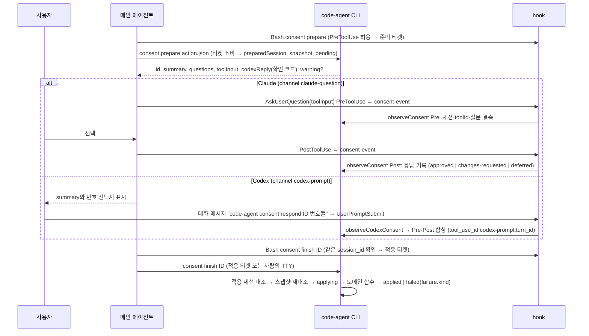
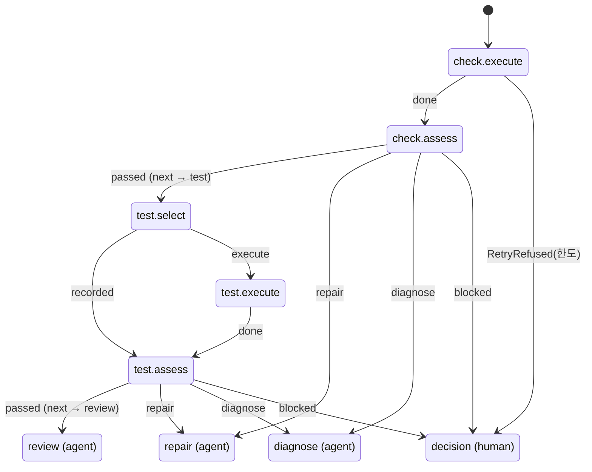

# code-agent 프로세스 흐름도

이 문서는 현재 동작을 정리한 지도다. 기준은 커밋 `c4f3fbf`(2026-10-07)이다. 코드가 정본이므로 문서와 코드가 다르면 코드가 맞고, 이 문서를 고친다.
표의 `file:line`은 위 커밋 기준이다. 다만 계획 오케스트레이션을 다시 쓴 커밋과 그 검토 반영 커밋(§10)이 고친 모듈 — `planning.ts`·`planningState.ts`·`planningHook.ts`·`planningValidation.ts`·`stagedChecks.ts`·`codexHook.ts`·`sessionHook.ts`·`crossCheck.ts`·`handoff.ts` — 의 `file:line`은 검토 반영 커밋 기준이다(`commands.ts` 등 다른 모듈은 위 커밋 기준 그대로다). 교차 검증 무결성 커밋(§10)이 다시 쓴 `review.ts`·`reviewHook.ts`·`crossCheck.ts`와 새 모듈(`crossRecord.ts`·`reviewJudgment.ts`)은 줄 번호 없이 함수 이름으로 인용한다(§6.3). 동의·hook 경계 커밋(§10)이 다시 쓴 `consent.ts`·`hook.ts`·`codexHook.ts`·`cli.ts`(진입점)·`cliMain.ts`(명령)와 새 모듈(`consentTicket.ts`·`consentState.ts`·`answers.ts`·`snapshotCache.ts`·`consentReceipts.ts`·`retryGrant.ts`)도 함수 이름으로 인용한다(§4·§5). 줄 번호가 어긋나면 함께 적은 함수 이름으로 찾는다. 경로의 기준은 `src/agent/`이고, `core/`는 `src/core/`, `template/`·`doc/`는 저장소 루트의 같은 폴더다.
이 문서는 현재 동작만 적는다. 결함으로 판정된 동작과 개선안은 [2026-10-07 감사 기록](reviews/2026-10-07-dual-host-process-audit.md)에 있다.

**읽는 순서(에이전트용)** — §2에서 바뀌는 칸을 찾고, §3에서 그 행을 읽은 뒤, §9로 파일을 연다. 이어서 사람 확인(§4)·hook(§5)·호스트 차이(§7)에 걸리는지 본다. 이 문서에 없는 동작은 추측하지 말고 코드를 연다.

## 1. 목적과 갱신 규칙

**목적**은 세 가지다. 개발 에이전트(Claude·Codex)가 코드를 다시 분석하는 시간을 줄이고, 단계·게이트·hook을 잘못 기억해 생기는 오판과 재시도를 줄이며, 변경이 어느 흐름에 영향을 주는지 먼저 판단하게 하는 것이다.

**근거 수준** — 기본은 코드 판독이다. §5의 등록표와 판정 일부는 2026-10-07에 sandbox에서 직접 확인했다(`init --host both` 설치 결과, `codex-event`·`hook`·`stop`·`session-event`에 이벤트를 넣은 결과). 같은 날 검증 단계에서 `init` 호스트 합집합(§7), 세션 없는 상태의 `hook` 판정(§4.1), `git add -f`의 `.gitignore *` 무시(§8)도 sandbox에서 다시 확인했다. 그 밖에 실제 호스트에서 확인하지 않은 동작은 "미확인"이라고 적는다.

### 1.1 변경 → 갱신 대응표

| 바뀐 코드 | 갱신할 섹션 | 함께 맞출 중복 정의 |
|---|---|---|
| `layout.ts` `PHASES`·`AFTER_IMPLEMENT`·`STOP_PHASES` (20-43) | §2, §3 | `commands.ts` `PHASE_LABEL`·`PHASE_COMMAND`(94-122), `template/claude/skills/ca-next/SKILL.md:14-25` 표 |
| `commands.ts` `start`·`next`·`back`·`requireValidatable`·`abort` | §2, §3, §3.3 | 각 단계 스킬의 "자리 확인" 문장 |
| `request.ts` 접수·확정, `docsCommands.ts`·`bootstrap.ts` 준비 | §3.1, §4 | `ca-request`·`ca-adopt`·`ca-docs` SKILL.md |
| `init.ts` hook 등록(`initClaude`·`initCodex` — Codex PreToolUse 의 `|| exit 2`·`commandWindows`)·`HOOK_MATCHER`(`mcp__.*` 포함)·`CLAUDE_HOOKS`·`CODEX_EVENTS`·`hookInstallProblems`·`requireStartHooks` | §5, §7 | `doctor.ts` hook 목록(같은 `CLAUDE_HOOKS`·`CODEX_EVENTS`를 읽는다), `update.ts` hook 출력, `doc/codex.md` 이벤트 표, `README.md` 동작 구조 표, `doc/install.md`, `doc/usage.md` hook 수 |
| `codexHook.ts` | §4.2, §5.2, §7 | `template/CODEX.block.md`, `template/codex/ca-answer.md` |
| `consent.ts` `ActionSchema`(`CONSENT_ACTIONS`, `judgment` 포함)·`preview`·`applyLocked`·`observeConsent`(검사 순서)·실패 기록(`failure`·`consentGuide`)·`consentStatus`(`failure`·`warning`·Codex 확인 코드)·`SNAPSHOT_EXCLUDED` | §4 | `ca-answer/SKILL.md` 작업 JSON 문단·준비 절차 6항, `ca-answer/reference.md` 필드 표·예시, `template/codex/ca-answer.md` 동작 목록(`consentBinding.test.ts` T-J-3 이 세 곳을 `CONSENT_ACTIONS`와 대조한다) |
| `consentTicket.ts`(준비·적용 티켓)·`consentState.ts`(색인·열린 동의·적용 잠금 확인)·`answers.ts`(업무 답 관찰)·`snapshotCache.ts`·`consentReceipts.ts`·`retryGrant.ts`(사람 허용) | §4, §5.3, §6.4, §8 | 티켓 명령 꼴(`consentCommandOf`)과 `hook.ts` `isModelCommand`의 `consent` 허용 꼴, `cliMain.ts` consent 분기. 업무 답 규칙은 `ca-answer/SKILL.md` 1·3절과 `template/codex/ca-answer.md` 업무 질문 문단. 허용 키 표(`grantTarget`)는 `GRANT_STEP`과 같아야 한다 |
| `cli.ts`(hook 하위 명령 지연 로드·`hookFailureExit`)·`cliMain.ts`(명령) | §5, §6.4 hook 종료 코드 | 새 hook 하위 명령은 `HOOKS`와 `retryPolicy.ts` `hookFailureExit` 표에 함께 더한다 |
| `hook.ts` `decide`(티켓 발급)·`decideTool`·`decideMcp`·`readDenied`·`aliasGuard`·`decideOutside`(열린 동의 창·소스 업데이트·hook 설정)·`decideDocWrite`·`MODEL_SUBCOMMANDS` | §5.3, §5.4 | `template/CLAUDE.block.md`, `decideBash` 거부 문구 |
| `planning.ts`·`planningState.ts`·`planningHook.ts` | §6.1 | `doc/planning.md` 역할·action 표, 단계 스킬 1~6항(advance `action`을 바꾸면 4항), `ca-plan/contract.md:10,16`(질문 출처·수정 피드백), `ca-plan/SKILL.md` 4-1항·반려 절차와 `crossCriticProblems` 문구(고칠 작업은 지적 내용으로 정한다), `ca-next/SKILL.md:31`(재개 때 실행 중 배정 확인 — Codex는 SessionStart가 없다)·`:51`(자동 되감기 예외), `sessionHook.ts`(실행 중 배정 요약), `handoff.ts` `handoffPlanning`(배정 요약의 `previous`) |
| `lock.ts` | §6.1, §8 | 리뷰 기록·동의 적용·작업 임대가 같은 잠금을 쓴다 — 호출자별 `ageReclaim`·`display`·문구 |
| `stagedChecks.ts`, `planningValidation.ts`·`workDocs.ts`의 게이트 함수 | §6.1 관찰 6단계 | 게이트 함수를 바꾸면 계획 담당 완료 hook의 문서 검사도 함께 바뀐다(같은 함수) |
| `verificationFlow.ts`·`validate.ts`·`evidence.ts`, `core/build.ts` `CommandResult`, `tree.ts` `partialTreeHash`, `testResults.ts`·`testReports.ts`, `retryPolicy.ts` 검증 절 | §3.2 check~integrate, §6.2, §6.3 리뷰 회차, §8 | `ca-check/SKILL.md` 노드 처리 목록, `ca-check`·`ca-test`·`ca-integrate`·`ca-implement`·`ca-fix` 재시도 문장과 `ca-review` 5항, `ca-tester.md` 동결 문장, 장시간 실행 정본 문장(`ca-check`·`ca-test`·`ca-integrate`·`ca-implement` 4곳 글자 그대로) |
| `review.ts`·`reviewHook.ts`·`crossCheck.ts`·`crossRecord.ts`·`reviewJudgment.ts` | §3.2 review, §5.1·§5.2 리뷰어 행, §6.3, §7, §8 | `ca-review/SKILL.md` 4-1·4-2·끝, `ca-plan/SKILL.md` 4-1. 리뷰 회차 한도는 `evidence.ts` `reviewRoundUsageOf` 하나다(§6.2·§6.3). 표 규칙(`reviewResultProblems`)은 hook·교차·게이트가 같이 쓴다 — `ca-reviewer.md` 출력 표와 맞춘다. 사람 판단 네 함수(`previewWaiveFinding`·`waiveFinding`·`previewCrossStop`·`recordCrossStop`)는 동의 `judgment`가 부른다(`ca-answer` 세 곳의 목록과 함께 연결) |
| `deliver.ts`·`knowledge.ts` | §3.2 deliver, §8 | `ca-integrate/SKILL.md` |
| `hosts.ts` `codexText`(64-82) | §7 | 치환 대상 문장: `hosts.ts:78-80`의 리터럴이 `ca-analyze`·`ca-impact`·`ca-design`·`ca-plan` SKILL.md와 `ca-analyst`·`ca-explorer`·`ca-writer` 에이전트 원문과 글자 그대로 같아야 치환된다. 교차 명령의 권한 상승 치환(`셸: \`code-agent (review|planning) cross --by claude\``)은 `ca-review`·`ca-plan` 4-1의 `` Bash: `code-agent … cross --by codex` `` 가 `Bash:`·`--by` 치환을 거친 글자에 맞춘다 |
| `crossEnv.ts`(교차 자식 표지·`runtimeHost`), hook 진입점(`runStopHook`·`runSessionHook`·`runReviewHook`·`runPlanningHook`·`codexHook`) | §5, §6.3, §7 | 교차 자식(`CODE_AGENT_CROSS`)에서 통과하는 hook 목록(`CROSS_CHILD_PASS_EVENTS`), 교차 자식의 진행 명령·쓰기 거부(`hook.ts` `crossChildGuard` — 문구 `CROSS_CHILD_DENY`, 읽기 전용 명령 목록 `CROSS_CHILD_READONLY`. C4 작업 임대도 같은 문구를 쓴다) |
| `crossCheck.ts` `crossInvocationArgs` | §6.3 다른 호스트 실행 | `doctor --cross`의 점검 목록(`crossFlags`)은 이 인자에서 만든다 — 따로 맞출 것이 없다 |
| `retryPolicy.ts` `POLICIES`·`LIMITS`·`GRANT_STEP`·`TIMING`·`GUIDE_KEYS`·`GUIDE_VARIANTS`·판정 함수, `lock.ts`, `crossEnv.ts`, `hostText.ts` | §6.4(표는 생성 블록 — `renderRetryPolicyTable()` 출력으로 다시 붙인다), 연결된 판정 지점의 §4·§5·§6.1~§6.3 | §6.4 생성 블록(`docSync.test.ts`가 바이트 대조), 안내 문구 자리표시와 `GUIDE_KEYS`·`GUIDE_VARIANT_KEYS`(`retryPolicy.test.ts`가 대조), `crossFailureText`의 Codex 배너 식(Codex exec 출력 라벨이 바뀌면), `hostText.ts` `SKILL_NAMES`·`ROLE_NAMES`(템플릿 폴더·`hosts.ts` `ROLE_NAMES`와 같아야 한다 — `hostText.test.ts`가 대조) |
| `modelPolicy.ts` `ROLE_POLICY`·`TIER_DEFAULTS`·`CLAUDE_EFFORTS`·`CLAUDE_NO_EFFORT`, `models.ts`, `prices.ts` | §4.1 model 행, §6.3 다른 호스트 실행, §7 모델 기본값 행, §8 `models.json` 행 | `template/claude/agents/ca-*.md` 머리말 `model`·`effort`(`modelPolicy.test.ts`가 대조), `doc/codex.md` 역할별 모델 표(같은 테스트가 대조), `doc/design.md` 모델 문단, `ca-answer/reference.md`·`template/codex/ca-answer.md` 모델 예시, `retryPolicy.ts` `CROSS_PATTERNS.config`·`crossFailureText`(모델·강도 오류 문구, Codex 배너 라벨), `doc/usage.md` 단가표 |
| 상태·산출물 경로(`layout.ts`, `handoff.ts`, `deliveryPaths`) | §8 | `.gitignore` 블록(`init.ts:191-192`), `baselineFiles`(`bootstrap.ts:40-62`) |
| 새 파일·모듈 이동 | §9 | — |
| 스킬·서브에이전트 추가·삭제 | §7, §9 | 설치 수(`README.md` 동작 구조 표, `doc/codex.md` 설치 대상 표, `doc/install.md`, `doc/usage.md:188`), `ca-next/SKILL.md` 표, `init.ts`의 Codex 설치 안내 문구. 서브에이전트는 `hosts.ts` `ROLE_NAMES`(10)·`codexText` 역할 정규식(65)과 `modelPolicy.ts` `AGENTS`·`ROLE_POLICY`도 고치고, 계획·리뷰 담당이면 `init.ts:228-231`·`doctor.ts:181` matcher도 고친다 |

**갱신 절차** — 코드 변경과 같은 커밋에서 해당 행과 `file:line`을 고치고, §10에 한 줄을 남긴다. 확인하지 못한 동작은 쓰지 않거나 "미확인"으로 표시한다.

## 2. 전체 흐름 한 장

둥근 칸(`([ ])`)은 사람의 동의다(§4). 새 작업의 기본 동의는 `setup`(최초 준비 때만), `request`, `plan`, `deliver`다. 상황에 따라 `docs`(공통 문서만 다시 확정할 때, `preparationHint` `request.ts:609`), `repro-log`(fix에서 로컬 재현이 안 될 때), `judgment`(한도 추가·지적 기각·교차 중지), `abort` 등이 더해진다(§4.1).

## 3. 스테이지별 표

**공통 전제** (`commands.ts:516-524`) — `next`는 매번 AI-DLC 미진행, 유효한 커서와 `baseCommit`(`requireWork` 158-171), 공통 문서 확정, 요구 확정(`request.ts:350-378`), 답 없는 질문 0(`requireAnswers` 184-193)을 확인한다. analysis~plan에서는 `planningProblems`와 `planningDocumentProblems`도 본다. 게이트에 걸린 `next`는 `Stop`을 던지고 커서는 그대로 둔다.

### 3.1 커서가 생기기 전

| 단계 | 진입 조건 | 담당 | CLI | 산출 | 넘어가는 조건 |
|---|---|---|---|---|---|
| 준비 | 매니페스트가 없거나, 공통 문서가 미확정이거나, 문서 세션이 열려 있다(`preparationHint` `request.ts:603-612`) | 메인 `/ca-adopt`·`/ca-docs`, 서브 `ca-surveyor`·`ca-writer` | `docs recommend·begin·setup·link·end` 등, `survey`, `manifest check`, 동의 `setup`. 문서 세션의 쓰기 범위는 `docs begin` 때의 매니페스트로 `docs-session.json` `writable`에 고정한다(`doc/` 밖은 `.md`만, `docs link`로 연결한 문서만 더해진다) | `code-agent.json`, POLICY 4종(`doc/*.md`), KNOWLEDGE 빈 뼈대(`doc/knowledge/*`, `docs begin`이 만든다 `docsCommands.ts:151,167-177`), `approvals/docs.jsonl`, 준비 커밋. `approvals/docs.jsonl`은 준비 커밋 대상(`baselineFiles` `bootstrap.ts:45-49`)에 없고 첫 반영 커밋에 들어간다(`deliver.ts:324`) | `request submit`의 매니페스트 검사(`request.ts:417-426,645`), `start`의 `requireDocs`(`commands.ts:276`)와 `requirePreparedBranch`(`bootstrap.ts:75-94`) |
| 접수 | `request begin`(`request.ts:428-489`). 문서 세션 열림·AI-DLC·진행 중 작업(같은 ID 포함)·다른 ID 접수·종류 변경이면 거부한다. ID를 생략하면 진행 중인 접수의 ID를 쓰고, 없으면 작업 폴더·확정 원장이 없는 첫 `WORK-0001` 형식(4자리) ID를 발급한다(437-443) | 메인 `/ca-request`(서브 없음) | `request begin`·`request`·`request submit`, 동의 `request` | `doc/work/<ID>/request.json`(모델), `requirement.md`(코드 렌더 785), `approvals/<slug>/request.jsonl` | `decideRequest`가 보여 준 바이트 해시로 `confirmed`를 기록한다(`request.ts:811-893`) |
| start | 실행 중인 호스트의 hook 설치(`requireStartHooks` — 다른 설치 호스트의 누락·판별 불가는 경고만), 요구 확정, 문서 세션 없음, AI-DLC 없음, 매니페스트 있음, 공통 문서 확정, 다른 ID 접수 없음(`commands.ts:266-295`) | 메인(스킬이 호출) | `start <지시서>` | 브랜치 `<kind>/<ID>`, `baseCommit`(새 브랜치는 기준 끝, 기존 브랜치는 merge-base, 333-341), `questions.md`, 업무 답 시작 행(`writeAnswerBaseline`, §4.3), `active.json`(phase=analysis, planningVersion=1, 354), 접수 세션 삭제(356) | 같은 작업이면 상태만 출력한다. 다른 작업이 진행 중이면 거부한다(297-306). fix는 오류 로그 절이 필요하다(308) |

접수 세션 동안 모델은 `doc/work/<ID>/` 안에만 쓸 수 있고, `requirement.md`는 코드만 쓴다(`hook.ts:307-322`).

### 3.2 커서 단계 (`PHASES` `layout.ts:20-31`)

| 단계 | 담당 (메인 / 서브) | CLI | 산출 | 게이트 (`next`) | 실패 시 |
|---|---|---|---|---|---|
| analysis | `/ca-analyze` / `ca-analyst`(role analysis) | `planning advance` 외, `next` | `01-requirements.md`, `questions.md` | `requireRequirements`: 01 형식과 원문 대조(`commands.ts:531-533`, 196-212) | advance가 `blocked`이면 질문에 답하거나 입력을 고친다. 형식 오류는 `repair`(1회) |
| impact | `/ca-impact` / 기본은 `ca-explorer`(explore)와 `ca-writer`(synthesis). `planning advance`가 impact 작업을 처음 등록할 때 요구 R이 1~3개, 조사 파일이 12개 이하, 합계 96,000바이트 이하면 `ca-explorer` 단독(impact)(`planning.ts:78-85`) | 같음 | `02-analysis.md` | 조사 결과가 current이고 사실 충돌이 없다(`planningState.ts:474-479`). `analysisProblems`(534-538) | 같음. 사실 충돌은 조사를 다시 돌린다 |
| design | `/ca-design` / `ca-analyst`(design) | 같음 | `03-design.md`, `04-functional.md` | `designProblems`와 `functionalProblems`(539-546) | 같음 |
| plan | `/ca-plan` / `ca-analyst`(plan)와 `ca-critic`(critic). 두 호스트 설치 시 `planning cross` | `planning advance·cross`, `plan submit`, 동의 `plan` | `plan.json`, `07-test-spec.md`, `<target>.plan.json`, `05-plan.md`(렌더 1286-1289), 승인 원장 | `reviewedPlanProblems`(critic이 본 plan.json과 제출본이 같다), 계획 존재, 승인 `approved`(547-558) | 반려되면 `ca-plan`의 반려 절차로 원인 작업을 다시 배정하고 재제출한다 |
| implement | `/ca-implement` / `ca-implementer`, 테스트 단계는 `ca-tester`(`handoff.ts:43-44`) | `context --file`, `repro`(fix), `next` | 계획 파일 | 승인 유지, 현재 Task 파일 존재, 같은 단계의 다음 Task로 이동. 단계가 끝나면 `missingPlannedFiles`, fix의 test 단계는 `reproMissing`을 본 뒤 다음 단계나 check로 간다(559-598) | `Stop`이면 빠진 파일을 다시 맡긴다. 승인이 stale이면 재제출·재승인한다 |
| check | `/ca-check` / 수정은 `ca-implementer` | `verify --json [--retry]`(단계만 돌릴 때는 `check`) | `<target>.verify.json`, `08-validation.md`, `.code-agent/log/` | `stageProblems(check)`(`evidence.ts` `stageProblemEntries`) | verify 노드 `repair`·`diagnose`·`decision` — 원인별 카운터(§6.2, 규약 §6.4) |
| test | `/ca-test` / TC 코드가 없을 때 `ca-tester` | `verify --json`(또는 `test`) | 같은 증거, `testCases`, `testFreeze` | `stageProblems(test)`: ⑦의 모든 TC가 `passed` + 동결 뒤 바뀐 kind:test 파일 없음(`testFreezeProblems`) | 같음. 수정 뒤 `verify`로 check부터 다시 |
| review | `/ca-review` / `ca-reviewer` | `review`, `context --file`, 두 호스트면 `review cross --by <다른 호스트>` | `<target>.review.json`(리뷰어 실행·교차 시도는 회차마다 append-only), `09-review.md` | `reviewProblems`(`review.ts`) | 계획 안 지적은 수정 루프 → `verify` → 새 회차(리뷰 회차 3회까지, §6.3) — 같은 회차는 다시 리뷰하지 않는다. 계획 밖 지적은 질문 또는 재계획. 의견이 갈리거나 범위 밖이면 사람 판단(동의 `judgment` `waive-finding`, §6.3 사람 판단) |
| integrate | `/ca-integrate` / 없음 | `integrate` | `integrate` 실행 기록, `integrationTestCases`, `.code-agent/log/worktree.lock`(실행 중) | `stageProblems(integrate)`: 통합 TC 전부 passed, 동결 뒤 바뀐 kind:test 파일 없음, fix면 재현 테스트 트리가 일치 | 수정 루프. prepare 실패·중단은 환경으로 분류하고 같은 회차 재실행 2회, 코드 결함은 같은 코드 재실행 거부(§6.2) |
| deliver | `/ca-integrate` 3절 / 없음 | 동의 `deliver`(사람은 TTY `deliver`) | `10-pr.md` 모델 3절, `knowledge.proposal.md`(선택), 로컬 커밋 | `next`로는 끝나지 않는다(618-623). `deliverProblems`(`deliver.ts:189-232`), 작업 브랜치(401-409), 사람 확인(419) | `Stop`이면 커밋하지 않는다. `back`은 거부한다(`commands.ts:763-768`). 커밋이 실패하면 고른 KNOWLEDGE 갱신을 스테이지에서 내리고 원래 내용으로 되돌린다(`restoreKnowledge`). 커밋 중 계획 파일이 바뀌면(pre-commit hook 등) 결과에 경고한다(되돌리지 않는다). ⑩ 검증 절·커밋 메시지에 교차 검증·사람 판단 줄이 붙는다(§6.3) |

**hook의 쓰기 범위** (`decideWrite` `hook.ts:444-540`, 작업 커서가 있을 때) — 지시서·`05-plan.md`·`08-validation.md`는 언제나 거부한다(447-471). 관찰 흐름의 계획 출력 문서는 메인 쓰기를 거부한다(474). 그 밖의 작업 폴더는 어느 단계에서든 허용한다(475-477). refactor는 추적 중인 기존 테스트 파일을 거부한다(481-490). analysis~plan에서는 작업 폴더 밖을 거부한다(492-497). implement부터는 제출된 계획과 `approved` 승인이 있어야 하고(498-508), implement에서 계획에 tasks가 있으면 현재 Task 파일만 허용한다(509). implement와 그 뒤 단계 모두 파일이 속한 단계 판정(512-521), fix의 재현 순서(548-568), 쓰기 한도(`writeBlockReason` — 고쳐도 다음 회차가 거부될 때만)·테스트 동결(결과가 인식된 실행부터, 수집 수정 1회 예외)(`freezeReason`, §6.2), 경계·계획 대조(532-538)를 적용한다.

### 3.3 커서 이동

| 명령 | 방향 | 조건 | `stages.jsonl`의 `by` |
|---|---|---|---|
| `next` | 한 칸 앞. implement 안에서는 Task·단계 단위로 움직인다 | §3.2 게이트 | `next` |
| `back <단계>` | 뒤로만. `deliver`는 대상이 아니고, deliver에서는 실행 자체를 거부한다 | `commands.ts:758-789`. hook은 모델의 `back`을 허용한다(`hook.ts:94`). "사용자 지시 시에만"은 스킬 규칙이다 — 예외는 계획 `planning advance`의 `rewind-required`·`rewind.auto: true`(같은 사유에 한 번, §6.1)다 | `back` |
| `check`·`verify`(check 진입) | test·review·integrate에서 check로 되감는다 | `REWINDABLE`(633), `requireValidatable`(655-658) | `next`(656) |
| 동의 `deliver` | 커서 삭제 | 커밋 성공(`deliver.ts:424-425`) | `deliver` |
| 동의 `abort` | 커서 삭제, 작업이 없으면 접수 세션 삭제 | `commands.ts:708-722`. 문서·원장·계획은 남는다 | `abort` |

## 4. 사람 확인 지점

### 4.1 동의 동작 (`consent.ts` `ActionSchema`·`CONSENT_ACTIONS`, 제목은 `consentState.ts` `CONSENT_TITLES`)

| action | 제목 | 준비(`preview`) | 적용(`applyLocked`) | 사람의 직접 CLI 대체 |
|---|---|---|---|---|
| setup | 초기 설정 확정 | `confirmDoc(all)`과 `setupBaseline`의 확인 문구 | 둘을 차례로 실행 | `confirm doc all` + `setup baseline` |
| docs | 공통 문서 확정 | `confirmDoc(kind)` | 같음 | `confirm doc <종류>` |
| baseline | 기준 커밋 생성 | `setupBaseline` | 같음 | `setup baseline` |
| request | 요구사항 확인 | `decideRequest`(reject면 comment 필수) | 같음 | `confirm request <ID>` · `reject request <ID> --comment` |
| plan | 작업 계획 확인 | `decide` | 같음 | `approve` · `reject --comment` |
| deliver | 결과와 로컬 커밋 확인 | `deliver`를 두 번 캡처하고 `knowledgeChoices`를 만든다 | `deliver` | `deliver` |
| knowledge-prune | 지식 문서 정리 | `pruneCandidates` | `knowledgePrune` | `knowledge prune` |
| model | 에이전트 모델 변경 | `validateModelChange` + 표. 스냅샷에 `모델 정책` 상태(`modelPolicyFingerprint` — 등급·기본값·강도 미지원 규칙)를 묶어, 준비 뒤 CLI 의 정책이 바뀌면 `consent-target-changed`로 거부된다. 지문은 그 시점에 도는 CLI가 계산하므로 셸의 code-agent와 hook 명령이 다른 빌드여도 거부되며, 거부 문구에 두 설치본을 확인하라는 안내가 붙는다(`requireConsentSnapshot`) | `setModel` | `model <역할\|all> <모델\|default> [--reasoning\|--effort 강도]` |
| abort | 작업 진행 종료 | `status` | `abort` | `abort` |
| plugin-add · plugin-remove | 플러그인 등록·제거 | `previewPlugin*` | `pluginAdd` · `pluginRemove` | `plugin add` · `plugin remove` |
| update | code-agent 업데이트 | `previewSourceUpdate` | `updateFromSource` | `update`(`updateFromSourceConfirmed` — 미리보기를 보이고 TTY `update` 입력) |
| repro-log | 오류 로그 근거로 수정 진행 | `approveLogBasis` | 같음 | 없음 |
| judgment | 사람 판단 기록 | 공통 검증(`kind` ∈ retry-grant·waive-finding·cross-stop, `comment` 필수·500자, waive-finding 의 `id`, cross-stop 의 `name` ∈ review·planning) 뒤 `budgetReport`(`retryGrant.ts`)·`previewWaiveFinding`·`previewCrossStop`(`reviewJudgment.ts`) | `grantRetry`·`waiveFinding`·`recordCrossStop` — 각 함수가 소유 기록의 잠금 안에서 소진·지적·지점 전제를 다시 본다 | 없음 |

- 직접 CLI의 사람 확인은 명령마다 다르다. `confirm doc`·`confirm request`·`reject request`·`approve`·`reject`·`setup baseline`·`deliver`·`plugin add`와 소스 `update`(`updateFromSourceConfirmed` — 미리보기 뒤 `update`, `--templates-only`는 제외)는 `confirmOnTerminal`(`tty.ts:76-90`)이 TTY에서 확인 단어 입력을 요구한다. `model` 변경·`plugin remove`·`knowledge prune`은 TTY만 요구한다(`requireTerminal` `tty.ts:55-63`, `models.ts` `setModel`, `plugins/commands.ts:422`, `knowledgeCommands.ts:217`). `abort`(`commands.ts:708-722`)에서는 TTY 확인 호출을 찾지 못했다. `judgment`는 직접 CLI 대체가 없다(`repro-log`와 같다).
- 동의 적용 중에는 준비 때 캡처한 문구와 같은 확인만 통과한다(`applyLocked`의 `withInteraction` 어댑터 — 첫 확인 전 불일치는 대상 변경, 앞선 확인 뒤 불일치는 적용 실패로 기록, §4.2).
- 작업·접수·문서 세션 중에 모델이 셸에서 이 동작들을 직접 부르면 hook이 거부한다(§5.4). 세션이 없으면 hook은 `.code-agent`·키 자리·hook 설정 파일 언급과 소스 `code-agent update`(`--templates-only` 제외)를 막고, 응답·적용을 기다리는 동의가 있으면 30분 동안 셸을 code-agent 명령과 읽기용 git 으로 좁힌다(§5.3 3단계). 그 밖의 `init`·`approve`·`setup baseline` 같은 명령은 hook을 지나 위의 TTY 확인과 각 명령의 전제 검사만 남는다.

### 4.2 응답 관찰 — 호스트별

**결속 규칙** (`consent.ts` `observeConsent`·`applyLocked`·`consentCommandGuard`, `consentTicket.ts`, `hook.ts` `decide`)
- **준비 티켓** — hook 이 `code-agent consent prepare …`(셸 연결자·리디렉션·치환 없는 정확한 꼴, 인자 글자와 무관)를 허용하면 그 세션을 `.code-agent/consents/tickets/prepare.json`(저장소당 하나, 가장 최근 것만)에 적는다(`issueTicket`, 루트는 `findRepoRoot` — 하위 폴더 세션도 저장소 루트). CLI `consent prepare`는 15분(`TIMING.consentTicketTtlMs`) 안의 티켓을 rename 으로 가로채 소비해야 준비하고, 기록에 `preparedSession`(세션·호스트)과 `format: 2`·`workId`를 남긴다(`PREPARE_UNOBSERVED`). 두 세션이 동시에 준비하면 결속이 어긋나 거부된다(fail-closed). 프로세스 안에서 `binding` 없이 부른 준비(테스트 fixture)와 이전 기록은 `preparedSession`이 없어 이전 규칙(첫 Pre 가 세션을 정함)을 따른다.
- **적용 티켓** — hook 이 `code-agent consent apply|finish <UUID>`를 허용하면 `apply-<UUID>.json` 티켓을 낸다. CLI 적용은 그 티켓이나 호스트 표지(`CLAUDECODE`·`CODEX_MARKERS`)가 없는 TTY(`terminalCaller`)가 있어야 하고(`APPLY_UNOBSERVED`), 준비 세션이 있는 동의는 응답을 관찰한 세션의 티켓이나 TTY만 받는다(스냅샷 대조보다 먼저 — 남의 시도가 동의를 폐기하지 못한다). `consentCommandGuard`는 `sessionId ?? preparedSession.id`와 셸 세션을 대조한다.
- `observeConsent` 잠금 안의 검사 순서: 채널 → 상태(`pending`) → 준비 세션(세션·채널) → 세션 → 작업 경로 → 스냅샷. 앞의 다섯 거부는 기록을 폐기하지 않는다. 서브에이전트(`agent_id`)의 질문은 거부한다.
- 첫 Pre가 `sessionId`·`channel`·`cwd`를 정한다. Pre의 질문은 준비된 질문과 deep-equal이어야 한다.
- Post는 결속된 toolId 하나만 한 번 소비한다. 시간 초과·추가 질문·메모가 붙은 응답은 승인으로 보지 않는다.
- 적용은 스냅샷을 한 번 재대조한다(플러그인 동작만 설명 대조 뒤 한 번 더 — `pluginPreview`). 중단된 `applying`은 `failed`로 처리하고 다시 실행하지 않는다.
- Codex 응답 형식은 `^code-agent consent respond <36자 id> [1-3](,[1-3]){0,3}( <확인 코드 6자>)?$`다(`observeCodexConsent`). 새 기록(`format: 2`)은 `codexReply` 마지막 질문 끝의 확인 코드(지금 질문 묶음 해시 앞 6자, `codexReplyCode`)를 요구한다 — 없거나 다르면 UserPromptSubmit 이 막고 사유를 보인다. 이전 형식 기록은 코드 없이 받는다. 이벤트에 `turn_id`가 있어야 하고, 질문 수와 선택 수가 같아야 한다. Claude `toolInput`은 바뀌지 않는다.
- 동의 잠금 `consents/apply.lock`은 공통 `acquireLock`(나이 회수 없음 — 같은 PC 의 죽은 pid 만 회수, 살아 있는 주인은 CLI 2초·hook 10초 대기)이다. 잠금을 살아 있는 프로세스가 쥔 동안 hook 은 모든 모드의 쓰기 도구를 거부한다(`consentLockHeld`).
- 세션 밖에서 응답·적용을 기다리는 동의(색인 `consents/index.json`의 `open`, 30분 `TIMING.consentOpenWindowMs`)가 있으면 셸을 code-agent 명령과 읽기용 git 으로 좁힌다. 유효기간으로 동의를 무효화하지는 않는다(스냅샷·세션 결속이 대신한다).
- 동의 스냅샷에서 `consents/`·`log/`·`lease.json*`(`SNAPSHOT_EXCLUDED`)을 뺀다 — 응답을 기다리는 동안 hook·CLI 가 쓰는 자체 기록이 열린 동의를 깨지 않는다. 업무 답 기록(`work/<ID>/answers.jsonl`)은 남긴다(§4.3). 제어 경로 **아래**의 링크는 따라가지 않고 `link:<대상>`으로 해시하고(Git 이 그 아래 파일을 나열해도 링크 하나로), 제어 루트·제어 파일·문서 경로 자체나 조상이 링크면 거부한다. 파일 내용 해시는 (size·mtime·ctime·ino) 캐시(`snapshot-cache.json`, 2초 안 변경·ctime 0 은 캐시하지 않는다)로 재사용한다 — 값은 캐시 없이 구한 것과 같다.

**실패 기록** — 대상 변경·응답 거부·적용 실패는 `ConsentRecord.failure{class, kind, at, detail}`로 남고(`status` 값은 늘지 않는다), 출력 `failure.guide`(`consentGuide`)는 갈래마다 다르다. 같은 동의로 다시 묻거나 적용하지 않는다. 같은 동작의 최근 종료 기록 둘이 모두 대상 변경이면 다음 준비 결과에 `warning`(외부 hook·편집기·빌드 확인)을 붙인다 — 준비를 막지 않는다.

| kind | class | 상태 | 언제 | 안내 |
|---|---|---|---|---|
| `target` | consent-target-changed | failed | 응답 관찰·적용 때 스냅샷 불일치, 플러그인 설명 변경, 적용 때 **첫 확인 전** 확인 화면 불일치(업그레이드로 화면이 바뀐 경우) | 바뀐 것을 알리고 새로 준비 |
| `response-change` | consent-target-changed | changes-requested | `수정 요청` | 고칠 내용을 업무 질문으로 받아 고친 뒤 새로 준비 |
| `response-defer` | consent-target-changed | deferred | `보류` | 멈추고 다시 묻지 않는다 |
| `response-none` | consent-target-changed | failed | 명시적 선택 없음(시간 초과·추가 질문·메모), 일부 미응답 | 미응답으로 두고 다시 묻지 않는다 |
| `response-invalid` | consent-target-changed | failed | 질문 불일치, 선택지 밖 응답 | CLI 질문 그대로 새로 준비 |
| `apply` | consent-apply-failed | failed | `applying` 잔존, 앞선 확인을 하나 이상 통과한 뒤의 화면 불일치, 도메인 함수 실패 | 상태 확인 뒤 새로 준비 |

### 4.3 업무 질문 답 관찰 (`answers.ts`)

- Claude 의 업무 `AskUserQuestion`(동의 질문이 아닌 것)을 `consent-event` hook 이 `.code-agent/work/<ID>/answers.jsonl`(반영 커밋에 들어간다)에 기록한다 — Pre 는 `ask` 행, Post 는 같은 세션·호출·질문의 `ask`가 있고 미리 채운 답이 아닐 때만 `answer` 행. 서브에이전트 질문·작업 없는 질문은 기록하지 않는다. 관찰 실패는 질문을 막지 않는다(stderr). `start`가 시작 행(`writeAnswerBaseline`)을 쓴다.
- 판정(`answerSources`, 답이 있는 질문만): 시작 행이 없으면 `legacy`(이전 작업) → 시작 행의 접수 답(확정 지시서의 "접수 때 정한 것" `- A:` 값과 같았던 답)이면 `intake` → 관찰된 응답과 첫 줄(선택지 글자면 그 문장도, NFC·공백·끝의 `(추천)`·따옴표 정규화)이 같으면 `observed` → `[Answer]:` **뒤**의 마지막 `[Source]:` 줄이 `대화`로 시작하면 `conversation` → 그 밖은 `unverified`.
- `unverified`는 답이 없는 것과 같이 막는다: `next`·`plan submit`·승인(`requireAnswers`), Stop hook(`(답 출처 미확인)`), 반영(`deliverProblems`), `status` 다음 줄, 계획 배정의 관련 질문(`readyProblems`).
- 계획 승인·반영 확인 화면에 답 출처 절(`formatAnswerSources` — 출처별 수와 `대화` 답의 이름·답)을 싣는다. 판정 입력(`questions.md`·`answers.jsonl`·확정 지시서)은 모두 동의 스냅샷 안이라, 동의를 준비한 뒤 업무 질문을 하면 그 동의는 대상 변경으로 폐기된다.
- Codex 는 업무 답을 관찰하지 않는다(사용자 메시지 원문도 기록하지 않는다) — Codex 에서 받은 답은 모두 `[Source]: 대화`로 적어 화면에 드러난다.

## 5. hook 등록표

### 5.1 Claude — `.claude/settings.json` (`init.ts:223-233`, sandbox 확인)

| 이벤트 | matcher | 하위 명령 | 처리 | 판정·기록 | 실패 시 |
|---|---|---|---|---|---|
| PreToolUse | `Write\|Edit\|MultiEdit\|NotebookEdit\|Bash\|PowerShell\|Read\|Grep\|Glob\|mcp__.*` | `hook` | `runHook`→`decide` | deny JSON. 허용한 동의 준비·적용 명령은 티켓을 낸다(§4.2) | 예외면 exit 2로 막는다 |
| PreToolUse | `AskUserQuestion` | `consent-event` | `runConsentHook` — 동의 질문은 `observeConsent` Pre, 업무 질문은 `observeAnswerEvent`(§4.3) | 질문 결속 / 업무 질문 기록 | 동의 질문은 exit 2, 업무 질문 관찰 실패는 stderr 만 남기고 0 |
| PostToolUse | `AskUserQuestion` | `consent-event` | 같은 분기 — `observeConsent` Post / `observeAnswerEvent` | 응답 기록 | 같음 |
| Stop | 없음 | `stop` | `decideStop`(`stopHook.ts:22-54`) | implement~integrate에서 계획 밖 변경이나 미응답 질문이 있으면 `{decision:block}`을 1회 낸다 | 언제나 exit 0(57-69) |
| SubagentStart·Stop | `ca-reviewer` | `review-event` | `observeReviewer`(`reviewHook.ts`) | review 단계가 아니면 아무것도 하지 않는다. 회차마다 append-only 실행 기록 — Start: 완료된 회차는 무시 기록(`completed-round`), 받아들인 실행이 끝나지 않았으면 동시 호출로 무시(15분 넘으면 고아로 보고 새 실행), 같은 agent 의 끝난 실행 재개는 새 실행, 호출 한도(회차당 2) 초과는 무시. Stop: 표 규칙(`reviewResultProblems`) 검사 후 `## 지적` 재작성 — 걸리면 한 번 되돌림 → 기록(§6.3) | `subagentExit`(`runReviewHook`): SubagentStop에서 기록 전의 되돌림은 `stop_hook_active`가 아니면 2, 기록된 실패(무시된 실행 포함)·`stop_hook_active`면 0. Start 실패는 2 |
| SubagentStart·Stop | `ca-analyst\|ca-explorer\|ca-writer\|ca-critic` | `planning-event` | `observePlanner`(`planningHook.ts:335-357`) | §6.1 | `subagentExit`(§6.4, `runPlanningHook` 358-366): SubagentStop에서 기록 전의 되돌릴 수 있는 실패(형식·식별·내용)와 기록하지 못한 판정 실패는 `stop_hook_active`가 아니면 2, 기록된 실패·`stop_hook_active`면 0. Start 실패는 2 |
| SessionStart | 없음 | `session-event` | `sessionAnchor`(`sessionHook.ts:18-22`, `progress` 51-78) | 작업 4줄·접수 3줄·문서 세션 2줄의 상태를 stdout에 낸다. 설치 호스트의 hook 이 빠졌으면 진행 상태와 무관하게 경고 한 줄을 붙인다(`hookInstallWarning`). 계획 배정이 running으로 기록돼 있으면 그 목록과 안내 한 줄을 더한다(`runningPlanning` 28-49 — 입력 `source`가 startup·resume·clear면 `planning cancel <ID>` 뒤 advance, 그 밖은 advance의 stale·cancel 안내). AI-DLC 경고가 있으면 1줄을 더한다(20). 진행 중인 것이 없으면 출력 없음 | 언제나 exit 0 |

hook 하위 명령은 진입점 `cli.ts`가 그 hook 의 모듈만 지연 로드한다(`HOOKS`). 모듈 로드·stdin 읽기 실패는 `hookFailureExit(hookFailureInput(...))` 표로 끝낸다 — `hook`과 동의 질문(`metadata.source`가 `code-agent:`, 또는 stdin 을 못 읽음)은 exit 2, 업무 질문·Stop·SessionStart·SubagentStop 은 0, SubagentStart 는 2. Claude 설정에는 셸 `|| exit 2` 래핑을 하지 않는다(Windows PowerShell 5.1 에서 `||`가 구문 오류라 hook 이 매번 비차단 실패가 된다) — 설정 누락·hook 미실행은 SessionStart·`status`·시작 게이트(`requireStartHooks`)·doctor 가 드러낸다.

교차 실행이 띄운 자식(환경 `CODE_AGENT_CROSS`)에서는 `stop`·`session-event`·`review-event`·`planning-event`가 아무것도 하지 않고 0을 낸다(`crossEnv.ts` `crossChild`). `hook`(PreToolUse)은 진행 명령·쓰기를 먼저 거부하고(§5.3 0단계) 그 밖은 그대로 판정한다. `consent-event` 판정은 그대로다.

### 5.2 Codex — `.codex/hooks.json` (`init.ts:186-189`, sandbox 확인)

다섯 이벤트가 matcher 없이 모두 `code-agent codex-event` → `runCodexHook` → `codexHook`로 들어간다. PreToolUse 항목만 비Windows 명령을 `<명령> codex-event || exit 2`로 감싸고(프로세스가 판정 전에 죽으면 막는다), Windows 용 `commandWindows`는 래핑하지 않는다(실행 셸 미확인). 나머지 넷은 래핑하지 않는다 — UserPromptSubmit 을 감싸면 설치가 깨졌을 때 사용자가 아무 말도 못 한다.

| 이벤트 | 처리 | 실패 시 |
|---|---|---|
| PreToolUse | `Bash`·`PowerShell`·`apply_patch`와 `mcp__*`(MCP 도구 — Claude 와 같은 `decideMcp`)만 판정한다. 그 밖의 도구는 `{}`를 내고, 작업·접수·문서 세션 중이면 이름을 `.code-agent/log/codex-tools.json`에 센다(`noteUnknownCodexTool` — doctor 가 "Codex 미판정 도구"로 알린다). `apply_patch`는 `patchPaths`의 모든 경로를 `Edit`로 `decide`에 넘긴다. 셸은 Windows면 `shell: powershell` 규칙으로 판정한다. `host: "codex"`를 넘기고(티켓의 호스트), `agent_id`는 넘기지 않는다 | deny JSON. 입력을 읽지 못해도 deny JSON(`hookFailureExit`) |
| UserPromptSubmit | `observeCodexConsent`. `code-agent consent respond`로 시작하지 않는 메시지는 무시하고 아무것도 쓰지 않는다(업무 답은 관찰하지 않는다 — `[Source]: 대화`, §4.3) | 동의 응답의 예외만 stderr와 exit 2(Codex 가 메시지를 막고 사유를 보인다). 그 밖의 메시지 판정 실패는 `{}`·exit 0(작업 경로가 없는 이벤트 포함) |
| SubagentStart·Stop | `commonAgentName`(`ca_x`→`ca-x`)으로 바꾼 뒤 transcript 없이 `observePlanner`(`host: "codex"` — 되돌리지 않고 바로 기록)와 `observeReviewer`(`host: "codex"` — 표 규칙 위반은 되돌리지 않고 바로 형식 오류로 기록)에 넘긴다. 결과는 `last_assistant_message`만 본다. 관찰 대상이 아니면 `{}`·exit 0(진행 중 작업 없는 SubagentStop으로 sandbox 확인) | 예외면 기록 여부와 관계없이 stderr에 사유를 남기고 `{}`·exit 0(`subagentExit` codex, `runCodexHook`) — Codex는 exit 2로 담당을 잇지 않는다 |
| Stop | `decideStop` → `{decision:"block"}`(93-95) | `{}`, exit 0(123-127) |

교차 실행이 띄운 Codex 자식(`CODE_AGENT_CROSS`)에서는 Stop·SubagentStart·SubagentStop·UserPromptSubmit·SessionStart가 `{}`로 통과한다(`CROSS_CHILD_PASS_EVENTS`). PreToolUse는 `decide`를 거치므로 Claude와 같이 진행 명령·`apply_patch`를 거부하고(§5.3 0단계) 그 밖은 그대로 판정한다.

### 5.3 PreToolUse 판정 순서 (`decide`, `hook.ts:178-223`)

0. 교차 실행 자식(`CODE_AGENT_CROSS`)이면 쓰기 도구와, 읽기 전용 목록(`read <파일>`·`status`·`survey`·`planning status`·`help`, 인자 없는 `code-agent` — 연결·리다이렉트·치환 문자 없이) 밖의 `code-agent` 명령을 `CROSS_CHILD_DENY`로 거부한다(`crossChildGuard`). 작업 임대를 읽거나 쓰지 않는다. 다른 호스트의 읽기 전용 실행(Claude `--allowedTools Read,Grep,Glob`, Codex `-s read-only`)과 별개다.
   - `mcp__*` 도구는 상태를 읽기 전에 `decideMcp`로 간다 — 경로 키(`path`·`file_path`·`uri` 등, 한 단계 아래 객체까지)의 값을 도구 이름 동사(write·edit·create·…)에 따라 `Write`·`Read` 입력으로 이 판정 전체를 다시 탄다. 로컬 파일 서버(`fs`·`filesystem`·`files`·`file-system`·`local-file(s)`)는 모든 경로를, 그 밖의 서버는 저장소·키 저장소 안을 가리키는 절대 경로·`file://`만 판정한다. 경로 인자가 없는 도구는 판정하지 않는다.
   - 쓰기 도구는 모든 모드에서 먼저 동의 적용 잠금(`consentLockHeld`)과 Windows 이름 끝 점·공백(`aliasGuard`)을 본다. 로컬 관리 공유·장치 경로(`\\localhost\C$\…`·`\\?\UNC\…`·`\\.\C:`)는 드라이브 경로로 접어 판정한다(`foldWindowsAlias`).
   - 판정이 허용이고 셸 명령이 정확한 꼴의 동의 준비·적용이면 티켓을 낸다(`decide` — §4.2).
1. 셸 명령 검사(182-184): 관찰 명령(`consent-event`·`planning-event`·`review-event`·`codex-event`)을 부르면 거부한다. `consent apply·finish`는 세션 결속을 확인한다.
2. 모드 결정(186-198): 작업 > 문서 세션 > 접수 세션 > 없음. 상태를 읽지 못하면 `decideUnreadable`(230-244).
3. 모드가 없으면 `decideOutside`: 셸은 키 자리 언급, 응답·적용을 기다리는 동의가 있을 때 code-agent 명령·읽기용 git 밖의 명령(30분, `openConsent`), `.code-agent` 경로, hook 설정 파일(`.claude/settings(.local).json`·`.codex/hooks.json`·`.codex/config.toml` — `HOST_CONFIG`), 소스 `code-agent update`(`--templates-only` 제외)를 거부한다. 읽기는 키 자리만(`readDenied`), 쓰기는 키 자리·`:` 경로·`.code-agent`·`.claude`·`.codex`·`.agents`·`doc/work/*/requirement.md`만 거부한다. 저장소 밖 쓰기는 관여하지 않는다. `rm -rf .claude` 같은 폴더 단위 명령은 막지 않는다(시작 게이트·SessionStart·doctor 가 드러낸다).
4. 셸이면 `decideBash`(387-421): 키 자리 언급과 AI-DLC 실행 언급을 먼저 거부한다(388-394). 연결·리다이렉트·줄바꿈·`$(`(56)를 거부하고, PowerShell이면 작은따옴표 밖의 `(){}@$`와 큰따옴표 안의 `$`도 거부한다(62-71). 모델 명령(§5.4), 선언된 build·test·commands(문서·접수 세션 제외), 읽기 전용 git(`status·diff·log·show`, 목록 보기 `git branch`, `-o`·`--output`·`--no-index` 제외)만 허용한다.
5. 읽기 도구는 키 자리(`~/.code-agent/credentials.json`)만 막는다(`readDenied` — 상태 읽기 실패 모드도 같다). Grep 의 `glob`·Glob 의 `pattern` 정적 접두(첫 와일드카드 구성요소 앞)와 키 파일 이름도 보고, 검색(Grep·Glob)은 키 저장소의 상위 폴더 자체도 거부한다.
6. 쓰기는 `guardRepo`·`streamGuard`를 거친 뒤 모드별로 판정한다: 작업은 `decidePlanner`(staging) → `decideWrite`, 접수는 `decideRequestWrite`, 문서 세션은 `decideDocWrite`(`doc/`·`code-agent.json`과, `docs-session.json` `writable` 안의 `.md`만 — 범위가 없는 이전 형식 세션은 지금 매니페스트로 계산하되 `.md`만).

### 5.4 모델이 셸로 부를 수 있는 `code-agent` 명령 (세션·작업 중)

- 허용(`hook.ts:89-129`, 접두어 일치)
  - `start`·`next`·`back`·`context`·`read`·`status`·`plan submit`·`planning prepare·advance·status·result·dispatch·repair·cancel·cross`·`docs *`·`survey`·`manifest check`·`request *`
  - `plugin list`·`repro`·`check`·`test`·`verify`·`review *`·`integrate`
  - `consent prepare <파일>`·`consent status·apply·finish <id>`, `model`·`model --host <호스트>`(조회만), `setup`(조회만), `help`, 인자 없는 `code-agent`
- 그 밖은 모두 거부한다. 그중 `abort`·`approve`·`reject`·`confirm`·`model` 변경·`deliver`·`plugin add·remove`·`update`·`knowledge prune`·`setup baseline`은 §4.1 동의로 실행한다. `init`·`usage`·`doctor`·`knowledge`(목록)·`plugin example`은 동의 동작이 없고 사람이 직접 실행한다.

## 6. 오케스트레이션

### 6.1 계획 작업 (analysis·impact·design·plan, `planningVersion=1`)

| 역할 | 단계 | 담당(Claude / Codex) | 출력 | 선행(dependsOn) |
|---|---|---|---|---|
| analysis | analysis | `ca-analyst` / `ca_analyst` | `01-requirements.md` | 없음 |
| explore | impact | `ca-explorer` | 없음(facts만) | analysis |
| impact | impact | `ca-explorer` | `02-analysis.md` | analysis |
| synthesis | impact | `ca-writer` | `02-analysis.md` | explore 전체 |
| design | design | `ca-analyst` | `03-design.md`·`04-functional.md` | impact 또는 synthesis |
| plan | plan | `ca-analyst` | `plan.json`·`07-test-spec.md` | design |
| critic | plan | `ca-critic` | 없음 | plan |

근거: 단계 매핑 `ROLE_PHASE` `planningState.ts:31`(`planning.ts:21`이 `PHASE`로 재수출), 담당 `planningState.ts:16`(Codex 이름은 `hosts.ts:11`), 출력 `planningState.ts:439-442`, 선행 `planning.ts:68-71`.

**배정 — `planning advance`** (`advancePlanning` `planning.ts:405-480`)
1. 계획 단계가 아니면 거부한다. 잠금 밖에서 모든 작업의 current 판정을 한 번 돌려 메모를 채운 뒤(411), 전체 처리를 `<target>.planning.json.lock` 잠금 안에서 한다(`mutatePlanning` 48-64). 잠금은 공통 `acquireLock`(`lock.ts`, `ageReclaim`)이다 — 주인 `{pid, host, at, nonce}`를 적고, 같은 PC의 죽은 주인과 주인 기록 없는 오래된 잠금은 같은 호출에서 회수한다(stderr 한 줄). 살아 있는 주인은 CLI 2초·hook 10초(`TIMING`) 기다린 뒤 "같은 명령을 한 번만 다시 실행" Stop, 다른 PC·주인 불명은 곧바로 사람에게 넘기는 Stop이다(문구에 잠금의 저장소 상대 경로). 잠금 안에서 처음 쓸 때 `retry.since`를 기록한다(58).
2. 이 단계의 기본 작업 중 빠진 것만 등록한다(`defaults` 73-97, `prepareState` 102-141). 새로 만드는 analysis·design 작업은 존재하는 업무 규칙 KNOWLEDGE(`businessRuleFiles` `planningState.ts:500-511`)를 inputs에 넣는다. 이미 있는 작업은 그대로다.
3. 고아 정리(`sweepOrphans` 163-175) — 마지막 시도가 running인 모든 작업을 `orphanState`(§6.4, 관찰 정보는 `runView` `planningState.ts:366-388`)로 판정한다. 연결된 담당이 모두 끝났는데 running이면 확실한 고아라 `orphaned`(`failure.class: dispatch-orphan`)로 표시하고 같은 호출에서 다시 배정한다. 시작이 관찰되지 않은 채(배정 시각과 그 뒤 관찰된 마지막 담당 시작·종료 중 늦은 시각부터) 또는 시작이 관찰된 채 기한이 지나면 의심 고아(`stale`)다. 이 정리는 동시 한도보다 먼저다.
4. 되감기 판정(`rewindOf` 349-374) — 앞 단계 작업 중 current가 아닌 것이 있으면 메모를 모두 버리고 다시 계산해 확정한 뒤, 배정 없이 `rewind`를 낸다. `phase`는 가장 앞 단계, `command`는 `code-agent back <단계>`, `tasks[].staleBecause`는 `staleCauses`(`planningState.ts:398-434`)의 항목별 이유(입력 파일·질문과 출처·선행 결과·기준 커밋·code-agent.json·호스트 지침·출력 문서)다. 같은 사유 키(단계 + 작업별 낡은 원인)의 첫 회만 `auto:true`이고 `retry.rewinds`(최근 20개)에 남긴다. analysis까지 되감거나 원인이 기준 커밋·code-agent.json·호스트 지침이면 `notice`를 붙인다.
5. 이 단계 작업마다 다음 순서로 판정한다(429-468).
   - 현재 결과가 유효하면(`taskCurrent`, `planningState.ts:330-337`) `reused`.
   - 실행 중이면 3의 판정대로 `stale`(의심 고아) 또는 `waiting`.
   - 같은 입력으로 failed면 `blocked` — `class`는 시도의 `failure.class`(같은 입력 실패 한도를 다 썼으면 `same-input-repeat`, 이때 `reasons` 둘째 줄도 재배정 안내 대신 그 한도 안내다), `counter`는 `sameInput`.
   - 마지막 두 시도가 모두 출처(transcript) 확인 실패로 고아(`failure.kind: source`)면 `blocked`(`class: hook-failure`) — 담당이 고칠 수 없는 hook·환경 원인이라 자동으로 다시 배정하지 않는다. 명시 `planning dispatch`는 받는다.
   - 동시 실행 한도(기본 3, 최대 4)에 닿았으면 `blocked`(`class: precondition`).
   - 교정 대기면 `repairState`(310-332), 그 밖은 `dispatchState`(251-276)로 배정한다. 직전 시도가 `orphaned`·`failed`면 새 배정에 `previous`(`previousOf` 281-285 — 상태·원인·사유)를 싣는다. 완료 hook이 기록한 실패는 Claude에서 exit 0이라 메인에게 보이지 않기 때문이다. 한도 거부(`RetryRefused`)는 그 `class`·`counter`로, 그 밖의 `Stop`은 `precondition`으로 `blocked`에 싣는다.
6. `dispatchState`는 선행 결과가 current이고 차단 지적·관련 미결 질문이 없으며 입력 파일이 있어야 배정한다(`readyProblems` `planningState.ts:338-351`). synthesis는 조사 사실 충돌도 없어야 한다(256). 실행 중인 자기 작업은 동시 한도 대신 실행 중·stale 문구로 거부한다(261-265). 한도는 `planningDispatchDecision`(§6.4)이 판정한다 — 같은 `inputHash`의 failed(`sameInput`, 취소·고아는 세지 않는다)와 `retry.since` 이후의 작업별 배정(`taskTotal`, 취소·고아 포함). 사람 허용은 동의 `judgment retry-grant`(`taskTotal`·`sameInput`, `id` 는 계획 작업 ID)가 `grantPlanningRetry`를 불러 소진된 카운터에만 `retry.grants`로 기록한다(범위는 `grantScope` — 같은 입력은 지금 입력 해시). 같은 작업을 다시 준비해도 시도 기록이 남으므로, 작업 총 배정 한도에 닿은 작업에 남는 길은 사람 허용(총 배정 +3)이나 작업 종료(abort)다. `repairState`는 교정 1회만 허용하고 입력 해시가 그대로여야 하며 같은 입력 실패 한도만 본다(교정은 같은 시도다).
7. `action`을 정한다(473): `rewind-required` → `dispatch` → `stale` → `wait` → `blocked` → `ready-for-gate`. `running`·`orphaned`·`stale`·`cancel`·`rewind`·`feedback`은 해당할 때만 싣는다. `feedback[]`(`feedbackOf` 380-399)은 이 단계 이하 작업과 현재 critic의 교차 검토가 낸 차단 지적이고, `citedTask`·`citedPhase`는 근거 문서를 낸 작업일 뿐 원인이 아니다 — 차단 지적으로는 되감지 않는다.
8. CLI는 배정 전문을 `.code-agent/work/<ID>/handoff/<dispatchId>.md`에 쓰고 요약(`previous`가 있으면 포함)과 `assignmentFile`만 출력한다(`handoff.ts:91-112`). `planning status`(218-236)는 작업마다 실행 관찰(`run`)·낡은 이유(`staleBecause`)·사용량(`budget`)을 더한다(읽기 전용 — 고아 표시를 저장하지 않는다).

입력 해시(`hashInput` `planningState.ts:304-326`, `taskHash`는 그 값)에 들어가는 것은 작업 정의, `baseCommit`, 매니페스트 해시, 입력 파일 해시, `CLAUDE.md`·`AGENTS.md` 해시(기본 작업의 `contextVersion` 2), 선행 결과 해시, 관련 질문이다. 직렬화 객체는 이전 `taskHash`와 키 순서까지 같고 질문은 고정 투영(`hashedQuestion` 279-283)으로 넣으므로 갱신만으로 진행 중 작업의 결과가 낡지 않는다(골든 값은 `planning.test.ts`가 고정한다). 관련 질문(`questionApplies` 272-277)은 작업의 `questionIds`에 있거나, 검증된 출처가 있으면 출처 작업과 그 후손(dependsOn을 거쳐 출처에 닿는 작업)이고, 출처가 없으면 범위(`[Requirements]`)가 없거나 요구 번호가 겹치는 질문이다. 검증된 출처(`questionOrigin` 264-267)는 `[Origin]` 줄이 질문을 쓴 코드(완료 hook·교차 검토)가 `planning.json` `questionOrigins`에 남긴 값과 같고 그 작업이 상태에 있을 때만이다 — 메인이 직접 적은 `[Origin]`은 출처 없는 규칙으로 떨어진다. 답이 달린 질문도 내용째 들어가므로 답을 적으면 해시가 바뀐다. 새 시도는 해시의 부품(`inputParts` — 입력 파일이 50개 이하면 파일별 해시 포함)을 함께 기록해 낡은 이유를 항목별로 보인다.

**명령 1회 범위 메모** (`withPlanningCache` `planningState.ts:131-135`) — 계획 명령·완료 hook 한 번 안에서 파일 sha와 questions.md 본문은 `(mtimeNs, size, ino)` stat 검증 메모로, `git ls-files`는 root별 메모로, 입력 해시는 판정 메모로 재사용한다. 판정 메모는 `mutatePlanning` 진입과 쓰기 뒤에 버리고, 되감기는 메모를 모두 버린 값으로만 확정한다. 범위 밖(`next`·`plan submit` 게이트 포함)에서는 매번 새로 계산한다.

**관찰 — SubagentStart·Stop** (`observePlanner` `planningHook.ts:335-357`)
- 공통 전제: `session_id`·`agent_id`가 없으면 오류다(339). 갱신은 hook 잠금 대기(`TIMING.hookLockWaitMs`)로 `mutatePlanning` 안에서 한다.
- Start: 실행 중인 같은 담당 종류의 배정이 있으면 담당을 등록하고, 후보가 하나일 때만 `dispatchId`를 연결한다(342-348).
- Stop은 잠금 밖 준비(`prepareStop` 96-118 — 결과 수신 29-50, 파싱, staging 읽기와 그 역할의 문서 검사, 해시 메모) 뒤 잠금 안에서 판정한다(`decideStop` 151-329). 판정은 값으로 돌려준다(예외면 저장하지 않으므로 되돌림 횟수·고아 기록을 남기려고). `return`(기록 없이 같은 담당에게 되돌림)은 Claude(`host: "claude"`)에서 `stop_hook_active`가 아니고 그 담당의 되돌림(`agents[].returns`)이 한도 전일 때만이다. 되돌릴 때 그때까지 판정한 `SubagentHandback` 수(`agents[].judgedHandbacks`)를 남기고, 다음 Stop은 그 뒤의 보고만 본다(없으면 `last_assistant_message`) — 되돌린 옛 보고를 다시 판정하지 않는다. 시도를 `orphaned`로 둘 때(2~4)는 같은 시도에 연결된 다른 미완료 담당이 없을 때만이다(`orphanLinked` 136-139 — `orphanState`와 같은 기준). 순서:
  1. 같은 id·세션의 담당이 없으면 무시하고, 이미 끝난 담당이면 기록된 실패("이미 처리한 완료 이벤트입니다")다(154-155).
  2. 출처(transcript) 검증 실패는 되돌리지 않는다 — 담당 기록(`agents[].failure`)에 남기고 연결된 running 시도를 `orphaned`로 둔다(`failure.kind: source`, 174-180).
  3. 형식 오류(JSON·스키마·크기, 182-225): 식별 필드가 이미 running이 아닌 시도를 가리키면 4와 같은 늦은 결과다. 배정을 특정할 수 없으면 연결 시도가 있을 때 한 번 되돌리고(식별 필드 안내), 아니면 연결 시도를 `orphaned`로 기록한다. 실행 중 단계·입력이 바뀌었으면 시도를 `cancelled`로 둔다. 되돌릴 수 있으면 되돌리고, 아니면 `needs-correction`(교정을 이미 썼거나 결과가 크기 한도 500,000자를 넘어 원본을 보존하지 않으면 `failed`)과 `failure.class: agent-format-error`를 기록한다.
  4. 식별(227-242): `taskId`·`dispatchId`·`inputHash`·담당 종류·시작 시각이 배정과 맞지 않을 때 — 보고한 시도가 이미 running이 아니면(취소·고아·교체·종료) 담당의 시작 연결과 상관없이 늦은 결과다. 담당 기록만 남기고 시도는 건드리지 않으며, 담당의 연결(`dispatchId`)을 보고한 시도로 옮긴다(재배정 뒤 늦게 시작해 새 배정에 연결됐던 담당이 새 배정을 고아로 만들지 않게). 연결 시도가 더는 running이 아니거나 시작이 보고한 배정보다 먼저여도 늦은 결과다. 그 밖(복사 오류)은 한 번 되돌린 뒤, 그다음은 연결 시도를 `orphaned`로 둔다(같은 입력 실패에 세지 않는다).
  5. 실행 중 단계·입력 변경과 선행 조건 문제(244-253)는 시도를 `cancelled`(`failure.class: dispatch-orphan`)로 둔다.
  6. 내용 검사(255-296)는 문제를 모두 모은다 — staging 읽기, 근거가 inputs·선행 근거 안이고 실재하는지, completed의 근거·질문, 질문 요구 범위, 출력 집합, 미완료의 문서, 교정 보존, 그리고 그 역할의 결정적 문서 검사(`stagedDocumentProblems`, 아래 게이트). 문제가 있으면 한 번 되돌리고(교정 시도의 문서 검사 실패는 되돌리지 않는다), 아니면 `failed`와 `failure.class: agent-content-error`를 기록한다.
  7. 기록(298-328): completed면 staging 본문 또는 `content`를 정식 문서로 원자 쓰기하고 staging을 지운다. 질문은 코드가 번호를 매기고 `[Origin]: <작업 ID>`를 붙여 `questions.md`에 붙이고, 출처를 `planning.json` `questionOrigins`에도 기록한다. 담당이 `failed`로 반환했으면 `failure`를 남긴다. 담당에 `finished`·`endedAt`을 적는다.
  - 기록한 실패는 `PlanningFailure`(`RecordedFailure`), 되돌림은 `ReturnToAgent`로 던진다(354-355). 종료 코드는 §5.1·§5.2와 같다 — Claude는 `subagentExit`, Codex(`host: "codex"`)는 되돌리지 않고 언제나 0이다.

**게이트**
- `planningProblems`(`planningState.ts:457-483`): 단계별 필수 역할마다 결과가 하나이고 current이며 차단 지적이 없어야 한다. 앞 단계 역할이 낡았으면 `planning advance`가 되감을 단계를 알려 준다고 덧붙인다. impact 이후에는 조사가 current이고 사실 충돌이 없어야 한다. plan에서는 교차 검토 조건(`crossCriticProblems` 445-455)도 본다.
- `planningDocumentProblems`(`planningValidation.ts:27-53`): 확인 필요·TODO·TBD 표시가 없어야 하고, `파일:줄` 근거가 실재해야 한다. AC에는 내용이, BR에는 `파일:줄` 또는 답이 달린 Q 번호 근거가 있어야 한다.
- 완료 hook이 같은 게이트 함수를 staging 본문에 먼저 돈다(`stagedDocumentProblems` `stagedChecks.ts:17-49`, 문서 덮어보기 `DocOverlay`): analysis는 01 형식·원문 추적, impact·synthesis는 `analysisProblems`, design은 `designProblems`·`functionalProblems`, plan은 07 `testSpecProblems`와 plan.json의 스키마·tasks·AC·요구 커버리지·남은 질문(`planDraftProblems`·`planShapeProblems` `planningValidation.ts:61-81`, `plan submit`과 같은 함수), 그리고 각 출력의 `planningDocumentProblems`다. 순서·경로·preserve·종류별 규칙은 `plan submit`에만 있다. `next`·`plan submit`의 최종 게이트는 그대로다.
- `reviewedPlanProblems`(`planningValidation.ts:13-21`): 제출된 계획이 작업 폴더의 `plan.json`(관찰된 plan 담당이 쓴 초안)과 같은 해시여야 한다. plan 게이트와 승인(`commands.ts:549,1317`)이 본다.

### 6.2 검증 노드 — `verify` (`verificationFlow.ts` `verify`·`assess`)

원인 분류·카운터·한도·판정 함수는 `retryPolicy.ts` 검증 절이 정본이다(§6.4). 증거를 그 입력으로 바꾸는 것은 `evidence.ts` `verifyView`(상태·카운터·예산)·`roundState`·`reviewRoundUsage`다. `check()`·`verify`·hook·`status`·`context`가 같은 함수로 판정한다.

**진입 노드** — 매 호출마다 상태로 다시 계산한다.
- 커서가 review이고 check·test 증거가 유효하면 `review`.
- 커서가 test이고 check가 유효하면 `test.select`. 이 회차의 test 시작 표지가 남아 있으면(끊긴 test) 앞 기록을 판정하지 않고 `test.execute`로 간다.
- 그 밖에는 `requireValidatable('check')`로 커서를 check로 되감는다. 현재 회차의 check 기록이 있고 증거 묶임이 맞으면 `check.assess`, 아니면 `check.execute`.
- `--retry`는 언제나 `check.execute`부터 다시 실행한다. 판정에는 쓰지 않는다 — 같은 코드 재실행은 `--retry`든 `code-agent check` 직접 호출이든 같은 카운터를 쓴다.
- `verify`는 커서가 check·test·review·integrate일 때만 돈다.
- `check.execute`는 회차 판정을 `check()` 한 곳에 맡긴다. `check()`가 한도로 거부하면(`RetryRefused`, class `limit-exceeded`) `decision`이고, 그 밖의 거부(전제 미충족 등)는 사유 그대로 Stop이다.

**상태** (`verifyState`·`roundStateOf`) — 실행마다 `runClass`로 가른다: 통과, 결함(환경이 아닌 failed), 환경(선언 문구·실행 파일 없음·실행 실패·원인 미상 error·플러그인 not-run), 시간 초과, 전제(선언 없는 not-run). 실패 TC는 결함이다. 회차 상태는 `code-defect > precondition > interrupted > environment > result-unconfirmed > passed` 순으로 고른다.
- 회차에 실행·시작 표지가 하나도 없으면 기록 없이 끊긴 회차(`emptyRound`)다.
- test·통합 검증의 시작 표지(`retry.started`)만 남았으면 `interrupted`다.
- 그 회차에 test 기록이 없으면 앞 회차의 마지막 test 상태를 이어받는다 — 실패한 test 뒤 test를 건너뛰고 고쳐도 고쳐 쓰기를 쓴다.
- 같은 회차 재사용(`check()`)이 지운 test·통합 검증의 상태는 `retry.wiped`에 남는다. 지운 test는 그 뒤 test가 돌 때까지 마지막 test 상태이고(다음 회차도 이어받는다), 지운 통합 검증은 그 회차에만 든다. 그 단계가 다시 돌면 끝 저장에서 지운다 — test를 끊거나 환경으로 실패시킨 뒤 `check`로 지우고 고쳐도 고쳐 쓰기를 쓴다.

**판정 `assess`** — `stageProblemEntries`가 게이트 문제마다 종류를 붙인다. stop은 다시 돌려도 남는 것(승인·계획 밖 변경·없는 계획 파일·보존 테스트·동결 뒤 바뀐 테스트·재현 기록), rerun은 다시 돌리면 맞춰지는 것(증거 없음·묶임 네 줄·회차 불일치·⑧ 불일치·integrate의 재현 트리), result는 실행 결과(실패한 실행·확인되지 않은 TC)다.
- 문제가 없으면 `next()`를 부르고 `passed`.
- stop 문제가 있거나 상태가 `precondition`(명령 미선언)이면 노드 없이 Stop이다(`검증 전제가 맞지 않습니다`).
- 실행이 모두 통과했고 rerun 문제만 남았으면(검증 명령이 계획 파일을 고침·⑧·회차) `diagnose`, class `precondition`이다. 재개는 `verify --retry`(check부터 다시)다 — ⑧만 어긋났으면 `--retry` 없는 `verify`는 `check.assess`부터 들어가 ⑧을 다시 렌더하지 않는다. 다시 돈 회차는 통과 뒤 변경이라 고쳐 쓰기를 쓰지 않는다.
- 그 밖은 `verifyNode`가 노드를, `nodeCounter`가 decision의 소진 카운터를 정한다.

| 상태 | 조건 | 노드 | 소진 카운터 |
|---|---|---|---|
| code-defect | 고쳐 쓰기와 총 회차가 남음 | repair | — |
| code-defect | 그 밖 | decision | 고쳐 쓰기 소진이면 fix, 아니면 totalRounds |
| environment·interrupted | 같은 코드 재실행이 남음 | diagnose | — |
| environment·interrupted | 그 밖 | decision | rerun |
| result-unconfirmed | 같은 코드 재실행이 남았거나, (수집 수정이나 고쳐 쓰기가 남았고 총 회차가 남음) | diagnose | — |
| result-unconfirmed | 그 밖 | decision | 고치는 길을 막은 카운터(수집 수정이 남았으면 totalRounds) |

**회차 정책 `check()`** (`nextRoundDecision`) — 실행 전에, 아무것도 쓰기 전에 한 곳에서 판정한다. 거부는 `RetryRefused`(exit 1)다.

| 직전 상태 | 기록 없이 끊김 | 트리 변경 | 결과 | 거부 |
|---|---|---|---|---|
| 증거 없음 | — | — | 새 회차(first) | — |
| 아무것 | 예 | 아니오 | 같은 회차 재사용, 같은 코드 재실행 +1 | 재실행 소진 |
| 아무것 | 예 | 예 | 새 회차(fix) — 끊긴 뒤 고친 것은 고쳐 쓰기다 | 고쳐 쓰기·총 회차 소진 |
| passed | 아니오 | 아니오 | 같은 회차 재사용(카운터 없음) | — |
| passed | 아니오 | 예 | 새 회차(review, 통과 뒤 변경) — 고쳐 쓰기를 쓰지 않는다 | 리뷰 회차·총 회차 소진 |
| code-defect | 아니오 | 아무것 | 새 회차(fix) — 같은 코드의 `--retry`도 고쳐 쓰기다 | 고쳐 쓰기·총 회차 소진 |
| environment·interrupted | 아니오 | 아니오 | 같은 회차 재사용, 재실행 +1 | 재실행 소진 |
| environment·interrupted | 아니오 | 예 | 새 회차(fix) | 고쳐 쓰기·총 회차 소진 |
| result-unconfirmed | 아니오 | 아니오 | 같은 회차 재사용, 재실행 +1 | 재실행 소진 |
| result-unconfirmed | 아니오 | 예 | 수집 수정이 남았으면 새 회차(collect), 아니면 fix | 고쳐 쓰기·총 회차 소진 |
| precondition | 아니오 | 아니오 | 거부 — 선언 없는 명령은 다시 돌려도 같다 | — |
| precondition | 아니오 | 예 | 새 회차(fix) | 고쳐 쓰기·총 회차 소진 |

- 같은 회차 재사용은 그 회차의 check·test·integrate 실행 기록을 모두 비운다 — test도 다시 돈다. 지운 test·통합 검증의 상태는 `retry.wiped`로 남긴다(위 상태). 새 회차는 `rounds+1`과 원인(`retry.causes`)을, 재사용은 재실행 수(`retry.reruns`)를 실행 전에 저장하고 ⑧도 함께 렌더한다.
- fix의 격리 재현 갱신은 다음 회차가 허용된 뒤에만 한다.
- 카운터: 고쳐 쓰기(`fixRounds`, 증거를 처음 만들 때 고정), 수집 수정(fix 작업은 0 — 재현부터 언다), 같은 코드 재실행·통합 검증 재실행(회차당), 리뷰 회차(`review.json`), 총 회차(1+고쳐 쓰기+리뷰+수집). 한도 값은 `LIMITS`와 §6.4 표가 정본이다. 사람이 한도를 늘리는 길은 동의 `judgment retry-grant`(`retryGrant.ts` — 고쳐 쓰기·재실행·통합 재실행·재현은 `verify.json` `retry.grants`, 범위는 코드가 지금 회차·테스트 트리에서 정한다)이고, 그 밖은 재계획·재승인·abort다.

**같은 회차 재실행 — test·integrate** (`sameRoundDecision`) — `runTests`는 이 회차의 test 기록이나 시작 표지가 있으면, `integrate`는 이 회차의 통합 검증 기록이나 시작 표지가 있으면 회차를 열지 않고 다시 돈다. 직전이 passed면 그대로, environment·interrupted·result-unconfirmed면 재실행 카운터(통합은 `integrateRerun`)를 쓰고, code-defect·precondition이면 거부한다(같은 코드로 다시 돌리지 않는다).

**환경 분류** (`runSpecs`, `environmentMatch`) — 실패한 실행 출력에 선언 문구(`environmentErrors`)가 있어도, 같은 실행의 결과(콘솔 결과 줄과 새 보고서 파일의 모든 testcase, TC id 유무와 무관)에 실패가 하나라도 있으면 환경이 아니다. 재현(`repro`)만은 문구만으로 환경이다 — 재현에서 환경으로 보는 것은 재현을 인정하지 않는 엄격한 쪽이다. 실행 원인은 `VerifyRun.cause`(timeout·spawn·missing-tool·environment, `CommandResult.timedOut`·`notFound`)로 남는다. 통합 검증의 prepare 실패는 결과(failed)를 그대로 두고 원인만 environment로 단다. 콘솔 출력 속 JUnit XML은 `<?xml` 선언이 있을 때만 읽고, 보고서 탐색이 2만 항목·깊이 12에서 끊기면 실행 기록(`reportScan`)과 출력에 남긴다.

**동결** — kind:test 파일은 결과가 인식된(TC 결과 줄이 있는) 또는 코드 결함으로 실패한 test 실행부터, fix는 재현부터 언다(`testFrozen`). 그때의 파일별 바이트 해시를 증거의 `testFreeze`에 굳히고 test·integrate 게이트가 대조한다(`testFreezeProblems`, stop). 결과 미확인 회차에는 수집 수정 1회 동안 kind:test 파일이 열린다(`collectWindowOpen`, fix는 없다). 새 회차를 열 때 `rebaseTestFreeze`가 수집 수정 회차의 변경 전부와 ⑨ 지적으로 연 파일(`review.json` `used`)만 기준에 받아들이므로 게이트는 `review.json`을 읽지 않는다. ⑨ 지적으로 연 파일은 리뷰 회차마다 한 번만 받아들인다(`testFreeze.rebased[].reviewRound`) — hook은 review 단계의 열린 지적에만 그 파일을 열므로, 같은 리뷰 회차 안에서 check로 되감긴 뒤 다시 바뀐 것은 hook을 거치지 않은 변경이다. `check` 출력은 ⑦ TC id가 계획 파일 어디에도 없으면 `!!` 줄로 미리 알린다(막지 않는다).

**hook 쓰기 차단** (`freezeReason`) — `writeBlockReason`은 고쳐도 다음 회차가 거부될 때만(`nextRoundDecision`의 트리 변경 판정과 같다) 계획 파일 쓰기를 전부 거부하고, 막은 카운터(고쳐 쓰기·리뷰 회차·총 회차)의 문구를 낸다. 그다음 동결을 본다(⑨ 지적·수집 수정 창이 열쇠). `status`의 `다음:` 한도 줄도 증거로 같은 판정을 한다(`verifyLimitHint`).

**시작 표지와 실행 중 보호** — test·통합 검증은 명령을 돌리기 전 저장(⑧ 렌더 포함)에 `retry.started`(phase·round·pid·host·at)를 넣고 끝 저장에서 지운다. 통합 검증은 이 저장을 임시 worktree를 만든 **뒤**에 한다 — 만들지 못해 멈추면 재실행 카운터·표지를 남기지 않는다. 남아 있으면 그 실행은 끊긴 것이다. 표지의 실행이 아직 돌면(같은 PC면 살아 있는 pid, 다른 PC면 나이가 명령 한도×3+10분 안) `check`·`test`는 멈춘다(`requireNotRunning`).

**통합 검증 표지·잔여 worktree** (`claimWorktree`) — 통합 검증과 격리 재현은 카운터를 기록하기 **전에** 체크아웃마다 하나인 `.code-agent/log/worktree.lock`(pid·host·at·id·target·phase·round·worktree)을 원자 생성으로 쥔다. 다른 실행이 돌고 있으면 아무것도 쓰지 않고 멈춘다. 낡은 표지는 회수 가드(`worktree.lock.reclaim`, `lock.ts` `acquireLock`) 안에서 다시 읽어 본 표지 그대로일 때만 회수한다 — 둘이 같은 낡은 표지를 회수해 둘 다 쥐는 경합을 막는다. 그 worktree는 이 체크아웃의 것이고 실제로 남아 있을 때만 지우고 보고한다. 임시 worktree 이름은 `code-agent-integrate-<체크아웃 키 8자>-XXXXXX`이고(`checkoutKey`: 실제 경로의 sha256, Windows는 소문자), 쥔 뒤 `git worktree list`에서 자기 키 접두어의 것만 지운다. 다른 체크아웃의 것과 이전 버전 이름(`code-agent-integrate-XXXXXX`)은 지우지 않고 결과에 보고한다. 표지를 `verify.json`에 두지 않는 이유는 실행 중인 명령의 끝 저장이 표지를 덮기 때문이다.

**재현 시도** (`repro`) — 같은 테스트 트리로 재현하지 못했으면(결과 미확인·전제) 다시 돌리지 않는다. 같은 트리의 환경·중단 재실행과 서로 다른 트리의 시도에 한도가 있다(`reproRerun`·`reproAttempt`). 시도는 실행 전에(격리 재현은 임시 worktree를 만든 뒤에) `retry.repro`에 기록하고, 끝난 원인은 트리별로(`retry.repro.classes`) 남긴다 — 뒤 트리의 시도 기록(`reproAttempt`)이 덮어도 이미 재현하지 못한 트리를 끊긴 시도로 보지 않는다. 재현을 보거나 사람이 로그 근거를 확인하면(`approveLogBasis`) 시도 카운터를 비운다. 격리 재현 갱신이 실패해도 증거의 `treeHash`는 바뀌지 않는다(`carryForRepro`).

**이행** — `retry`가 없는 옛 증거는 `verifyRetryOf`가 추정한다(직전 회차가 모두 통과면 review, 그 밖과 기록 없는 회차 다음은 fix, 총 회차 한 회차 유예). 원래 그 파일을 쓰는 명령이 다음에 저장할 때 기록한다. 옛 규칙보다 엄격해지는 판정은 하나다: 마지막 회차가 실행 기록 없이 끊긴 뒤 코드를 고치면 고쳐 쓰기를 쓴다(옛 규칙은 마지막으로 기록된 실행을 봤다). 진행 중 작업이 여기서 막히면 사람 판단으로 넘긴다. 부분 트리 해시는 파일 바이트로 계산한다 — 유효한 UTF-8 파일은 값이 같고, 바이너리 계획 파일이 있는 진행 중 작업은 검증을 한 번 다시 받는다.

**실행 규칙**
- `runWorkflow`(`core/workflow.ts:22-51`)는 program 노드만 연속 실행하고 agent·human 노드에서 인계를 반환한다. 전이는 32회까지다.
- 이력은 `<target>.verification-flow.json`에 남는다.
- 결과 JSON에 `failure`(class·at·detail·origin·counter)와 `budget`(fix·collect·rerun·integrateRerun·reviewRounds·totalRounds 각각 key·used·limit·left·exhausted)이 붙는다. 텍스트 출력은 `원인:`·`남은 회차:` 줄을 더한다.
- `task`는 원인별 안내다: diagnose는 원인 문구(`guidance`), decision은 한도 문구, repair는 노드 문구에 남은 회차를 붙인다.
- `integrate`의 결과 줄(`remainingNote`)은 환경·시간 초과·결과 미확인에 `integrate` 변형 문구를 쓴다 — 같은 회차는 `code-agent integrate`로 다시 돌고 통합 검증 재실행을 쓴다(`verify --retry`는 check로 되감아 같은 코드 재실행을 쓰고 그 회차 기록을 지운다).
- 재개 명령은 노드별로 다르다: diagnose → `verify --retry`, review → `/ca-review`, decision → `/ca-answer`, 그 밖 → `verify`.
- CLI 종료 코드는 review면 0, 그 밖은 1이다(`cli.ts:253-258`).

### 6.3 리뷰와 교차 검증

이 절의 인용은 함수 이름 기준이다(`review.ts`·`reviewHook.ts`·`crossCheck.ts`는 교차 검증 무결성 커밋이 다시 썼다). 기록 타입과 접근 함수는 `crossRecord.ts`, 사람 판단 기록은 `reviewJudgment.ts`다.

**리뷰 회차**
1. `review`(`openRound`, `review.ts`)가 회차를 연다. check·test가 통과해 있어야 하고, 기준·계획·매니페스트가 바뀌었으면 회차를 리셋한다(사람 허용·사람 판단도 함께 버린다). 마지막 회차와 트리가 같으면 새 회차를 거부한다. 리뷰 회차는 3회까지다(`review.json` `limit`, 그 묶임의 첫 회차에 고정, 사람 허용으로 +1). 넘으면 `openRound`가 거부하고(`리뷰 회차 한도 N회를 모두 썼습니다`) `check()`도 리뷰 수정 회차를 거부한다. `limit`이 없는 옛 기록은 이미 3회차 이상이면 한 회차 유예를 받고, 다음 `openRound`가 한도를 고정한다. 리뷰 회차 판정은 `reviewRoundUsageOf` 하나이고, `openRound`는 stale → 같은 트리 거부 → 한도 순으로 잠금 밖에서 한 번, `review.json` 잠금 안에서 다시 읽은 기록으로 한 번 더 판정한 뒤 저장한다(이전 최상위 필드 — 한도·허용·사람 판단·교차 기록·`used` — 를 그대로 잇는다).
2. **모든 `review.json` 쓰기는 `mutateReview`다** — `<review.json>.lock`(`acquireLock`, CLI 2초·hook 10초 대기, 죽은 주인·주인 없는 10분 잠금 회수) 안에서 다시 읽고 고친 뒤 회차마다 옛 필드(`reviewer`·`cross` — 파생 사본, `syncLegacyRound`)를 다시 쓰고, ⑨ 가 있으면 같은 잠금 안에서 회차 구역을 다시 렌더한다. 다른 호스트를 실행하는 동안은 잠그지 않는다.
3. **리뷰어 실행**(`observeReviewer`, §5) — 회차마다 append-only `reviewers[]`. 한 회차에 받아들인(무시되지 않은) 끝나지 않은 실행은 많아야 하나다.
   - SubagentStart: 같은 실행의 중복 이벤트는 무시한다. 같은 agent 의 끝난 실행을 다시 시작하면(재개) 새 실행(`resumed`)이다. 그 회차에 유효한 결과가 있으면 `ignored: completed-round`, 받아들인 실행이 끝나지 않았으면 `ignored: concurrent`(먼저 **시작한** 실행만 결과가 된다), 그 실행이 15분(`TIMING.reviewerOrphanMs`)을 넘겼으면 그것을 `ignored: orphaned`로 두고 새 실행을 받는다. 리뷰어 호출(무시되지 않은 실행과 고아)이 한도(회차당 2, 사람 허용 +1)에 닿았으면 `ignored: run-limit`.
   - SubagentStop: 무시된 실행의 결과는 `ignored.result`에만 남기고 기록된 실패다. 결과는 기록 **전에** 표 규칙(`reviewResultProblems` — 표 모양·id·다섯 칸·id 중복·상태 `열림`·`해결`·계획 파일 칸의 경로 꼴·범위 칸과 계획 대조)으로 검사한다. 걸리면 Claude 는 `stop_hook_active`가 아닐 때 같은 담당에게 한 번 돌려보내고(exit 2, `returns`), 그 밖(Codex 는 바로)은 `failure: agent-format-error`로 기록한다 — 새로 부를 수 있다. 통과하면 결과를 기록하고 ⑨ `## 지적`을 다시 쓴다.
   - 유효 결과(`effectiveReviewer`)는 무시·실패가 아닌 완료 실행 중 표 규칙을 지킨 첫 실행이다. 옛 기록(`reviewer`만 있음)의 완료 결과가 표 규칙에 걸리면 유효하지 않아(호출 1회로 센다) 리뷰어를 다시 부를 수 있다.
   - 같은 회차는 다시 리뷰하지 않는다 — 지적은 고친 뒤 새 회차에서 다시 받는다. ⑨ 회차 구역에는 재호출·실패·무시가 있을 때만 `### 실행 기록`, 사람 판단이 있을 때만 `### 사람 판단`이 붙는다(옛 기록은 바이트가 같다).
4. 동결된 테스트 파일은 review 단계에서 마지막 회차가 지금 기준·계획·매니페스트 위에 있고, 그 파일을 가리키는 관찰된(유효한 리뷰어 결과 또는 완료된 교차 리뷰) "계획 안·열림" 지적이 있을 때 풀린다(`findingOpensFile`). 사람 판단으로 기각한 지적은 열쇠가 되지 못한다. 이 경우 `used` 기록을 남기고(`mutateReview`), 그 지적 줄은 이후 지울 수 없다(`reviewProblems`). 다른 탈출구는 계획 재승인이다 — `planHash`가 바뀌면 증거가 통째로 무효라 동결도 풀린다(`hook.ts` `freezeReason`). 결과 미확인 회차의 수집 수정 1회 동안은 kind:test 파일이 열린다(fix 는 재현부터 얼어 있어 없다). 동결 뒤 바뀐 파일은 test·integrate 게이트가 증거(`testFreeze`)로 다시 대조한다. ⑨ 지적으로 연 파일(리뷰 회차마다 한 번)과 수집 수정 회차의 파일은 다음 check 가 새 회차를 열 때 기준을 갱신하므로 게이트는 `review.json`을 읽지 않는다.
5. **게이트**(`reviewProblems`) — 마지막 회차의 기준·계획·매니페스트·트리, 유효한 리뷰어 결과(없으면 실행 중·멈춘 실행·호출 한도·옛 결과의 표 규칙 위반·형식 오류 기록 중 맞는 안내), ⑨ `## 지적` = 유효 결과, 회차 구역 = 렌더, 교차 지점(아래), 열린 지적·상태 값·계획 밖·범위 칸 — 사람 판단으로 기각한 지적은 세지 않는다. 상태 값·범위 칸 검사는 손으로 쓴 문서를 위한 방어로 남는다(기록된 결과는 hook 이 기록 전에 같은 규칙으로 걸렀다).

**사람 판단** (`reviewJudgment.ts` — 동의 `judgment`의 `waive-finding`·`cross-stop`이 부르는 네 함수 `previewWaiveFinding`·`waiveFinding`·`previewCrossStop`·`recordCrossStop`. 공통 검증은 동의 `preview`가 먼저 한다(§4.1). 리뷰어 호출·교차 지점·설정 오류·형식 교정·리뷰 회차의 한도 추가는 `judgment retry-grant` — `reviewBudgets`·`planningCrossBudgets`의 행을 `mutateReview`·`mutatePlanning`으로 `grants`에 남긴다(같은 키는 지금 단계가 파일을 정한다))
- `waive-finding`: review 단계는 F(유효한 리뷰어 결과)·X(완료된 교차 결과) 번호, plan 단계는 현재 critic 지점의 교차 계획 검토 차단 지적. 게이트를 막는 지적(열림·계획 밖·상태 값 오류·범위 칸 불일치)만 기각한다(`waiveVerdict`). 표의 줄은 남고 `review.json` `waivers`(계획은 `planning.json` `crossWaivers`)에 기록한다. 리뷰 기각은 기록한 회차에만 적용되고, 다음 회차에는 출처·id·경로가 같고 범위 칸과 지적 칸(공백 차이 제외, `detailHash`)까지 같을 때만 이어진다. 다르면 게이트가 `(n회차 사람 판단과 지적 내용이 다릅니다 — 다시 판단)`을 붙여 막는다. 교차 리뷰 프롬프트에는 앞 회차의 교차 기각을 참고로만 싣는다.
- `cross-stop`: 두 호스트 설치에서 열린 지점에 막힌 시도(설정 오류·형식 오류·샌드박스·시간 초과·끊긴 실행)가 있을 때만(계획은 질문을 다 답한 needs-input, 차단 지적 없는 실패 완료도). 사람 중지 시도(`mode: human`, `class: cross-stop`)를 더하고 ⑨ `## 교차 지적`을 중지 줄로 쓴다. 사람 중지 지점은 다시 실행하지 않는다.

**교차 검증 (both 설치 전용, `crossRequired` = `hosts.json`에 호스트 2개)**

| 지점 | 명령 | 전제 | 실행 | 기록 | 게이트 |
|---|---|---|---|---|---|
| 계획 | `planning cross --by <호스트>` (`crossCritic`) | `crossRequired`, plan 단계, critic 결과가 completed이고 current. 지점 = critic 배정(`criticDispatchId`) | `handoff/cross-critic.md`(질문을 다 답한 needs-input 시도가 있으면 `## 이전 교차 검토의 질문과 답`)를 쓰고 다른 호스트의 `ca-critic`을 실행 | `planning.json` `crossAttempts`(append-only, 승인 해시 밖)와 파생 사본 `cross`(게이트와 같은 보기의 첫 completed — `syncLegacyPlanning`). 질문은 끝 기록 잠금 안에서 `questions.md`에 — `[Requirements]`에는 결과 원소에서 뽑은 요구 키만(없으면 critic 요구), `[Origin]: <critic 작업>`과 `questionOrigins` 기록(답은 critic만 낡게 한다), 쓴 번호를 `outcome.questionIds`에. 결과 검사: JSON·스키마(질문 본문 구조 필드 포함)·근거 범위·지적 id 중복·질문 없는 needs-input | `crossCriticProblems`: 현재 critic 지점의 보기(`planningCrossView` — 질문을 모두 답한 needs-input 은 `answered-input`으로 열린 지점)가 중지면 통과, 완료면 질문 대기·실패(사람 중지가 없으면)·기각되지 않은 차단 지적 0, 실행 중·열림이면 막고 열림은 직전 실행 원인과 안내(`crossHintText` — 리뷰 게이트와 같은 문구)를 붙인다. advance 의 수정 피드백(`feedbackOf`)도 같은 보기의 완료 결과에서 차단 지적을 고른다 |
| 리뷰 | `review cross --by <호스트>` (`crossReview`) | `crossRequired`, `requireValidatable('review')`, 열린 회차가 있고 그 회차의 트리·계획·매니페스트가 지금과 일치. 지점 = 회차 | 다른 호스트의 `ca-reviewer`(프롬프트: X 번호, 계획 파일 목록, 직전 회차의 교차 결과, 앞 회차 교차 기각 참고) | `review.json` 회차의 `crossAttempts`(append-only)와 파생 사본 `cross`, ⑨ `## 교차 지적`(X 번호) — **마지막 회차일 때만** 다시 쓴다 | `reviewProblems`: 게이트 쪽 고아 보기(`orphanView`)를 거친 지점이 completed면 문서 = 기록, stopped면 통과, running·open이면 막고 open은 `crossPointHint`의 직전 실행 원인과 안내(`crossHintText`)를 붙인다. 안내의 `--by`는 지점 호스트(`pointHost`) |

**시도와 지점** — 시도마다 `{n, host, caller, mode(review·correct·preflight·human), startedAt, endedAt, pid, machine, model, class, kind, detail, result, normalized, rawPath, logPath, consent, usage}`를 남긴다. 시작 기록과 끝 기록은 각각 짧은 잠금 안에서 하고(리뷰 `mutateReview`, 계획 `mutatePlanning`), 다른 호스트를 실행하는 동안은 잠그지 않는다 — 그 사이 기록된 리뷰어 결과·`used`가 보존된다. 지점 상태(`crossPointState`)·판정(`crossPointDecision`)·예산(`crossBudgets`)·안내(`crossPointHint`)는 `retryPolicy.ts`다(§6.4).
- 시작 기록: 지점 호스트(`pointHost` — 다른 호스트를 실제로 띄운 첫 review·correct 시도. 사전 판정 `preflight`·사람 중지는 고정하지 않는다)와 다른 `--by`는 거부한다. 옛 기록(배열 없음)의 완료 결과가 지금 표 규칙에 걸리면 배열을 만들 때 그 원문을 `handoff/cross-review-r<회차>-1-raw.md`로 옮겨(`rawPath`, 시도의 `result`에도 남긴다) 처음부터 다시 실행하지 않고 형식만 교정한다(원문이 없는 옛 `cross.error`는 처음부터). 끝 기록 없는 시도는 같은 PC 의 죽은 pid 이거나 제한 + 5분이 지났으면 끊긴 실행(`cross-timeout`·`interrupted`)으로 닫아 저장한다(`orphanView` — 게이트는 같은 보기를 저장하지 않고 쓴다). 그 밖의 끝나지 않은 시도가 있으면 실행 중이라 거부한다. 완료 지점은 거부하고(재실행으로 지적을 지우는 길이 없다 — 첫 completed가 이기고 중지가 완료를 덮지 않는다), 사람 중지 지점도 거부한다. 사람이 아닌 중지 지점은 지점 한도 안에서 다시 실행한다(게이트를 강하게만 한다). 지점 시도(review·correct)가 한도(3, 사람 허용 +1)에 닿으면 거부한다 — 중지 지점이면 중지대로 진행한다고 안내한다. 직전 실패가 형식 오류면 원문이 있을 때 형식 교정(`correct`)으로 돈다. 끊긴 시도를 닫은 뒤 거부(지점 한도·사전 판정)하면 닫았다는 알림을 거부 문구 앞에 붙인다(닫은 기록은 저장된다).
- 실행 전 판정(`crossPreflight`): `claude`를 띄울 차례인데 셸에 Codex 샌드박스 표지(`CODEX_SANDBOX`·`CODEX_SANDBOX_NETWORK_DISABLED=1`)가 있으면 띄우지 않고 `preflight` 시도(`host-sandbox-denied`)를 남긴 뒤 권한 상승을 안내한다(exit 1 — 중지가 아니다). 사람이 셸 설정의 `CODE_AGENT_CROSS_PREFLIGHT=off`로만 끈다. 표지가 없어도 Codex가 부른(`runtimeHost` codex) `--by claude`이고 그 지점에 아직 샌드박스 네트워크 거부가 없으면, 첫 네트워크 오류는 실행 불가가 아니라 `host-sandbox-denied`(`sandbox-network`, 사유에 그 사실을 붙인다 — `crossSandboxSuspect`)로 막고 권한 상승을 안내한다. 같은 지점에서 다시 나면 실행 불가로 기록하고 진행한다.
- 끝 기록: 다시 읽은 기록에서 같은 회차(번호·여는 시각)를 찾지 못하면(그 사이 리셋) 기록하지 않는다. 리뷰 결과는 `## 교차 지적` 머리를 뗀 뒤 F 번호를 X 로 다시 매기고(`normalizeCrossBody`, `normalized`) 리뷰어와 같은 표 규칙(`reviewResultProblems`)으로 검사한다.

**다른 호스트 실행** (`runCross` — 인자는 순수 함수 `crossInvocationArgs`, 실행 준비는 `crossInvocation`)
- Claude: `claude -p <prompt> --agent <역할> --model <m> [--effort <e>] --output-format json --setting-sources project --permission-prompts none --allowedTools Read,Grep,Glob`. 모델·강도는 `claudeModelOf(역할)`(`models.json` 값, 없으면 역할 기본 — critic·reviewer는 판단 역할이라 opus/high)이고 `claudeModelArgs`가 인자를 만든다(강도를 받지 않는 모델은 `--effort` 없이). 결과 표시는 `modelLabel`.
- Codex: `codex exec -s read-only -C <root> --ephemeral -m <model> -c model_reasoning_effort="<r>" -o <tmp> "<developer_instructions>\n\n---\n\n<prompt>"`(`codexModelArgs`).
- 자식 환경은 `crossChildEnv` — 부른 쪽 표지(`CLAUDECODE` 등)를 지우고 `CODE_AGENT_CROSS=<호스트>`를 넣는다. 교차 자식 안에서는 Stop·SessionStart·리뷰어·계획 담당 hook 과 Codex 의 Stop·Subagent·UserPromptSubmit 이벤트가 아무것도 하지 않고(§5), 다시 교차 명령을 부르면 거부한다. PreToolUse는 진행 명령·쓰기를 거부하고(§5.3 0단계, 읽기 전용 명령만 연다) 그 밖은 그대로, 동의 판정도 그대로다.
- 부른 쪽 호스트(`runtimeHost` — `CLAUDECODE=1`이면 claude, Codex 표지면 codex, 둘 다·없음이면 판별 안 함)가 `--by`와 같으면 거부한다(`requireCrossCaller`).
- 시간 제한은 `TIMING.crossTimeoutMin`이다(`CODE_AGENT_CROSS_TIMEOUT_MIN`으로 바꾼다 — 양수, 소수 허용). 스킬은 도구 timeout 600000ms 또는 백그라운드로 부른다.
- 실행 파일 위치는 `hostCommand`(`hosts.ts`)가 이 순서로 찾는다: `CODE_AGENT_*_BIN` → Windows `%APPDATA%\npm\node_modules`의 Node 진입점 → PATH. Windows에서 PATH로 찾은 `.cmd`·`.bat`는 거부한다(`core/build.ts:305-307`).
- 시도마다 소요 시간과(Claude JSON에 있으면) 비용·토큰·턴 수를 `usage`에 남긴다. ⑩ 검증 절이 보인다(usage 합산은 아직 없다).
- `doctor --cross`가 다른 호스트의 `--help`로 교차 실행 옵션(`crossFlags` — 인자에서 옵션 꼴 토큰을 뽑아 만든 목록)이 모두 있는지 점검한다(모델 호출 없음, 작업 중에는 사람이 별도 터미널에서).

**실패 처리** — 분류는 `classifyCrossFailure`이고 분류 입력은 호스트의 오류 채널(`crossFailureText`)뿐이다(§6.4 생성 블록의 교차 행이 정본). Codex 세션 출력은 stderr의 맺음 줄 앞 마지막 한 줄이 Codex 자신의 `ERROR:` 줄일 때만 본다 — 이어진 `ERROR:` 줄을 합치지 않고, 전사 끝 줄·마지막 응답(stdout)·신호로 끝난 세션(status null)은 보지 않는다(분류되지 않은 종료, 사유는 종료 코드). 모델 차례가 시작되기 전(전사 라벨·명령 끝 줄 없음)에 남은 줄이 하나뿐이면 그 줄을 본다. 그 밖의 spawn 오류(출력이 16MB를 넘은 `ENOBUFS` 등)는 출력을 보지 않고 분류되지 않은 종료다.

| 원인 | 기록 | 결과 | 다시 실행 |
|---|---|---|---|
| `cross-unavailable` — 실행 파일 없음, 미설치·인증·사용 한도·네트워크·장애 문구 | 시도 + ⑨ 중지 줄(`stopBody`) | 중지 기록 후 진행(exit 0). 지점 한도가 남았으면 같은 지점을 다시 실행할 수 있다고 덧붙인다 | 사람이 아닌 중지 — 지점 한도 안에서 |
| `cross-config-error` — 알 수 없는 옵션·모델 없음·강도 오류, 분류되지 않은 비정상 종료(알 수 없는 spawn 오류 포함), JSON 아님, Codex 마지막 응답 없음 | 시도 + 출력 원문 `handoff/cross-*-log.txt`(`logPath`, config·unclassified) | 게이트 막힘(exit 1). 안내는 모델 설정(동의 model)·`doctor --cross`·실행 파일 설정 | 첫 오류 뒤 1회(`crossError`) |
| `cross-timeout` — 제한 시간(`ETIMEDOUT`) | 시도 | 첫 번째는 막힘(exit 1, 백그라운드로 한 번 더), 두 번째 제한 시간은 중지 기록 후 진행 | 1회(`crossTimeout`) |
| `cross-timeout`·`interrupted` — 끝 기록 없이 끊긴 실행 | 다음 실행이 닫는다 | 막힘 — 중지가 아니다 | 지점 한도 안에서 |
| `cross-result-invalid` — 표·JSON 아님, 표 규칙·근거 범위·id 중복·질문 없는 needs-input | 시도 + 원문 `handoff/cross-*-raw.md`(`rawPath`) | 막힘(exit 1) | 같은 명령이 원문의 형식만 교정(`correct`, 1회 `crossFormat`) |
| `host-sandbox-denied` — 샌드박스 표지(사전), EPERM·EACCES·거부 문구, 샌드박스 안 네트워크 오류(Codex가 부른 claude의 지점 첫 네트워크 오류 포함) | 시도 | 막힘(exit 1), 권한 상승 요청 | 권한 상승 뒤 같은 명령. 거절하면 사람 중지 |
| 완료 지점 재실행 | 기록하지 않는다 | 거부(exit 1) — 지적은 고친 뒤 새 회차·critic 결과에서, 의견이 갈리면 사람 판단 | 없음 |
| 사람이 아닌 중지 지점의 재실행이 다른 원인으로 실패 | 시도 | 그 원인의 문구 + "이전 중지 기록대로 진행"(게이트는 막히지 않는다), ⑨ 중지 줄은 그대로 | — |

`status`는 최근 기록(작업 폴더의 review.json·planning.json 최신 20개)에서 이어진 사람이 아닌 중지가 2개 이상이면 경고하고(`crossStopStreak`), 리뷰 줄에 회차 사용·리뷰어 상태·교차 지점·사람 판단 수를 붙인다. `doctor`는 연속 중지가 1개 이상이면 알리고, 셸에 `CODE_AGENT_CROSS`가 남아 있으면 지우라고 알린다. ⑩ 검증 절과 커밋 메시지는 교차 리뷰(회차별 지점 상태·열린 지적·소요)·교차 계획 검토·사람 판단을 보인다 — 그 줄을 더하기 전 판의 렌더와 파일 전체가 같으면 반영 확인 화면이 손 수정으로 보지 않는다(`renderTraceBlock` `legacy`).

### 6.4 실패 원인과 재시도 규약 (`retryPolicy.ts`)

실패 원인별 재시도 규약의 원천은 `retryPolicy.ts`(순수 모듈 — `fs`·`zod`·`child_process`·`path`를 import하지 않는다)다. 실패가 나면 원인을 하나로 분류하고, 재시도를 할지·몇 번 할지·고쳐 쓰기 회차를 쓸지·누구에게 넘길지를 그 원인이 정한다. 원인 판정은 코드가 하고, 모델은 결과의 `failure.class`·안내 문구·`budget`을 읽고 따른다. CLI는 스스로 다시 실행하지 않는다. 예외는 같은 호출 안의 죽은 잠금 회수(`lock.ts`)와, Claude 담당에게 hook이 한 번 되돌리는 것(`stop_hook_active`)뿐이다.

**연결 상태** — 계획 쪽(§6.1 배정·관찰, §5.1 planning-event, §5.2 Codex 담당 이벤트)은 이 표에 연결됐다: `planningDispatchDecision`·`orphanState`·`subagentExit`·`lockDecision`(`lock.ts` `acquireLock`)·`guidance`를 쓴다. 사람 허용(표의 "+N/사람" 증분)은 동의 `judgment retry-grant`(`retryGrant.ts` `budgetReport`·`grantRetry`)가 카운터 키마다 소유 기록·함수를 불러 남긴다 — 검증 `patchEvidence`(잠금이 없어 기록 뒤 다시 읽어 확인), 리뷰 `mutateReview`, 계획 `grantPlanningRetry`·`mutatePlanning`. 사람의 관찰된 선택 없이는 한도가 늘지 않는다. 검증 판정 지점(§6.2: `check`·`test`·`integrate`·`repro`·`verify`·hook 쓰기 차단·`status`·`context`)과 리뷰 회차 한도(§6.3 `openRound`)도 이 규약에 연결됐다. 교차 지점(§6.3 `review cross`·`planning cross` — `classifyCrossFailure`·`crossPreflight`·`crossPointState`·`crossPointDecision`·`crossBudgets`·`crossPointHint`·`consecutiveCrossStops`)과 리뷰어 실행(§5.1 review-event — `subagentExit`)도 연결됐다. 교차·리뷰 쪽의 사람 판단(`waive-finding`·`cross-stop`)과 허용(`reviewBudgets`·`planningCrossBudgets` 예산)도 동의 `judgment`에 연결됐다. 동의(§4.2 실패 기록 — `consent-target-changed`·`consent-apply-failed`의 `kind`, 동의 잠금 `acquireLock`)와 hook 실패 코드(`hookFailureExit` — `cli.ts` hook 진입의 모듈 로드 실패와 `runCodexHook` 판정 예외)도 연결됐다. 각 지점의 현재 동작은 그 절이 정본이다. 지점을 연결하는 커밋이 그 절을 이 표에 맞춰 고친다.

아래 표는 `renderRetryPolicyTable()`이 `POLICIES`에서 렌더한 생성 블록이다. 손으로 고치지 말고 `POLICIES`를 고친 뒤 다시 렌더해 붙인다 — `src/test/docSync.test.ts`가 바이트를 대조한다(줄바꿈 CRLF·LF 차이만 무시). 표의 숫자는 `LIMITS`·`GRANT_STEP`·`TIMING`에서 렌더된다(`code-defect`의 fixRounds 기본값은 매니페스트 스키마의 값이고 `retryPolicy.test.ts`가 대조한다). 대조는 렌더되는 값에만 걸린다 — 표에 나오지 않는 값(`TIMING.crossTimeoutMin`, 표에 없는 `GRANT_STEP`)은 docSync가 잡지 못하므로 이 절의 산문에는 숫자를 쓰지 않는다. 렌더되지 않는 정책 필드 `onExhausted`·`consumesFixRound`는 `retryPolicy.test.ts`가 넘으면·고쳐 쓰기 회차 칸과 맞는지 본다. 보조 원인 둘(`precondition`·`hook-failure`)은 분류 밖으로 새는 Stop과 hook 예외를 담는다.

<!-- generated:retry-policy -->
| 원인 | 판별 | 재시도 | 한도 | 고쳐 쓰기 회차 | 넘으면 |
|---|---|---|---|---|---|
| `code-defect` 코드 결함 | 환경이 아닌 failed 실행·failed TC(환경 문구보다 우선), 계획 안 리뷰 지적 | 계획 안에서 고친 뒤 `verify`. 같은 코드의 `--retry`도 고쳐 쓰기 회차를 쓴다 | 고쳐 쓰기 ≤ fixRounds(기본 2), 리뷰 회차 ≤ 3, 총 회차 ≤ 1+고쳐 쓰기+리뷰+수집 | 씀(통과 뒤 변경은 리뷰 회차) | decision |
| `environment` 환경 | 선언 문구가 있고 그 실행에 실패 TC 없음(재현은 실패 결과가 있어도 문구만으로), 실행 파일 없음·실행 실패, prepare 실패 | 환경을 확인받은 뒤 `verify --retry`(같은 회차). 통합 검증은 `integrate`, 재현은 `repro` | 같은 코드 재실행 ≤ 2/회차, 통합 재실행 ≤ 2/회차, 재현 재실행 ≤ 2/테스트 트리 | 같은 코드면 안 씀, 고치면 씀 | decision |
| `interrupted` 중단·시간 초과 | 명령 제한 시간 초과, 실행 기록 없는 회차, 시작 표지만 남은 test·통합 검증 | 셸 명령의 제한 시간을 길게 주거나 백그라운드로 같은 명령, 같은 회차 | 같은 코드 재실행 ≤ 2/회차, 통합 재실행 ≤ 2/회차 | 같은 코드면 안 씀, 끊긴 뒤 고치면 씀 | decision |
| `result-unconfirmed` 결과 미확인 | 실패 없이 ⑦ TC 가 unknown·skipped·not-run, 재현 못함 | 수집(TC 이름·보고 형식)을 고친 뒤 `verify`, 보고 위치만 고쳤으면 `verify --retry` | 수집 수정 1(fix 작업 0), 재현 시도 3 | 수집 수정 1회는 안 씀, 그 뒤 씀 | decision, 재현은 repro-log 동의 |
| `precondition` 전제·선언 미충족(보조) | 명령 미선언(not-run), 단계·순서·승인·계획 밖 변경 등 전제 Stop | 없음 — 전제를 채운 뒤 한 번 | — | 안 씀 | Stop(사유 그대로) |
| `agent-format-error` 담당 출력 형식 오류 | 결과 JSON·스키마 위반, 리뷰 결과가 지적 표·`- 없음`이 아님 | Claude 는 같은 담당에게 1회 되돌림, 그다음(Codex 는 바로) 형식만 교정 1회. 리뷰어는 같은 회차 재호출 | 되돌림 1, 교정 1, 리뷰어 호출 2/회차 | 안 씀 | 같은 입력 규칙, 리뷰어는 decision |
| `agent-content-error` 담당 결과 내용 오류 | 근거·출력 집합·질문 범위·결정적 문서 검사 실패 | Claude 되돌림 1, 그다음 실패 기록 → 수정 피드백을 입력에 넣어 재배정 | 되돌림 1, 같은 입력 실패 3, 작업 총 배정 6 | 안 씀 | 총 배정 상한 → 사람 판단 |
| `dispatch-orphan` 배정 식별 불일치·고아 실행 | 식별 불일치·특정 불가·출처 검증 실패, 연결 담당이 끝났는데 running, 시작 미관찰 10분·시작 관찰 60분 | Claude 식별 되돌림 1. 확실한 고아는 advance 가 자동 재배정, 의심 고아는 `planning cancel` 뒤 advance | 같은 입력 실패에 안 셈, 작업 총 배정에 셈 | 안 씀 | 총 배정 상한 → 사람 판단 |
| `same-input-repeat` 같은 입력 반복 실패 | 같은 작업·같은 inputHash 로 failed 3 | 입력을 보완한 뒤 `planning dispatch`로 명시할 때만 | 같은 입력 실패 3(+1/사람) | 안 씀 | 질문·사람 판단 |
| `reassign-total` 입력 변경 재배정 총 상한 | 작업별 배정 수(이행 시각 이후, 취소·고아 포함) | 없음 — 자동 재배정을 멈춘다 | 작업 총 배정 6(+3/사람) | 안 씀 | 사람 판단(judgment) |
| `cross-unavailable` 교차 호스트 실행 불가 | 오류 채널의 미설치·인증·한도·네트워크·장애 문구, 실행 파일 없음 | 없음 — 중지 기록 후 진행. 사람이 아닌 중지 지점은 지점 한도 안에서 다시 실행할 수 있다 | 지점 시도 3 | 안 씀 | 진행 |
| `cross-config-error` 교차 호출 설정 오류 | 알 수 없는 옵션·모델 없음·강도 오류, 화이트리스트 밖 비정상 종료, JSON 아님 | 설정을 고친 뒤 같은 명령 1회 | 설정 오류 재실행 1, 지점 시도 3 | 안 씀 | decision(게이트 막힘) |
| `cross-timeout` 교차 시간 초과 | ETIMEDOUT(제한 시간), 끝 기록 없이 끊긴 실행 | 제한 시간이면 백그라운드 1회 | 시간 초과 1, 지점 3 | 안 씀 | 두 번째 제한 시간은 중지 기록 후 진행, 끊긴 실행은 지점 한도 뒤 decision |
| `cross-result-invalid` 교차 결과 형식 오류 | 지적 표·JSON 아님, 표 규칙·근거 범위 위반(F→X 정규화 뒤) | 같은 명령으로 원문의 형식만 교정 1회 | 형식 교정 1, 지점 시도 3 | 안 씀 | decision(게이트 막힘) |
| `host-sandbox-denied` Codex 샌드박스 제한 | 샌드박스 표지(사전 판정), EPERM·EACCES·거부 문구, 샌드박스 안 네트워크 오류(Codex 가 부른 claude 의 지점 첫 네트워크 오류 포함) | 권한 상승을 요청해 같은 명령 | — | 안 씀 | 사람(judgment cross-stop) |
| `blocking-finding` 차단 지적 | 열린 F·X 지적, critic·교차 critic 의 blocking 지적 | 재실행으로 지우지 못한다 — 계획 안은 고친 뒤 새 회차, 계획 밖은 질문·재계획 | 리뷰 회차 3 | 안 씀(리뷰 회차를 쓴다) | 사람 기각(judgment waive-finding) |
| `limit-exceeded` 상한 초과 | 사람 허용을 더한 한도를 다 쓴 카운터의 재시도 | 없음 — 자동 재시도 금지 | 카운터별 | — | 사람 판단(judgment retry-grant)·재계획·abort |
| `consent-target-changed` 동의 대상 변경·취소 | 준비·응답·적용 직전의 스냅샷 불일치, 승인이 아닌 응답 | 같은 동의를 다시 묻지 않는다 — 새로 준비 | — | — | 사람 |
| `consent-apply-failed` 동의 적용 중단·실패 | applying 잔존, 앞선 확인 뒤 확인 화면 불일치, 도메인 함수 실패 | 같은 동의로 다시 적용하지 않는다 — 상태 확인 뒤 새로 준비 | 0 | — | 사람 |
| `lock-stale` 잠금 고착 | 같은 PC 의 죽은 pid, 주인 기록 없는 10분 잠금 | 같은 호출에서 회수. 살아 있으면 대기(2초·hook 10초) 뒤 같은 명령 1회 | 대기 재실행 1 | — | 다른 PC·판정 불가면 사람 |
| `hook-failure` hook 판정 실패(보조) | hook 판정 함수 예외, hook 모듈 로드 실패 | 같은 호출을 반복하지 않는다. 종료 코드는 이벤트별(hookFailureExit·subagentExit) | 담당 되돌림 1 | — | 사람(doctor 점검) |
<!-- /generated:retry-policy -->

| 판정 | 함수 (`retryPolicy.ts`) |
|---|---|
| 검증 회차 | `runCauseOf`·`runClass`·`verifyState`·`roundStateOf`·`verifyRetryOf`(옛 증거는 `deriveLegacyCauses`)·`verifyBudget`·`nextRoundDecision`·`sameRoundDecision`·`verifyNode`·`nodeCounter`·`writeBlockReason`·`budgetText`·`environmentMatch` |
| 계획 배정 | `planningDispatchDecision`(같은 입력 실패·작업 총 배정)·`orphanState`(시작 미관찰·시작 관찰 기한)·`subagentExit` |
| 교차 실행 | `crossFailureText`(오류 채널만 — Codex 세션 출력은 stderr 마지막 줄이 Codex의 `ERROR:` 줄일 때만, 마지막 응답 제외)·`classifyCrossFailure`·`crossPreflight`·`crossPointState`·`crossBudgets`(지점·원인별 예산)·`crossPointDecision`·`crossPointHint`·`consecutiveCrossStops` |
| 잠금·hook | `lockDecision`(`lock.ts` `acquireLock`이 쓴다 — 회수는 `<잠금>.reclaim` 가드를 잡은 프로세스 하나만, 해제는 자기 기록일 때만)·`hookFailureExit`(입력은 `hookFailureInput`으로만 만든다) |
| 한도·허용·안내 | `limitOf`·`budgetOf`·`grantScope`·`grantFor`·`guidance`(`GUIDE_KEYS`·`GUIDE_VARIANTS`, 기록된 실패는 `recordedVariant`로 변형을 고른다)·`limitExceededText`·`COUNTER_LABEL`(카운터 이름표의 단일 원천)·`retrySummary`(측정 전용) |

**카운터** — 규약상 고쳐 쓰기·수집 수정·같은 코드 재실행·통합 재실행·재현 카운터는 `verify.json` `retry`, 리뷰 회차·리뷰어 호출·교차 지점 시도는 `review.json`, 같은 입력·작업 총 배정·교차 critic 시도는 `planning.json` `retry`·`attempts`에 둔다. 범위는 각 파일의 묶임(기준 커밋·계획·매니페스트)이고, 묶임이 바뀌면 카운터와 사람 허용이 함께 버려진다. 옛 기록은 읽을 때 추정하고(`deriveLegacyCauses`, 리뷰 회차 유예 1회) 쓸 때 기록한다. 추정 카운터는 옛 규칙보다 엄격해지지 않는다. 엄격해지는 판정은 하나다: 마지막 회차가 실행 기록 없이 끊긴 뒤 코드를 고치면 새 규칙은 고쳐 쓰기를 쓴다(옛 규칙은 마지막으로 기록된 실행을 봤다) — 진행 중 작업이 여기서 막히면 `judgment retry-grant`로 넘긴다. 카운터의 사용 수는 이미 쓴 시도·재실행 수이고 사용 수가 한도에 닿으면 소진이다(`Budget`). 교차 설정 오류·제한 시간 초과 재실행은 첫 실패 뒤부터 센다(`crossBudgets`). 사람 허용의 범위 문자열은 `grantScope` 하나가 만든다(검증 `""`·`round:<r>`·`tree:<해시>`, 리뷰 `""`·`round:<n>`, 계획 `planning:<작업>`·`planning:<작업>:<입력 해시>`·`critic:<배정>`).

**사람 판단** — 상한에 닿으면 자동 재시도를 멈추고 사람에게 넘긴다. 규약상 사람은 동의 `judgment`로 고른다: `retry-grant`(카운터별 증분, `GRANT_STEP`), `waive-finding`(지적 기각), `cross-stop`(막힌 교차 지점을 중지로 기록). 재계획·재승인·abort는 그대로 있다. 소진되지 않은 카운터에는 허용을 기록하지 않는다(`grantFor`).

**hook 종료 코드** — 판정 실패: PreToolUse는 막는다(Claude exit 2, Codex deny). Stop·SessionStart는 막지 않는다. 동의 질문·동의 응답은 막고, 업무 질문·사용자 메시지는 막지 않는다(`hookFailureExit`, 알 수 없으면 막는 쪽 — `cli.ts` hook 진입의 모듈 로드 실패, `runCodexHook` 판정 예외, `runConsentHook`이 같은 표를 쓴다). SubagentStop은 `subagentExit`: Claude는 기록 전의 되돌릴 수 있는 실패(형식·내용·식별)를 `stop_hook_active`가 아닐 때 한 번 exit 2로 같은 담당에게 돌려보내고, 그 밖은 기록 후 0을 낸다. Codex는 되돌리지 않고 기록 후 0을 낸다.

**교차 검증** — 규약상 "실행할 수 없음"은 화이트리스트(미설치·인증·한도·네트워크·장애, 그리고 두 번째 제한 시간 초과 — 끊긴 실행은 제외)뿐이다. 이때만 중지로 기록하고 게이트가 통과한다. 패턴은 `crossFailureText`가 고른 오류 채널에만 댄다(전사·사용량 숫자·Codex 배너·되풀이된 프롬프트·Codex 마지막 응답 제외). 설정 오류·분류되지 않은 종료·형식 오류·샌드박스 거부는 게이트를 막는다. completed 지점은 다시 실행하지 않고, 중지가 completed를 덮지 않는다. 사람이 아닌 중지 지점은 지점 한도 안에서 다시 실행할 수 있다(게이트를 강하게만 한다).

## 7. Claude와 Codex 차이

| 설치 | `hosts.json` | 교차 검증 |
|---|---|---|
| `--host claude` | `["claude"]` | 요구하지 않는다(`crossCriticProblems`·`reviewProblems`가 건너뛴다) |
| `--host codex` | `["codex"]` | 요구하지 않는다 |
| `--host both`, 또는 기존 설치에 다른 호스트 추가 | `claude`·`codex` 둘 다(순서는 이전 기록이 먼저) | `planning cross`·`review cross`를 요구한다. 실행할 수 없으면 중지로 기록하고 통과한다. 설정 오류·형식 오류·샌드박스 거부·끊긴 실행은 막는다(§6.3) |

`init`은 `hosts.json`에 이전 기록과 이번 호스트의 합집합을 쓴다(`init.ts:163-167`). 이전 기록이 없으면 Claude PreToolUse hook이 있는지로 이전 호스트를 판정한다. 그래서 Claude 프로젝트에 `--host codex`를 더하면 both가 된다(`hosts.json`이 있을 때와 지운 뒤 모두 sandbox 확인). 반대로 both 설치에 `init --host claude`를 다시 실행해도 `hosts.json`은 둘 다로 남는다(sandbox 확인). 호스트를 줄이려면 `hosts.json`을 사람이 고친다(`doc/codex.md:74`).

두 호스트를 같은 작업에 동시에 쓰지 않는다는 규칙은 문서에만 있다(`doc/codex.md:55`). 동의는 준비 때 그 명령을 본 hook 의 세션·호스트(준비 티켓)에, 첫 응답 관찰(Pre) 때 채널·세션·작업 경로에 묶이므로(`observeConsent`), 준비한 뒤 호스트를 바꾸면 동의를 다시 준비해야 한다.

| 항목 | Claude | Codex | 근거 |
|---|---|---|---|
| 설치 위치 | `.claude/skills`·`.claude/agents/*.md`·`.claude/settings.json`·`CLAUDE.md` | `.agents/skills`·`.codex/agents/*.toml`·`.codex/hooks.json`·`AGENTS.md` | `hosts.ts:83-105`, `init.ts:180-203` |
| 스킬 본문 | 번들 원본 | `codexText` 정규식 변환. `ca-answer`만 `template/codex/ca-answer.md`로 바꾼다 | `hosts.ts:64-90` |
| 서브에이전트 이름 | `ca-analyst` | `ca_analyst`(배정의 `hostAgents.codex`) | `hosts.ts:11`, `planning.ts:291` |
| 모델 기본값 | 판단(analyst·critic·reviewer) opus/high, 실행(그 밖) sonnet/medium. 정의 파일 머리말 `model`·`effort`(강도를 받지 않는 haiku·Sonnet 4.5 이하·Opus 4.1 이하·`claude-<숫자>` 이전 ID는 `effort` 줄 없음 — `CLAUDE_NO_EFFORT`). 변경값은 `.code-agent/models.json`(역할 키=모델, 예약 키 `effort`) | `gpt-6.1-sol`. 판단 high, 실행 medium. 변경값은 `.code-agent/codex-models.json` | `modelPolicy.ts` `ROLE_POLICY`·`TIER_DEFAULTS` |
| 파일 읽기 | Read·Grep·Glob(키 자리만 막음) | 셸의 `code-agent read <파일> [시작] [줄 수]` | `hook.ts:205-208`, `hosts.ts:81` |
| 파일 쓰기 판정 | Write·Edit·MultiEdit·NotebookEdit | `apply_patch`의 각 경로를 `Edit`로 판정 | `codexHook.ts:71-78` |
| 계획 담당 출력 | staging 파일 + `{path, staged}`. `agent_id`로 담당에게만 연다 | artifacts `{path, content}`. staging은 열리지 않는다 | `hook.ts:428-442`, `hosts.ts:78-80` |
| 담당 결과 수신 | `SubagentHandback` 또는 `last_assistant_message`(되돌린 뒤에는 그때까지 판정한 보고 뒤의 것만) | `last_assistant_message`만 | `planningHook.ts:29-50`, `codexHook.ts:87` |
| 동의 응답 | AskUserQuestion Pre·PostToolUse (`claude-question`) | 사용자 메시지 + UserPromptSubmit (`codex-prompt`) — 새 동의는 응답 끝에 확인 코드 6자 | §4.2 |
| 동의 준비·적용 결속 | PreToolUse 가 본 준비 명령의 세션(티켓) | 같음 — Codex PreToolUse 와 UserPromptSubmit 의 `session_id`가 같은 값인지는 실제 호스트에서 미확인 | `consentTicket.ts`, §4.2 |
| 업무 답 관찰 | AskUserQuestion Pre/Post 를 `answers.jsonl`에 기록 | 관찰 없음 — 모든 업무 답이 `[Source]: 대화`로 승인·반영 화면에 드러난다 | §4.3 |
| PreToolUse 프로세스 실패 래핑 | 없음(JS 진입의 `hookFailureExit`만) | 비Windows 명령만 `|| exit 2`, `commandWindows`는 래핑 없음 | `init.ts` `initCodex` |
| MCP 도구 판정 | matcher `mcp__.*` → `decideMcp` | `mcp__*` → `decideMcp`, 그 밖의 미지 도구는 기록만 | `hook.ts`, `codexHook.ts` |
| 세션 시작 상태 주입 | SessionStart `session-event` — 실행 중으로 기록된 계획 배정과(시작·재개·비우기면) 취소 명령을 붙인다 | 미등록 — 시작이 관찰되지 않은 배정은 advance의 `stale` 판정(10분)에 기댄다. 시작이 관찰된 담당은 60분 동안 `wait`이므로, 재개 절차(`ca-next` 1항)가 `planning status`의 실행 중 배정을 확인해 이 대화에서 부른 담당이 아니면 cancel한다 | `init.ts:233`, `init.ts:187`, `sessionHook.ts:28-49`, `template/claude/skills/ca-next/SKILL.md:31` |
| 서브에이전트 hook 실패 코드 | 계획 담당·리뷰어 모두 `subagentExit` — 기록 전의 되돌릴 수 있는 실패를 한 번 2로 되돌리고, 기록된 실패·`stop_hook_active`면 0 | 담당 이벤트의 예외는 언제나 `{}`·exit 0(기록 후, 되돌리지 않는다) | `planningHook.ts` `runPlanningHook`, `reviewHook.ts` `runReviewHook`, `codexHook.ts` `runCodexHook` |
| 토큰 사용량 집계 | `usage` 지원 | 미지원 | `doc/codex.md:78` |
| 교차 검증 대상일 때 실행 형태 | `claude -p … --agent <역할> --model <m> [--effort <e>]` | `codex exec -s read-only … -m <m> -c model_reasoning_effort=…` | `crossCheck.ts` `crossInvocationArgs` |
| 교차 명령을 부를 때 | `Bash:` 그대로 | 스킬 사본이 샌드박스 밖(권한 상승)으로 실행하라고 안내한다. 셸에 Codex 샌드박스 표지가 있으면 CLI 가 `claude`를 띄우기 전에 멈춘다(`crossPreflight`, `CODE_AGENT_CROSS_PREFLIGHT=off`로 사람만 끈다). 표지가 없어도 지점 첫 네트워크 오류는 샌드박스 거부로 막는다(`crossSandboxSuspect`) | `hosts.ts` `codexText`, `retryPolicy.ts` `crossPreflight` |
| 지금 호스트 판별(같은 호스트 `--by` 거부) | `CLAUDECODE=1` | Codex 표지(`CODEX_CI`·`CODEX_SANDBOX`·`CODEX_SANDBOX_NETWORK_DISABLED`·`CODEX_THREAD_ID` — 실제 셸에 있는지 미확인). 둘 다 보이거나 하나도 없으면 판별하지 않고 받는다 | `crossEnv.ts` `runtimeHost` |

## 8. 상태·산출물 파일 지도

`.code-agent/`는 코드만 쓴다. 모델의 도구 쓰기는 모드와 관계없이 hook이 막는다(`stateGuard` `hook.ts:337-345`). 세션이 없을 때는 셸 명령의 `.code-agent` 경로 언급도 막고(276-283), 세션·작업 중에는 셸 허용 목록(§5.4)이 쓰기 명령을 막는다.

| 경로 | 쓰는 곳 | 읽는 곳 | git |
|---|---|---|---|
| `active.json` | `saveActive`(`layout.ts:144-150`): start·next·back·check 되감기. 삭제는 deliver·abort | 모든 명령·hook | 무시(`init.ts:191-192`) |
| `request-session.json` · `docs-session.json`(`version: 2`·`writable` — 문서 세션 쓰기 범위, `docs link`가 더한다) | `request begin` · `docs begin/end/link` | hook 모드 판정, start | 무시 |
| `hosts.json` · `version` | init | `selectedHosts`, update·doctor | 준비 커밋(`bootstrap.ts:45-46`). `version`은 반영 커밋에도 들어간다(`deliver.ts:321`) |
| `models.json`(역할 키=모델 문자열, 예약 키 `effort`={역할: 강도}) · `codex-models.json` | 동의 `model`(`setModel` — 대상 역할 항목만 바꾼다) | `claudeModelOf`·`codexModelOf`(형식 오류는 고치는 법과 함께 `Stop`. init·update는 아무 파일도 쓰기 전에 설치 호스트 전부의 hook 설정과 이 파일을 읽어 본다 — `init.ts` `requireInstallSettings`). init·update·doctor는 다시 쓰지 않는다 | 준비·반영 커밋 |
| `approvals/<slug>.jsonl` | `recordDecision`(계획 승인·반려 해시 사슬) | `checkApproval`(`core/approval.ts:342-387`) | 반영 커밋 |
| `approvals/<slug>/request.jsonl` · `<target>-<seq>.plan.json` | `recordRequestDecision` · 승인 스냅샷(`core/approval.ts:438`) | `requestState` · `stale-plan` diff | 반영 커밋 |
| `approvals/docs.jsonl` | `confirmDoc` | 문서 게이트 | 반영 커밋 |
| `consents/<uuid>.json`(`failure`·`preparedSession`·`format`·`workId` 는 새 기록만) · `apply.lock` · `index.json`(열린 동의·동작별 최근 종료 3개) · `tickets/`(준비·적용 티켓) · `snapshot-cache.json` | consent prepare·hook·apply(`save`가 색인을 같은 잠금 안에서 고친다) · hook(`issueTicket`) | consent, hook(`openConsent`·`consentLockHeld`), CLI(`takeTicket`) | 무시. 동의 스냅샷에서 `consents/`·`log/`·`lease.json*`을 뺀다(`SNAPSHOT_EXCLUDED`) |
| `work/<ID>/answers.jsonl` | `start`(시작 행)·consent-event hook(업무 질문 Pre/Post) | 답 출처 판정(`answerSources` — 게이트·확인 화면) | 반영 커밋. 동의 스냅샷 안 |
| `approvals/<slug>/consents.jsonl` · `approvals/<slug>/<target>-<seq>.manifest.json` | deliver(`writeConsentReceipts` — 선택 label·시각·세션·실패 원인) · `recordDecision`(경계·검증 선언 스냅샷) | 사람 · 재승인 화면(`diffBoundary`) | 반영 커밋 |
| `log/codex-tools.json` | Codex PreToolUse(판정하지 않은 도구, 작업·세션 중에만) | doctor | 무시 |
| `work/<ID>/<target>.plan.json` | `plan submit` | `loadWork` | 반영 커밋 |
| `work/<ID>/<target>.planning.json` (+`.lock`) | planning 명령·planning hook·`planning cross`. `.lock`에는 주인 `{pid, host, at, nonce}`가 있고 같은 PC의 죽은 주인·오래된 빈 잠금은 다음 실행이 회수한다(§6.1). `retry`(이행 시각 `since`·사람 허용 `grants`·자동 되감기 `rewinds`), 코드가 쓴 질문의 출처 `questionOrigins`(질문 ID → 작업 ID), 시도의 `failure`(출처 확인 실패는 `kind: source`)·`inputParts`·`orphaned` 상태, 담당의 `returns`·`judgedHandbacks`·`failure`·`endedAt`, 교차 계획 검토 시도 `crossAttempts`(critic 배정마다 지점 — 있으면 `cross`는 파생 사본)·사람 기각 `crossWaivers`는 새로 기록할 때만 붙는다 | 계획 게이트, `approvalDocsHash`(`work.ts:49-56` — 작업별 마지막 시도만 묶고 `agents`·`retry`는 밖이다) | 반영 커밋 |
| `work/<ID>/<target>.verify.json` (원인별 재시도 카운터 `retry`·테스트 동결 기준 `testFreeze` 포함 — `retry.started` 는 test·integrate 실행 중에만, `retry.wiped` 는 같은 회차 재사용 뒤 그 단계가 다시 돌 때까지만 있다) | repro·check·test·integrate | `stageProblems`, `verifyView`(check()·hook·status·context) | 반영 커밋 |
| `work/<ID>/<target>.verification-flow.json` | verify | verify 재개 | 반영 커밋 |
| `work/<ID>/<target>.review.json` (+`.lock`) | review·review-event·review cross·사람 판단 — 모두 `mutateReview`(잠금 안 다시 읽기). 회차의 `reviewers`(리뷰어 실행)·`crossAttempts`(교차 시도)는 append-only이고 `reviewer`·`cross`는 파생 사본이다. 최상위 `limit`·`grants`·`waivers`(사람 기각)·`used`. 옛 기록(배열 없음)은 읽을 때 추정하고 그 배열에 더하는 쓰기가 처음 만든다 | `reviewProblems`, 동결 해제, ⑩ 검증 절 | 반영 커밋(쓰기 중에만 있는 `.lock`이 남아 있으면 함께 들어갈 수 있다) |
| `work/<ID>/handoff/` (`<dispatchId>.md`, `context.md`, `cross-critic.md`, 교차 원문 `cross-review-r<회차>-<n>-raw.md`·`cross-critic-<배정 8자>-<n>-raw.md`, 출력 원문 `…-log.txt`) | planning advance·dispatch·repair·context --file·planning cross·review cross(`writeHandoff`) | 서브에이전트 | 폴더 안 `.gitignore *`(`handoff.ts:22-28`)가 있지만, 반영은 `git add -f`로 `work/<ID>`를 폴더째 추가하므로(`deliver.ts:318,348`) handoff 파일도 커밋된다. `git add -f -- <폴더>`가 안쪽 `.gitignore *`를 무시하는 것은 2026-10-07 sandbox git 실험으로 확인했다. `writeHandoff`의 주석도 커밋에 들어간다고 적는다 |
| `log/stages.jsonl`, `log/`(검증 로그) | `logStage`, `runSpecs` | `usage`(집계 전용, 판정에는 쓰지 않음) | 무시 |
| `log/worktree.lock` (+`.reclaim` 회수 가드) | integrate·격리 repro(`claimWorktree`) — 실행하는 동안만 있다. 가드는 낡은 표지를 회수하는 순간만 있다 | 같은 체크아웃의 다른 integrate·격리 repro 가 실행 중이면 멈춘다. 주인 pid 가 죽었거나 낡으면 다음 실행이 회수한다 | 무시 |
| OS 임시 폴더 `code-agent-integrate-<체크아웃 키>-*` (저장소 밖) | integrate·격리 repro(`claimWorktree`·`inCleanWorktree`) — 같은 호출이 끝나면 지운다 | 끊기면 같은 체크아웃의 다음 integrate·격리 repro 가 `git worktree list` 에서 자기 키 접두어만 찾아 지운다. 다른 체크아웃·이전 버전 이름은 보고만 한다 | 저장소 밖 |

| `doc/work/<ID>/` 파일 | 작성 주체 | 비고 |
|---|---|---|
| `request.json`, `consent-action.json` | 메인 | 접수 초안, 동의 동작 |
| `requirement.md` | `request submit` 렌더 | 모델 쓰기 거부 |
| `questions.md` | start 생성. 메인·planning hook·`planning cross`가 추가한다. 코드가 쓰는 질문에는 `[Origin]: <작업 ID>`가 `[Answer]:` 앞에 붙는다 | 미응답이 있으면 `next`·Stop이 막는다. 코드가 출처를 기록한(`planning.json` `questionOrigins`) 질문은 그 작업과 후손만 낡게 한다 — 메인이 적은 `[Origin]`은 무시된다(§6.1) |
| `01`·`02`·`03`·`04`·`07`, `plan.json` | 관찰된 계획 담당(hook이 기록) | 메인 쓰기 거부(`hook.ts:474`). 승인 묶음(`stale-docs`) |
| `05-plan.md` · `08-validation.md` | plan submit · check/test/integrate 렌더 | 모델 쓰기 거부 |
| `09-review.md` | 회차 구역은 review, `## 지적`은 review-event, `## 교차 지적`은 review cross | 게이트가 기록과 대조한다. 회차 구역은 문자열 일치(`reviewProblems`의 `renderRoundsBlock` 대조), 지적 절은 `normalizeFindings` 정규화 뒤 비교(`observedFindings`·`observedCross`) |
| `10-pr.md` | `요약`·`확인 방법`·`위험·되돌리기` 3절은 메인(`deliver.ts:47`), trace 블록은 deliver | 위조는 deliver가 다시 렌더 |
| `knowledge.proposal.md` | 메인(선택) | deliver 동의에서 항목별로 고른다 |
| `.staging/<dispatchId>/` | Claude 계획 담당 | 완료하면 hook이 지운다(`planningHook.ts:301`). 실패·교정 대기·되돌림 중인 배정의 것은 남는다(`planning.ts:29-30`). 폴더 안 `.gitignore *`(`planning.ts:32-36`)가 있지만 반영의 `git add -f`가 `doc/work/<ID>`를 폴더째 추가하므로(`deliver.ts:326,348`) 남은 staging도 커밋된다(handoff와 같은 git 동작) |

공통 문서의 기본 경로는 POLICY가 `doc/architecture.md`·`conventions.md`·`test-strategy.md`·`quality.md`, KNOWLEDGE가 `doc/knowledge/data-dictionary.md`·`api-catalog.md`·`business-rules.md`다(`schemas.ts` defaultPath 44·126·179·236·292·317·342). 매니페스트로 다른 경로를 연결할 수 있다(`docs link`). KNOWLEDGE는 deliver 동의에서 고른 항목만 코드가 키 단위로 바꾸거나 추가한다(`deliver.ts:262-275`, `knowledge.ts:120-127`). 작업 커서가 있는 동안 모델은 작업 폴더와 승인된 계획 파일 밖을 쓸 수 없으므로(§3.2 hook의 쓰기 범위), 계획 파일로 잡히지 않은 공통 문서에 작업 결과가 넘어가는 길은 이 선택 반영뿐이다. 삭제는 `knowledge prune` 동의로만 한다.

## 9. 코드 모듈 지도

| 단계·기능 | 파일 (`src/agent/` 기준) |
|---|---|
| CLI 진입·hook 하위 명령 분기 | `cli.ts`(진입점 — hook 하위 명령 지연 로드 `HOOKS`·모듈 로드 실패 `hookFailureExit`), `cliMain.ts`(명령 `runCommand` — consent 티켓 소비·소스 update 확인) |
| 설치·갱신·점검 | `init.ts`, `hosts.ts`, `assets.ts`, `update.ts`, `sourceUpdate.ts`, `doctor.ts`, `models.ts`, `modelPolicy.ts`(역할 모델·추론 강도 정책 `ROLE_POLICY`·`TIER_DEFAULTS`) |
| 준비·공통 문서 | `docsCommands.ts`, `docs.ts`, `schemas.ts`, `setup.ts`, `bootstrap.ts`, `survey.ts` |
| 접수 | `request.ts`, `intakeTrace.ts` |
| 커서·게이트·context | `commands.ts`, `work.ts`, `layout.ts`, `git.ts`, `tree.ts` |
| 작업 문서 검사 | `workDocs.ts`, `sourceTrace.ts`, `questions.ts`, `planningValidation.ts`, `stagedChecks.ts`(완료 hook의 게이트 검사) |
| 계획 오케스트레이션 | `planning.ts`, `planningState.ts`, `planningHook.ts`, `handoff.ts`, `lock.ts`(공통), `retryPolicy.ts`(공통) |
| 계획 형식·승인 원장·경계 | `core/plan.ts`, `core/approval.ts`, `core/gate.ts`, `core/manifest.ts`, `core/workOrder.ts` |
| 검증 | `validate.ts`(`check`·`runTests`·`integrate`·`repro`, `claimWorktree`·`checkoutKey`), `evidence.ts`(`verifyView`·`stageProblemEntries`·`reviewRoundUsageOf`), `retryPolicy.ts`(검증 판정), `lock.ts`(`pidAlive`), `testResults.ts`, `testReports.ts`, `tree.ts`(`partialTreeHash`·`fileHashes`), `core/build.ts` |
| 검증 노드 | `verificationFlow.ts`, `core/workflow.ts` |
| 리뷰·교차 검증 | `review.ts`(`mutateReview`·게이트·`reviewBudgets`), `reviewHook.ts`, `crossCheck.ts`(`crossReview`·`crossCritic`·`runCross`·`crossInvocationArgs`·`crossFlags`·`crossSandboxSuspect`·`planningCrossBudgets`), `crossRecord.ts`(기록 타입·옛 기록 추정·고아 보기·파생 사본·지점 호스트 `pointHost`·게이트 안내 `crossHintText`·표 규칙 `reviewResultProblems`·연속 중지), `reviewJudgment.ts`(사람 판단 네 함수), `blocks.ts` |
| 반영·지식 | `deliver.ts`, `knowledge.ts`, `knowledgeCommands.ts` |
| 동의 | `consent.ts`, `consentTicket.ts`(준비·적용 티켓·`terminalCaller`), `consentState.ts`(색인·`openConsent`·`consentLockHeld`·`CONSENT_TITLES`), `snapshotCache.ts`, `consentReceipts.ts`(영수증·원장 끝줄 대조), `retryGrant.ts`(`judgment retry-grant`), `answers.ts`(업무 답 관찰), `tty.ts` |
| hook | `hook.ts`(`decide` — 교차 자식 거부 `crossChildGuard`가 먼저), `stopHook.ts`, `sessionHook.ts`, `codexHook.ts` |
| 재시도 규약·공통 기반 (§6.4, 계획 쪽·검증·리뷰 회차 한도·교차 지점·리뷰어 실행에 연결됨) | `retryPolicy.ts`(원인·카운터·한도·판정·안내 문구 — 순수 모듈), `lock.ts`(공통 파일 잠금 `acquireLock`(회수 가드·자기 기록 해제)·`pidAlive`), `crossEnv.ts`(실행 환경 표지 `runtimeHost`·`crossChild` — 순수 모듈), `hostText.ts`(호스트별 표기 `skill`·`agentName`·`askVia` 등) |
| 기타 | `aidlc.ts`(AI-DLC 공존), `usage.ts`·`prices.ts`(사용량 — 스테이지·에이전트·모델별, 단가표 `PRICES`·`priceKey`), `plugins/`, `read.ts`(`code-agent read`), `stop.ts`(`Stop` 예외), `core/exemplar.ts`(참조 코드), `core/atomic.ts`(`writeAtomic`), `core/types.ts`(공통 타입) |
| 절차 템플릿 | `template/claude/skills/ca-*/SKILL.md`(+`criteria.md`·`legacy.md`·`contract.md`·`reference.md`), `template/claude/agents/ca-*.md`, `template/CLAUDE.block.md`, `template/CODEX.block.md`, `template/codex/ca-answer.md` |

단계 스킬은 `ca-next/SKILL.md:14-25` 표를 따른다. 서브에이전트 사용처는 다음과 같다.
- `ca-surveyor`: adopt·docs
- `ca-writer`: adopt·docs·synthesis
- `ca-analyst`·`ca-explorer`·`ca-critic`: 계획
- `ca-implementer`: implement·check 수정
- `ca-tester`: implement 테스트 단계·test
- `ca-reviewer`: review

## 10. 변경 이력

| 날짜 | 변경 | 기준 커밋 | 대상 섹션 |
|---|---|---|---|
| 2026-10-07 | 최초 작성. 코드 판독과 sandbox(`init --host both` 설치, `hook`·`codex-event`·`stop`·`session-event` 이벤트 주입, git 실험)로 확인했고, 별도 검증자가 진술 24곳을 코드에 맞춰 고쳤다 | `c4f3fbf` | 전체 |
| 2026-10-07 | 실패 원인별 재시도 규약 공통 모듈(`retryPolicy.ts`·`lock.ts`·`crossEnv.ts`·`hostText.ts`)과 §6.4 생성 블록(`docSync.test.ts`가 대조). 판정 지점에는 아직 연결하지 않아 §4·§5·§6.1~§6.3의 현재 동작은 그대로다 | `2327975` | §1.1, §6.4, §9 |
| 2026-10-07 | 공통 모듈 검토 반영: 잠금 회수 직렬화(`.reclaim` 가드)·자기 기록 해제·읽기 실패와 Windows EPERM 처리, 교차 실패 분류 범위(Codex 세션은 끝의 `ERROR:` 줄만·stdout 은 마지막 응답·Claude stderr 도 오류 줄만), 교차 예산 `crossBudgets`(설정 오류·시간 초과는 첫 실패 뒤부터), 담당 형식·내용 오류의 기본 문구를 되돌림으로(기록은 `record` 변형), 끊긴 교차 실행 안내 변형, 결과 미확인 노드의 재실행 조건. 판정 지점 연결 전이라 §4·§5·§6.1~§6.3은 그대로다 | `3b5e867` | §6.4, §9 |
| 2026-10-07 | 계획 오케스트레이션을 재시도 규약에 연결: 공통 잠금(`acquireLock` — 주인 기록·죽은 주인·오래된 빈 잠금 회수), 같은 입력 실패·작업별 총 배정 한도(`planningDispatchDecision`, `retry.since`·사람 허용 `grantPlanningRetry`), 고아 판정(`orphanState` — 확실한 고아 자동 재배정, 의심 고아 `stale`·`cancel`, 동시 한도보다 먼저), 완료 hook 재구성(잠금 밖 준비·Claude 한 번 되돌림 `subagentExit`·식별 불일치와 출처 실패의 고아 기록·실행 중 입력 변경은 `cancelled`·Codex 담당 이벤트 언제나 0), 완료 hook의 결정적 문서 검사(`stagedChecks.ts`), 질문 출처(`[Origin]` — 출처 작업과 후손만 낡게, 교차 질문은 요구 키만), 질문 본문 구조 필드 검사(파서와 같은 줄 경계·공백), 입력 해시 부품(`inputParts`)·낡은 이유·명령 1회 범위 메모(해시 계약 유지), 앞 단계가 낡았을 때 `rewind-required`(같은 사유에 한 번 자동), 차단 지적 `feedback`(근거 문서 작업만), SessionStart 실행 중 배정 요약, 업무 규칙 KNOWLEDGE 입력 연결, 후보 순위 절단 제거·순회 순서 | `fa70f74` | 머리말, §1.1, §3.2, §3.3, §4.2, §5.1, §5.2, §6.1, §6.3, §6.4 연결 상태, §7, §8, §9 |
| 2026-10-07 | 계획 오케스트레이션 독립 검토 반영: 크기 한도를 넘은 결과는 교정 대기 대신 `failed`, 보고한 시도가 이미 running이 아니면 늦은 결과(담당 연결을 보고한 시도로 옮긴다), 다른 미완료 담당이 연결된 시도는 고아로 두지 않음(`orphanLinked`), 출처 확인 실패가 두 번 이어지면 `blocked`(`hook-failure`), 재배정의 `previous`(직전 실패), 되돌린 뒤에는 그때까지 판정한 SubagentHandback 뒤의 보고만(`judgedHandbacks`), 질문 출처는 코드가 기록한 것(`questionOrigins`)만 믿음(교차 질문은 잠금 안에서 쓴다), `reassign-total` 안내에서 지금 실행할 수 없는 선택지를 뺌, ca-plan 4-1항·반려 절차·`crossCriticProblems`의 고칠 작업 문장, ca-next 재개 때 실행 중 배정 확인 | `110ec6a` | 머리말, §1.1, §6.1, §6.3, §6.4 연결 상태, §7, §8 |
| 2026-10-07 | 검증 재시도를 원인별 카운터로 나누고(고쳐 쓰기·수집 수정·같은 코드 재실행·통합 검증 재실행·리뷰 회차·총 회차) `check()`·`verify`·hook·`status` 가 한 판정 함수로 통일. 통과 뒤 변경은 고쳐 쓰기가 아니라 리뷰 회차·총 회차가 묶는다. 환경 분류는 실패 결과가 없을 때만(재현은 문구만으로), 시간 초과는 원인 필드로, 동결은 결과가 인식된 실행부터(수집 수정 1회 예외)·증거(`testFreeze`)로 게이트 대조, test·통합 검증 시작 표지(끊고 고치면 고쳐 쓰기), 체크아웃별 worktree 표지와 자기 키 잔여 worktree 정리, 파일 바이트 해시, 실패한 재현 갱신이 `treeHash` 를 바꾸지 않음, 재현 시도 한도. 옛 증거에서 엄격해지는 판정은 '끊긴 회차 뒤 수정'(고쳐 쓰기를 쓴다) 하나다. §6.2 는 함수 이름 기준으로 다시 썼다 | `e3e082d` | §1.1, §3.2, §6.2, §6.3, §6.4 연결 상태, §8, §9 |
| 2026-10-07 | 검증 재시도 검토 반영: 통합 검증 결과 줄의 재개 안내를 `code-agent integrate`·통합 검증 재실행 하나로(`GUIDE_VARIANTS` `integrate` 변형), test 실행 전 저장도 ⑧ 을 렌더하고 대조 불일치 진단의 재개는 `verify --retry`, 같은 회차 재사용이 지운 test·통합 검증 상태(`retry.wiped`)를 판정에 남김, 통합 검증·격리 재현은 임시 worktree 를 만든 뒤 카운터·표지 기록, 재현 트리별 원인(`retry.repro.classes`)과 로그 근거 확인의 시도 카운터 비움, ⑨ 지적 재기준은 리뷰 회차마다 한 번, 낡은 worktree 표지 회수 가드와 없는 worktree 미보고, ⑧·⑩ 회차 줄을 `검증 회차 · 고쳐 쓰기 사용/한도`로(옛 증거는 그대로), §6.4 환경 판별에 재현 예외 | `53368a4` | §6.2, §6.3, §6.4 생성 블록, §8 |
| 2026-10-07 | 역할별 모델·추론 강도 정책(`modelPolicy.ts` `ROLE_POLICY`·`TIER_DEFAULTS`): Claude 판단 opus/high·실행 sonnet/medium, 템플릿 머리말 `effort`, `models.json` 예약 키 `effort`(역할 값은 이전처럼 문자열), `model` 명령 `--effort`, model 동의 스냅샷의 모델 정책 상태, doctor "에이전트 모델"·update 전후 보고, 단가표 `claude-sonnet-5-5`·`claude-fable-5`와 모델별 usage. 교차 실행 `--effort`는 C1 연결 뒤 | `eaad713` | §1.1, §4.1, §6.3, §7, §8, §9 |
| 2026-10-07 | 역할별 모델 검토 반영: init·update가 쓰기 전에 설치 호스트 전부의 `models.json`·`codex-models.json`도 읽어 형식 오류면 아무 파일도 쓰지 않고 멈춘다(이전에는 스킬·에이전트를 번들로 덮은 뒤 멈췄다), 강도 미지원 목록 `CLAUDE_NO_EFFORT`에 Sonnet 4.5 이하·Opus 4·4.1·`claude-<숫자>` 이전 ID를 더했다, doctor "에이전트 모델"은 정의 파일이 없으면 `·`로 낮춘다, model 동의의 `모델 정책` 불일치에 설치본 확인 안내. 이 문서의 `file:line` 기준은 그대로 `c4f3fbf`이고, 이후 커밋이 더하거나 고친 인용은 줄 번호 없이 함수·상수 이름으로 적는다(앞 행에서 넣은 `models.ts`·`modelPolicy.ts` 줄 번호를 이름으로 바꿈) | `ca36d3e` | §1.1, §4.1, §7, §8 |
| 2026-10-07 | 교차 검증 무결성(C1): 교차 시도·리뷰어 실행을 회차·critic 배정마다 append-only 로 기록하고 완료 지점 재실행을 거부(사람이 아닌 중지 지점은 지점 한도 안에서 다시 실행), `review.json` 모든 쓰기를 `mutateReview`(잠금 + 다시 읽기 + ⑨ 재렌더)로, 교차 실패를 원인별로 분류(오류 채널만 보고 실행 불가만 중지 — 설정 오류·형식·내용 오류·샌드박스·끊긴 실행은 막힘), 원인별 재실행 한도(지점 3·설정 오류·시간 초과·형식 교정 각 1)와 형식만 교정, Codex 샌드박스 사전 판정, 같은 호스트 `--by` 거부와 지점 호스트 고정, 9분 제한, 교차 자식(`CODE_AGENT_CROSS`) hook 통과, F→X 정규화, 리뷰어 동시 호출·완료 뒤 재호출 무시·15분 고아·기록 전 표 규칙 검사(되돌림 1 → 기록, 회차당 호출 2), 옛 needs-input 이어가기(`answered-input`), 교차 Claude 인자 `--effort`, 사람 판단 함수(`waive-finding`·`cross-stop`, 동의 배선 전), ⑩·커밋 메시지의 교차·사람 판단 줄(갱신 전 렌더와 대조), 커밋 중 계획 파일 변경 경고·커밋 실패 시 KNOWLEDGE 되돌림, `status`·`doctor` 연속 중지 경고와 `doctor --cross`, 시도별 소요·비용 기록 | `a1a70d8` | 머리말, §1.1, §3.2, §5.1, §5.2, §6.3, §6.4 연결 상태, §7, §8, §9 |
| 2026-10-08 | 교차 검증 독립 검토 반영: Codex 세션 출력은 stderr 마지막 줄이 Codex의 `ERROR:` 줄일 때만 분류(이어진 묶음·전사 끝 줄·마지막 응답·신호 종료 제외, 모델 차례 전 남은 한 줄은 예외)·알 수 없는 spawn 오류(`ENOBUFS`)는 분류되지 않은 종료·Claude 네트워크 문구 둘, Codex가 부른 `--by claude`의 지점 첫 네트워크 오류는 샌드박스 거부(`crossSandboxSuspect`), 지점 호스트는 실제로 띄운 첫 시도(`pointHost` — 사전 판정·사람 중지 제외, 게이트 `--by` 안내도), 옛 완료 교차 결과가 표 규칙에 걸리면 원문을 handoff 로 옮겨 형식만 교정, 끊긴 시도를 닫은 뒤의 거부에도 알림, 계획 게이트 안내를 리뷰와 같은 `crossHintText`로, 파생 사본 `cross`·advance 수정 피드백을 게이트와 같은 보기에서(`syncLegacyPlanning`·`feedbackOf`), 교차 자식의 PreToolUse 진행 명령·쓰기 거부(`crossChildGuard`), §6.4 `host-sandbox-denied` 판별 다시 렌더 | 이 커밋(부모 `2facbc0`) | §1.1, §5.1, §5.2, §5.3, §6.3, §6.4 생성 블록·판정 표, §7, §8, §9 |
| 2026-10-08 | 동의·hook 경계(C5): 동의 쪽 재시도 규약(실패 기록 `failure{class,kind}`와 갈래별 안내 `consentGuide`, 대상 변경은 폐기·재적용 금지, 첫 확인 전 화면 불일치는 대상 변경, 연속 2회 대상 변경 경고, 공통 `acquireLock` 동의 잠금), 스냅샷 제외 목록(`consents/`·`log/`·`lease.json*`)·제어 경로 아래 링크 해시·내용 해시 캐시·플러그인만 두 번 재대조, 준비·적용 티켓과 준비 세션 결속(세션 검사를 스냅샷 대조보다 먼저), 30분 열린 동의 창, Codex 확인 코드(이전 형식 호환), 사람 판단 동의 `judgment`(`retryGrant.ts` 카운터별 허용 — 검증·리뷰·계획 교차·계획 배정, C1 `waive-finding`·`cross-stop` 연결), 업무 답 관찰(`answers.ts`·`[Source]: 대화`·답 출처 게이트와 화면 절 — Codex 원문 기록 없음), 문서 세션 범위 고정(`writable`)·KNOWLEDGE `.md` 한정, 승인 화면 경계·검증 선언 절과 재승인 diff(경계 스냅샷·문서별 해시)·setup 화면 세 줄, 소스 update 확인(직접 CLI·세션 밖 hook), Grep·Glob 정적 접두·키 저장소 상위 폴더, Windows 이름 끝 점·공백과 로컬 관리 공유 접기, MCP 도구 판정(`mcp__.*`)·Codex 미판정 도구 기록, 세션 밖 hook 설정 언급 거부·hook 누락 감지와 시작 게이트, 적용 중 쓰기 거부, 동의 영수증·원장 끝줄 대조, hook 진입 최소 구조(`cli.ts` 지연 로드·`cliMain.ts`)와 `hookFailureExit` 연결(Codex 사용자 메시지는 동의 응답만 막음), Codex PreToolUse `|| exit 2` 래핑 | 이 커밋(부모 `77407a9`) | 머리말, §1.1, §2, §3.1, §4.1, §4.2, §4.3(신설), §5.1, §5.2, §5.3, §6.1, §6.2, §6.3, §6.4 연결 상태·hook 종료 코드, §7, §8, §9 |
