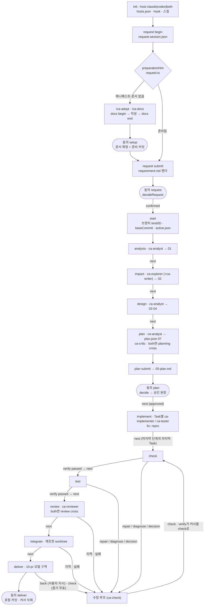
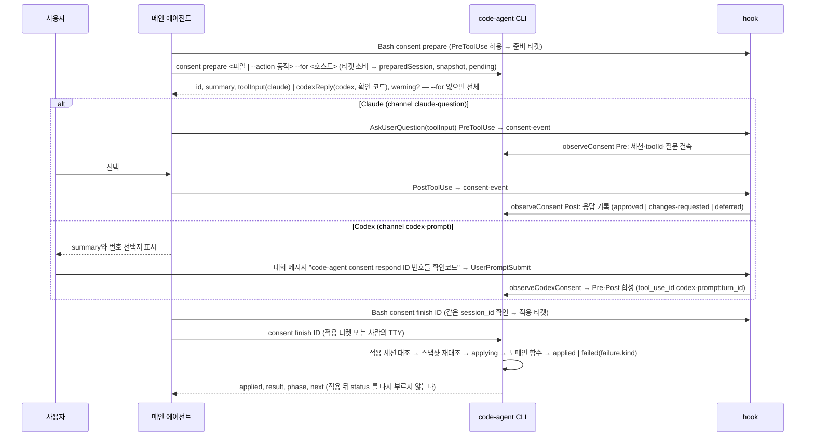
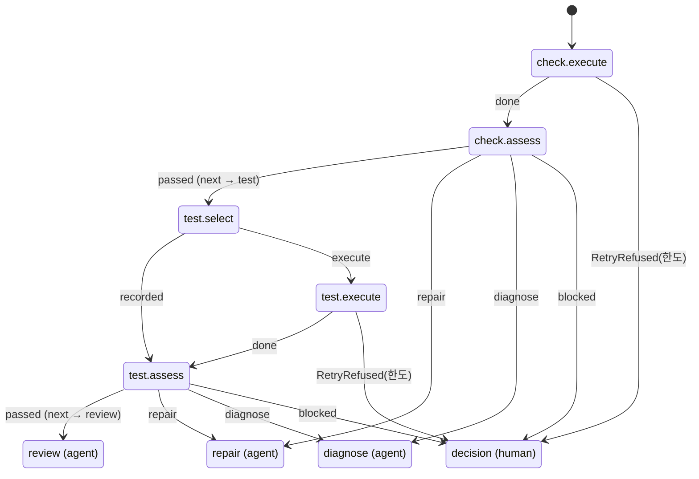

# code-agent 프로세스 흐름도

이 문서는 현재 동작을 정리한 지도다. 내용은 §10 마지막 행까지의 현재 동작이다. 코드가 정본이므로 문서와 코드가 다르면 코드가 맞고, 이 문서를 고친다.
표의 `file:line`은 커밋 `c4f3fbf` 기준이다. 다만 `planning.ts`·`planningState.ts`·`planningHook.ts`·`planningValidation.ts`·`stagedChecks.ts`·`codexHook.ts`·`sessionHook.ts`·`crossCheck.ts`·`handoff.ts`의 `file:line`은 커밋 `110ec6a` 기준이다(`commands.ts` 등 다른 모듈은 `c4f3fbf` 기준 그대로다). 다음은 줄 번호 없이 함수 이름으로 인용한다 — `review.ts`·`reviewHook.ts`·`crossCheck.ts`·`crossRecord.ts`·`reviewJudgment.ts`(§6.3), `consent.ts`·`hook.ts`·`codexHook.ts`·`cli.ts`(진입점)·`cliMain.ts`(명령)·`consentTicket.ts`·`consentState.ts`·`answers.ts`·`snapshotCache.ts`·`consentReceipts.ts`·`retryGrant.ts`(§4·§5), `commands.ts`(`nextHint`·`status`·`start`·`requireValidatable`·`back`)·`hook.ts`·`request.ts`(`preparationHint`·`startBlockers`)·`deliver.ts`·`sessionHook.ts`·`hosts.ts`·`hostText.ts`·`reentry.ts`·`lease.ts`·`failureHint.ts`의 해당 부분, 그 밖에 `c4f3fbf` 뒤에 더하거나 고친 인용(§10 의 각 행). `template/`·`doc/` 인용의 줄 번호는 HEAD 기준이고(`src/test/finalReverify.test.ts`의 '흐름도의 줄 인용' 시험이 §10 앞의 인용마다 그 줄의 글을 `CITED_LINES` 표와 대조한다 — 줄이 밀리면 인용과 표를 함께 고친다), 줄이 자주 움직이는 표·문단은 절 이름(예: `ca-next` 의 '멈춘 자리별 재개')으로 인용한다. 줄 번호가 어긋나면 함께 적은 함수·절 이름으로 찾는다. 경로의 기준은 `src/agent/`이고, `core/`는 `src/core/`, `template/`·`doc/`는 저장소 루트의 같은 폴더다.
이 문서는 현재 동작만 적는다. 결함으로 판정된 동작과 개선안은 [감사 기록](reviews/2026-10-07-dual-host-process-audit.md)에 있다. 지적마다의 처리 상태(반영·일부·범위 밖·보류와 다음 배정)는 [절차 보완 결과 요약](reviews/2026-10-08-procedure-fix-summary.md)에 있다.

**읽는 순서(에이전트용)** — §2에서 바뀌는 칸을 찾고, §3에서 그 행을 읽은 뒤, §9로 파일을 연다. 이어서 사람 확인(§4)·hook(§5)·호스트 차이(§7)에 걸리는지 본다. 이 문서에 없는 동작은 추측하지 말고 코드를 연다.

## 1. 목적과 갱신 규칙

**목적**은 세 가지다. 개발 에이전트(Claude·Codex)가 코드를 다시 분석하는 시간을 줄이고, 단계·게이트·hook을 잘못 기억해 생기는 오판과 재시도를 줄이며, 변경이 어느 흐름에 영향을 주는지 먼저 판단하게 하는 것이다.

**근거 수준** — 기본은 코드 판독이다. §5의 등록표와 판정 일부는 sandbox에서 직접 확인했다(`init --host both` 설치 결과, `codex-event`·`hook`·`stop`·`session-event`에 이벤트를 넣은 결과). `init` 호스트 합집합(§7), 세션 없는 상태의 `hook` 판정(§4.1), `git add -f`의 `.gitignore *` 무시(§8)도 sandbox에서 확인했다. 그 밖에 실제 호스트에서 확인하지 않은 동작은 "미확인"이라고 적는다.

### 1.1 변경 → 갱신 대응표

| 바뀐 코드 | 갱신할 섹션 | 함께 맞출 중복 정의 |
|---|---|---|
| `layout.ts` `PHASES`·`AFTER_IMPLEMENT`·`STOP_PHASES` (20-43) | §2, §3 | `phaseInfo.ts` `PHASE_LABEL`·`reentry.ts` `PHASE_SKILL`, `template/claude/skills/ca-next/SKILL.md:14-25` 표, §3.2 표의 단계 칸(`docSync.test.ts`가 `PHASES`와 순서까지 대조) |
| `commands.ts` `start`·`next`(implement 의 Task 완료 판정 `untouchedTaskFiles` 포함)·`back`·`requireValidatable`·`abort` | §2, §3, §3.3 | 각 단계 스킬의 "자리 확인" 문장(직전 `code-agent` 출력에 스테이지가 있으면 status 를 다시 부르지 않는다), `ca-implement` 5항 |
| `commands.ts` `nextHint`(판정 순서 — AI-DLC → 요구 → 질문 → 승인 무효 `reentryHint` → 검증 한도 `verifyLimitHint` → `failureHint` → 스테이지)·`status` | §3, §3.2 `다음:` 의 원천 | `ca-next/SKILL.md` '멈춘 자리별 재개' 표, `ca-status/SKILL.md` 원인별 안내 줄. 원인별 안내의 원천은 원인을 판정한 모듈이다(검증 — 이 함수의 check·test 갈래, 리뷰·교차 — `reviewProblems`·`crossCriticProblems`, 계획 배정 — `planning advance`) |
| `reentry.ts`(`reentryHint`·`staleEarliest`·`PHASE_SKILL`)·`failureHint.ts` | §3.2 실패 시, §3.3 | 승인 무효 문장(`nextHint`·`next`(implement 이후 모든 스테이지 — 스테이지 게이트보다 먼저)·`requireValidatable`·`requireReproable`·`hook.ts` `decideWrite`가 같은 문장), 단계 스킬 9개의 되감기 예외 문장(승인 무효), `failureHint`가 읽는 기록 꼴(`planning.json` 시도의 `failure`, `consents/<UUID>.json` `failure`)과 `GUIDE_KEYS`의 동의 원인 키(`detail`) |
| `hostText.ts`(표기 함수 `skill`·`agentName`·`askVia`·`viaShell`·`shellLabel`·`fileToolsHint`·`readVia`·`readToolVia`·`editVia`, 판정 `notationFor`) | §7 CLI 출력 표기 | `SKILL_NAMES` ↔ `template/claude/skills` 디렉터리, `ROLE_NAMES` ↔ `template/claude/agents`(`hostText.test.ts`), 호출 지점 — `cliMain.ts` `useNotation`, hook 진입 `withNotation`(Claude 하위 명령은 claude, `codexHook`은 codex). 파일·확인 화면에 기록되는 문자열(⑧·⑨·⑩, 원장, 동의 `confirmations`, `setupStatus`)은 리터럴을 유지한다 |
| `lease.ts`(`leaseDecision`·`leaseGuard`·`sessionStartLease`·`releaseLease`·`leaseLine`) | §5.3, §7, §8 | `hook.ts` `LEASE_FREE`(임대를 보지 않는 읽기 전용 명령)·`decideTool`의 임대 자리(동의 티켓 발급 전), `consent.ts` `SNAPSHOT_EXCLUDED`(`lease.json*`), `init.ts` `GITIGNORE_LINES`, `sessionHook.ts` `progress`, `ca-next` 재개표의 다른 세션·넘겨받기 행 |
| `request.ts` 접수·확정, `docsCommands.ts`·`bootstrap.ts` 준비 | §3.1, §4 | `ca-request`·`ca-adopt`·`ca-docs` SKILL.md |
| `init.ts` hook 등록(`initClaude`·`initCodex` — Codex PreToolUse 의 `|| exit 2`·`commandWindows`)·`HOOK_MATCHER`(`mcp__.*` 포함)·`CLAUDE_HOOKS`·`CODEX_EVENTS`·`hookInstallProblems`·`requireStartHooks` | §5, §7 | §5.1·§5.2 등록표(`docSync.test.ts`가 임시 저장소에 `init --host both` 한 `.claude/settings.json`·`.codex/hooks.json`과 대조), `doctor.ts` hook 목록(같은 `CLAUDE_HOOKS`·`CODEX_EVENTS`를 읽는다), `update.ts` hook 출력, `doc/codex.md` 이벤트 표, `README.md` 동작 구조 표, `doc/install.md`, `doc/usage.md` hook 수·init 표 |
| `codexHook.ts` | §4.2, §5.2, §7 | `template/CODEX.block.md`, `template/codex/ca-answer.md` |
| `consent.ts` `ActionSchema`(`CONSENT_ACTIONS`, `judgment` 포함)·`preview`·`applyLocked`·`observeConsent`(검사 순서)·실패 기록(`failure`·`consentGuide`)·`consentStatus`(`failure`·`warning`·Codex 확인 코드)·`SNAPSHOT_EXCLUDED` | §4 | §4.1 표의 action 칸(`docSync.test.ts`가 `CONSENT_ACTIONS`와 대조), `ca-answer/SKILL.md` 동작 준비 절·준비 절차 6항, `ca-answer/reference.md` 필드 표·예시, `template/codex/ca-answer.md` 동작 목록(`consentBinding.test.ts` T-J-3 이 세 곳을 `CONSENT_ACTIONS`와 대조한다) |
| `consent.ts` `renderConsentOutput`(`--for` 출력에서 빼는 필드)·`AFTER_APPLY`(흐름을 멈추는 동작의 적용 뒤 `next`), `commands.ts` `nextStep`(적용 뒤 `next`) | §4.2 | `ca-answer/SKILL.md` 1·3·5·6·7항(읽는 필드 `toolInput`·`toolInput.questions`·적용 결과 `{status, result, phase, next}`), `template/codex/ca-answer.md` 1·2·4항(`codexReply`·`phase`·`next`), `status`의 `다음:`(`nextHint` — `nextStep`과 같은 값이다) |
| `consentTicket.ts`(준비·적용 티켓, 준비 인자 문법 `splitCommandArgs`·`parsePrepareArgs`·`INLINE_ACTIONS`)·`consentState.ts`(색인·열린 동의·적용 잠금 확인)·`answers.ts`(업무 답 관찰)·`snapshotCache.ts`·`consentReceipts.ts`·`retryGrant.ts`(사람 허용) | §4, §5.3, §6.4, §8 | 티켓 명령 꼴(`consentCommandOf`)과 `hook.ts` `isModelCommand`의 `consent` 허용 꼴, `cliMain.ts` consent 분기. `INLINE_ACTIONS`는 `ca-answer/SKILL.md` 동작 준비 절의 인라인 목록과 `template/codex/ca-answer.md` 인라인 문장의 목록과 같다(`consentOutput.test.ts`). 업무 답 규칙은 `ca-answer/SKILL.md` 1·3절과 `template/codex/ca-answer.md` 업무 질문 문단. 허용 키 표(`grantTarget`)는 `GRANT_STEP`과 같아야 한다 |
| `cli.ts`(hook 하위 명령 지연 로드·`hookFailureExit`)·`cliMain.ts`(명령), `hook.ts`·`codexHook.ts`·`request.ts`의 지연 로드(`consent.ts`·이벤트별 모듈·`init.ts`) | §5, §6.4 hook 종료 코드, §9 | 새 hook 하위 명령은 `HOOKS`와 `retryPolicy.ts` `hookFailureExit` 표에 함께 더한다. 분기 안의 지연 `require` 실패도 같은 표로 끝나야 한다 — 가드를 `try`로 감싸 통과시키지 않는다(`hookLoad.test.ts` 지연 로드 실패 행). hook 경로 모듈(`hook`·`codexHook`·`stopHook`·`sessionHook`과 그 import)에서 명령 모듈을 정적으로 import 하지 않는다 — `hookLoad.test.ts`의 금지 목록(`HEAVY`)·실행 경로·로드 실패 표가 대조한다 |
| `hook.ts` `decide`(티켓 발급)·`decideTool`·`decideMcp`·`readDenied`·`aliasGuard`·`decideOutside`(열린 동의 창·소스 업데이트·hook 설정)·`decideDocWrite`·`MODEL_SUBCOMMANDS` | §5.3, §5.4 | `template/CLAUDE.block.md`, `decideBash` 거부 문구 |
| `planning.ts`·`planningState.ts`·`planningHook.ts`·`planningChain.ts` | §6.1 | `doc/planning.md` 역할·action 표, `planningChain.ts` `planningNextLine` 표(action별 다음 행동의 원천 — `planningChain.test.ts`), 연쇄 거부의 `questions`(`commands.ts` `OpenQuestionsStop` — `requireAnswers`가 던질 때만), 연쇄 출력의 지금 스테이지(`chain.to` — `ca-analyze`·`ca-impact`·`ca-design` 5항, `ca-next` 3항), 단계 스킬 2·3·4항(네 스킬이 같은 글자 — `templateText.test.ts`, advance `action`을 바꾸면 4항의 요지도), `ca-plan/contract.md:10,16`(질문 출처·수정 피드백), `ca-plan/SKILL.md` 4-1항·반려 절차와 `crossCriticProblems` 문구(고칠 작업은 지적 내용으로 정한다), `ca-next/SKILL.md:31`(재개 때 실행 중 배정 확인 — Codex는 SessionStart가 없다)·`:72`(되감기 예외 셋)·'멈춘 자리별 재개' 표의 `stale`·`rewind-required` 행, `sessionHook.ts`(실행 중 배정 요약), `handoff.ts` `handoffPlanning`(배정 요약의 `previous`) |
| `lock.ts` | §6.1, §8 | 리뷰 기록·동의 적용·작업 임대가 같은 잠금을 쓴다 — 호출자별 `ageReclaim`·`display`·문구 |
| `stagedChecks.ts`, `planningValidation.ts`·`workDocs.ts`의 게이트 함수 | §6.1 관찰 6단계 | 게이트 함수를 바꾸면 계획 담당 완료 hook의 문서 검사도 함께 바뀐다(같은 함수) |
| `verificationFlow.ts`·`validate.ts`·`evidence.ts`, `core/build.ts` `CommandResult`, `tree.ts` `partialTreeHash`, `testResults.ts`·`testReports.ts`, `retryPolicy.ts` 검증 절 | §3.2 check~integrate, §6.2, §6.3 리뷰 회차, §8 | `ca-check/SKILL.md` 노드 처리 목록, `ca-check`·`ca-test`·`ca-integrate`·`ca-implement`·`ca-fix` 재시도 문장과 `ca-review` 5항, `ca-tester.md` 동결 문장, 장시간 실행 정본 문장(`ca-check`·`ca-test`·`ca-integrate`·`ca-implement` 4곳 글자 그대로) |
| `review.ts`·`reviewHook.ts`·`crossCheck.ts`·`crossRecord.ts`·`reviewJudgment.ts` | §3.2 review, §5.1·§5.2 리뷰어 행, §6.3, §7, §8 | `ca-review/SKILL.md` 4-1·4-2·끝, `ca-plan/SKILL.md` 4-1. 리뷰 회차 한도는 `evidence.ts` `reviewRoundUsageOf` 하나다(§6.2·§6.3). 표 규칙(`reviewResultProblems`)은 hook·교차·게이트가 같이 쓴다 — `ca-reviewer.md` 출력 표와 맞춘다. 사람 판단 네 함수(`previewWaiveFinding`·`waiveFinding`·`previewCrossStop`·`recordCrossStop`)는 동의 `judgment`가 부른다(`ca-answer` 세 곳의 목록과 함께 연결) |
| `deliver.ts`·`knowledge.ts` | §3.2 deliver, §8 | `ca-integrate/SKILL.md`. 반영 제외 규칙(`deliveryExcludes`·`isDeliveryExcluded` — handoff·staging·작업 상태 폴더의 `*.lock`)은 커밋·커밋 뒤 대조·동의 미리보기가 같이 쓴다 |
| `hosts.ts` `codexText`(문장째 치환 `CODEX_SENTENCES` — `templateText.test.ts`가 원문이 Claude 템플릿에 있고 Codex 사본에 남지 않는지 대조) | §7 | 장시간 실행 정본 문장(`ca-check`·`ca-test`·`ca-integrate`·`ca-implement`)과 교차 4-1 문장(`ca-review`·`ca-plan`)은 문장째 치환한다 — 원문이 글자 그대로 같아야 걸리고, 어긋나면 `hostNotation.test.ts`가 Codex 사본의 `Bash`·`600000ms`로 잡는다. 역할 정규식은 `hostText.ts` `ROLE_NAMES`로 만든다. 그 밖의 치환 대상 문장: staging 문장 세 리터럴이 `ca-analyze`·`ca-impact`·`ca-design`·`ca-plan` SKILL.md와 `ca-analyst`·`ca-explorer`·`ca-writer` 에이전트 원문과 글자 그대로 같아야 치환된다. 교차 명령의 권한 상승 치환(`셸: \`code-agent (review|planning) cross --by claude\``)은 `ca-review`·`ca-plan` 4-1의 `` Bash: `code-agent … cross --by codex` `` 가 `Bash:`·`--by` 치환을 거친 글자에 맞춘다 |
| `crossEnv.ts`(교차 자식 표지·`runtimeHost`), hook 진입점(`runStopHook`·`runSessionHook`·`runReviewHook`·`runPlanningHook`·`codexHook`) | §5, §6.3, §7 | 교차 자식(`CODE_AGENT_CROSS`)에서 통과하는 hook 목록(`CROSS_CHILD_PASS_EVENTS`), 교차 자식의 진행 명령·쓰기 거부(`hook.ts` `crossChildGuard` — 문구 `CROSS_CHILD_DENY`, 읽기 전용 명령 목록 `CROSS_CHILD_READONLY`. 작업 임대도 같은 문구를 쓴다) |
| `crossCheck.ts` `crossInvocationArgs` | §6.3 다른 호스트 실행 | `doctor --cross`의 점검 목록(`crossFlags`)은 이 인자에서 만든다 — 따로 맞출 것이 없다 |
| `retryPolicy.ts` `POLICIES`·`LIMITS`·`GRANT_STEP`·`TIMING`·`GUIDE_KEYS`·`GUIDE_VARIANTS`·판정 함수, `lock.ts`, `crossEnv.ts`, `hostText.ts` | §6.4(표는 생성 블록 — `renderRetryPolicyTable()` 출력으로 다시 붙인다), 연결된 판정 지점의 §4·§5·§6.1~§6.3 | §6.4 생성 블록(`docSync.test.ts`가 바이트 대조), 안내 문구 자리표시와 `GUIDE_KEYS`·`GUIDE_VARIANT_KEYS`(`retryPolicy.test.ts`가 대조), `crossFailureText`의 Codex 배너 식(Codex exec 출력 라벨이 바뀌면), `hostText.ts` `SKILL_NAMES`·`ROLE_NAMES`(템플릿 폴더·`hosts.ts` `ROLE_NAMES`와 같아야 한다 — `hostText.test.ts`가 대조) |
| `usage.ts`(`usageReport`·`commandKey`·`skillReadKey`·`transcripts` — `subagents/` 아래 하위 폴더의 `agent-*.jsonl` 포함)·`codexUsage.ts`(`unwrapShellArgv` — 셸 래퍼 벗기기)·`retryReport.ts`(옛 기록은 `crossAttemptsOf`·`legacyPlanningAttempts`·단수 `reviewer`) | §7 토큰 사용량 행, §8 읽기만 하는 행, §9 | `doc/usage.md` usage 절, `doc/codex.md` 사용량 문단, `scripts/evaluate-full-flow.cjs`(`usageData`·`retry`)·`summarize-evaluations.cjs`. 측정은 기록을 읽기만 한다 — 쓰거나 배정 입력·스킬로 돌려보내지 않는다 |
| `modelPolicy.ts` `ROLE_POLICY`·`TIER_DEFAULTS`·`CLAUDE_EFFORTS`·`CLAUDE_NO_EFFORT`, `models.ts`, `prices.ts` | §4.1 model 행, §6.3 다른 호스트 실행, §7 모델 기본값 행(`docSync.test.ts`가 `ROLE_POLICY`·`TIER_DEFAULTS`와 대조), §8 `models.json` 행 | `template/claude/agents/ca-*.md` 머리말 `model`·`effort`(`modelPolicy.test.ts`가 대조), `doc/codex.md` 역할별 모델 표(같은 테스트가 대조), `doc/design.md` 모델 문단, `ca-answer/reference.md`·`template/codex/ca-answer.md` 모델 예시, `retryPolicy.ts` `CROSS_PATTERNS.config`·`crossFailureText`(모델·강도 오류 문구, Codex 배너 라벨), `doc/usage.md` 단가표 |
| 상태·산출물 경로(`layout.ts`, `handoff.ts`, `deliveryPaths`) | §8 | `.gitignore` 블록(`init.ts` `GITIGNORE_LINES`), `baselineFiles`(`bootstrap.ts:40-62`) |
| 새 파일·모듈 이동 | §9 | — |
| `template/**` 문장(늘리거나 옮김) | §9 절차 템플릿 | `src/test/templateBudget.test.ts` 파일별·흐름 합계(Claude·Codex) 예산 — 넘기면 필요할 때만 읽는 보조 문서로 옮기거나 근거를 `doc/reviews`에 남기고 `BUDGET`을 고친다(`node scripts/template-sizes.cjs --suggest`) |
| 스킬·서브에이전트 추가·삭제 | §7, §9 | 설치 수(`README.md` 동작 구조 표, `doc/codex.md` 설치 대상 표, `doc/install.md`, `doc/usage.md:191`), `ca-next/SKILL.md` 표, `init.ts`의 Codex 설치 안내 문구. 서브에이전트는 `hostText.ts` `ROLE_NAMES`(정본 — `hosts.ts`가 다시 내보내고 `codexText` 역할 정규식도 이것으로 만든다)와 `modelPolicy.ts` `AGENTS`·`ROLE_POLICY`도 고치고, 계획·리뷰 담당이면 `init.ts:228-231`·`doctor.ts:181` matcher도 고친다 |

**갱신 절차** — 코드 변경과 같은 커밋에서 해당 행과 `file:line`을 고치고, §10에 변경당 한 줄(바뀐 것의 요지와 커밋 — 경위·지적별 처리·검증 결과는 `doc/reviews/` 기록에)을 남긴다. 확인하지 못한 동작은 쓰지 않거나 "미확인"으로 표시한다.

## 2. 전체 흐름 한 장

둥근 칸(`([ ])`)은 사람의 동의다(§4). 새 작업의 기본 동의는 `setup`(최초 준비 때만), `request`, `plan`, `deliver`다. 상황에 따라 `docs`(공통 문서만 다시 확정할 때, `request.ts` `preparationHint`), `repro-log`(fix에서 로컬 재현이 안 될 때), `judgment`(한도 추가·지적 기각·교차 중지), `abort` 등이 더해진다(§4.1).

## 3. 스테이지별 표

**공통 전제** (`commands.ts:516-524`) — `next`는 매번 AI-DLC 미진행, 유효한 커서와 `baseCommit`(`requireWork` 158-171), 공통 문서 확정, 요구 확정(`request.ts:350-378`), 답 없는 질문 0(`requireAnswers` 184-193)을 확인한다. analysis~plan에서는 `planningProblems`와 `planningDocumentProblems`도 본다. 게이트에 걸린 `next`는 `Stop`을 던지고 커서는 그대로 둔다.

### 3.1 커서가 생기기 전

| 단계 | 진입 조건 | 담당 | CLI | 산출 | 넘어가는 조건 |
|---|---|---|---|---|---|
| 준비 | 매니페스트가 없거나, 공통 문서가 미확정이거나, 문서 세션이 열려 있거나, 준비 커밋이 없다(`preparationHint` — 매니페스트 없이 문서 세션이 열려 있으면(`ca-adopt` 도중) `/ca-adopt` 로 설정·문서를 마저 쓰고 `docs end`(작업·접수 없는 `status` 도 이것을 접수 안내보다 먼저 낸다 — 문서 세션 중에는 `request begin` 이 거부된다). 확정이 필요하면 기준 커밋을 보고 `setup`(문서 확정 + 준비 커밋)·`docs`(문서만)·`baseline`(준비 커밋만) 동의 하나를 고른다. git 저장소가 아니거나 작업 중이면 준비 커밋은 보지 않는다) | 메인 `/ca-adopt`·`/ca-docs`, 서브 `ca-surveyor`·`ca-writer` | `docs recommend·begin·setup·link·end` 등, `survey`, `manifest check`, 동의 `setup`. 문서 세션의 쓰기 범위는 `docs begin` 때의 매니페스트로 `docs-session.json` `writable`에 고정한다(`doc/` 밖은 `.md`만, `docs link`로 연결한 문서만 더해진다) | `code-agent.json`, POLICY 4종(`doc/*.md`), KNOWLEDGE 빈 뼈대(`doc/knowledge/*`, `docs begin`이 만든다 `docsCommands.ts:151,167-177`), `approvals/docs.jsonl`, 준비 커밋. `approvals/docs.jsonl`은 준비 커밋 대상(`baselineFiles` `bootstrap.ts:45-49`)에 없고 첫 반영 커밋에 들어간다(`deliver.ts:324`) | `request submit`의 매니페스트 검사(`request.ts:417-426,645`), `start`의 `requireDocs`(`commands.ts:276`)와 `requirePreparedBranch`(`bootstrap.ts:75-94`) |
| 접수 | `request begin`(`request.ts:428-489`). 문서 세션 열림·AI-DLC·진행 중 작업(같은 ID 포함)·다른 ID 접수·종류 변경이면 거부한다. ID를 생략하면 진행 중인 접수의 ID를 쓰고, 없으면 작업 폴더·확정 원장이 없는 첫 `WORK-0001` 형식(4자리) ID를 발급한다(437-443). 새 접수이고 작업 브랜치가 아직 없는데 미커밋 변경(`startBlockers`)이 있으면 `시작 전 정리 필요:` 경고 줄을 붙인다(거부하지 않는다 — 접수 중 `status`도 같은 줄). `request.json`의 `target`은 하나다(초안 스키마 `.max(1)`) | 메인 `/ca-request`(서브 없음) | `request begin`·`request`·`request submit`, 동의 `request` | `doc/work/<ID>/request.json`(모델), `requirement.md`(코드 렌더 785), `approvals/<slug>/request.jsonl` | `decideRequest`가 보여 준 바이트 해시로 `confirmed`를 기록한다(`request.ts:811-893`) |
| start | 실행 중인 호스트의 hook 설치(`requireStartHooks` — 다른 설치 호스트의 누락·판별 불가는 경고만), 요구 확정, 문서 세션 없음, AI-DLC 없음, 매니페스트 있음, 공통 문서 확정, 다른 ID 접수 없음(`commands.ts:266-295`). 진행 중 확인 뒤·브랜치 전환 앞에서 대상이 여럿인 지시서를 거부하고(이미 시작한 작업은 그대로 잇는다), 새 작업 브랜치면 미커밋·미추적 변경을 거부한다(`startBlockers` — 작업 폴더·`.code-agent`·지시서·준비 커밋에 담을 도입 파일 제외, 이미 있는 브랜치는 보지 않는다) | 메인(스킬이 호출) | `start <지시서>` | 브랜치 `<kind>/<ID>`, `baseCommit`(새 브랜치는 기준 끝, 기존 브랜치는 merge-base, 333-341), `questions.md`, 업무 답 시작 행(`writeAnswerBaseline`, §4.3), `active.json`(phase=analysis, planningVersion=1, 354), 접수 세션 삭제(356) | 같은 작업이면 상태만 출력한다. 다른 작업이 진행 중이면 거부한다(297-306). fix는 오류 로그 절이 필요하다(308) |

접수 세션 동안 모델은 `doc/work/<ID>/` 안에만 쓸 수 있고, `requirement.md`는 코드만 쓴다(`hook.ts:307-322`).

### 3.2 커서 단계 (`PHASES` `layout.ts:20-31`)

| 단계 | 담당 (메인 / 서브) | CLI | 산출 | 게이트 (`next`) | 실패 시 |
|---|---|---|---|---|---|
| analysis | `/ca-analyze` / `ca-analyst`(role analysis) | `planning advance [--chain]` 외, `next` | `01-requirements.md`, `questions.md` | `requireRequirements`: 01 형식과 원문 대조(`commands.ts:531-533`, 196-212) | advance 출력의 `next` 줄(action별 한 줄, 실패는 원인의 `guidance()`)을 따른다 — `blocked`이면 질문에 답하거나 입력을 고친다. 형식 오류는 `repair`(1회) |
| impact | `/ca-impact` / 기본은 `ca-explorer`(explore)와 `ca-writer`(synthesis). `planning advance`가 impact 작업을 처음 등록할 때 요구 R이 1~3개, 조사 파일이 12개 이하, 합계 96,000바이트 이하면 `ca-explorer` 단독(impact)(`planning.ts:78-85`) | 같음 | `02-analysis.md` | 조사 결과가 current이고 사실 충돌이 없다(`planningState.ts:474-479`). `analysisProblems`(534-538) | 같음. 사실 충돌은 조사를 다시 돌린다 |
| design | `/ca-design` / `ca-analyst`(design) | 같음 | `03-design.md`, `04-functional.md` | `designProblems`와 `functionalProblems`(539-546) | 같음 |
| plan | `/ca-plan` / `ca-analyst`(plan)와 `ca-critic`(critic). 두 호스트 설치 시 `planning cross` | `planning advance·cross`, `plan submit`, 동의 `plan` | `plan.json`, `07-test-spec.md`, `<target>.plan.json`, `05-plan.md`(렌더 1286-1289), 승인 원장 | `reviewedPlanProblems`(critic이 본 plan.json과 제출본이 같다), 계획 존재, 승인 `approved`(547-558) | 반려되면 `ca-plan`의 반려 절차로 원인 작업을 다시 배정하고 재제출한다 |
| implement | `/ca-implement` / `ca-implementer`, 테스트 단계는 `ca-tester`(`handoff.ts:43-44`) | `context --file`, `repro`(fix), `next` | 계획 파일 | 승인 유지, 현재 Task 파일 존재, Task 의 계획 파일이 **모두** 기준 커밋과 같으면 거부(`untouchedTaskFiles` — 새 파일·일부만 그대로는 막지 않는다, `precondition`·카운터 없음), 같은 단계의 다음 Task로 이동. 단계가 끝나면 `missingPlannedFiles`, fix의 test 단계는 `reproMissing`을 본 뒤 다음 단계나 check로 간다(559-598) | `Stop`이면 빠진 파일을 다시 맡긴다. 승인이 stale이면 재제출·재승인한다 |
| check | `/ca-check` / 수정은 `ca-implementer` | `verify --json [--retry]`(단계만 돌릴 때는 `check`) | `<target>.verify.json`, `08-validation.md`, `.code-agent/log/` | `stageProblems(check)`(`evidence.ts` `stageProblemEntries`) | verify 노드 `repair`·`diagnose`·`decision` — 원인별 카운터(§6.2, 규약 §6.4) |
| test | `/ca-test` / TC 코드가 없을 때 `ca-tester` | `verify --json`(또는 `test`) | 같은 증거, `testCases`, `testFreeze` | `stageProblems(test)`: ⑦의 모든 TC가 `passed` + 동결 뒤 바뀐 kind:test 파일 없음(`testFreezeProblems`) | 같음. 수정 뒤 `verify`로 check부터 다시 |
| review | `/ca-review` / `ca-reviewer` | `review`, `context --file`, 두 호스트면 `review cross --by <다른 호스트>` | `<target>.review.json`(리뷰어 실행·교차 시도는 회차마다 append-only), `09-review.md` | `reviewProblems`(`review.ts`) | 계획 안 지적은 수정 루프 → `verify` → 새 회차(리뷰 회차 3회까지, §6.3) — 같은 회차는 다시 리뷰하지 않는다. 계획 밖 지적은 질문 또는 재계획. 의견이 갈리거나 범위 밖이면 사람 판단(동의 `judgment` `waive-finding`, §6.3 사람 판단) |
| integrate | `/ca-integrate` / 없음 | `integrate` | `integrate` 실행 기록, `integrationTestCases`, `.code-agent/log/worktree.lock`(실행 중) | `stageProblems(integrate)`: 통합 TC 전부 passed, 동결 뒤 바뀐 kind:test 파일 없음, fix면 재현 테스트 트리가 일치 | 수정 루프. prepare 실패·중단은 환경으로 분류하고 같은 회차 재실행 2회, 코드 결함은 같은 코드 재실행 거부(§6.2) |
| deliver | `/ca-integrate` 3절 / 없음 | 동의 `deliver`(사람은 TTY `deliver`) | `10-pr.md` 모델 3절, `knowledge.proposal.md`(선택), 로컬 커밋 | `next`로는 끝나지 않는다(618-623). `deliverProblems`(`deliver.ts:189-232`), 작업 브랜치(401-409), 사람 확인(419) | `Stop`이면 커밋하지 않는다. 사용자 지시가 있으면 `back`으로 되감고(준비해 둔 deliver 동의는 무효), 사람이 계획 파일을 고쳐 증거 묶임이 깨졌으면 `check`·`verify`가 check 로 되감는다(`다음:`도 반영 동의 대신 이 길을 보인다 — `nextHint` deliver 갈래의 `evidenceBroken`). TTY 확인 뒤 커서·게이트를 다시 대조한다. 커밋은 handoff·staging·작업 상태 폴더의 `*.lock`을 뺀다(`deliveryExcludes`). 커밋이 실패하면 고른 KNOWLEDGE 갱신을 스테이지에서 내리고 원래 내용으로 되돌린다(`restoreKnowledge`). 커밋 중 계획 파일이 바뀌면(pre-commit hook 등) 결과에 경고한다(되돌리지 않는다). ⑩ 검증 절·커밋 메시지에 교차 검증·사람 판단 줄이 붙는다(§6.3) |

**`다음:` 의 원인별 안내** (`nextHint`) — 판정 순서는 AI-DLC 차단 → 요구 미확정 → 미응답 질문 → implement 이후의 승인 무효(`reentryHint` — 관찰 흐름은 낡은 계획 작업의 가장 앞 단계로 `back` → 그 단계 스킬로 재실행 → `plan submit` → `plan` 동의, 낡은 작업이 없으면 지금 자리에서 `plan` 동의. 옛 흐름의 `stale-docs`·`stale-order`는 '계획을 바꿔야 하면 / 그대로면' 두 갈래, 그 밖은 그 자리 동의 — 승인은 스테이지를 요구하지 않고 증거 묶임은 문서 해시를 보지 않는다) → check·test 의 검증 한도(`verifyLimitHint`) → `failureHint`(관찰 흐름 analysis~plan 의 배정 실패·고아를 원인 이름표와 배정 ID 로 `planning advance` 에 이끄는 한 줄, deliver 진입 뒤 마지막 deliver 동의의 실패를 `guidance(class, {detail})` 로) → 스테이지 문구(관찰 흐름 analysis~design 은 `planning advance`, plan 은 critic 뒤 교차 계획 검토가 남았으면 그 줄(`crossCriticProblems`) 아니면 `planning advance`, check·test 는 진입 명령 `verify --json` — 지금 회차의 실행만 보고(앞 회차의 통과로 '검증 통과'를 내지 않는다), 검증 명령이 code-agent 기록을 바꿔 되돌린 실행이 지금 회차에 있으면(단계 필터 없이 — test 의 기록 변경 뒤 `verify --retry`·`check`가 같은 코드 재실행으로 거부해 커서가 check 에 서도) 그 단계 게이트의 stop 문제 전부(기록 변경 문장 `stateGuardText`와 동결 뒤 바뀐 테스트 등)를 전제 안내 `guidance("precondition")`로 — verify 의 Stop 과 같은 목록, 지금 회차 실행이 통과여도 게이트(`stageProblemEntries` — `next`가 보는 것)가 남으면 '검증 통과' 대신 verify 가 하는 일(다시 돌려도 남는 문제는 전제 안내 `guidance("precondition")` — verify 의 Stop 과 같은 문장, 검증 뒤 계획 파일이 바뀌었으면 `verify --json`, 그 밖의 대조는 `verify --json --retry`), 이 회차의 test 를 아직 돌리지 않았으면 'N회차 test 를 아직 돌리지 않음 — `verify --json`', 진단(diagnose) 노드면 verify 결과의 재개 명령과 같은 `verify --json --retry`, review 는 `reviewProblems` 첫 줄 — 교차 원인 문구 포함(한도로 거부될 지점은 실행 명령 없이 사람 판단만), integrate 는 진입 명령, deliver 는 증거 묶임이 깨졌으면 `verify --json` 의 check 되감기)다. 미응답 질문 줄은 답 출처를 확인할 수 없는 질문이 있으면 그 ID 와 받는 길(`unverifiedAnswerHint`)을 붙인다. 검증 한도 줄은 카운터마다 사람 선택지(한 번 더 허용 `judgment retry-grant <키>` · 재계획 · abort, 총 회차는 허용 없이, 리뷰를 열지 않고 쓴 리뷰 회차는 허용 대신 `NO_REVIEW_CHOICES`, 지적 기각은 열린 지적이 있을 때만)를 붙인다. `next`도 implement 이후에는 스테이지 게이트보다 먼저 같은 승인 무효 문장으로 멈춘다. 원인 문구는 원인을 판정한 모듈이 렌더한 것이라 같은 상태에서 직전 명령과 무관하게 같다(`verification-flow.json`·교차 시도의 class 를 따로 읽지 않는다). 분류는 모두 `precondition`이고 카운터와 무관하다.

**hook의 쓰기 범위** (`decideWrite` `hook.ts:444-540`, 작업 커서가 있을 때) — 지시서·`05-plan.md`·`08-validation.md`는 언제나 거부한다(447-471). 관찰 흐름의 계획 출력 문서는 메인 쓰기를 거부한다(474). 그 밖의 작업 폴더는 어느 단계에서든 허용한다(475-477). refactor는 추적 중인 기존 테스트 파일을 거부한다(481-490). analysis~plan과 deliver에서는 작업 폴더 밖을 거부한다(492-497, deliver는 그 바로 뒤 — 반영 단계는 사람이 확인하는 트리다). implement부터는 제출된 계획과 `approved` 승인이 있어야 하고(498-508), implement에서 계획에 tasks가 있으면 현재 Task 파일만 허용한다(509). implement와 그 뒤 단계 모두 파일이 속한 단계 판정(512-521), fix의 재현 순서(548-568), 쓰기 한도(`writeBlockReason` — 고쳐도 다음 회차가 거부될 때만)·테스트 동결(테스트가 실제로 돈 실행부터 — 결과 인식·코드 결함·시간 초과·선언된 환경 문구, 수집 수정 1회 예외)(`freezeReason`, §6.2), 경계·계획 대조(532-538)를 적용한다.

### 3.3 커서 이동

| 명령 | 방향 | 조건 | `stages.jsonl`의 `by` |
|---|---|---|---|
| `next` | 한 칸 앞. implement 안에서는 Task·단계 단위로 움직인다 | §3.2 게이트 | `next` |
| `planning advance --chain` | analysis·impact·design 에서 결과가 모두 준비돼 `ready-for-gate` 일 때만 같은 호출로 `next`(한 칸 앞)를 한 번 부른다. 다음 단계 배정은 하지 않는다 | §3.2 게이트(거부면 exit 1, 커서 그대로) | `next` |
| `back <단계>` | 뒤로만. `deliver`는 대상이 아니다. deliver에서도 되감고, 준비해 둔 반영 동의가 무효가 된다는 줄을 더한다(`backNotes`) | `back`. hook은 모델의 `back`을 허용한다(`MODEL_SUBCOMMANDS`). "사용자 지시 시에만"은 스킬 규칙이다 — 예외는 승인 무효의 재진입(`다음:`의 `reentryHint`), 계획 `planning advance`의 `rewind-required`·`rewind.auto: true`(같은 사유에 한 번, §6.1), deliver 의 수정 요청(사용자 확인 뒤)이다 | `back` |
| `check`·`verify`(check 진입) | test·review·integrate에서 check로 되감는다. deliver는 증거 묶임(`bindingProblems`)이 깨졌을 때만(`evidenceBroken`) — 맞으면 `back check` 안내와 함께 거부한다 | `REWINDABLE`, `requireValidatable`, `verify`(deliver 도 받는다) | `next` |
| 동의 `deliver` | 커서 삭제 | 커밋 성공(`deliver.ts:424-425`) | `deliver` |
| 동의 `abort` | 커서 삭제, 작업이 없으면 접수 세션 삭제 | `commands.ts:708-722`. 문서·원장·계획은 남는다 | `abort` |

## 4. 사람 확인 지점

### 4.1 동의 동작 (`consent.ts` `ActionSchema`·`CONSENT_ACTIONS`, 제목은 `consentState.ts` `CONSENT_TITLES`)

| action | 제목 | 준비(`preview`) | 적용(`applyLocked`) | 사람의 직접 CLI 대체 |
|---|---|---|---|---|
| setup | 초기 설정 확정 | `confirmDoc(all)`과 `setupBaseline`의 확인 문구 | 둘을 차례로 실행 | `confirm doc all` + `setup baseline` |
| docs | 공통 문서 확정 | `confirmDoc(kind)` | 같음 | `confirm doc <종류>` |
| baseline | 기준 커밋 생성 | `setupBaseline` | 같음 | `setup baseline` |
| request | 요구사항 확인 | `decideRequest`(reject면 comment 필수) | 같음 | `confirm request <ID>` · `reject request <ID> --comment` |
| plan | 작업 계획 확인 | `decide` | 같음 | `approve` · `reject --comment` |
| deliver | 결과와 로컬 커밋 확인 | `deliver`를 두 번 캡처하고 `knowledgeChoices`를 만든다 | `deliver` | `deliver` |
| knowledge-prune | 지식 문서 정리 | `pruneCandidates` | `knowledgePrune` | `knowledge prune` |
| model | 에이전트 모델 변경 | `validateModelChange` + 표. 진행 중인 작업(접수 세션부터 반영 `deliver`·종료 `abort` 전까지 — `models.ts` `workInProgress`)이 있으면 질문을 내기 전에 거부한다(`requireNoWorkInProgress` — `precondition`의 `model-in-work` 문구: 작업 ID·단계와 "작업을 반영(deliver)하거나 종료(abort)한 뒤 바꾸세요". 정의 파일·변경값 파일은 커밋되는 설치 파일이라 작업 중 변경은 그 작업의 계획 밖 변경이 된다). 강도만 바꾸거나 기본값으로 되돌려도 같고, 조회(값 없는 `code-agent model`·`--host`)는 작업 중에도 연다 — 그때 표의 변경 줄은 같은 `model-in-work` 문장과 작업이 끝난 뒤의 방법이다(`modelsTable`). 작업이 없을 때 준비·승인한 동의도 적용 시점(`applyLocked`, 스냅샷 대조 앞)에 다시 보고, 그사이 작업이 시작됐으면 적용하지 않고 대상 변경(`consent-target-changed`, kind `target`)으로 폐기한다. 스냅샷에 `모델 정책` 상태(`modelPolicyFingerprint` — 등급·기본값·강도 미지원 규칙)를 묶어, 준비 뒤 CLI 의 정책이 바뀌면 `consent-target-changed`로 거부된다. 지문은 그 시점에 도는 CLI가 계산하므로 셸의 code-agent와 hook 명령이 다른 빌드여도 거부되며, 거부 문구에 두 설치본을 확인하라는 안내가 붙는다(`requireConsentSnapshot`) | `setModel` | `model <역할\|all> <모델\|default> [--reasoning\|--effort 강도]` |
| abort | 작업 진행 종료 | `status` | `abort` | `abort` |
| plugin-add · plugin-remove | 플러그인 등록·제거 | `previewPlugin*` | `pluginAdd` · `pluginRemove` | `plugin add` · `plugin remove` |
| update | code-agent 업데이트 | `previewSourceUpdate` | `updateFromSource` | `update`(`updateFromSourceConfirmed` — 호스트 표지(`hostMarked`)가 있는 셸은 거부, 미리보기를 보이고 TTY `update` 입력) |
| repro-log | 오류 로그 근거로 수정 진행 | `approveLogBasis` | 같음 | 없음 |
| judgment | 사람 판단 기록 | 공통 검증(`kind` ∈ retry-grant·waive-finding·cross-stop, `comment` 필수·500자, waive-finding 의 `id`, cross-stop 의 `name` ∈ review·planning) 뒤 `budgetReport`(`retryGrant.ts`)·`previewWaiveFinding`·`previewCrossStop`(`reviewJudgment.ts`) | `grantRetry`·`waiveFinding`·`recordCrossStop` — 각 함수가 소유 기록의 잠금 안에서 소진·지적·지점 전제를 다시 본다 | 없음 |

- 직접 CLI의 사람 확인은 명령마다 다르다. `confirm doc`·`confirm request`·`reject request`·`approve`·`reject`·`setup baseline`·`deliver`·`plugin add`와 소스 `update`(`updateFromSourceConfirmed` — 미리보기 뒤 `update`, `--templates-only`는 제외. 소스 `update`만은 호스트 표지가 있는 셸이면 TTY 여부와 관계없이 먼저 거부한다 — `HOST_SHELL_UPDATE`, 동의 적용의 `terminalCaller`와 같은 규칙)는 `confirmOnTerminal`(`tty.ts:76-90`)이 TTY에서 확인 단어 입력을 요구한다. `model` 변경·`plugin remove`·`knowledge prune`은 TTY만 요구한다(`requireTerminal` `tty.ts:55-63`, `models.ts` `setModel`, `plugins/commands.ts:422`, `knowledgeCommands.ts:217`). `model` 변경은 TTY를 묻기 전에 진행 중인 작업부터 보고 거부한다(`validateModelChange` — 동의와 같은 `model-in-work` 문구, exit 1). `abort`(`commands.ts:708-722`)에서는 TTY 확인 호출을 찾지 못했다. `judgment`는 직접 CLI 대체가 없다(`repro-log`와 같다).
- 동의 적용 중에는 준비 때 캡처한 문구와 같은 확인만 통과한다(`applyLocked`의 `withInteraction` 어댑터 — 첫 확인 전 불일치는 대상 변경, 앞선 확인 뒤 불일치는 적용 실패로 기록, §4.2).
- 작업·접수·문서 세션 중에 모델이 셸에서 이 동작들을 직접 부르면 hook이 거부한다(§5.4). 세션이 없으면 hook은 `.code-agent`·키 자리·hook 설정 파일 언급(Windows 의 글자 그대로의 별칭 포함)과 소스 `code-agent update`(부르는 꼴과 무관 — `SOURCE_UPDATE`, `--templates-only` 제외)를 막고, 응답·적용을 기다리는 동의가 있으면 30분 동안 그 동의를 준비·응답한 세션의 셸을 code-agent 명령과 읽기용 git 으로 좁힌다(§5.3 3단계). 그 밖의 `init`·`approve`·`setup baseline` 같은 명령은 hook을 지나 위의 TTY 확인과 각 명령의 전제 검사만 남는다.

### 4.2 응답 관찰 — 호스트별

**결속 규칙** (`consent.ts` `observeConsent`·`applyLocked`·`consentCommandGuard`, `consentTicket.ts`, `hook.ts` `decide`)
- **준비 인자** — `consent prepare <파일> | --action <동작> [--id] [--kind] [--spec] [--for claude|codex]`(깃발 순서·따옴표 무관). 자유 문구가 없는 동작(`INLINE_ACTIONS` — setup·docs·baseline·request·plan·deliver·knowledge-prune·abort·update·repro-log)만 인라인으로 받고, 반려·model·plugin-add·plugin-remove·judgment 는 JSON 파일이다. 문법은 hook(`consentCommandOf`)과 CLI 가 같은 함수(`splitCommandArgs`·`parsePrepareArgs`)로 본다 — 문법이 틀린 명령에는 hook 이 티켓을 내지 않고 CLI 는 티켓을 꺼내기 전에 사용법으로 멈춘다. `--for`는 티켓의 호스트와 같아야 하고(다르면 거부) 기록의 `form`이 되어 그 동의의 prepare·status·finish CLI 출력에서 그 호스트가 쓰지 않는 필드를 뺀다(`renderConsentOutput` — Claude 는 `questions`·`codexReply`, Codex 는 `questions`·`toolInput`. 함수 반환은 전체 그대로라 Codex 응답 관찰·hook 은 바뀌지 않는다). `consent finish`가 적용하면 결과에 `phase`·`next`(status 의 `다음:`과 같은 값 `nextStep`, 흐름을 멈추는 deliver·abort·update·model·플러그인·knowledge-prune 은 고정 문구 `AFTER_APPLY`)를 더한다.
- **준비 티켓** — hook 이 `code-agent consent prepare …`(셸 연결자·리디렉션·치환 없는 정확한 꼴, 인자 글자와 무관 — 문법만 본다)를 허용하면 그 세션을 `.code-agent/consents/tickets/prepare.json`(저장소당 하나, 가장 최근 것만)에 적는다(`issueTicket`, 루트는 `findRepoRoot` — 하위 폴더 세션도 저장소 루트). CLI `consent prepare`는 15분(`TIMING.consentTicketTtlMs`) 안의 티켓을 rename 으로 가로채 소비해야 준비하고, 기록에 `preparedSession`(세션·호스트)과 `format: 2`·`workId`를 남긴다(`PREPARE_UNOBSERVED`). 두 세션이 동시에 준비하면 결속이 어긋나 거부된다(fail-closed). 프로세스 안에서 `binding` 없이 부른 준비(테스트 fixture)와 이전 기록은 `preparedSession`이 없어 이전 규칙(첫 Pre 가 세션을 정함)을 따른다.
- **적용 티켓** — hook 이 `code-agent consent apply|finish <UUID>`를 허용하면 `apply-<UUID>.json` 티켓을 낸다. CLI 적용은 그 티켓이나 호스트 표지(`CLAUDECODE`·`CODEX_MARKERS`)가 없는 TTY(`terminalCaller`)가 있어야 하고(`APPLY_UNOBSERVED`), 준비 세션이 있는 동의는 응답을 관찰한 세션의 티켓이나 TTY만 받는다(스냅샷 대조보다 먼저 — 남의 시도가 동의를 폐기하지 못한다). `consentCommandGuard`는 `sessionId ?? preparedSession.id`와 셸 세션을 대조한다 — 기록은 티켓·CLI 와 같은 저장소 루트(`findRepoRoot`)에서 읽어 하위 폴더에서 연 세션도 적용 티켓을 받는다.
- `observeConsent` 잠금 안의 검사 순서: 채널 → 상태(`pending`) → 준비 세션(세션·채널) → 세션 → 작업 경로 → 스냅샷. 앞의 다섯 거부는 기록을 폐기하지 않는다. 서브에이전트(`agent_id`)의 질문은 거부한다.
- 첫 Pre가 `sessionId`·`channel`·`cwd`를 정한다. Pre의 질문은 준비된 질문과 deep-equal이어야 한다.
- Post는 결속된 toolId 하나만 한 번 소비한다. 시간 초과·추가 질문·메모가 붙은 응답은 승인으로 보지 않는다.
- 적용은 스냅샷을 한 번 재대조한다(플러그인 동작만 설명 대조 뒤 한 번 더 — `pluginPreview`). 중단된 `applying`은 `failed`로 처리하고 다시 실행하지 않는다.
- Codex 응답 형식은 `^code-agent consent respond <36자 id> [1-3](,[1-3]){0,3}( <확인 코드 6자>)?$`다(`observeCodexConsent`). 새 기록(`format: 2`)은 `codexReply` 마지막 질문 끝의 확인 코드(지금 질문 묶음 해시 앞 6자, `codexReplyCode`)를 요구한다 — 없거나 다르면 UserPromptSubmit 이 막고 사유를 보인다. 코드는 prepare·status 출력에 실려 모델도 보는 값이라, 요약을 줄이다 마지막 질문·코드 줄까지 빠뜨리는 실수를 막을 뿐 사람이 입력했다는 증명은 아니다(`codex exec resume`으로 코드를 붙여 보내도 통과한다 — 같은 한계). 이전 형식 기록은 코드 없이 받는다. 이벤트에 `turn_id`가 있어야 하고, 질문 수와 선택 수가 같아야 한다. Claude `toolInput`은 바뀌지 않는다.
- 동의 잠금 `consents/apply.lock`은 공통 `acquireLock`(나이 회수 없음 — 같은 PC 의 죽은 pid 만 회수, 살아 있는 주인은 CLI 2초·hook 10초 대기)이다. 잠금을 살아 있는 프로세스가 쥔 동안 hook 은 모든 모드에서 저장소 안을 가리키는 쓰기 도구를 거부한다(`consentLockHeld` — 저장소 밖 쓰기는 동의 스냅샷과 무관해 막지 않는다. 거부 문구에 잠금 경로와, 실행 중인 code-agent 가 없으면 사람이 지운다는 안내가 있다).
- 세션 밖에서 응답·적용을 기다리는 동의(색인 `consents/index.json`의 `open`, 30분 `TIMING.consentOpenWindowMs`)가 있으면 그 동의를 준비·응답한 세션(색인 항목의 `session` — 응답 뒤 `sessionId`, 그 전 준비 세션)의 셸을 code-agent 명령과 읽기용 git 으로 좁힌다. 다른 세션은 좁히지 않는다 — 그 세션의 쓰기는 스냅샷 대조가 폐기로 잡는다(세션이 기록되지 않은 옛 동의는 모든 세션을 좁힌다). 유효기간으로 동의를 무효화하지는 않는다(스냅샷·세션 결속이 대신한다). 그래서 창이 풀린 뒤에도 답하지 않은 동의는 `pending`으로 남고, 프로세스 안에서 동의 함수를 직접 부르는 조작(`node -e`)은 그때와 열린 동의가 없을 때 막지 못한다 — 오래 둔 동의는 쓰지 말고 새로 준비한다.
- 동의 스냅샷에서 `consents/`·`log/`·`lease.json*`(`SNAPSHOT_EXCLUDED`)을 뺀다 — 응답을 기다리는 동안 hook·CLI 가 쓰는 자체 기록이 열린 동의를 깨지 않는다. 업무 답 기록(`work/<ID>/answers.jsonl`)은 남긴다(§4.3). 제어 경로 **아래**의 링크는 따라가지 않고 `link:<대상>`으로 해시하고(Git 이 그 아래 파일을 나열해도 링크 하나로), 제어 루트·제어 파일·문서 경로 자체나 조상이 링크면 거부한다. 파일 내용 해시는 (size·mtime·ctime·ino) 캐시(`snapshot-cache.json`, 2초 안 변경·ctime 0 은 캐시하지 않는다)로 재사용한다 — 값은 캐시 없이 구한 것과 같다.

**실패 기록** — 대상 변경·응답 거부·적용 실패는 `ConsentRecord.failure{class, kind, at, detail}`로 남고(`status` 값은 늘지 않는다), 출력 `failure.guide`(`consentGuide`)는 갈래마다 다르고 문구 원천은 재시도 규약이다(대상 변경은 `consent-target-changed` 기본 문구, 승인이 아닌 응답은 그 원인의 `response-*` 변형, 적용 실패는 `consent-apply-failed` — `status` 의 `다음:`(`failureHint`)도 같은 문구). 같은 동의로 다시 묻거나 적용하지 않는다. 같은 동작의 최근 종료 기록 둘이 모두 대상 변경이면 다음 준비 결과에 `warning`(외부 hook·편집기·빌드 확인)을 붙인다 — 준비를 막지 않는다.

| kind | class | 상태 | 언제 | 안내 |
|---|---|---|---|---|
| `target` | consent-target-changed | failed | 응답 관찰·적용 때 스냅샷 불일치, 플러그인 설명 변경, 적용 때 **첫 확인 전** 확인 화면 불일치(업그레이드로 화면이 바뀐 경우) | 바뀐 것을 알리고 새로 준비 |
| `response-change` | consent-target-changed | changes-requested | `수정 요청` | 고칠 내용을 업무 질문으로 받아 고친 뒤 새로 준비 |
| `response-defer` | consent-target-changed | deferred | `보류` | 멈추고 다시 묻지 않는다 |
| `response-none` | consent-target-changed | failed | 명시적 선택 없음(시간 초과·추가 질문·메모), 일부 미응답 | 미응답으로 두고 다시 묻지 않는다 |
| `response-invalid` | consent-target-changed | failed | 질문 불일치, 선택지 밖 응답 | CLI 질문 그대로 새로 준비 |
| `apply` | consent-apply-failed | failed | `applying` 잔존, 앞선 확인을 하나 이상 통과한 뒤의 화면 불일치, 도메인 함수 실패 | 상태 확인 뒤 새로 준비 |

### 4.3 업무 질문 답 관찰 (`answers.ts`)

- Claude 의 업무 `AskUserQuestion`(동의 질문이 아닌 것)을 `consent-event` hook 이 `.code-agent/work/<ID>/answers.jsonl`(반영 커밋에 들어간다)에 기록한다 — Pre 는 `ask` 행, Post 는 같은 세션·호출·질문의 `ask`가 있고 미리 채운 답이 아닐 때만 `answer` 행. 서브에이전트 질문·작업 없는 질문은 기록하지 않는다. 관찰 실패는 질문을 막지 않는다(stderr). `start`가 시작 행(`writeAnswerBaseline`)을 쓴다.
- 판정(`answerSources`, 답이 있는 질문만): 시작 행이 없으면 `legacy`(이전 작업) → 시작 행의 접수 답(확정 지시서의 "접수 때 정한 것" `- A:` 값과 같았던 답)이면 `intake` → 같은 Q 번호(질문 도구의 `header`·`question` 앞부분의 `Q<n>`)로 관찰된 응답과 첫 줄(선택지 글자면 그 문장도, NFC·공백·끝의 `(추천)`·따옴표 정규화)이 같으면 `observed` — Q 번호 없는 질문 호출의 응답은 어느 질문에도 맞추지 않는다 → `[Answer]:` **뒤**의 마지막 `[Source]:` 줄이 `대화`로 시작하면 `conversation` → 그 밖은 `unverified`.
- `unverified`는 답이 없는 것과 같이 막는다: `next`·`plan submit`·승인(`requireAnswers`), Stop hook(`(답 출처 미확인)`), 반영(`deliverProblems`), `status` 다음 줄, 계획 배정의 관련 질문(`readyProblems`).
- 계획 승인·반영 확인 화면에 답 출처 절(`formatAnswerSources` — 출처별 수와 `대화` 답의 이름·답)을 싣는다. 판정 입력(`questions.md`·`answers.jsonl`·확정 지시서)은 모두 동의 스냅샷 안이라, 동의를 준비한 뒤 업무 질문을 하면 그 동의는 대상 변경으로 폐기된다.
- Codex 는 업무 답을 관찰하지 않는다(사용자 메시지 원문도 기록하지 않는다) — Codex 에서 받은 답은 모두 `[Source]: 대화`로 적어 화면에 드러난다.

## 5. hook 등록표

### 5.1 Claude — `.claude/settings.json` (`init.ts:223-233`, sandbox 확인)

| 이벤트 | matcher | 하위 명령 | 처리 | 판정·기록 | 실패 시 |
|---|---|---|---|---|---|
| PreToolUse | `Write\|Edit\|MultiEdit\|NotebookEdit\|Bash\|PowerShell\|Read\|Grep\|Glob\|mcp__.*` | `hook` | `runHook`→`decide` | deny JSON. 허용한 동의 준비·적용 명령은 티켓을 낸다(§4.2) | 예외면 exit 2로 막는다 |
| PreToolUse | `AskUserQuestion` | `consent-event` | `runConsentHook` — 동의 질문은 `observeConsent` Pre, 업무 질문은 `observeAnswerEvent`(§4.3) | 질문 결속 / 업무 질문 기록 | 동의 질문은 exit 2, 업무 질문 관찰 실패는 stderr 만 남기고 0 |
| PostToolUse | `AskUserQuestion` | `consent-event` | 같은 분기 — `observeConsent` Post / `observeAnswerEvent` | 응답 기록 | 같음 |
| Stop | 없음 | `stop` | `decideStop`(`stopHook.ts:22-54`) | implement~deliver에서 계획 밖 변경이나 미응답 질문이 있으면 `{decision:block}`을 1회 낸다(`STOP_PHASES` — 동의 흐름에서는 반영 확인 전에 사람이 TTY 앞에 있지 않다) | 언제나 exit 0(57-69) |
| SubagentStart·Stop | `ca-reviewer` | `review-event` | `observeReviewer`(`reviewHook.ts`) | review 단계가 아니면 아무것도 하지 않는다. 회차마다 append-only 실행 기록 — Start: 완료된 회차는 무시 기록(`completed-round`), 받아들인 실행이 끝나지 않았으면 동시 호출로 무시(15분 넘으면 고아로 보고 새 실행), 같은 agent 의 끝난 실행 재개는 새 실행, 호출 한도(회차당 2) 초과는 무시. Stop: 표 규칙(`reviewResultProblems`) 검사 후 `## 지적` 재작성 — 걸리면 한 번 되돌림 → 기록(§6.3). 기록 전 판정 실패(리뷰 도중 트리·계획 변경, transcript 문제 등 — 담당이 고칠 수 없다)는 그 실행에 `failure: hook-failure`로 기록한다(`recordHookFailure` — 게이트가 고아 기한까지 "실행 중"에 갇히지 않고 새 호출을 받는다) | `subagentExit`(`runReviewHook`): SubagentStop에서 기록 전의 형식 되돌림(`ReturnToReviewer`)과 기록하지 못한 판정 실패는 `stop_hook_active`가 아니면 2, 기록된 실패(무시된 실행·hook 판정 실패 기록 포함)·`stop_hook_active`면 0. Start 실패와 이벤트를 알 수 없는 입력(깨진·읽지 못한 stdin)은 2 |
| SubagentStart·Stop | `ca-analyst\|ca-explorer\|ca-writer\|ca-critic` | `planning-event` | `observePlanner`(`planningHook.ts:335-357`) | §6.1 | `subagentExit`(§6.4, `runPlanningHook` 358-366): SubagentStop에서 기록 전의 되돌릴 수 있는 실패(형식·식별·내용)와 기록하지 못한 판정 실패는 `stop_hook_active`가 아니면 2, 기록된 실패·`stop_hook_active`면 0. Start 실패와 이벤트를 알 수 없는 입력(깨진·읽지 못한 stdin)은 2 |
| SessionStart | 없음 | `session-event` | `sessionAnchor`(`sessionHook.ts:18-22`, `progress` 51-78) | 작업 4줄·접수 3줄·문서 세션 2줄의 상태를 stdout에 낸다. 입력 `source`가 `compact`·`clear`이고 진행 중인 것이 있으면 ca-answer 절차를 다시 읽으라는 한 줄을 붙인다(`withReread` — 스킬 공통 문단은 "이 대화에서 아직 읽지 않았거나 압축·비워진 뒤라면 읽는다"). 진행 중인 것이 없어도 응답·적용을 기다리는 동의(색인의 열린 창 — `consentState.ts` `openConsent`, 도입 뒤 setup·update·model·플러그인 등)가 있으면 머리 줄·동의 제목 줄과 함께 그 한 줄을 낸다. 설치 호스트의 hook 이 빠졌으면 진행 상태와 무관하게 경고 한 줄을 붙인다(`hookInstallWarning`). 계획 배정이 running으로 기록돼 있으면 그 목록과 안내 한 줄을 더한다(`runningPlanning` 28-49 — 입력 `source`가 startup·resume·clear면 `planning cancel <ID>` 뒤 advance, 그 밖은 advance의 stale·cancel 안내). AI-DLC 경고가 있으면 1줄을 더한다(20). 입력 `session_id`가 있으면 작업 임대를 이 세션으로 넘겨받고(`source`가 `compact`면 넘겨받지 않는다 — 압축은 세션 ID 가 그대로인 같은 대화라, 새로 연 세션에 넘어간 임대를 아직 열린 이전 세션이 압축만으로 되찾지 않게 한다), 같은 작업의 다른 세션이었으면 작업 줄 뒤에 `이 세션이 작업 진행 기록을 넘겨받았습니다` 한 줄을 붙인다. 다른 호스트(Codex)가 쥔 신선한 임대, 또는 압축 때 다른 세션이 쥔 신선한 임대면 넘겨받지 않고 이 세션의 진행 명령이 거부된다는 `takeover` 안내 줄(`sessionStartLease`). 진행 중인 것·기다리는 동의·hook 누락이 모두 없으면 출력 없음. 루트는 `findRepoRoot`(하위 폴더에서 연 세션도 저장소 루트 — Stop hook 도 같다) | 언제나 exit 0 |

hook 하위 명령은 진입점 `cli.ts`가 그 hook 의 모듈만 지연 로드한다(`HOOKS`). `hook`(`hook.ts`)은 `consent.ts`(commands·deliver·validate·sourceUpdate 그래프)를 셸 명령이 `code-agent consent apply|finish ` 꼴일 때만 읽고(세션 결속 가드), `request.ts`는 `init.ts`를 접수 시작 때만 읽는다 — 도구 호출마다 도는 PreToolUse 경로는 명령 모듈을 읽지 않는다(`hookLoad.test.ts`가 hook·codexHook·stopHook·sessionHook 그래프의 금지 목록과 실행 경로를 본다. SessionStart 만 hook 누락 경고 때문에 `init.ts`를 읽는다). `consent-event`가 읽는 `consent.ts`는 judgment 소유 모듈(`retryGrant.ts`·`reviewJudgment.ts`)을 그 동작의 준비·적용 때만 읽는다(`judgmentModules`). 모듈 로드·stdin 읽기 실패는 `hookFailureExit(hookFailureInput(...))` 표로 끝낸다 — `hook`과 동의 질문(`metadata.source`가 `code-agent:`, 또는 stdin 을 못 읽음)은 exit 2, 업무 질문·Stop·SessionStart·SubagentStop 은 0, 담당 hook(`planning-event`·`review-event`)은 SubagentStop 만 0 이고 SubagentStart 와 이벤트를 알 수 없는 입력(읽지 못함·깨진 JSON·필드 없음)은 2(진입 함수가 깨진 stdin 을 `subagentExit`로 끝내는 것과 같다). 분기 안의 지연 로드(`consent apply|finish` 가드의 `consent.ts`, Codex 의 이벤트별 모듈)가 실패해도 같은 표다 — 적용 가드는 막고(Claude exit 2·Codex deny), Codex 동의 응답은 2, Codex Stop·담당 이벤트는 0. Claude 설정에는 셸 `|| exit 2` 래핑을 하지 않는다(Windows PowerShell 5.1 에서 `||`가 구문 오류라 hook 이 매번 비차단 실패가 된다) — 설정 누락·hook 미실행은 SessionStart·`status`·시작 게이트(`requireStartHooks`)·doctor 가 드러낸다.

교차 실행이 띄운 자식(환경 `CODE_AGENT_CROSS`)에서는 `stop`·`session-event`·`review-event`·`planning-event`가 아무것도 하지 않고 0을 낸다(`crossEnv.ts` `crossChild`). `hook`(PreToolUse)은 진행 명령·쓰기를 먼저 거부하고(§5.3 0단계) 그 밖은 그대로 판정한다. `consent-event` 판정은 그대로다.

### 5.2 Codex — `.codex/hooks.json` (`init.ts:186-189`, sandbox 확인)

다섯 이벤트가 matcher 없이 모두 `code-agent codex-event` → `runCodexHook` → `codexHook`로 들어간다. PreToolUse 항목만 비Windows 명령을 `<명령> codex-event || exit 2`로 감싸고(프로세스가 판정 전에 죽으면 막는다), Windows 용 `commandWindows`는 래핑하지 않는다(실행 셸 미확인). 나머지 넷은 래핑하지 않는다 — UserPromptSubmit 을 감싸면 설치가 깨졌을 때 사용자가 아무 말도 못 한다. `codexHook.ts`는 `hook.ts`만 정적으로 읽고, 이벤트별 모듈은 그 분기에서 읽는다 — Subagent 는 `planningHook`·`reviewHook`, Stop 은 `stopHook`, UserPromptSubmit 은 `code-agent consent respond`로 시작하는 메시지일 때만 `consent.ts`(사용자 메시지마다 도는 이벤트라 일반 메시지는 동의 그래프를 읽지 않는다).

| 이벤트 | 처리 | 실패 시 |
|---|---|---|
| PreToolUse | `Bash`·`PowerShell`·`apply_patch`와 `mcp__*`(MCP 도구 — Claude 와 같은 `decideMcp`)만 판정한다. 그 밖의 도구는 `{}`를 내고, 작업·접수·문서 세션 중이면 이름을 `.code-agent/log/codex-tools.json`에 센다(`noteUnknownCodexTool` — doctor 가 "Codex 미판정 도구"로 알린다). `apply_patch`는 `patchPaths`의 모든 경로를 `Edit`로 `decide`에 넘긴다. 셸은 Windows면 `shell: powershell` 규칙으로 판정한다. `host: "codex"`를 넘기고(티켓의 호스트), `agent_id`는 넘기지 않는다 | deny JSON. 입력을 읽지 못해도 deny JSON(`hookFailureExit`) |
| UserPromptSubmit | `observeCodexConsent`. `code-agent consent respond`로 시작하지 않는 메시지는 무시하고 아무것도 쓰지 않는다(업무 답은 관찰하지 않는다 — `[Source]: 대화`, §4.3) | 동의 응답의 예외만 stderr와 exit 2(Codex 가 메시지를 막고 사유를 보인다). 그 밖의 메시지 판정 실패는 `{}`·exit 0(작업 경로가 없는 이벤트 포함) |
| SubagentStart·Stop | `commonAgentName`(`ca_x`→`ca-x`)으로 바꾼 뒤 transcript 없이 `observePlanner`(`host: "codex"` — 되돌리지 않고 바로 기록)와 `observeReviewer`(`host: "codex"` — 표 규칙 위반은 되돌리지 않고 바로 형식 오류로 기록)에 넘긴다. 결과는 `last_assistant_message`만 본다. 관찰 대상이 아니면 `{}`·exit 0(진행 중 작업 없는 SubagentStop으로 sandbox 확인) | 예외면 기록 여부와 관계없이 stderr에 사유를 남기고 `{}`·exit 0(`subagentExit` codex, `runCodexHook`) — Codex는 exit 2로 담당을 잇지 않는다 |
| Stop | `decideStop` → `{decision:"block"}`(93-95) | `{}`, exit 0(123-127) |

교차 실행이 띄운 Codex 자식(`CODE_AGENT_CROSS`)에서는 Stop·SubagentStart·SubagentStop·UserPromptSubmit·SessionStart가 `{}`로 통과한다(`CROSS_CHILD_PASS_EVENTS`). PreToolUse는 `decide`를 거치므로 Claude와 같이 진행 명령·`apply_patch`를 거부하고(§5.3 0단계) 그 밖은 그대로 판정한다.

### 5.3 PreToolUse 판정 순서 (`decide`, `hook.ts:178-223`)

0. 교차 실행 자식(`CODE_AGENT_CROSS`)이면 쓰기 도구와, 읽기 전용 목록(`read <파일>`·`status`·`survey`·`planning status`·`help`, 인자 없는 `code-agent` — 연결·리다이렉트·치환 문자 없이) 밖의 `code-agent` 명령을 `CROSS_CHILD_DENY`로 거부한다(`crossChildGuard`). 작업 임대를 읽거나 쓰지 않는다. 다른 호스트의 읽기 전용 실행(Claude `--allowedTools Read,Grep,Glob`, Codex `-s read-only`)과 별개다.
   - `mcp__*` 도구는 상태를 읽기 전에 `decideMcp`로 간다 — 경로 키(`path`·`file_path`·`uri`·`relative_path`·`pathInProject` 등, 한 단계 아래 객체까지)의 값을 도구 이름의 쓰기 동사(write·edit·create·…)에 따라 `Write`·`Read` 입력으로 이 판정 전체를 다시 탄다. 동사는 도구 이름을 `_`·`-`·camelCase 경계로 나눈 낱말로 맞춘다(`compute`·`read_output_file`의 `put` 같은 부분 문자열은 쓰기가 아니다 — `mcpWrites`). 로컬 파일 서버(`fs`·`filesystem`·`files`·`file-system`·`local-file(s)`)는 모든 경로를, 프로젝트 상대 경로 키(`relative_path`·`pathInProject`·`project_path` — `MCP_PROJECT_KEYS`)는 서버 이름과 무관하게 저장소 기준 상대 경로도, 그 밖의 서버는 저장소·키 저장소 안과 사용자 수준 호스트 설정 파일(`userHostConfig` — 다른 이름 포함)을 가리키는 절대 경로·`file://`만 판정한다(원격 서비스의 경로 인자를 막지 않으면서, 이름이 파일 서버가 아닌 로컬 쓰기 서버도 그 설정 파일을 쓰지 못한다). 경로 인자가 없는 도구는 판정하지 않는다.
   - 쓰기 도구는 모든 모드에서 먼저 동의 적용 잠금(`consentLockHeld` — 저장소 안 대상만)과 Windows 이름 끝 점·공백(`aliasGuard`)을 본다. 로컬 관리 공유·장치 경로(`\\localhost\C$\…`·`\\?\UNC\…`·`\\.\C:`)는 드라이브 경로로 접어 판정한다(`foldWindowsAlias` — 이 PC 로 보는 이름은 `localhost`·PC 이름과 이 PC 의 네트워크 주소, IPv6 리터럴 이름 `0--1.ipv6-literal.net` 포함). 이름으로 접지 못한 UNC(FQDN·사용자 공유 등)는 쓰기 판정에서 공유 쪽 가장 가까운 기존 조상부터 (dev, ino)를 저장소 루트와 견주어 저장소 안인지 본다(`shareInside`, win32 — 공유에 닿지 못하면 저장소 밖).
   - 판정이 허용이고 셸 명령이 정확한 꼴의 동의 준비·적용이면 티켓을 낸다(`decide` — §4.2). 작업 임대로 거부된 명령에는 티켓이 없다(아래 7).
1. 셸 명령 검사(182-184): 관찰 명령(`consent-event`·`planning-event`·`review-event`·`codex-event`)을 부르면 거부한다. `consent apply·finish`는 세션 결속을 확인한다(`consentCommandGuard` — 그 꼴의 명령일 때만 `consent.ts`를 읽는다).
2. 모드 결정(186-198): 작업 > 문서 세션 > 접수 세션 > 없음. 상태 경로의 루트는 `findRepoRoot(CLAUDE_PROJECT_DIR ?? cwd)`다 — 하위 폴더에서 연 세션도 저장소 루트의 작업·세션·열린 동의·적용 잠금을 본다(CLI·티켓·Codex 와 같은 루트). 상태를 읽지 못하면 `decideUnreadable` — 읽기, `code-agent.json` 쓰기, 셸의 `code-agent manifest check`·`status`·`help`와 `code-agent read <파일>`(연결자 없이 — Codex 의 읽기 길)만 연다. 거부 문구의 읽기·쓰기 도구는 호스트 표기다(`readVia`·`editVia`).
3. 모드가 없으면 `decideOutside`: 셸은 키 자리 언급, 이 세션이 준비·응답한 동의가 응답·적용을 기다릴 때 code-agent 명령·읽기용 git 밖의 명령(30분, `openConsent` — 다른 세션의 동의는 좁히지 않는다), `.code-agent` 경로(`mentionsState`), hook 설정 파일(`.claude/settings(.local).json`·`.codex/hooks.json`·`.codex/config.toml` — `mentionsHostConfig`(`HOST_CONFIG`), 연결자 없는 `code-agent read <파일>`은 연다 — 문구의 읽기 도구는 `readToolVia`), 소스 update(`code-agent  update`·`npx code-agent update`·`cli.js update` 같은 꼴도 — `SOURCE_UPDATE`, `--templates-only` 제외)를 거부한다. 앞의 둘은 Windows 의 글자 그대로의 별칭(대소문자, 이름 끝의 점·공백 `.code-agent./`, 8.3 짧은 이름 `CODE-A~1`·`CLAUDE~1\SETTIN~1.JSO`, `./`, 폴더 이름 뒤의 NTFS 스트림 표기 `.claude::$INDEX_ALLOCATION\`·`.code-agent:$I30:$INDEX_ALLOCATION/`, `<이름>\..\` — hook 설정 파일은 겹친 `a\b\..\..\` 까지 되풀이해 접은 꼴도)도 본다 — 와일드카드·변수로 조립한 이름은 잡지 못한다. 읽기는 키 자리만(`readDenied`), 쓰기는 키 자리·사용자 수준 hook 설정(`~/.claude/settings(.local).json`·`~/.codex`(또는 `CODEX_HOME`)`/hooks.json`·`config.toml` — 셸 언급 거부와 같은 파일, `userHostConfig`. 같은 파일의 다른 이름 — NTFS 스트림 표기(`settings.json::$DATA`·`:$DATA`·`:<이름>`, 폴더의 `::$INDEX_ALLOCATION`), 긴 경로 접두, 로컬 관리 공유, 이름 끝 점·공백, 대소문자, 8.3 짧은 이름, `..`, 세션 작업 경로·저장소 루트 기준 상대 경로 — 는 이름을 접고(`foldStreams`·`foldWindowsAlias`) 실제 경로로 풀어 견주며, 이름으로 접지 못한 별칭(하드 링크·이름으로 모르는 UNC)은 파일이 있으면 (dev, ino), 없으면 부모 폴더의 (dev, ino)와 파일 이름으로 견준다. Codex `apply_patch` 는 패치 경로마다 같은 판정을 받는다)·`:` 경로·`.code-agent`·`.claude`·`.codex`·`.agents`·`doc/work/*/requirement.md`만 거부한다. 그 밖의 저장소 밖 쓰기는 관여하지 않는다. `rm -rf .claude` 같은 폴더 단위 명령은 막지 않는다(시작 게이트·SessionStart·doctor 가 드러낸다).
4. 셸이면 `decideBash`(387-421): 키 자리 언급과 AI-DLC 실행 언급을 먼저 거부한다(388-394). 연결·리다이렉트·줄바꿈·`$(`(56)를 거부하고, PowerShell이면 작은따옴표 밖의 `(){}@$`와 큰따옴표 안의 `$`도 거부한다(62-71). 모델 명령(§5.4), 선언된 build·test·commands(문서·접수 세션 제외), 읽기 전용 git(`status·diff·log·show`, 목록 보기 `git branch`, `-o`·`--output`·`--no-index` 제외)만 허용한다.
5. 읽기 도구는 키 자리(`~/.code-agent/credentials.json`)만 막는다(`readDenied` — 상태 읽기 실패 모드도 같다). 경로·`glob`·`pattern`의 맨 앞 `~`는 홈으로 풀어 판정한다(`expandTilde` — Claude Code 의 Read·Grep·Glob·Write 와 MCP 파일 서버가 `~`를 홈으로 풀어 실행하고, 호스트가 정규화하지 않는 필드가 있다). 쓰기 판정(`repoPath`·`insideStore`)과 MCP 경로 인자도 같다. Grep 의 `glob`·Glob 의 `pattern` 정적 접두(첫 와일드카드 구성요소 앞)와 키 파일 이름도 보고, 검색(Grep·Glob)은 키 저장소의 상위 폴더 자체도 거부한다.
6. 쓰기는 `guardRepo`·`streamGuard`를 거친 뒤 모드별로 판정한다: 작업은 `decidePlanner`(staging) → `decideWrite`, 접수는 `decideRequestWrite`, 문서 세션은 `decideDocWrite`(`doc/`·`code-agent.json`과, `docs-session.json` `writable` 안의 `.md`만 — 범위가 없는 이전 형식 세션은 지금 매니페스트로 계산하되 `.md`만).
7. **작업 임대**(`lease.ts`, 작업 모드에서 4·6의 기존 판정이 허용일 때만 — 기존 거부가 언제나 먼저다) — 진행 명령(모델 명령 중 `LEASE_FREE` 읽기 전용 목록 밖: `status`·`context`·`read`·`survey`·`planning status·result`·`model` 조회·`setup`·`doctor`·`consent status`·`takeover`·`docs` 조회·`request` 형식 등은 보지 않는다)과 쓰기에서 임대를 본다. 세션이 없으면 보지 않는다. 임대가 없거나 다른 작업이면 이 세션이 잡고, 같은 주인(Claude 는 세션까지, Codex 는 호스트만 — 서브 에이전트 `session_id` 미확인)이면 1분마다 마지막 활동을 갱신한다. 다른 세션이 쥔 신선한 임대(마지막 활동 30분 안)는 거부한다(`precondition` — 같은 명령을 다시 실행해도 같고, 사용자 확인 뒤 `code-agent takeover`). 30분이 지났거나 `takeover`로 풀린 임대는 이 세션이 넘겨받는다(`previous`). 기록(잠금 `lease.json.lock` — `acquireLock` hook 대기·쓰기)이 실패해도 막지 않고 처음 읽은 값으로 판정한다. 예외 하나: 동의 주인 세션(1단계 `consentCommandGuard`가 확인한 `consent apply|finish <id>`)의 적용은 다른 세션이 쥔 임대로 거부하지 않는다 — 사람이 그 세션에서 승인했고, 다른 창을 연 것만으로 확인 지점이 늘지 않게 한다(임대가 비었거나 자기 것이면 평소처럼 잡거나 touch 한다). 교차 실행 자식은 0단계가 먼저 막고, 임대를 읽거나 쓰지 않는다.

### 5.4 모델이 셸로 부를 수 있는 `code-agent` 명령 (세션·작업 중)

- 허용(`hook.ts:89-129`, 접두어 일치)
  - `start`·`next`·`back`·`context`·`read`·`status`·`plan submit`·`planning prepare·advance [--chain]·status·result·dispatch·repair·cancel·cross`·`docs *`·`survey`·`manifest check`·`request *`
  - `plugin list`·`repro`·`check`·`test`·`verify`·`review *`·`integrate`
  - `consent prepare <파일> | --action <동작> …`·`consent status·apply·finish <id>`, `model`·`model --host <호스트>`(조회만), `setup`(조회만), `doctor [--host <claude|codex|both>] [--cross]`(읽기 전용 조회 — 순서 무관), `takeover`(작업 임대 해제 — 사용자 확인은 스킬 규칙), `help`, 인자 없는 `code-agent`
- 그 밖은 모두 거부한다. 그중 `abort`·`approve`·`reject`·`confirm`·`model` 변경·`deliver`·`plugin add·remove`·`update`·`knowledge prune`·`setup baseline`은 §4.1 동의로 실행한다. `init`·`usage`·`knowledge`(목록)·`plugin example`은 동의 동작이 없고 사람이 직접 실행한다. 거부 문구의 셸·파일 도구 이름은 호스트 표기다(`viaShell`·`fileToolsHint`·`readVia`·`readToolVia`·`editVia`).

## 6. 오케스트레이션

### 6.1 계획 작업 (analysis·impact·design·plan, `planningVersion=1`)

| 역할 | 단계 | 담당(Claude / Codex) | 출력 | 선행(dependsOn) |
|---|---|---|---|---|
| analysis | analysis | `ca-analyst` / `ca_analyst` | `01-requirements.md` | 없음 |
| explore | impact | `ca-explorer` | 없음(facts만) | analysis |
| impact | impact | `ca-explorer` | `02-analysis.md` | analysis |
| synthesis | impact | `ca-writer` | `02-analysis.md` | explore 전체 |
| design | design | `ca-analyst` | `03-design.md`·`04-functional.md` | impact 또는 synthesis |
| plan | plan | `ca-analyst` | `plan.json`·`07-test-spec.md` | design |
| critic | plan | `ca-critic` | 없음 | plan |

근거: 단계 매핑 `ROLE_PHASE` `planningState.ts:31`(`planning.ts:21`이 `PHASE`로 재수출), 담당 `planningState.ts:16`(Codex 이름은 `hostText.ts` `codexAgentName` — `hosts.ts`가 다시 내보낸다), 출력 `planningState.ts:439-442`, 선행 `planning.ts:68-71`.

**배정 — `planning advance`** (`advancePlanning` `planning.ts:405-480`)
1. 계획 단계가 아니면 거부한다. 잠금 밖에서 모든 작업의 current 판정을 한 번 돌려 메모를 채운 뒤(411), 전체 처리를 `<target>.planning.json.lock` 잠금 안에서 한다(`mutatePlanning` 48-64). 잠금은 공통 `acquireLock`(`lock.ts`, `ageReclaim`)이다 — 주인 `{pid, host, at, nonce}`를 적고, 같은 PC의 죽은 주인과 주인 기록 없는 오래된 잠금은 같은 호출에서 회수한다(stderr 한 줄). 살아 있는 주인은 CLI 2초·hook 10초(`TIMING`) 기다린 뒤 "같은 명령을 한 번만 다시 실행" Stop, 다른 PC·주인 불명은 곧바로 사람에게 넘기는 Stop이다(문구에 잠금의 저장소 상대 경로). 잠금 안에서 처음 쓸 때 `retry.since`를 기록한다(58).
2. 이 단계의 기본 작업 중 빠진 것만 등록한다(`defaults` 73-97, `prepareState` 102-141). 새로 만드는 analysis·design 작업은 존재하는 업무 규칙 KNOWLEDGE(`businessRuleFiles` `planningState.ts:500-511`)를 inputs에 넣는다. 이미 있는 작업은 그대로다.
3. 고아 정리(`sweepOrphans` 163-175) — 마지막 시도가 running인 모든 작업을 `orphanState`(§6.4, 관찰 정보는 `runView` `planningState.ts:366-388`)로 판정한다. 연결된 담당이 모두 끝났는데 running이면 확실한 고아라 `orphaned`(`failure.class: dispatch-orphan`)로 표시하고 같은 호출에서 다시 배정한다. 시작이 관찰되지 않은 채(배정 시각과 그 뒤 관찰된 마지막 담당 시작·종료 중 늦은 시각부터) 또는 시작이 관찰된 채 기한이 지나면 의심 고아(`stale`)다. 이 정리는 동시 한도보다 먼저다.
4. 되감기 판정(`rewindOf` 349-374) — 앞 단계 작업 중 current가 아닌 것이 있으면 메모를 모두 버리고 다시 계산해 확정한 뒤, 배정 없이 `rewind`를 낸다. `phase`는 가장 앞 단계, `command`는 `code-agent back <단계>`, `tasks[].staleBecause`는 `staleCauses`(`planningState.ts:398-434`)의 항목별 이유(입력 파일·질문과 출처·선행 결과·기준 커밋·code-agent.json·호스트 지침·출력 문서)다. 같은 사유 키(단계 + 작업별 낡은 원인)의 첫 회만 `auto:true`이고 `retry.rewinds`(최근 20개)에 남긴다. analysis까지 되감거나 원인이 기준 커밋·code-agent.json·호스트 지침이면 `notice`를 붙인다.
5. 이 단계 작업마다 다음 순서로 판정한다(429-468).
   - 현재 결과가 유효하면(`taskCurrent`, `planningState.ts:330-337`) `reused`.
   - 실행 중이면 3의 판정대로 `stale`(의심 고아) 또는 `waiting`.
   - 같은 입력으로 failed면 `blocked` — `class`는 시도의 `failure.class`(같은 입력 실패 한도를 다 썼으면 `same-input-repeat`, 이때 `reasons` 둘째 줄도 재배정 안내 대신 그 한도 안내다), `counter`는 `sameInput`.
   - 마지막 두 시도가 모두 출처(transcript) 확인 실패로 고아(`failure.kind: source`)면 `blocked`(`class: hook-failure`) — 담당이 고칠 수 없는 hook·환경 원인이라 자동으로 다시 배정하지 않는다. 명시 `planning dispatch`는 받는다.
   - 동시 실행 한도(기본 3, 최대 4)에 닿았으면 `blocked`(`class: precondition`).
   - 교정 대기면 `repairState`(310-332), 그 밖은 `dispatchState`(251-276)로 배정한다. 직전 시도가 `orphaned`·`failed`면 새 배정에 `previous`(`previousOf` 281-285 — 상태·원인·사유)를 싣는다. 완료 hook이 기록한 실패는 Claude에서 exit 0이라 메인에게 보이지 않기 때문이다. 한도 거부(`RetryRefused`)는 그 `class`·`counter`로, 그 밖의 `Stop`은 `precondition`으로 `blocked`에 싣는다.
6. `dispatchState`는 선행 결과가 current이고 차단 지적·관련 미결 질문이 없으며 입력 파일이 있어야 배정한다(`readyProblems` `planningState.ts:338-351` — 답은 있는데 출처를 확인할 수 없는 질문은 `미결 질문`이 아니라 `답 출처 미확인 Q<n>`과 받는 길로 적는다). Codex 담당 배정(Codex 단일 설치, 또는 두 호스트 설치에서 부른 쪽이 Codex — `codexContract`)은 staging 을 열지 않고 `resultShape.artifacts`를 `{path, content}`로, 지침을 content 문장으로 낸다(Codex 담당은 staging 을 쓸 수 없다). synthesis는 조사 사실 충돌도 없어야 한다(256). 실행 중인 자기 작업은 동시 한도 대신 실행 중·stale 문구로 거부한다(261-265). 한도는 `planningDispatchDecision`(§6.4)이 판정한다 — 같은 `inputHash`의 failed(`sameInput`, 취소·고아는 세지 않는다)와 `retry.since` 이후의 작업별 배정(`taskTotal`, 취소·고아 포함). 사람 허용은 동의 `judgment retry-grant`(`taskTotal`·`sameInput`, `id` 는 계획 작업 ID)가 `grantPlanningRetry`를 불러 소진된 카운터에만 `retry.grants`로 기록한다(범위는 `grantScope` — 같은 입력은 지금 입력 해시). 같은 작업을 다시 준비해도 시도 기록이 남으므로, 작업 총 배정 한도에 닿은 작업에 남는 길은 사람 허용(총 배정 +3)이나 작업 종료(abort)다. `repairState`는 교정 1회만 허용하고 입력 해시가 그대로여야 하며 같은 입력 실패 한도만 본다(교정은 같은 시도다).
7. `action`을 정한다(473): `rewind-required` → `dispatch` → `stale` → `wait` → `blocked` → `ready-for-gate`. `running`·`orphaned`·`stale`·`cancel`·`rewind`·`feedback`은 해당할 때만 싣는다. `feedback[]`(`feedbackOf` 380-399)은 이 단계 이하 작업과 현재 critic의 교차 검토가 낸 차단 지적이고, `citedTask`·`citedPhase`는 근거 문서를 낸 작업일 뿐 원인이 아니다 — 차단 지적으로는 되감지 않는다.
8. CLI는 배정 전문을 `.code-agent/work/<ID>/handoff/<dispatchId>.md`에 쓰고 요약(`previous`가 있으면 포함)과 `assignmentFile`만 출력한다(`handoff.ts:91-112`). CLI 출력에는 다음 행동 한 줄 `next`가 더해진다(`planningChain.ts` `planningNextLine` — 기존 키·`problems`는 그대로). 계획 스킬은 action별 행동을 이 줄로 따른다: 배정(`assignmentFile`만 넘김, 여럿이면 함께, 교정은 형식만), `stale`·`cancel`(재시도 규약 `dispatch-orphan` 문구), `wait`(반복 조회 금지·끝난 호출의 `planning cancel`), 되감기(`rewind.auto`면 알림 뒤 사용자 지시 없이, 아니면 보고), 막힘(원인과 행동을 함께 적은 항목은 그 두 줄, 사유 하나면 원인의 `guidance()` 기록 변형, 막힌 작업 없이 교차 계획 검토만 남았으면 그 줄(`crossCriticProblems` — `planning cross --by` 명령이나 사람 판단) 뒤 advance, 그 밖은 일반 문구), 게이트(analysis~design `code-agent next`, plan 은 `plan submit`), 차단 지적 덧붙임. 문구는 호스트 중립이다. `--chain`이면 analysis·impact·design 의 `ready-for-gate`에서 같은 호출로 `next()`를 한 번 시도하고 결과를 `chain{from, gate: passed|rejected, to?, reason?, questions?}`에 싣는다(최상위 `phase`는 advance 를 돌린 단계이고, 통과하면 지금 스테이지는 `chain.to`다. `questions`는 답 없는·출처 미확인 질문 때문에 거부됐을 때만 — `next()`가 `requireAnswers`의 `OpenQuestionsStop`을 던졌을 때 — 싣는다. AI-DLC·문서·요구 확정 거부는 질문이 열려 있어도 `reason`만이다) — 다음 단계 배정은 하지 않고(다음 절차의 1항이 연다), plan 은 잇지 않으며(계획 제출·승인은 사람 확인), 다른 action·실패·거부에서는 게이트를 시도하지 않고 자동으로 다시 시도하지 않는다. 거부면 exit 1 이다. `--chain` 호출의 안내는 모두 `--chain`을 유지한다. `planning dispatch·repair` 단건 출력에도 `next`(재사용이면 advance, 아니면 담당 호출)가 더해진다. `planning status`(218-236)는 작업마다 실행 관찰(`run`)·낡은 이유(`staleBecause`)·사용량(`budget`)을 더한다(읽기 전용 — 고아 표시를 저장하지 않는다).

입력 해시(`hashInput` `planningState.ts:304-326`, `taskHash`는 그 값)에 들어가는 것은 작업 정의, `baseCommit`, 매니페스트 해시, 입력 파일 해시, `CLAUDE.md`·`AGENTS.md` 해시(기본 작업의 `contextVersion` 2), 선행 결과 해시, 관련 질문이다. 직렬화 객체는 이전 `taskHash`와 키 순서까지 같고 질문은 고정 투영(`hashedQuestion` 279-283)으로 넣으므로 갱신만으로 진행 중 작업의 결과가 낡지 않는다(골든 값은 `planning.test.ts`가 고정한다). 관련 질문(`questionApplies` 272-277)은 작업의 `questionIds`에 있거나, 검증된 출처가 있으면 출처 작업과 그 후손(dependsOn을 거쳐 출처에 닿는 작업)이고, 출처가 없으면 범위(`[Requirements]`)가 없거나 요구 번호가 겹치는 질문이다. 검증된 출처(`questionOrigin` 264-267)는 `[Origin]` 줄이 질문을 쓴 코드(완료 hook·교차 검토)가 `planning.json` `questionOrigins`에 남긴 값과 같고 그 작업이 상태에 있을 때만이다 — 메인이 직접 적은 `[Origin]`은 출처 없는 규칙으로 떨어진다. 답이 달린 질문도 내용째 들어가므로 답을 적으면 해시가 바뀐다. 새 시도는 해시의 부품(`inputParts` — 입력 파일이 50개 이하면 파일별 해시 포함)을 함께 기록해 낡은 이유를 항목별로 보인다.

**명령 1회 범위 메모** (`withPlanningCache` `planningState.ts:131-135`) — 계획 명령·완료 hook 한 번 안에서 파일 sha와 questions.md 본문은 `(mtimeNs, size, ino)` stat 검증 메모로, `git ls-files`는 root별 메모로, 입력 해시는 판정 메모로 재사용한다. 판정 메모는 `mutatePlanning` 진입과 쓰기 뒤에 버리고, 되감기는 메모를 모두 버린 값으로만 확정한다. 범위 밖(`next`·`plan submit` 게이트 포함)에서는 매번 새로 계산한다.

**관찰 — SubagentStart·Stop** (`observePlanner` `planningHook.ts:335-357`)
- 공통 전제: `session_id`·`agent_id`가 없으면 오류다(339). 갱신은 hook 잠금 대기(`TIMING.hookLockWaitMs`)로 `mutatePlanning` 안에서 한다.
- Start: 실행 중인 같은 담당 종류의 배정이 있으면 담당을 등록하고, 후보가 하나일 때만 `dispatchId`를 연결한다(342-348).
- Stop은 잠금 밖 준비(`prepareStop` 96-118 — 결과 수신 29-50, 파싱, staging 읽기와 그 역할의 문서 검사, 해시 메모) 뒤 잠금 안에서 판정한다(`decideStop` 151-329). 판정은 값으로 돌려준다(예외면 저장하지 않으므로 되돌림 횟수·고아 기록을 남기려고). `return`(기록 없이 같은 담당에게 되돌림)은 Claude(`host: "claude"`)에서 `stop_hook_active`가 아니고 그 담당의 되돌림(`agents[].returns`)이 한도 전일 때만이다. 되돌릴 때 그때까지 판정한 `SubagentHandback` 수(`agents[].judgedHandbacks`)를 남기고, 다음 Stop은 그 뒤의 보고만 본다(없으면 `last_assistant_message`) — 되돌린 옛 보고를 다시 판정하지 않는다. 시도를 `orphaned`로 둘 때(2~4)는 같은 시도에 연결된 다른 미완료 담당이 없을 때만이다(`orphanLinked` 136-139 — `orphanState`와 같은 기준). 순서:
  1. 같은 id·세션의 담당이 없으면 무시하고, 이미 끝난 담당이면 기록된 실패("이미 처리한 완료 이벤트입니다")다(154-155).
  2. 출처(transcript) 검증 실패는 되돌리지 않는다 — 담당 기록(`agents[].failure`)에 남기고 연결된 running 시도를 `orphaned`로 둔다(`failure.kind: source`, 174-180).
  3. 형식 오류(JSON·스키마·크기, 182-225): 식별 필드가 이미 running이 아닌 시도를 가리키면 4와 같은 늦은 결과다. 배정을 특정할 수 없으면 연결 시도가 있을 때 한 번 되돌리고(식별 필드 안내), 아니면 연결 시도를 `orphaned`로 기록한다. 실행 중 단계·입력이 바뀌었으면 시도를 `cancelled`로 둔다. 되돌릴 수 있으면 되돌리고, 아니면 `needs-correction`(교정을 이미 썼거나 결과가 크기 한도 500,000자를 넘어 원본을 보존하지 않으면 `failed`)과 `failure.class: agent-format-error`를 기록한다.
  4. 식별(227-242): `taskId`·`dispatchId`·`inputHash`·담당 종류·시작 시각이 배정과 맞지 않을 때 — 보고한 시도가 이미 running이 아니면(취소·고아·교체·종료) 담당의 시작 연결과 상관없이 늦은 결과다. 담당 기록만 남기고 시도는 건드리지 않으며, 담당의 연결(`dispatchId`)을 보고한 시도로 옮긴다(재배정 뒤 늦게 시작해 새 배정에 연결됐던 담당이 새 배정을 고아로 만들지 않게). 연결 시도가 더는 running이 아니거나 시작이 보고한 배정보다 먼저여도 늦은 결과다. 그 밖(복사 오류)은 한 번 되돌린 뒤, 그다음은 연결 시도를 `orphaned`로 둔다(같은 입력 실패에 세지 않는다).
  5. 실행 중 단계·입력 변경과 선행 조건 문제(244-253)는 시도를 `cancelled`(`failure.class: dispatch-orphan`)로 둔다.
  6. 내용 검사(255-296)는 문제를 모두 모은다 — staging 읽기, 근거가 inputs·선행 근거 안이고 실재하는지, completed의 근거·질문, 질문 요구 범위, 출력 집합, 미완료의 문서, 교정 보존, 그리고 그 역할의 결정적 문서 검사(`stagedDocumentProblems`, 아래 게이트). 문제가 있으면 한 번 되돌리고(교정 시도의 문서 검사 실패는 되돌리지 않는다), 아니면 `failed`와 `failure.class: agent-content-error`를 기록한다.
  7. 기록(298-328): completed면 staging 본문 또는 `content`를 정식 문서로 원자 쓰기하고 staging을 지운다. 질문은 코드가 번호를 매기고 `[Origin]: <작업 ID>`를 붙여 `questions.md`에 붙이고, 출처를 `planning.json` `questionOrigins`에도 기록한다. 담당이 `failed`로 반환했으면 `failure`를 남긴다. 담당에 `finished`·`endedAt`을 적는다.
  - 기록한 실패는 `PlanningFailure`(`RecordedFailure`), 되돌림은 `ReturnToAgent`로 던진다(354-355). 종료 코드는 §5.1·§5.2와 같다 — Claude는 `subagentExit`, Codex(`host: "codex"`)는 되돌리지 않고 언제나 0이다.

**게이트**
- `planningProblems`(`planningState.ts:457-483`): 단계별 필수 역할마다 결과가 하나이고 current이며 차단 지적이 없어야 한다. 앞 단계 역할이 낡았으면 `planning advance`가 되감을 단계를 알려 준다고 덧붙인다. impact 이후에는 조사가 current이고 사실 충돌이 없어야 한다. plan에서는 교차 검토 조건(`crossCriticProblems` 445-455)도 본다.
- `planningDocumentProblems`(`planningValidation.ts:27-53`): 확인 필요·TODO·TBD 표시가 없어야 하고, `파일:줄` 근거가 실재해야 한다. AC에는 내용이, BR에는 `파일:줄` 또는 답이 달린 Q 번호 근거가 있어야 한다.
- 완료 hook이 같은 게이트 함수를 staging 본문에 먼저 돈다(`stagedDocumentProblems` `stagedChecks.ts:17-49`, 문서 덮어보기 `DocOverlay`): analysis는 01 형식·원문 추적, impact·synthesis는 `analysisProblems`, design은 `designProblems`·`functionalProblems`, plan은 07 `testSpecProblems`와 plan.json의 스키마·tasks·AC·요구 커버리지·남은 질문(`planDraftProblems`·`planShapeProblems` `planningValidation.ts:61-81`, `plan submit`과 같은 함수), 그리고 각 출력의 `planningDocumentProblems`다. 순서·경로·preserve·종류별 규칙은 `plan submit`에만 있다. `next`·`plan submit`의 최종 게이트는 그대로다.
- `reviewedPlanProblems`(`planningValidation.ts:13-21`): 제출된 계획이 작업 폴더의 `plan.json`(관찰된 plan 담당이 쓴 초안)과 같은 해시여야 한다. plan 게이트와 승인(`commands.ts:549,1317`)이 본다.

### 6.2 검증 노드 — `verify` (`verificationFlow.ts` `verify`·`assess`)

원인 분류·카운터·한도·판정 함수는 `retryPolicy.ts` 검증 절이 정본이다(§6.4). 증거를 그 입력으로 바꾸는 것은 `evidence.ts` `verifyView`(상태·카운터·예산)·`roundState`·`reviewRoundUsage`다. `check()`·`verify`·hook·`status`·`context`가 같은 함수로 판정한다.

**진입 노드** — 매 호출마다 상태로 다시 계산한다.
- 커서가 review이고 check·test 증거가 유효하면 `review`.
- 커서가 test이고 check가 유효하면 `test.select`. 이 회차의 test 시작 표지가 남아 있으면(끊긴 test) 앞 기록을 판정하지 않고 `test.execute`로 간다.
- 그 밖에는 `requireValidatable('check')`로 커서를 check로 되감는다. 현재 회차의 check 기록이 있고 증거 묶임이 맞으면 `check.assess`, 아니면 `check.execute`.
- `--retry`는 언제나 `check.execute`부터 다시 실행한다. 판정에는 쓰지 않는다 — 같은 코드 재실행은 `--retry`든 `code-agent check` 직접 호출이든 같은 카운터를 쓴다.
- `verify`는 커서가 check·test·review·integrate일 때만 돈다.
- `check.execute`는 회차 판정을 `check()` 한 곳에 맡긴다. `check()`가 한도로 거부하면(`RetryRefused`, class `limit-exceeded`) `decision`이고, 그 밖의 거부(전제 미충족 등)는 사유 그대로 Stop이다. `test.execute`도 같다 — 끊긴 test 의 같은 코드 재실행을 다 썼으면(`runTests`의 `sameRoundDecision` 거부) 예외가 아니라 `decision`(failure·budget·resume)이다.

**상태** (`verifyState`·`roundStateOf`) — 실행마다 `runClass`로 가른다: 통과, 결함(환경이 아닌 failed), 환경(선언 문구·실행 파일 없음·실행 실패·원인 미상 error·플러그인 not-run), 시간 초과, 전제(선언 없는 not-run, 검증 명령이 code-agent 기록을 바꿔 되돌린 실행 — 원인 `guard`). 실패 TC는 결함이다. 회차 상태는 `code-defect > precondition > interrupted > environment > result-unconfirmed > passed` 순으로 고른다.
- 회차에 실행·시작 표지가 하나도 없으면 기록 없이 끊긴 회차(`emptyRound`)다.
- test·통합 검증의 시작 표지(`retry.started`)만 남았으면 `interrupted`다.
- 그 회차에 test 기록이 없으면 앞 회차의 마지막 test 상태를 이어받는다 — 실패한 test 뒤 test를 건너뛰고 고쳐도 고쳐 쓰기를 쓴다.
- 같은 회차 재사용(`check()`)이 지운 test·통합 검증의 상태는 `retry.wiped`에 남는다. 지운 test는 그 뒤 test가 돌 때까지 마지막 test 상태이고(다음 회차도 이어받는다), 지운 통합 검증은 그 회차에만 든다. 그 단계가 다시 돌면 끝 저장에서 지운다 — test를 끊거나 환경으로 실패시킨 뒤 `check`로 지우고 고쳐도 고쳐 쓰기를 쓴다.

**판정 `assess`** — `stageProblemEntries`가 게이트 문제마다 종류를 붙인다. stop은 다시 돌려도 남는 것(승인·계획 밖 변경·없는 계획 파일·보존 테스트·동결 뒤 바뀐 테스트·재현 기록), rerun은 다시 돌리면 맞춰지는 것(증거 없음·묶임 네 줄·회차 불일치·⑧ 불일치·integrate의 재현 트리), result는 실행 결과(실패한 실행·확인되지 않은 TC)다.
- 문제가 없으면 `next()`를 부르고 `passed`.
- stop 문제가 있거나 상태가 `precondition`(명령 미선언·기록 변경)이면 노드 없이 Stop이다(`검증 전제가 맞지 않습니다` — 사람 확인 멈춤이라 결과 JSON 이 없다).
- 실행이 모두 통과했고 rerun 문제만 남았으면(검증 명령이 계획 파일을 고침·⑧·회차) `diagnose`, class `precondition`이다. 재개는 `verify --retry`(check부터 다시)다 — ⑧만 어긋났으면 `--retry` 없는 `verify`는 `check.assess`부터 들어가 ⑧을 다시 렌더하지 않는다. 다시 돈 회차는 통과 뒤 변경이라 고쳐 쓰기를 쓰지 않는다.
- 그 밖은 `verifyNode`가 노드를, `nodeCounter`가 decision의 소진 카운터를 정한다.

| 상태 | 조건 | 노드 | 소진 카운터 |
|---|---|---|---|
| code-defect | 고쳐 쓰기와 총 회차가 남음 | repair | — |
| code-defect | 그 밖 | decision | 고쳐 쓰기 소진이면 fix, 아니면 totalRounds |
| environment·interrupted | 같은 코드 재실행이 남음 | diagnose | — |
| environment·interrupted | 그 밖 | decision | rerun |
| result-unconfirmed | 같은 코드 재실행이 남았거나, (수집 수정이나 고쳐 쓰기가 남았고 총 회차가 남음) | diagnose | — |
| result-unconfirmed | 그 밖 | decision | 고치는 길을 막은 카운터(수집 수정이 남았으면 totalRounds) |

**회차 정책 `check()`** (`nextRoundDecision`) — 실행 전에, 아무것도 쓰기 전에 한 곳에서 판정한다. 거부는 `RetryRefused`(exit 1)다.

| 직전 상태 | 기록 없이 끊김 | 트리 변경 | 결과 | 거부 |
|---|---|---|---|---|
| 증거 없음 | — | — | 새 회차(first) | — |
| 아무것 | 예 | 아니오 | 같은 회차 재사용, 같은 코드 재실행 +1 | 재실행 소진 |
| 아무것 | 예 | 예 | 새 회차(fix) — 끊긴 뒤 고친 것은 고쳐 쓰기다 | 고쳐 쓰기·총 회차 소진 |
| passed | 아니오 | 아니오 | 같은 회차 재사용(카운터 없음) | — |
| passed | 아니오 | 예 | 새 회차(review, 통과 뒤 변경) — 고쳐 쓰기를 쓰지 않는다 | 리뷰 회차·총 회차 소진 |
| code-defect | 아니오 | 아무것 | 새 회차(fix) — 같은 코드의 `--retry`도 고쳐 쓰기다 | 고쳐 쓰기·총 회차 소진 |
| environment·interrupted | 아니오 | 아니오 | 같은 회차 재사용, 재실행 +1 | 재실행 소진 |
| environment·interrupted | 아니오 | 예 | 새 회차(fix) | 고쳐 쓰기·총 회차 소진 |
| result-unconfirmed | 아니오 | 아니오 | 같은 회차 재사용, 재실행 +1 | 재실행 소진 |
| result-unconfirmed | 아니오 | 예 | 수집 수정이 남았으면 새 회차(collect), 아니면 fix | 고쳐 쓰기·총 회차 소진 |
| precondition | 아니오 | 아니오 | 거부 — 선언 없는 명령·검증 명령의 기록 변경은 다시 돌려도 같다(`PRECONDITION_SAME_TREE`, 기록 변경이면 거부 문구가 `stateGuardText`) | — |
| precondition | 아니오 | 예 | 새 회차(fix) | 고쳐 쓰기·총 회차 소진 |

- 같은 회차 재사용은 그 회차의 check·test·integrate 실행 기록을 모두 비운다 — test도 다시 돈다. 지운 test·통합 검증의 상태는 `retry.wiped`로 남긴다(위 상태). 새 회차는 `rounds+1`과 원인(`retry.causes`)을, 재사용은 재실행 수(`retry.reruns`)를 실행 전에 저장하고 ⑧도 함께 렌더한다.
- fix의 격리 재현 갱신은 다음 회차가 허용된 뒤에만 한다.
- 카운터: 고쳐 쓰기(`fixRounds`, 증거를 처음 만들 때 고정), 수집 수정(fix 작업은 0 — 재현부터 언다), 같은 코드 재실행·통합 검증 재실행(회차당), 리뷰 회차(`review.json` 회차와 통과 뒤 변경으로 연 검증 회차 중 큰 값 — `reviewRoundBudget`. 리뷰를 열지 않은 '통과 → 수정 → verify' 반복도 리뷰 회차를 쓰고, `review.json`이 지워져도 검증 기록 쪽 수가 남는다. 한도·허용은 `review.json` 값), 총 회차(1+고쳐 쓰기+리뷰+수집 — 구성 한도의 합이라 옛 증거의 유예 밖에서는 먼저 닿지 않는다). 통과 뒤 변경 거부의 원래 원인은 마지막 리뷰 회차에 기각되지 않은 열린 지적이 있으면 `blocking-finding`, 없으면 `code-defect`(`reviewOpenFindings`). 한도 값은 `LIMITS`와 §6.4 표가 정본이다. 사람이 한도를 늘리는 길은 동의 `judgment retry-grant`(`retryGrant.ts` — 고쳐 쓰기·재실행·통합 재실행·재현은 `verify.json` `retry.grants`, 리뷰 회차는 검증 단계(check·test·review·integrate) 어디서든 `review.json` `grants` — 지금 묶임의 리뷰 기록에 연 회차가 없으면(`reviewOpened`) 받지 않는다, 범위는 코드가 지금 회차·테스트 트리에서 정한다)이고, 그 밖은 재계획·재승인·abort다. 총 회차는 사람 허용으로 늘리지 않는다 — 그 한도 문구는 허용 선택지를 빼고 낸다(`limitExceededText`의 `no-grant` 변형, hook·`다음:`·check 의 남은 회차 줄도 같다). 리뷰를 열지 않은 채 통과 뒤 변경으로 리뷰 회차를 다 쓰면 check 거부의 기록에 `kind: no-review`를 달고, verify 의 decision(`no-review` 변형)·hook 쓰기 거부(`writeBlockReason`)·`다음:`(`exhaustedHint`)·허용 거부가 같은 세 선택지(`NO_REVIEW_CHOICES` — 바꾼 계획 파일을 사람이 되돌려 통과한 트리로 돌아간 뒤 `next`로 리뷰 받기 · 재계획·재승인 · abort)를 싣는다 — 허용·지적 기각을 싣지 않는다. 리뷰를 열었고 열린 지적이 없으면 회차 추가만 싣는다(지적 기각 없음). 되돌린 트리는 마지막 통과 트리와 같아 같은 트리 재사용(카운터 없음)으로 통과한다. 허용은 ⑧ `## 사람 허용` 절과 ⑩ 검증 절·커밋 메시지의 `사람 판단` 줄에 드러난다.

**같은 회차 재실행 — test·integrate** (`sameRoundDecision`) — `runTests`는 이 회차의 test 기록이나 시작 표지가 있으면, `integrate`는 이 회차의 통합 검증 기록이나 시작 표지가 있으면 회차를 열지 않고 다시 돈다. 직전이 passed면 그대로, environment·interrupted·result-unconfirmed면 재실행 카운터(통합은 `integrateRerun`)를 쓰고, code-defect·precondition이면 거부한다(같은 코드로 다시 돌리지 않는다).

**환경 분류** (`runSpecs`, `environmentMatch`) — 실패한 실행 출력에 선언 문구(`environmentErrors`)가 있어도, 같은 실행의 결과(콘솔 결과 줄과 새 보고서 파일의 모든 testcase, TC id 유무와 무관)에 실패가 하나라도 있으면 환경이 아니다. 재현(`repro`)만은 문구만으로 환경이다 — 재현에서 환경으로 보는 것은 재현을 인정하지 않는 엄격한 쪽이다. 실행 원인은 `VerifyRun.cause`(timeout·spawn·missing-tool·environment, `CommandResult.timedOut`·`notFound`)로 남는다. 통합 검증의 prepare 실패는 결과(failed)를 그대로 두고 원인만 environment로 단다. 콘솔 출력 속 JUnit XML은 `<?xml` 선언이 있을 때만 읽고, 보고서 탐색이 2만 항목·깊이 12에서 끊기면 실행 기록(`reportScan`)과 출력에 남긴다.

**동결** — kind:test 파일은 테스트가 실제로 돈 test 실행부터 언다: 결과가 인식된(TC 결과 줄이 있는) 실행, 코드 결함·제한 시간 초과·선언된 환경 문구로 끝난 실행(`freezingTestRun` — 걸려 멈춘 테스트를 지우거나 약하게 고치는 길을 닫는다). 실행 파일 없음·실행 실패·명령 미선언처럼 테스트가 돌지 않은 실행과 결과 미확인(exit 0) 실행은 얼리지 않는다. fix는 재현부터 언다(`testFrozen`). 그때의 파일별 바이트 해시를 증거의 `testFreeze`에 굳히고 test·integrate 게이트가 대조한다(`testFreezeProblems`, stop). 결과 미확인 회차에는 수집 수정 1회 동안 kind:test 파일이 열린다(`collectWindowOpen`, fix는 없다). 새 회차를 열 때 `rebaseTestFreeze`가 수집 수정 회차의 변경 전부와 ⑨ 지적으로 연 파일(`review.json` `used`)만 기준에 받아들이므로 게이트는 `review.json`을 읽지 않는다. ⑨ 지적으로 연 파일은 리뷰 회차마다 한 번만 받아들인다(`testFreeze.rebased[].reviewRound`) — hook은 review 단계의 열린 지적에만 그 파일을 열므로, 같은 리뷰 회차 안에서 check로 되감긴 뒤 다시 바뀐 것은 hook을 거치지 않은 변경이다. `check` 출력은 ⑦ TC id가 계획 파일 어디에도 없으면 `!!` 줄로 미리 알린다(막지 않는다).

**hook 쓰기 차단** (`freezeReason`) — `writeBlockReason`은 고쳐도 다음 회차가 거부될 때만(`nextRoundDecision`의 트리 변경 판정과 같다) 계획 파일 쓰기를 전부 거부하고, 막은 카운터(고쳐 쓰기·리뷰 회차·총 회차)의 문구를 낸다. 그다음 동결을 본다(⑨ 지적·수집 수정 창이 열쇠). `status`의 `다음:` 한도 줄도 증거로 같은 판정을 한다(`verifyLimitHint`).

**검증 명령의 기록 보호** (`runSpecs`의 `guardedStateFiles`) — 검증 명령은 모델이 쓴 테스트 코드를 실행하므로 `.code-agent`를 고칠 수 있다(hook 은 모델 도구의 쓰기만 막는다). `review.json`·`planning.json`은 명령 실행 전 바이트와 대조해 바뀌었으면(지움 포함) 실행 전 내용으로 되돌리고 그 실행을 증거로 받지 않는다 — 리뷰 회차·교차 지점·사람 판단을 지워 한도를 피하는 길을 닫는다. 그 실행은 실행마다 원인 `guard`(`outcome: error`, 되돌린 파일 `guarded`)로 남고 `runClass`가 전제 미충족(`precondition`)으로 본다 — 그 출력으로 TC 결과를 읽지 않고 테스트를 얼리지 않는다(재현이면 재현 시도로 기록하고 멈춘다) — 그래서 게이트는 그 회차·단계의 ⑦ 미확인 줄('TC id 를 남기세요')을 싣지 않는다(틀린 할 일이다. 고친 뒤 새 회차에서 다시 대조한다). 게이트(`stageProblemEntries`의 stop 문제)·`verify`(노드 없는 Stop)·`status`의 `다음:`(그 단계 게이트의 stop 문제 전부 — verify 의 Stop 과 같은 목록)·같은 코드 재실행 거부(check·test·integrate)가 같은 한 문장(`stateGuardText` — 되돌린 파일, 증거로 받지 않음, 같은 코드로는 다시 돌리지 않음, 계획 안에서 고친 뒤 `verify`)을 쓴다. 고친 뒤의 `verify`는 트리가 바뀌어 새 회차(fix)로 돈다. `verify.json`은 끝 저장이 메모리 사본으로 다시 쓴다. 그 밖의 `.code-agent` 파일(동의 기록·티켓 등)은 대조하지 않는다 — 검증 명령이 그것들을 고치는 것은 막지 못한다(`doc/design.md` 한계).

**시작 표지와 실행 중 보호** — test·통합 검증은 명령을 돌리기 전 저장(⑧ 렌더 포함)에 `retry.started`(phase·round·pid·host·at)를 넣고 끝 저장에서 지운다. 통합 검증은 이 저장을 임시 worktree를 만든 **뒤**에 한다 — 만들지 못해 멈추면 재실행 카운터·표지를 남기지 않는다. 남아 있으면 그 실행은 끊긴 것이다. 표지의 실행이 아직 돌면(같은 PC면 살아 있는 pid, 다른 PC면 나이가 명령 한도×3+10분 안) `check`·`test`는 멈춘다(`requireNotRunning`).

**통합 검증 표지·잔여 worktree** (`claimWorktree`) — 통합 검증과 격리 재현은 카운터를 기록하기 **전에** 체크아웃마다 하나인 `.code-agent/log/worktree.lock`(pid·host·at·id·target·phase·round·worktree)을 원자 생성으로 쥔다. 다른 실행이 돌고 있으면 아무것도 쓰지 않고 멈춘다. 낡은 표지는 회수 가드(`worktree.lock.reclaim`, `lock.ts` `acquireLock`) 안에서 다시 읽어 본 표지 그대로일 때만 회수한다 — 둘이 같은 낡은 표지를 회수해 둘 다 쥐는 경합을 막는다. 그 worktree는 이 체크아웃의 것이고 실제로 남아 있을 때만 지우고 보고한다. 임시 worktree 이름은 `code-agent-integrate-<체크아웃 키 8자>-XXXXXX`이고(`checkoutKey`: 실제 경로의 sha256, Windows는 소문자), 쥔 뒤 `git worktree list`에서 자기 키 접두어의 것만 지운다. 다른 체크아웃의 것과 이전 버전 이름(`code-agent-integrate-XXXXXX`)은 지우지 않고 결과에 보고한다. 표지를 `verify.json`에 두지 않는 이유는 실행 중인 명령의 끝 저장이 표지를 덮기 때문이다.

**재현 시도** (`repro`) — 같은 테스트 트리로 재현하지 못했으면(결과 미확인·전제) 다시 돌리지 않는다. 같은 트리의 환경·중단 재실행과 서로 다른 트리의 시도에 한도가 있다(`reproRerun`·`reproAttempt`). 시도는 실행 전에(격리 재현은 임시 worktree를 만든 뒤에) `retry.repro`에 기록하고, 끝난 원인은 트리별로(`retry.repro.classes`) 남긴다 — 뒤 트리의 시도 기록(`reproAttempt`)이 덮어도 이미 재현하지 못한 트리를 끊긴 시도로 보지 않는다. 재현을 보거나 사람이 로그 근거를 확인하면(`approveLogBasis`) 시도 카운터를 비운다. 격리 재현 갱신이 실패해도 증거의 `treeHash`는 바뀌지 않는다(`carryForRepro`).

**이행** — `retry`가 없는 옛 증거는 `verifyRetryOf`가 추정한다(직전 회차가 모두 통과면 review, 그 밖과 기록 없는 회차 다음은 fix, 총 회차 한 회차 유예). 원래 그 파일을 쓰는 명령이 다음에 저장할 때 기록한다. 옛 규칙보다 엄격해지는 판정은 하나다: 마지막 회차가 실행 기록 없이 끊긴 뒤 코드를 고치면 고쳐 쓰기를 쓴다(옛 규칙은 마지막으로 기록된 실행을 봤다). 진행 중 작업이 여기서 막히면 사람 판단으로 넘긴다. 부분 트리 해시는 파일 바이트로 계산한다 — 유효한 UTF-8 파일은 값이 같고, 바이너리 계획 파일이 있는 진행 중 작업은 검증을 한 번 다시 받는다.

**실행 규칙**
- `runWorkflow`(`core/workflow.ts:22-51`)는 program 노드만 연속 실행하고 agent·human 노드에서 인계를 반환한다. 전이는 32회까지다.
- 이력은 `<target>.verification-flow.json`에 남는다.
- 결과 JSON에 `failure`(class·at·detail·origin·counter)와 `budget`(fix·collect·rerun·integrateRerun·reviewRounds·totalRounds 각각 key·used·limit·left·exhausted)이 붙는다. 텍스트 출력은 `원인:`·`남은 회차:` 줄을 더한다.
- `task`는 원인별 안내다: diagnose는 원인 문구(`guidance`), decision은 한도 문구, repair는 노드 문구에 남은 회차를 붙인다.
- `integrate`의 결과 줄(`remainingNote`)은 환경·시간 초과·결과 미확인에 `integrate` 변형 문구를 쓴다 — 같은 회차는 `code-agent integrate`로 다시 돌고 통합 검증 재실행을 쓴다(`verify --retry`는 check로 되감아 같은 코드 재실행을 쓰고 그 회차 기록을 지운다).
- 재개 명령은 노드별로 다르다: diagnose → `verify --retry`, review → `ca-review` 스킬, decision → `ca-answer` 스킬(호스트 표기 `skill()` — Claude `/ca-review`, Codex `$ca-review`), 그 밖 → `verify`. `verify`는 deliver 에서도 받는다(증거 묶임이 깨졌으면 check 로 되감는다, §3.3).
- CLI 종료 코드는 review면 0, 그 밖은 1이다(`cliMain.ts` `runCommand`의 verify 분기).

### 6.3 리뷰와 교차 검증

이 절의 인용은 함수 이름 기준이다. 기록 타입과 접근 함수는 `crossRecord.ts`, 사람 판단 기록은 `reviewJudgment.ts`다.

**리뷰 회차**
1. `review`(`openRound`, `review.ts`)가 회차를 연다. check·test가 통과해 있어야 하고, 기준·계획·매니페스트가 바뀌었으면 회차를 리셋한다(사람 허용·사람 판단도 함께 버린다). 마지막 회차와 트리가 같으면 새 회차를 거부한다. 리뷰 회차는 3회까지다(`review.json` `limit`, 그 묶임의 첫 회차에 고정, 사람 허용으로 +1). 넘으면 `openRound`가 거부하고(`리뷰 회차 한도 N회를 모두 썼습니다`) `check()`도 리뷰 수정 회차를 거부한다. 검증 쪽(`check()`·hook·`status`·허용) 예산은 통과 뒤 변경으로 연 검증 회차도 센다(`reviewRoundBudget`, §6.2) — `openRound`는 `review.json` 회차만 본다(리뷰를 받는 길은 막지 않는다). `limit`이 없는 옛 기록은 이미 3회차 이상이면 한 회차 유예를 받고, 다음 `openRound`가 한도를 고정한다. 리뷰 회차 판정은 `reviewRoundUsageOf` 하나이고, `openRound`는 stale → 같은 트리 거부 → 한도 순으로 잠금 밖에서 한 번, `review.json` 잠금 안에서 다시 읽은 기록으로 한 번 더 판정한 뒤 저장한다(이전 최상위 필드 — 한도·허용·사람 판단·교차 기록·`used` — 를 그대로 잇는다).
2. **모든 `review.json` 쓰기는 `mutateReview`다** — `<review.json>.lock`(`acquireLock`, CLI 2초·hook 10초 대기, 죽은 주인·주인 없는 10분 잠금 회수) 안에서 다시 읽고 고친 뒤 회차마다 옛 필드(`reviewer`·`cross` — 파생 사본, `syncLegacyRound`)를 다시 쓰고, ⑨ 가 있으면 같은 잠금 안에서 회차 구역을 다시 렌더한다. 다른 호스트를 실행하는 동안은 잠그지 않는다.
3. **리뷰어 실행**(`observeReviewer`, §5) — 회차마다 append-only `reviewers[]`. 한 회차에 받아들인(무시되지 않은) 끝나지 않은 실행은 많아야 하나다.
   - SubagentStart: 같은 실행의 중복 이벤트는 무시한다. 같은 agent 의 끝난 실행을 다시 시작하면(재개) 새 실행(`resumed`)이다. 그 회차에 유효한 결과가 있으면 `ignored: completed-round`, 받아들인 실행이 끝나지 않았으면 `ignored: concurrent`(먼저 **시작한** 실행만 결과가 된다), 그 실행이 15분(`TIMING.reviewerOrphanMs`)을 넘겼으면 그것을 `ignored: orphaned`로 두고 새 실행을 받는다. 리뷰어 호출(무시되지 않은 실행과 고아)이 한도(회차당 2, 사람 허용 +1)에 닿았으면 `ignored: run-limit`.
   - SubagentStop: 무시된 실행의 결과는 `ignored.result`에만 남기고 기록된 실패다. 기록 전에 판정이 실패하면(리뷰 도중 트리·계획 변경 등) 그 실행에 `failure: hook-failure`를 남긴다 — 끝나지 않은 실행으로 남아 게이트가 고아 기한까지 막히지 않고, 새 호출(호출 한도 안)을 받는다. 결과는 기록 **전에** 표 규칙(`reviewResultProblems` — 표 모양·id·다섯 칸·id 중복·상태 `열림`·`해결`·계획 파일 칸의 경로 꼴·범위 칸과 계획 대조)으로 검사한다. 걸리면 Claude 는 `stop_hook_active`가 아닐 때 같은 담당에게 한 번 돌려보내고(exit 2, `returns`), 그 밖(Codex 는 바로)은 `failure: agent-format-error`로 기록한다 — 새로 부를 수 있다. 통과하면 결과를 기록하고 ⑨ `## 지적`을 다시 쓴다.
   - 유효 결과(`effectiveReviewer`)는 무시·실패가 아닌 완료 실행 중 표 규칙을 지킨 첫 실행이다. 옛 기록(`reviewer`만 있음)의 완료 결과가 표 규칙에 걸리면 유효하지 않아(호출 1회로 센다) 리뷰어를 다시 부를 수 있다.
   - 같은 회차는 다시 리뷰하지 않는다 — 지적은 고친 뒤 새 회차에서 다시 받는다. ⑨ 회차 구역에는 재호출·실패·무시가 있을 때만 `### 실행 기록`, 사람 판단이 있을 때만 `### 사람 판단`이 붙는다(옛 기록은 바이트가 같다).
4. 동결된 테스트 파일은 review 단계에서 마지막 회차가 지금 기준·계획·매니페스트 위에 있고, 그 파일을 가리키는 관찰된(유효한 리뷰어 결과 또는 완료된 교차 리뷰) "계획 안·열림" 지적이 있을 때 풀린다(`findingOpensFile`). 사람 판단으로 기각한 지적은 열쇠가 되지 못한다. 이 경우 `used` 기록을 남기고(`mutateReview`), 그 지적 줄은 이후 지울 수 없다(`reviewProblems`). 다른 탈출구는 계획 재승인이다 — `planHash`가 바뀌면 증거가 통째로 무효라 동결도 풀린다(`hook.ts` `freezeReason`). 결과 미확인 회차의 수집 수정 1회 동안은 kind:test 파일이 열린다(fix 는 재현부터 얼어 있어 없다). 동결 뒤 바뀐 파일은 test·integrate 게이트가 증거(`testFreeze`)로 다시 대조한다. ⑨ 지적으로 연 파일(리뷰 회차마다 한 번)과 수집 수정 회차의 파일은 다음 check 가 새 회차를 열 때 기준을 갱신하므로 게이트는 `review.json`을 읽지 않는다.
5. **게이트**(`reviewProblems`) — 마지막 회차의 기준·계획·매니페스트·트리, 유효한 리뷰어 결과(없으면 실행 중·멈춘 실행·호출 한도·옛 결과의 표 규칙 위반·형식 오류 기록 중 맞는 안내), ⑨ `## 지적` = 유효 결과, 회차 구역 = 렌더, 교차 지점(아래), 열린 지적·상태 값·계획 밖·범위 칸 — 사람 판단으로 기각한 지적은 세지 않는다. 상태 값·범위 칸 검사는 손으로 쓴 문서를 위한 방어로 남는다(기록된 결과는 hook 이 기록 전에 같은 규칙으로 걸렀다).

**사람 판단** (`reviewJudgment.ts` — 동의 `judgment`의 `waive-finding`·`cross-stop`이 부르는 네 함수 `previewWaiveFinding`·`waiveFinding`·`previewCrossStop`·`recordCrossStop`. 공통 검증은 동의 `preview`가 먼저 한다(§4.1). 리뷰어 호출·교차 지점·설정 오류·형식 교정·리뷰 회차의 한도 추가는 `judgment retry-grant` — `reviewBudgets`·`planningCrossBudgets`의 행을 `mutateReview`·`mutatePlanning`으로 `grants`에 남긴다(같은 키는 지금 단계가 파일을 정한다))
- `waive-finding`: review 단계는 F(유효한 리뷰어 결과)·X(완료된 교차 결과) 번호, plan 단계는 현재 critic 지점의 교차 계획 검토 차단 지적. 게이트를 막는 지적(열림·계획 밖·상태 값 오류·범위 칸 불일치)만 기각한다(`waiveVerdict`). 표의 줄은 남고 `review.json` `waivers`(계획은 `planning.json` `crossWaivers`)에 기록한다. 리뷰 기각은 기록한 회차에만 적용되고, 다음 회차에는 출처·id·경로가 같고 범위 칸과 지적 칸(공백 차이 제외, `detailHash`)까지 같을 때만 이어진다. 다르면 게이트가 `(n회차 사람 판단과 지적 내용이 다릅니다 — 다시 판단)`을 붙여 막는다. 교차 리뷰 프롬프트에는 앞 회차의 교차 기각을 참고로만 싣는다.
- `cross-stop`: 두 호스트 설치에서 열린 지점에 막힌 시도(설정 오류·형식 오류·샌드박스·시간 초과·끊긴 실행)가 있을 때만(계획은 질문을 다 답한 needs-input, 차단 지적 없는 실패 완료도). 사람 중지 시도(`mode: human`, `class: cross-stop`)를 더하고 ⑨ `## 교차 지적`을 중지 줄로 쓴다. 사람 중지 지점은 다시 실행하지 않는다.

**교차 검증 (both 설치 전용, `crossRequired` = `hosts.json`에 호스트 2개)**

| 지점 | 명령 | 전제 | 실행 | 기록 | 게이트 |
|---|---|---|---|---|---|
| 계획 | `planning cross --by <호스트>` (`crossCritic`) | `crossRequired`, plan 단계, critic 결과가 completed이고 current. 지점 = critic 배정(`criticDispatchId`) | `handoff/cross-critic.md`(질문을 다 답한 needs-input 시도가 있으면 `## 이전 교차 검토의 질문과 답`)를 쓰고 다른 호스트의 `ca-critic`을 실행 | `planning.json` `crossAttempts`(append-only, 승인 해시 밖)와 파생 사본 `cross`(게이트와 같은 보기의 첫 completed — `syncLegacyPlanning`). 질문은 끝 기록 잠금 안에서 `questions.md`에 — `[Requirements]`에는 결과 원소에서 뽑은 요구 키만(없으면 critic 요구), `[Origin]: <critic 작업>`과 `questionOrigins` 기록(답은 critic만 낡게 한다), 쓴 번호를 `outcome.questionIds`에. 결과 검사: JSON·스키마(질문 본문 구조 필드 포함)·근거 범위·지적 id 중복·질문 없는 needs-input | `crossCriticProblems`: 현재 critic 지점의 보기(`planningCrossView` — 질문을 모두 답한 needs-input 은 `answered-input`으로 열린 지점)가 중지면 통과, 완료면 질문 대기·실패(사람 중지가 없으면)·기각되지 않은 차단 지적 0, 실행 중·열림이면 막고 열림은 직전 실행 원인과 안내(`crossHintText` — 리뷰 게이트와 같은 문구)를 붙인다. advance 의 수정 피드백(`feedbackOf`)도 같은 보기의 완료 결과에서 차단 지적을 고른다 |
| 리뷰 | `review cross --by <호스트>` (`crossReview`) | `crossRequired`, `requireValidatable('review')`, 열린 회차가 있고 그 회차의 트리·계획·매니페스트가 지금과 일치. 지점 = 회차 | 다른 호스트의 `ca-reviewer`(프롬프트: X 번호, 계획 파일 목록, 직전 회차의 교차 결과, 앞 회차 교차 기각 참고) | `review.json` 회차의 `crossAttempts`(append-only)와 파생 사본 `cross`, ⑨ `## 교차 지적`(X 번호) — **마지막 회차일 때만** 다시 쓴다 | `reviewProblems`: 게이트 쪽 고아 보기(`orphanView`)를 거친 지점이 completed면 문서 = 기록, stopped면 통과, running·open이면 막고 open은 `crossPointHint`의 직전 실행 원인과 안내(`crossHintText`)를 붙인다. 안내의 `--by`는 지점 호스트(`pointHost`) |

**시도와 지점** — 시도마다 `{n, host, caller, mode(review·correct·preflight·human), startedAt, endedAt, pid, machine, model, class, kind, detail, result, normalized, rawPath, logPath, consent, usage}`를 남긴다. 시작 기록과 끝 기록은 각각 짧은 잠금 안에서 하고(리뷰 `mutateReview`, 계획 `mutatePlanning`), 다른 호스트를 실행하는 동안은 잠그지 않는다 — 그 사이 기록된 리뷰어 결과·`used`가 보존된다. 지점 상태(`crossPointState`)·판정(`crossPointDecision`)·예산(`crossBudgets`)·안내(`crossPointHint`)는 `retryPolicy.ts`다(§6.4).
- 시작 기록: 지점 호스트(`pointHost` — 다른 호스트를 실제로 띄운 첫 review·correct 시도. 사전 판정 `preflight`·사람 중지는 고정하지 않는다)와 다른 `--by`는 거부한다. 옛 기록(배열 없음)의 완료 결과가 지금 표 규칙에 걸리면 배열을 만들 때 그 원문을 `handoff/cross-review-r<회차>-1-raw.md`로 옮겨(`rawPath`, 시도의 `result`에도 남긴다) 처음부터 다시 실행하지 않고 형식만 교정한다(원문이 없는 옛 `cross.error`는 처음부터). 끝 기록 없는 시도는 같은 PC 의 죽은 pid 이거나 제한 + 5분이 지났으면 끊긴 실행(`cross-timeout`·`interrupted`)으로 닫아 저장한다(`orphanView` — 게이트는 같은 보기를 저장하지 않고 쓴다). 그 밖의 끝나지 않은 시도가 있으면 실행 중이라 거부한다(`precondition`, kind `cross-busy` — 잠금 고착이 아니다). 완료 지점은 거부하고(재실행으로 지적을 지우는 길이 없다 — 첫 completed가 이기고 중지가 완료를 덮지 않는다), 사람 중지 지점도 거부한다. 사람이 아닌 중지 지점은 지점 한도 안에서 다시 실행한다(게이트를 강하게만 한다). 지점 시도(review·correct)가 한도(3, 사람 허용 +1)에 닿으면 거부한다 — 중지 지점이면 중지대로 진행한다고 안내한다. 직전 실패가 형식 오류면 원문이 있을 때 형식 교정(`correct`)으로 돈다. 끊긴 시도를 닫은 뒤 거부(지점 한도·사전 판정)하면 닫았다는 알림을 거부 문구 앞에 붙인다(닫은 기록은 저장된다).
- 실행 전 판정(`crossPreflight`): `claude`를 띄울 차례인데 셸에 Codex 샌드박스 표지(`CODEX_SANDBOX`·`CODEX_SANDBOX_NETWORK_DISABLED=1`)가 있으면 잠금 전에 연결을 한 번 확인한다(`crossNetProbe` — `api.anthropic.com:443`, `HTTPS_PROXY`·`https_proxy`가 있으면 그 프록시, `TIMING.crossNetProbeMs`). 연결이 `EACCES`·`EPERM`으로 거부되면(Windows Codex 샌드박스의 네트워크 차단 꼴 — 실측) 띄우지 않고 `preflight` 시도(`host-sandbox-denied`, 사유 끝에 `연결 확인 <호스트:포트> <결과>`)를 남긴 뒤 권한 상승을 안내한다(exit 1 — 중지가 아니다). 그 밖의 결과(연결됨·`ECONNREFUSED`·시간 초과 등)면 claude 를 띄운다 — Codex 가 권한 상승해 돌린 셸에도 `CODEX_SANDBOX_NETWORK_DISABLED=1`이 남으므로(실측) 표지만으로 막지 않는다. 같은 사유의 사전 거부가 마지막 시도면 다시 쌓지 않고 같은 거부만 낸다(`repeatedPreflight` — 지점 시도에 세지 않는 거부라 기록이 끝없이 늘지 않게). 사람이 셸 설정의 `CODE_AGENT_CROSS_PREFLIGHT=off`로만 끈다. 표지가 없어도 Codex가 부른(`runtimeHost` codex) `--by claude`의 네트워크 오류는 같은 지점에서 몇 번째든 실행 불가가 아니라 `host-sandbox-denied`(`sandbox-network`, 사유에 그 사실을 붙인다 — `crossSandboxSuspect`)로 막는다. 지금 부른 쪽을 판별하지 못하는 재실행(호스트 표지가 없는 셸 — 사람의 터미널, 두 호스트 표지가 섞인 셸)도 그 지점의 앞선 시도를 Codex 가 불렀거나(`caller` codex) Codex 샌드박스가 막았으면(`sandbox-network`·`preflight`) 같다 — 사유의 덧붙임은 'Codex 에서 부른 claude 지점의 네트워크 오류'다. Codex 에서 부른 적이 없는 지점을 표지 없는 셸에서 실행한 네트워크 오류는 실행 불가다. 첫 번째는 권한 상승해 같은 명령을 안내하고, 권한 상승 안내 뒤(그 지점의 앞선 `sandbox-network` 시도나 사전 판정 거부 뒤)에 다시 나면 실제 네트워크 문제일 수 있으니 사용자에게 알려 지시를 받으라고 안내한다(`recordedVariant` — 지점 시도가 남았으면 `network-repeat`: 사용자가 네트워크를 확인하면 같은 명령을 다시 실행하고, 진행하기로 정하면 `judgment cross-stop`. 다 썼으면 `network-exhausted`: `judgment cross-stop` 또는 `retry-grant crossPoint`). 이렇게 사람에게 넘긴 지점의 게이트 줄·`다음:`은 실행 명령을 앞세우지 않고 안내 뒤에 '사용자가 네트워크를 확인한 뒤 다시 실행할 명령'으로 싣는다(`crossRecord.ts` `crossGateHandoff`·`crossRerunAfterUser` — 다 쓴 지점은 명령을 싣지 않는다). 실행 불가 기록으로 넘기지 않으므로 사람 확인 없이 중지가 기록되지 않는다. 이 시도는 지점 시도(review·correct)라 지점 한도에서 멈춘다. 사람이 아닌 중지로 이미 게이트를 지난 지점의 재실행이 샌드박스 제한으로 끝나면 사람 판단(`judgment cross-stop`은 중지 지점을 받지 않는다)을 싣지 않는 `stopped` 변형과 '이전 중지 기록대로 진행'을 낸다. Claude 메인이 부른 `--by codex`의 네트워크 오류와, Codex 메인이 불렀어도 네트워크가 아닌 실행 불가(미설치·인증·사용 한도·서비스 장애)는 실행 불가로 중지를 기록하고 진행한다.
- 끝 기록: 다시 읽은 기록에서 같은 회차(번호·여는 시각)를 찾지 못하면(그 사이 리셋) 기록하지 않는다. 리뷰 결과는 `## 교차 지적` 머리를 뗀 뒤 F 번호를 X 로 다시 매기고(`normalizeCrossBody`, `normalized`) 리뷰어와 같은 표 규칙(`reviewResultProblems`)으로 검사한다.

**다른 호스트 실행** (`runCross` — 인자는 순수 함수 `crossInvocationArgs`, 실행 준비는 `crossInvocation`)
- Claude: `claude -p <prompt> --agent <역할> --model <m> [--effort <e>] --output-format json --setting-sources project --permission-prompts none --allowedTools Read,Grep,Glob`. 모델·강도는 `claudeModelOf(역할)`(`models.json` 값, 없으면 역할 기본 — critic·reviewer는 판단 역할이라 opus/high)이고 `claudeModelArgs`가 인자를 만든다(강도를 받지 않는 모델은 `--effort` 없이). 결과 표시는 `modelLabel`.
- Codex: `codex exec -s read-only -C <root> --ephemeral -m <model> -c model_reasoning_effort="<r>" -o <tmp> "<developer_instructions>\n\n---\n\n<prompt>"`(`codexModelArgs`).
- 자식 환경은 `crossChildEnv` — 부른 쪽 표지(`CLAUDECODE` 등)와 Claude Code 메시징 변수(`CLAUDE_CODE_MESSAGING_SOCKET`·`CLAUDE_CODE_MESSAGING_TOKEN`)를 지우고 `CODE_AGENT_CROSS=<호스트>`를 넣는다. 교차 자식 안에서는 Stop·SessionStart·리뷰어·계획 담당 hook 과 Codex 의 Stop·Subagent·UserPromptSubmit 이벤트가 아무것도 하지 않고(§5), 다시 교차 명령을 부르면 거부한다. PreToolUse는 진행 명령·쓰기를 거부하고(§5.3 0단계, 읽기 전용 명령만 연다) 그 밖은 그대로, 동의 판정도 그대로다.
- 부른 쪽 호스트(`runtimeHost` — `CLAUDECODE=1`이면 claude, Codex 표지면 codex, 둘 다·없음이면 판별 안 함)가 `--by`와 같으면 거부한다(`requireCrossCaller`).
- 시간 제한은 `TIMING.crossTimeoutMin`이다(`CODE_AGENT_CROSS_TIMEOUT_MIN`으로 바꾼다 — 양수, 소수 허용). 스킬은 도구 timeout 600000ms 또는 백그라운드로 부른다.
- 실행 파일 위치는 `hostCommand`(`hosts.ts`)가 이 순서로 찾는다: `CODE_AGENT_*_BIN` → Windows `%APPDATA%\npm\node_modules`의 Node 진입점 → PATH. Windows에서 PATH로 찾은 `.cmd`·`.bat`는 거부한다(`core/build.ts:305-307`). 이 거부와 `CODE_AGENT_*_BIN`이 없는 파일을 가리키는 경우는 사람이 설정으로 고치는 것이라 실행 불가가 아니라 설정 오류(`cross-config-error`, `hostCommandConfigError`)로 막는다 — PATH·npm 어디에도 없는 미설치만 실행 불가다.
- 시도마다 소요 시간과(Claude JSON에 있으면) 비용·토큰(입력·출력과 캐시 생성·캐시 읽기 따로)·턴 수를 `usage`에 남긴다. Codex 교차 성공은 소요 시간만 남긴다(사람용 출력의 `tokens used` 합계 하나는 입력·출력으로 나뉘지 않는다). ⑩ 검증 절이 보인다. `code-agent usage`의 재시도 절이 작업·대상별로 그 합(교차 실행 횟수·초·비용)을 읽기만 해서 낸다(`retryReport.ts`).
- `doctor --cross`가 다른 호스트의 `--help`로 교차 실행 옵션(`crossFlags` — 인자에서 옵션 꼴 토큰을 뽑아 만든 목록)이 모두 있는지 점검한다(모델 호출 없음, 읽기 전용이라 작업 중에도 모델이 부를 수 있다 — `cross-config-error` 안내가 가리킨다).

**실패 처리** — 분류는 `classifyCrossFailure`이고 분류 입력은 호스트의 오류 채널(`crossFailureText`)뿐이다(§6.4 생성 블록의 교차 행이 정본). Claude 는 stderr 의 오류 줄과, stdout JSON 이 실패(`is_error`·`result` 없음)면 `result`·`subtype`(`success` 제외 — claude 2.1.293 은 사용 한도·연결 실패에도 `subtype: "success"`를 낸다)·`api_error_status`(`api error <코드>` — 401 인증·429 한도·529 장애)·`api_error`를 본다. Codex 세션 출력은 stderr의 맺음 줄 앞 마지막 한 줄이 Codex 자신의 `ERROR:` 줄일 때만 본다 — 이어진 `ERROR:` 줄을 합치지 않고, 전사 끝 줄·마지막 응답(stdout)·신호로 끝난 세션(status null)은 보지 않는다(분류되지 않은 종료, 사유는 종료 코드). 모델 차례가 시작되기 전(전사 라벨·명령 끝 줄 없음)에 남은 줄이 하나뿐이면 그 줄을 본다. 알고 남긴 한계: 읽은 파일·도구 출력의 마지막 줄이 `ERROR:` 줄이고 Codex 가 자기 오류 줄 없이 신호가 아닌 종료 코드로 끝나면 그 줄을 Codex 자신의 오류 줄과 가르지 못한다 — 그 줄이 화이트리스트 문구(인증·한도·네트워크·장애)면 실행 불가로 분류되어 중지가 기록된다. 그 밖의 spawn 오류(출력이 16MB를 넘은 `ENOBUFS` 등)는 출력을 보지 않고 분류되지 않은 종료다.

| 원인 | 기록 | 결과 | 다시 실행 |
|---|---|---|---|
| `cross-unavailable` — 실행 파일 미설치(PATH·npm 어디에도 없음), 미설치·인증·사용 한도·네트워크·장애 문구 | 시도 + ⑨ 중지 줄(`stopBody`) | 중지 기록 후 진행(exit 0). 지점 한도가 남았으면 같은 지점을 다시 실행할 수 있다고 덧붙인다 | 사람이 아닌 중지 — 지점 한도 안에서 |
| `cross-config-error` — 알 수 없는 옵션·모델 없음·강도 오류, 분류되지 않은 비정상 종료(알 수 없는 spawn 오류 포함), JSON 아님, Codex 마지막 응답 없음, 실행 파일 변수가 없는 파일·PATH 의 셸 스크립트 | 시도 + 출력 원문 `handoff/cross-*-log.txt`(`logPath`, config·unclassified) | 게이트 막힘(exit 1). 안내는 `doctor --cross`·실행 파일 설정. 역할 모델은 작업 중에 바꾸지 않으므로(§4.1 model) 모델이 원인이거나 고칠 수 없으면 사람 중지(`judgment cross-stop`)이고, 모델은 작업이 끝난 뒤 동의 model 로 바꾼다. 재실행 한도를 다 쓴 실패는 재실행 대신 사람 판단(`judgment cross-stop`·`retry-grant crossError`)을 안내한다(`exhausted` 변형). 게이트·`다음:`의 교차 줄도 한도로 거부될 지점에는 실행 명령을 앞세우지 않는다. 실행 명령 뒤 괄호(`hosts.ts` `crossRunNote`)는 직전 실패가 있으면 달지 않고(그 원인 안내 `crossHintText`가 다음 일을 싣는다 — 설정 오류·샌드박스 거부는 게이트가 막혀 있다), 실행 전이라도 그 호스트의 실행 파일이 설정 오류면 설정 오류 갈래(`notice` 변형), 그 밖은 실행 불가 갈래(`cross-unavailable` 의 `gate` 변형)다 | 첫 오류 뒤 1회(`crossError`) |
| `cross-timeout` — 제한 시간(`ETIMEDOUT`) | 시도 | 첫 번째는 막힘(exit 1, 백그라운드로 한 번 더), 두 번째 제한 시간은 중지 기록 후 진행 | 1회(`crossTimeout`) |
| `cross-timeout`·`interrupted` — 끝 기록 없이 끊긴 실행 | 다음 실행이 닫는다 | 막힘 — 중지가 아니다 | 지점 한도 안에서 |
| `cross-result-invalid` — 표·JSON 아님, 표 규칙·근거 범위·id 중복·질문 없는 needs-input | 시도 + 원문 `handoff/cross-*-raw.md`(`rawPath`) | 막힘(exit 1). 교정까지 형식 오류면 재실행 대신 사람 판단을 안내한다(`exhausted` 변형) | 같은 명령이 원문의 형식만 교정(`correct`, 1회 `crossFormat`) |
| `host-sandbox-denied` — 샌드박스 표지와 연결 확인의 EACCES·EPERM(사전), EPERM·EACCES·거부 문구, 샌드박스 안 네트워크 오류(Codex가 부른 claude의 네트워크 오류는 몇 번째든 — 그 지점을 Codex 에서 부른 적이 있으면 표지 없는 셸의 재실행도) | 시도 | 막힘(exit 1), 권한 상승 요청. 권한 상승 안내(앞선 네트워크 오류·사전 거부) 뒤의 네트워크 오류는 사용자에게 알리고 지시를 받으라는 안내(`network-repeat`·`network-exhausted`)이고, 게이트 줄은 재실행 명령을 안내 뒤에 싣는다 | 권한 상승 뒤 같은 명령(지점 한도 안에서). 거절하거나 사용자가 진행하기로 정하면 사람 중지 |
| 완료 지점 재실행 | 기록하지 않는다 | 거부(exit 1) — 지적은 고친 뒤 새 회차·critic 결과에서, 의견이 갈리면 사람 판단 | 없음 |
| 사람이 아닌 중지 지점의 재실행이 다른 원인으로 실패 | 시도 | 그 원인의 문구 + "이전 중지 기록대로 진행"(게이트는 막히지 않는다), ⑨ 중지 줄은 그대로. 샌드박스 제한이면 사람 판단을 싣지 않는 `stopped` 변형이다 | — |

`status`는 최근 기록(작업 폴더의 review.json·planning.json 최신 20개)에서 이어진 사람이 아닌 중지가 2개 이상이면 경고하고(`crossStopStreak`), 리뷰 줄에 회차 사용·리뷰어 상태·교차 지점·사람 판단 수를 붙인다. `doctor`는 연속 중지가 1개 이상이면 알리고, 교차 안내(`crossNotice`)의 설정 오류 갈래는 그 지점의 게이트를 막으므로 막는 문제(`✗` — 실행 파일 변수를 고치는 길, `crossHostProblems`)로, 실행 불가는 실패가 아닌 줄(`·`)로 쓰며, 셸에 `CODE_AGENT_CROSS`가 남아 있으면 지우라고 알린다. ⑩ 검증 절과 커밋 메시지는 교차 리뷰(회차별 지점 상태·열린 지적·소요)·교차 계획 검토·사람 판단(기각·교차 중지·한도 허용 `retry-grant` — 검증·리뷰·계획 기록)을 보인다 — 그 줄들을 더하기 전 판의 렌더와 파일 전체가 같으면 반영 확인 화면이 손 수정으로 보지 않는다(`renderTraceBlock` `legacy`·`noGrants`). 반영 확인 화면은 코드 구역 앞에 모델이 쓴 PR 본문 구역(요약·확인 방법·위험·되돌리기 — `proseSectionLines`, 상한을 넘으면 자른 사실을 적는다)을 싣는다.

### 6.4 실패 원인과 재시도 규약 (`retryPolicy.ts`)

실패 원인별 재시도 규약의 원천은 `retryPolicy.ts`(순수 모듈 — `fs`·`zod`·`child_process`·`path`를 import하지 않는다)다. 실패가 나면 원인을 하나로 분류하고, 재시도를 할지·몇 번 할지·고쳐 쓰기 회차를 쓸지·누구에게 넘길지를 그 원인이 정한다. 원인 판정은 코드가 하고, 모델은 결과의 `failure.class`·안내 문구·`budget`을 읽고 따른다. CLI는 스스로 다시 실행하지 않는다. 예외는 같은 호출 안의 죽은 잠금 회수(`lock.ts`)와, Claude 담당에게 hook이 한 번 되돌리는 것(`stop_hook_active`)뿐이다.

**이 표를 쓰는 판정 지점** — 계획 쪽(§6.1 배정·관찰, §5.1 planning-event, §5.2 Codex 담당 이벤트)은 `planningDispatchDecision`·`orphanState`·`subagentExit`·`lockDecision`(`lock.ts` `acquireLock`)·`guidance`를 쓴다. 사람 허용(표의 "+N/사람" 증분)은 동의 `judgment retry-grant`(`retryGrant.ts` `budgetReport`·`grantRetry`)가 카운터 키마다 소유 기록·함수를 불러 남긴다 — 검증 `patchEvidence`(잠금이 없어 기록 뒤 다시 읽어 확인), 리뷰 `mutateReview`, 계획 `grantPlanningRetry`·`mutatePlanning`. 사람의 관찰된 선택 없이는 한도가 늘지 않는다. 검증 판정 지점(§6.2: `check`·`test`·`integrate`·`repro`·`verify`·hook 쓰기 차단·`status`·`context`)과 리뷰 회차 한도(§6.3 `openRound`)도 이 규약을 쓴다. 교차 지점(§6.3 `review cross`·`planning cross` — `classifyCrossFailure`·`crossPreflight`·`crossPointState`·`crossPointDecision`·`crossBudgets`·`crossPointHint`·`consecutiveCrossStops`)과 리뷰어 실행(§5.1 review-event — `subagentExit`)도 쓴다. 교차·리뷰 쪽의 사람 판단(`waive-finding`·`cross-stop`)과 허용(`reviewBudgets`·`planningCrossBudgets` 예산)은 동의 `judgment`가 기록한다. 동의(§4.2 실패 기록 — `consent-target-changed`·`consent-apply-failed`의 `kind`, 동의 잠금 `acquireLock`)와 hook 실패 코드(`hookFailureExit` — `cli.ts` hook 진입의 모듈 로드 실패와 `runCodexHook` 판정 예외)도 이 표를 쓴다. 각 지점의 현재 동작은 그 절이 정본이다. 지점을 새로 연결하면 같은 커밋에서 그 절을 이 표에 맞춰 고친다.

아래 표는 `renderRetryPolicyTable()`이 `POLICIES`에서 렌더한 생성 블록이다. 손으로 고치지 말고 `POLICIES`를 고친 뒤 다시 렌더해 붙인다 — `src/test/docSync.test.ts`가 바이트를 대조한다(줄바꿈 CRLF·LF 차이만 무시). 표의 숫자는 `LIMITS`·`GRANT_STEP`·`TIMING`에서 렌더된다(`code-defect`의 fixRounds 기본값은 매니페스트 스키마의 값이고 `retryPolicy.test.ts`가 대조한다). 대조는 렌더되는 값에만 걸린다 — 표에 나오지 않는 값(`TIMING.crossTimeoutMin`, 표에 없는 `GRANT_STEP`)은 docSync가 잡지 못하므로 이 절의 산문에는 숫자를 쓰지 않는다. 렌더되지 않는 정책 필드 `onExhausted`·`consumesFixRound`는 `retryPolicy.test.ts`가 넘으면·고쳐 쓰기 회차 칸과 맞는지 본다. 보조 원인 둘(`precondition`·`hook-failure`)은 분류 밖으로 새는 Stop과 hook 예외를 담는다.

<!-- generated:retry-policy -->
| 원인 | 판별 | 재시도 | 한도 | 고쳐 쓰기 회차 | 넘으면 |
|---|---|---|---|---|---|
| `code-defect` 코드 결함 | 환경이 아닌 failed 실행·failed TC(환경 문구보다 우선), 계획 안 리뷰 지적 | 계획 안에서 고친 뒤 `verify`. 같은 코드의 `--retry`도 고쳐 쓰기 회차를 쓴다 | 고쳐 쓰기 ≤ fixRounds(기본 2), 리뷰 회차 ≤ 3, 총 회차 ≤ 1+고쳐 쓰기+리뷰+수집 | 씀(통과 뒤 변경은 리뷰 회차) | decision |
| `environment` 환경 | 선언 문구가 있고 그 실행에 실패 TC 없음(재현은 실패 결과가 있어도 문구만으로), 실행 파일 없음·실행 실패, prepare 실패 | 환경을 확인받은 뒤 `verify --retry`(같은 회차). 통합 검증은 `integrate`, 재현은 `repro` | 같은 코드 재실행 ≤ 2/회차, 통합 재실행 ≤ 2/회차, 재현 재실행 ≤ 2/테스트 트리 | 같은 코드면 안 씀, 고치면 씀 | decision |
| `interrupted` 중단·시간 초과 | 명령 제한 시간 초과, 실행 기록 없는 회차, 시작 표지만 남은 test·통합 검증 | 셸 명령의 제한 시간을 길게 주거나 백그라운드로 같은 명령, 같은 회차 | 같은 코드 재실행 ≤ 2/회차, 통합 재실행 ≤ 2/회차 | 같은 코드면 안 씀, 끊긴 뒤 고치면 씀 | decision |
| `result-unconfirmed` 결과 미확인 | 실패 없이 ⑦ TC 가 unknown·skipped·not-run, 재현 못함 | 수집(TC 이름·보고 형식)을 고친 뒤 `verify`, 보고 위치만 고쳤으면 `verify --retry` | 수집 수정 1(fix 작업 0), 재현 시도 3 | 수집 수정 1회는 안 씀, 그 뒤 씀 | decision, 재현은 repro-log 동의 |
| `precondition` 전제·선언 미충족(보조) | 명령 미선언(not-run), 검증 명령이 code-agent 기록(review.json·planning.json)을 바꿔 되돌린 실행, 단계·순서·승인·계획 밖 변경 등 전제 Stop | 없음 — 전제를 채운 뒤 한 번 | — | 안 씀 | Stop(사유 그대로) |
| `agent-format-error` 담당 출력 형식 오류 | 결과 JSON·스키마 위반, 리뷰 결과가 지적 표·`- 없음`이 아님 | Claude 는 같은 담당에게 1회 되돌림, 그다음(Codex 는 바로) 형식만 교정 1회. 리뷰어는 같은 회차 재호출 | 되돌림 1, 교정 1, 리뷰어 호출 2/회차 | 안 씀 | 같은 입력 규칙, 리뷰어는 decision |
| `agent-content-error` 담당 결과 내용 오류 | 근거·출력 집합·질문 범위·결정적 문서 검사 실패 | Claude 되돌림 1, 그다음 실패 기록 → 수정 피드백을 입력에 넣어 재배정 | 되돌림 1, 같은 입력 실패 3, 작업 총 배정 6 | 안 씀 | 총 배정 상한 → 사람 판단 |
| `dispatch-orphan` 배정 식별 불일치·고아 실행 | 식별 불일치·특정 불가·출처 검증 실패, 연결 담당이 끝났는데 running, 시작 미관찰 10분·시작 관찰 60분 | Claude 식별 되돌림 1. 확실한 고아는 advance 가 자동 재배정, 의심 고아는 `planning cancel` 뒤 advance | 같은 입력 실패에 안 셈, 작업 총 배정에 셈 | 안 씀 | 총 배정 상한 → 사람 판단 |
| `same-input-repeat` 같은 입력 반복 실패 | 같은 작업·같은 inputHash 로 failed 3 | 입력을 보완한 뒤 `planning dispatch`로 명시할 때만 | 같은 입력 실패 3(+1/사람) | 안 씀 | 질문·사람 판단 |
| `reassign-total` 입력 변경 재배정 총 상한 | 작업별 배정 수(이행 시각 이후, 취소·고아 포함) | 없음 — 자동 재배정을 멈춘다 | 작업 총 배정 6(+3/사람) | 안 씀 | 사람 판단(judgment) |
| `cross-unavailable` 교차 호스트 실행 불가 | 오류 채널의 미설치·인증·한도·네트워크·장애 문구, 실행 파일 미설치(PATH·npm 어디에도 없음) | 없음 — 중지 기록 후 진행. 사람이 아닌 중지 지점은 지점 한도 안에서 다시 실행할 수 있다 | 지점 시도 3 | 안 씀 | 진행 |
| `cross-config-error` 교차 호출 설정 오류 | 알 수 없는 옵션·모델 없음·강도 오류, 화이트리스트 밖 비정상 종료, JSON 아님, 실행 파일 변수(CODE_AGENT_*_BIN)가 없는 파일·PATH 의 셸 스크립트(.cmd·.bat) | 설정을 고친 뒤 같은 명령 1회 | 설정 오류 재실행 1, 지점 시도 3 | 안 씀 | decision(게이트 막힘) |
| `cross-timeout` 교차 시간 초과 | ETIMEDOUT(제한 시간), 끝 기록 없이 끊긴 실행 | 제한 시간이면 백그라운드 1회 | 시간 초과 1, 지점 3 | 안 씀 | 두 번째 제한 시간은 중지 기록 후 진행, 끊긴 실행은 지점 한도 뒤 decision |
| `cross-result-invalid` 교차 결과 형식 오류 | 지적 표·JSON 아님, 표 규칙·근거 범위 위반(F→X 정규화 뒤) | 같은 명령으로 원문의 형식만 교정 1회 | 형식 교정 1, 지점 시도 3 | 안 씀 | decision(게이트 막힘) |
| `host-sandbox-denied` Codex 샌드박스 제한 | 샌드박스 표지가 있고 연결 확인이 EACCES·EPERM 으로 거부됨(사전 판정), EPERM·EACCES·거부 문구, 샌드박스 안 네트워크 오류(Codex 가 부른 claude 의 네트워크 오류는 같은 지점에서 몇 번째든 포함 — 그 지점을 Codex 에서 부른 적이 있으면 호스트 표지 없는 셸의 재실행도 같다. 실행 불가로 기록하지 않는다) | 권한 상승을 요청해 같은 명령. 권한 상승 안내(사전 거부 포함) 뒤 같은 지점에서 다시 네트워크 오류면 사람이 네트워크를 확인해 다시 실행하거나 중지를 정한다 | 사전 거부는 지점 시도에 세지 않고 같은 사유면 한 번만 기록, 실행한 시도는 지점 시도 3에 셈 | 안 씀 | 사람(judgment cross-stop) |
| `blocking-finding` 차단 지적 | 열린 F·X 지적, critic·교차 critic 의 blocking 지적 | 재실행으로 지우지 못한다 — 계획 안은 고친 뒤 새 회차, 계획 밖은 질문·재계획 | 리뷰 회차 3 | 안 씀(리뷰 회차를 쓴다) | 사람 기각(judgment waive-finding) |
| `limit-exceeded` 상한 초과 | 사람 허용을 더한 한도를 다 쓴 카운터의 재시도 | 없음 — 자동 재시도 금지 | 카운터별 | — | 사람 판단(judgment retry-grant)·재계획·abort |
| `consent-target-changed` 동의 대상 변경·취소 | 준비·응답·적용 직전의 스냅샷 불일치, 승인이 아닌 응답 | 같은 동의를 다시 묻지 않는다 — 새로 준비 | — | — | 사람 |
| `consent-apply-failed` 동의 적용 중단·실패 | applying 잔존, 앞선 확인 뒤 확인 화면 불일치, 도메인 함수 실패 | 같은 동의로 다시 적용하지 않는다 — 상태 확인 뒤 새로 준비 | 0 | — | 사람 |
| `lock-stale` 잠금 고착 | 같은 PC 의 죽은 pid, 주인 기록 없는 10분 잠금 | 같은 호출에서 회수. 살아 있으면 대기(2초·hook 10초) 뒤 같은 명령 1회 | 대기 재실행 1(안내만 — 기록·강제 없음) | — | 다른 PC·판정 불가면 사람 |
| `hook-failure` hook 판정 실패(보조) | hook 판정 함수 예외, hook 모듈 로드 실패 | 같은 호출을 반복하지 않는다. 리뷰어 완료 판정 실패는 그 실행에 기록하고(새 호출을 받는다) 기록하지 못한 판정 실패만 Claude 담당에게 한 번 되돌린다. 종료 코드는 이벤트별(hookFailureExit·subagentExit) | 기록하지 못한 판정 실패의 담당 되돌림 1 | — | 사람(doctor 점검) |
<!-- /generated:retry-policy -->

| 판정 | 함수 (`retryPolicy.ts`) |
|---|---|
| 검증 회차 | `runCauseOf`·`runClass`·`verifyState`·`roundStateOf`·`verifyRetryOf`(옛 증거는 `deriveLegacyCauses`)·`verifyBudget`·`nextRoundDecision`·`sameRoundDecision`·`verifyNode`·`nodeCounter`·`writeBlockReason`·`budgetText`·`environmentMatch` |
| 계획 배정 | `planningDispatchDecision`(같은 입력 실패·작업 총 배정)·`orphanState`(시작 미관찰·시작 관찰 기한)·`subagentExit` |
| 교차 실행 | `crossFailureText`(오류 채널만 — Codex 세션 출력은 stderr 마지막 줄이 Codex의 `ERROR:` 줄일 때만, 마지막 응답 제외)·`classifyCrossFailure`·`crossPreflight`·`crossPointState`·`crossBudgets`(지점·원인별 예산)·`crossPointDecision`·`crossPointHint`·`consecutiveCrossStops` |
| 잠금·hook | `lockDecision`(`lock.ts` `acquireLock`이 쓴다 — 회수는 `<잠금>.reclaim` 가드를 잡은 프로세스 하나만, 해제는 자기 기록일 때만)·`hookFailureExit`(입력은 `hookFailureInput`으로만 만든다) |
| 한도·허용·안내 | `limitOf`·`budgetOf`·`grantScope`·`grantFor`·`guidance`(`GUIDE_KEYS`·`GUIDE_VARIANTS`, 기록된 실패는 `recordedVariant`로 변형을 고른다)·`limitExceededText`·`COUNTER_LABEL`(카운터 이름표의 단일 원천)·`retrySummary`(측정 전용) |

**카운터** — 규약상 고쳐 쓰기·수집 수정·같은 코드 재실행·통합 재실행·재현 카운터는 `verify.json` `retry`, 리뷰 회차·리뷰어 호출·교차 지점 시도는 `review.json`, 같은 입력·작업 총 배정·교차 critic 시도는 `planning.json` `retry`·`attempts`에 둔다. 범위는 각 파일의 묶임(기준 커밋·계획·매니페스트)이고, 묶임이 바뀌면 카운터와 사람 허용이 함께 버려진다. 옛 기록은 읽을 때 추정하고(`deriveLegacyCauses`, 리뷰 회차 유예 — `reviewRoundUsageOf`) 쓸 때 기록한다. 추정 카운터는 옛 규칙보다 엄격해지지 않는다. 엄격해지는 판정은 하나다: 마지막 회차가 실행 기록 없이 끊긴 뒤 코드를 고치면 새 규칙은 고쳐 쓰기를 쓴다(옛 규칙은 마지막으로 기록된 실행을 봤다) — 진행 중 작업이 여기서 막히면 `judgment retry-grant`로 넘긴다. 카운터의 사용 수는 이미 쓴 시도·재실행 수이고 사용 수가 한도에 닿으면 소진이다(`Budget`). 교차 설정 오류·제한 시간 초과 재실행은 첫 실패 뒤부터 센다(`crossBudgets`). 사람 허용의 범위 문자열은 `grantScope` 하나가 만든다(검증 `""`·`round:<r>`·`tree:<해시>`, 리뷰 `""`·`round:<n>`, 계획 `planning:<작업>`·`planning:<작업>:<입력 해시>`·`critic:<배정>`).

**사람 판단** — 상한에 닿으면 자동 재시도를 멈추고 사람에게 넘긴다. 안내 문구의 원천은 이 모듈 하나다 — 기본 문구는 어딘가에서 `guidance()`로 렌더되고, 실제 문구의 원천이 따로 있는 원인(`UNRENDERED_GUIDES` — 차단 지적·잠금 고착·hook 판정 실패)은 표의 요지로만 쓴다(`retryPolicy.test.ts`가 소스를 대조한다). 규약상 사람은 동의 `judgment`로 고른다: `retry-grant`(카운터별 증분, `GRANT_STEP`), `waive-finding`(지적 기각), `cross-stop`(막힌 교차 지점을 중지로 기록). 재계획·재승인·abort는 그대로 있다. 소진되지 않은 카운터에는 허용을 기록하지 않는다(`grantFor`).

**hook 종료 코드** — 판정 실패: PreToolUse는 막는다(Claude exit 2, Codex deny). Stop·SessionStart는 막지 않는다. 동의 질문·동의 응답은 막고, 업무 질문·사용자 메시지는 막지 않는다(`hookFailureExit`, 알 수 없으면 막는 쪽 — `cli.ts` hook 진입의 모듈 로드 실패, `runCodexHook` 판정 예외, `runConsentHook`이 같은 표를 쓴다). SubagentStop은 `subagentExit`: Claude는 기록 전의 되돌릴 수 있는 실패(형식·내용·식별)와 기록하지 못한 판정 실패를 `stop_hook_active`가 아닐 때 한 번 exit 2로 같은 담당에게 돌려보내고, 기록된 실패는 0을 낸다. 리뷰어 완료의 판정 실패(담당이 고칠 수 없는 원인)는 되돌리지 않고 그 실행에 hook 판정 실패로 기록해 0이다. 담당 hook 의 판정 전 실패(모듈 로드·stdin)는 SubagentStop 만 막지 않고, SubagentStart 와 이벤트를 알 수 없는 입력은 막는다 — 깨진 JSON(`subagentExit`)과 읽지 못한 stdin(`hookFailureExit`)이 같다. Codex는 되돌리지 않고 기록 후 0을 낸다.

**교차 검증** — 규약상 "실행할 수 없음"은 화이트리스트(미설치·인증·한도·네트워크·장애, 그리고 두 번째 제한 시간 초과 — 끊긴 실행은 제외)뿐이다. 이때만 중지로 기록하고 게이트가 통과한다. 패턴은 `crossFailureText`가 고른 오류 채널에만 댄다(전사·사용량 숫자·Codex 배너·되풀이된 프롬프트·Codex 마지막 응답 제외). 설정 오류(실행 파일 변수가 없는 파일·PATH 의 셸 스크립트 포함)·분류되지 않은 종료·형식 오류·샌드박스 거부는 게이트를 막는다. completed 지점은 다시 실행하지 않고, 중지가 completed를 덮지 않는다. 사람이 아닌 중지 지점은 지점 한도 안에서 다시 실행할 수 있다(게이트를 강하게만 한다).

## 7. Claude와 Codex 차이

| 설치 | `hosts.json` | 교차 검증 |
|---|---|---|
| `--host claude` | `["claude"]` | 요구하지 않는다(`crossCriticProblems`·`reviewProblems`가 건너뛴다) |
| `--host codex` | `["codex"]` | 요구하지 않는다 |
| `--host both`, 또는 기존 설치에 다른 호스트 추가 | `claude`·`codex` 둘 다(순서는 이전 기록이 먼저) | `planning cross`·`review cross`를 요구한다. 실행할 수 없으면 중지로 기록하고 통과한다. 설정 오류·형식 오류·샌드박스 거부·끊긴 실행은 막는다(§6.3) |

`init`은 `hosts.json`에 이전 기록과 이번 호스트의 합집합을 쓴다(`init.ts:163-167`). 이전 기록이 없으면 Claude PreToolUse hook이 있는지로 이전 호스트를 판정한다. 그래서 Claude 프로젝트에 `--host codex`를 더하면 both가 된다(`hosts.json`이 있을 때와 지운 뒤 모두 sandbox 확인). 반대로 both 설치에 `init --host claude`를 다시 실행해도 `hosts.json`은 둘 다로 남는다(sandbox 확인). 호스트를 줄이려면 `hosts.json`을 사람이 고친다(`doc/codex.md` 제거 문단). init·status·doctor 의 교차 안내(`crossNotice`)도 그 길을 가리킨다. 그 안내는 못 쓰는 이유를 교차 실패 분류와 같이 가른다(원인 이름은 `POLICIES` label, 갈래 문장은 `GUIDE_VARIANTS`의 `notice` 변형) — PATH·npm 어디에도 없는 미설치는 `cross-unavailable`(그 지점을 중지로 기록하고 진행), 없는 파일을 가리키는 실행 파일 변수(`CODE_AGENT_*_BIN`)·PATH 의 셸 스크립트는 `cross-config-error`(`hostCommandConfigError` — 중지로 기록하지 않고 그 지점의 게이트가 막힌다. 사람이 고친 뒤 다시 실행하고, 고칠 수 없으면 사람이 `judgment cross-stop`)다. 두 갈래의 판정은 `crossHostProblems` 하나이고, 리뷰·계획 게이트 줄의 실행 명령 뒤 괄호(`crossRunNote`, §6.3)와 doctor 의 표시(설정 오류는 `✗`)도 같은 판정을 쓴다.

두 호스트를 같은 작업에 동시에 쓰지 않는 것은 작업 임대가 막는다(`lease.ts`, §5.3 7) — 진행 명령·쓰기를 처음 한 세션이 잡고 다른 세션은 거부된다. Claude 는 세션을 비교하고 SessionStart 가 압축(`compact`)을 빼고 같은 호스트 임대를 넘겨받는다(재시작·`/clear`가 막히지 않고, 아직 열린 이전 세션은 다음 진행 명령이 거부된다 — 그 세션이 압축돼도 되찾지 않는다). Codex 는 호스트만 비교한다(Codex 두 세션의 동시 진행은 막지 못한다). 다른 호스트가 쥔 신선한 임대는 `takeover`나 30분 무활동으로만 넘어간다. `takeover`는 모델이 부를 수 있어 사용자 확인을 코드가 강제하지 않는다 — 임대는 모르는 사이의 동시 진행을 막는 사고 방지 장치이지 권한 경계가 아니고, 넘겨받기 전 확인은 스킬 규칙(`ca-next` 재개표)이다. 분류는 `precondition`이다. 동의는 준비 때 그 명령을 본 hook 의 세션·호스트(준비 티켓)에, 첫 응답 관찰(Pre) 때 채널·세션·작업 경로에 묶이므로(`observeConsent`), 준비한 뒤 호스트를 바꾸면 동의를 다시 준비해야 한다.

| 항목 | Claude | Codex | 근거 |
|---|---|---|---|
| 설치 위치 | `.claude/skills`·`.claude/agents/*.md`·`.claude/settings.json`·`CLAUDE.md` | `.agents/skills`·`.codex/agents/*.toml`·`.codex/hooks.json`·`AGENTS.md` | `hosts.ts` `hostAssets`, `init.ts:180-203` |
| 스킬 본문 | 번들 원본 | `codexText` 정규식 변환. `ca-answer`만 `template/codex/ca-answer.md`로 바꾼다 | `hosts.ts` `codexText`·`hostAssets` |
| 서브에이전트 이름 | `ca-analyst` | `ca_analyst`(배정의 `hostAgents.codex`) | `hostText.ts` `codexAgentName`(`hosts.ts`가 다시 내보냄), `planning.ts:291` |
| 모델 기본값 | 판단(analyst·critic·reviewer) opus/high, 실행(그 밖) sonnet/medium. 정의 파일 머리말 `model`·`effort`(강도를 받지 않는 haiku·Sonnet 4.5 이하·Opus 4.1 이하·`claude-<숫자>` 이전 ID는 `effort` 줄 없음 — `CLAUDE_NO_EFFORT`). 변경값은 `.code-agent/models.json`(역할 키=모델, 예약 키 `effort`) | `gpt-6.1-sol`. 판단 high, 실행 medium. 변경값은 `.code-agent/codex-models.json` | `modelPolicy.ts` `ROLE_POLICY`·`TIER_DEFAULTS` |
| 파일 읽기 | Read·Grep·Glob(키 자리만 막음) | 셸의 `code-agent read <파일> [시작] [줄 수]` — 상태·설정을 읽지 못한 때와 세션 밖 hook 설정 파일에도 연다(연결자 없이) | `hook.ts:205-208`, `hosts.ts` `hostAssets`(Codex 사본의 읽기 문단), `hook.ts` `decideUnreadable`·`decideOutside` |
| 파일 쓰기 판정 | Write·Edit·MultiEdit·NotebookEdit | `apply_patch`의 각 경로를 `Edit`로 판정 | `codexHook.ts:71-78` |
| 계획 담당 출력 | staging 파일 + `{path, staged}`. `agent_id`로 담당에게만 연다 | artifacts `{path, content}`. staging은 열리지 않고, 배정 계약도 staging 없이 `{path, content}`다(Codex 단일 설치·두 호스트 설치의 Codex 호출 — `planning.ts` `codexContract`) | `hook.ts:428-442`, `hosts.ts` `codexText`(staging 문장 치환) |
| 담당 결과 수신 | `SubagentHandback` 또는 `last_assistant_message`(되돌린 뒤에는 그때까지 판정한 보고 뒤의 것만) | `last_assistant_message`만 | `planningHook.ts:29-50`, `codexHook.ts:87` |
| 동의 응답 | AskUserQuestion Pre·PostToolUse (`claude-question`) | 사용자 메시지 + UserPromptSubmit (`codex-prompt`) — 새 동의는 응답 끝에 확인 코드 6자 | §4.2 |
| 동의 준비·적용 결속 | PreToolUse 가 본 준비 명령의 세션(티켓) | 같음 — Codex PreToolUse 와 UserPromptSubmit 의 `session_id`가 같은 값인지는 실제 호스트에서 미확인 | `consentTicket.ts`, §4.2 |
| 업무 답 관찰 | AskUserQuestion Pre/Post 를 `answers.jsonl`에 기록 | 관찰 없음 — 모든 업무 답이 `[Source]: 대화`로 승인·반영 화면에 드러난다 | §4.3 |
| PreToolUse 프로세스 실패 래핑 | 없음(JS 진입의 `hookFailureExit`만) | 비Windows 명령만 `|| exit 2`, `commandWindows`는 래핑 없음 | `init.ts` `initCodex` |
| MCP 도구 판정 | matcher `mcp__.*` → `decideMcp` | `mcp__*` → `decideMcp`, 그 밖의 미지 도구는 기록만 | `hook.ts`, `codexHook.ts` |
| 세션 시작 상태 주입 | SessionStart `session-event` — 실행 중으로 기록된 계획 배정과(시작·재개·비우기면) 취소 명령을 붙인다 | 미등록 — 시작이 관찰되지 않은 배정은 advance의 `stale` 판정(10분)에 기댄다. 시작이 관찰된 담당은 60분 동안 `wait`이므로, 재개 절차(`ca-next` 1항)가 `planning status`의 실행 중 배정을 확인해 이 대화에서 부른 담당이 아니면 cancel한다 | `init.ts:233`, `init.ts:187`, `sessionHook.ts:28-49`, `template/claude/skills/ca-next/SKILL.md:31` |
| 서브에이전트 hook 실패 코드 | 계획 담당·리뷰어 모두 `subagentExit` — 기록 전의 되돌릴 수 있는 실패를 한 번 2로 되돌리고, 기록된 실패·`stop_hook_active`면 0 | 담당 이벤트의 예외는 언제나 `{}`·exit 0(기록 후, 되돌리지 않는다) | `planningHook.ts` `runPlanningHook`, `reviewHook.ts` `runReviewHook`, `codexHook.ts` `runCodexHook` |
| 동의 출력(`consent prepare … --for`) | `--for claude` — `toolInput`만(질문은 `toolInput.questions`) | `--for codex` — `codexReply`만(확인 코드 줄 포함) | `consent.ts` `renderConsentOutput`, ca-answer 1항(Claude)·`template/codex/ca-answer.md` 1항 |
| 토큰 사용량 집계 | `usage` — Claude 기록(토큰·비용 추정·요청·도구 호출·도구 결과 글자·명령별 호출·스킬 읽기, 서브에이전트는 `<세션>/subagents/` 아래 하위 폴더의 `agent-*.jsonl`까지) | `usage` — Codex 세션 기록(`$CODEX_HOME/sessions` 의 `rollout-*.jsonl`, 토큰·요청·도구 호출, 셸 명령 배열의 `bash -lc`·`powershell -Command`·`cmd /c` 래퍼를 벗겨 명령별 호출을 센다, 비용 미산정, **형식 미확인** — 공개 형식 기준 가정) | `usage.ts`·`codexUsage.ts`, `doc/codex.md` 사용량 문단 |
| 교차 검증 대상일 때 실행 형태 | `claude -p … --agent <역할> --model <m> [--effort <e>]` | `codex exec -s read-only … -m <m> -c model_reasoning_effort=…` | `crossCheck.ts` `crossInvocationArgs` |
| 교차 명령을 부를 때 | `Bash:` 그대로 | 스킬 사본이 샌드박스 밖(권한 상승)으로 실행하라고 안내한다. 셸에 Codex 샌드박스 표지가 있고 연결 확인이 `EACCES`·`EPERM`으로 거부되면 CLI 가 `claude`를 띄우기 전에 멈춘다(`crossPreflight`·`crossNetProbe`, `CODE_AGENT_CROSS_PREFLIGHT=off`로 사람만 끈다). 표지가 없어도 `claude`의 네트워크 오류는 같은 지점에서 몇 번째든 샌드박스 거부로 막고(그 지점을 Codex 에서 부른 적이 있으면 표지 없는 셸의 재실행도), 권한 상승 안내 뒤에는 사람이 네트워크를 확인해 다시 실행하거나 중지(`judgment cross-stop`)를 정한다(`crossSandboxSuspect`, §6.3) | `hosts.ts` `codexText`, `retryPolicy.ts` `crossPreflight`·`recordedVariant` |
| 역할 모델·추론 강도 변경 | 진행 중인 작업(접수~반영·종료)이 있으면 거부 — 작업이 끝난 뒤 동의 model 또는 터미널 `code-agent model <역할> <모델>`. 조회는 언제나 연다(작업 중이면 표의 변경 줄이 같은 거부 문장과 작업이 끝난 뒤의 방법을 싣는다 — `modelsTable`). doctor 가 정의 파일을 다시 쓰라고 할 때(Claude "에이전트 모델"·Codex "Codex 스킬·에이전트")도 작업 중이면 작업이 끝난 뒤 실행하라고 한다 | 같음(`--host codex`) | `models.ts` `requireNoWorkInProgress`, §4.1 model |
| CLI 출력 표기(`다음:`·거부 사유의 스킬·역할·질문 도구·셸·파일 도구) | `/ca-x`·`ca-x`·`AskUserQuestion으로`·`Bash 로`·Write/Edit(호스트 공통 문구 `현재 호스트 세션에서`와 호스트 이름이 없는 요구 반려 문구는 표기와 무관하다) | `$ca-x`·`ca_x`·`Codex 질문 도구(없으면 대화)로`·`셸로`·`apply_patch`·`code-agent read`. 두 호스트 설치에서 판별할 수 없으면 중립 `/ca-x($ca-x)` | `hostText.ts` `notationFor`(`CODE_AGENT_HOST`(표기 전용) → `hosts.json` 설치 호스트가 하나면 그것 → `crossEnv.runtimeHost` → 중립), `cliMain.ts` `useNotation`, hook 진입 `withNotation` |
| 지금 호스트 판별(같은 호스트 `--by` 거부) | `CLAUDECODE=1` | Codex 표지(`CODEX_CI`·`CODEX_SANDBOX`·`CODEX_SANDBOX_NETWORK_DISABLED`·`CODEX_THREAD_ID`). Windows 0.161.0 실측 — 모든 모드의 셸에 `CODEX_CI`·`CODEX_THREAD_ID`가 있고, workspace-write·read-only·권한 상승 셸에 `CODEX_SANDBOX_NETWORK_DISABLED=1`이 있으며 `CODEX_SANDBOX`는 없다. 둘 다 보이거나 하나도 없으면 판별하지 않고 받는다 | `crossEnv.ts` `runtimeHost` |

## 8. 상태·산출물 파일 지도

`.code-agent/`는 코드만 쓴다. 모델의 도구 쓰기는 모드와 관계없이 hook이 막는다(`stateGuard` `hook.ts:337-345`). 세션이 없을 때는 셸 명령의 `.code-agent` 경로 언급도 막고(276-283), 세션·작업 중에는 셸 허용 목록(§5.4)이 쓰기 명령을 막는다.

| 경로 | 쓰는 곳 | 읽는 곳 | git |
|---|---|---|---|
| `active.json` | `saveActive`(`layout.ts:144-150`): start·next·back·check 되감기. 삭제는 deliver·abort | 모든 명령·hook | 무시(`init.ts` `GITIGNORE_LINES`) |
| `lease.json`(작업 임대 `{version, id, target, host, session, claimedAt, seenAt, previous?, released?}`) · `lease.json.lock` | PreToolUse hook(`leaseGuard` — 진행 명령·쓰기에서 claim·1분마다 touch), Claude SessionStart(`sessionStartLease`), `code-agent takeover`(`releaseLease` — `released`만 남기고 지우지 않는다. 해제 기록은 다음 claim 의 `previous.why: takeover`). 잠금은 쓰는 순간만 있다 | hook·`status`(`진행 세션:` 줄 `leaseLine`) | 무시. 동의 스냅샷에서 뺀다(`SNAPSHOT_EXCLUDED`) — 응답을 기다리는 동안의 touch·해제가 동의를 깨지 않는다. 형식이 틀리면 없는 것으로 보고 다음 claim 이 덮는다 |
| `request-session.json` · `docs-session.json`(`version: 2`·`writable` — 문서 세션 쓰기 범위, `docs link`가 더한다) | `request begin` · `docs begin/end/link` | hook 모드 판정, start | 무시 |
| `hosts.json` · `version` | init | `selectedHosts`, update·doctor | 준비 커밋(`bootstrap.ts:45-46`). `version`은 반영 커밋에도 들어간다(`deliver.ts:321`) |
| `models.json`(역할 키=모델 문자열, 예약 키 `effort`={역할: 강도}) · `codex-models.json` | 동의 `model`(`setModel` — 대상 역할 항목만 바꾼다. 진행 중인 작업이 있으면 거부한다, §4.1) | `claudeModelOf`·`codexModelOf`(형식 오류는 고치는 법과 함께 `Stop`. init·update는 아무 파일도 쓰기 전에 설치 호스트 전부의 hook 설정과 이 파일을 읽어 본다 — `init.ts` `requireInstallSettings`). init·update·doctor는 다시 쓰지 않는다 | 준비·반영 커밋 |
| `approvals/<slug>.jsonl` | `recordDecision`(계획 승인·반려 해시 사슬) | `checkApproval`(`core/approval.ts:342-387`) | 반영 커밋 |
| `approvals/<slug>/request.jsonl` · `<target>-<seq>.plan.json` | `recordRequestDecision` · 승인 스냅샷(`core/approval.ts:438`) | `requestState` · `stale-plan` diff | 반영 커밋 |
| `approvals/docs.jsonl` | `confirmDoc` | 문서 게이트 | 반영 커밋 |
| `consents/<uuid>.json`(`failure`·`preparedSession`·`format`·`workId` 는 새 기록만, `form` 은 `--for` 로 준비했을 때만) · `apply.lock` · `index.json`(열린 동의·동작별 최근 종료 3개) · `tickets/`(준비·적용 티켓) · `snapshot-cache.json` | consent prepare·hook·apply(`save`가 색인을 같은 잠금 안에서 고친다) · hook(`issueTicket`) | consent, hook(`openConsent`·`consentLockHeld`), CLI(`takeTicket`) | 무시. 동의 스냅샷에서 `consents/`·`log/`·`lease.json*`을 뺀다(`SNAPSHOT_EXCLUDED`) |
| `work/<ID>/answers.jsonl` | `start`(시작 행)·consent-event hook(업무 질문 Pre/Post) | 답 출처 판정(`answerSources` — 게이트·확인 화면) | 반영 커밋. 동의 스냅샷 안 |
| `approvals/<slug>/consents.jsonl` · `approvals/<slug>/<target>-<seq>.manifest.json` | deliver(`writeConsentReceipts` — 선택 label·시각·세션·실패 원인) · `recordDecision`(경계·검증 선언 스냅샷) | 사람 · 재승인 화면(`diffBoundary`) | 반영 커밋 |
| `log/codex-tools.json` | Codex PreToolUse(판정하지 않은 도구, 작업·세션 중에만) | doctor | 무시 |
| `work/<ID>/<target>.plan.json` | `plan submit` | `loadWork` | 반영 커밋 |
| `work/<ID>/<target>.planning.json` (+`.lock`) | planning 명령·planning hook·`planning cross`. `.lock`에는 주인 `{pid, host, at, nonce}`가 있고 같은 PC의 죽은 주인·오래된 빈 잠금은 다음 실행이 회수한다(§6.1). `retry`(이행 시각 `since`·사람 허용 `grants`·자동 되감기 `rewinds`), 코드가 쓴 질문의 출처 `questionOrigins`(질문 ID → 작업 ID), 시도의 `failure`(출처 확인 실패는 `kind: source`)·`inputParts`·`orphaned` 상태, 담당의 `returns`·`judgedHandbacks`·`failure`·`endedAt`, 교차 계획 검토 시도 `crossAttempts`(critic 배정마다 지점 — 있으면 `cross`는 파생 사본)·사람 기각 `crossWaivers`는 새로 기록할 때만 붙는다 | 계획 게이트, `approvalDocsHash`(`work.ts:49-56` — 작업별 마지막 시도만 묶고 `agents`·`retry`는 밖이다), `failureHint`(지금 단계 작업의 마지막 시도 `failure`·running) | 반영 커밋(남은 `.lock`은 반영 커밋에서 빠진다 — `deliveryExcludes`) |
| `work/<ID>/<target>.verify.json` (원인별 재시도 카운터 `retry`·테스트 동결 기준 `testFreeze` 포함 — `retry.started` 는 test·integrate 실행 중에만, `retry.wiped` 는 같은 회차 재사용 뒤 그 단계가 다시 돌 때까지만 있다) | repro·check·test·integrate | `stageProblems`, `verifyView`(check()·hook·status·context) | 반영 커밋 |
| `work/<ID>/<target>.verification-flow.json` | verify | verify 재개 | 반영 커밋 |
| `work/<ID>/<target>.review.json` (+`.lock`) | review·review-event·review cross·사람 판단 — 모두 `mutateReview`(잠금 안 다시 읽기). 회차의 `reviewers`(리뷰어 실행)·`crossAttempts`(교차 시도)는 append-only이고 `reviewer`·`cross`는 파생 사본이다. 최상위 `limit`·`grants`·`waivers`(사람 기각)·`used`. 옛 기록(배열 없음)은 읽을 때 추정하고 그 배열에 더하는 쓰기가 처음 만든다 | `reviewProblems`, 동결 해제, ⑩ 검증 절. 검증 명령이 바꾸면 실행 전 내용으로 되돌린다(`guardedStateFiles`, §6.2) | 반영 커밋(쓰기 중에만 있는 `.lock`이 남아 있어도 반영 커밋에서 빠진다 — `deliveryExcludes`의 작업 상태 폴더 바로 아래 `*.lock`) |
| `work/<ID>/handoff/` (`<dispatchId>.md`, `context.md`, `cross-critic.md`, 교차 원문 `cross-review-r<회차>-<n>-raw.md`·`cross-critic-<배정 8자>-<n>-raw.md`, 출력 원문 `…-log.txt`) | planning advance·dispatch·repair·context --file·planning cross·review cross(`writeHandoff`) | 서브에이전트 | 반영 커밋에서 빠진다(`deliveryExcludes` — `:(exclude,literal)` pathspec. 반영의 `git add -f`는 폴더 안 `.gitignore *`를 무시하므로 pathspec 으로 뺀다). 옛 반영이 이미 커밋한 파일은 추적 상태로 남는다(지우지 않는다). 폴더 안 `.gitignore *`는 일반 `git add` 용이다. `handoffDir`는 `layout.ts`에 있고 `handoff.ts`가 다시 내보낸다 |
| `log/stages.jsonl`, `log/`(검증 로그) | `logStage`, `runSpecs` | `usage`(집계 전용, 판정에는 쓰지 않음) | 무시 |
| (읽기만) `work/<ID>/<target>.{verify,planning,review,verification-flow}.json`·`consents/*.json` | — | `usage` 재시도 절(`retryReport.ts` — `retrySummary` 카운터·정해진 경로의 `failure.class`(옛 `cross`·단수 `reviewer` 기록도 카운터와 같은 범위)·교차 시도 `usage` 합). 출력에만 쓰고 어떤 파일에도 쓰지 않는다(자가 학습 아님) | — |
| `log/worktree.lock` (+`.reclaim` 회수 가드) | integrate·격리 repro(`claimWorktree`) — 실행하는 동안만 있다. 가드는 낡은 표지를 회수하는 순간만 있다 | 같은 체크아웃의 다른 integrate·격리 repro 가 실행 중이면 멈춘다. 주인 pid 가 죽었거나 낡으면 다음 실행이 회수한다 | 무시 |
| OS 임시 폴더 `code-agent-integrate-<체크아웃 키>-*` (저장소 밖) | integrate·격리 repro(`claimWorktree`·`inCleanWorktree`) — 같은 호출이 끝나면 지운다 | 끊기면 같은 체크아웃의 다음 integrate·격리 repro 가 `git worktree list` 에서 자기 키 접두어만 찾아 지운다. 다른 체크아웃·이전 버전 이름은 보고만 한다 | 저장소 밖 |

| `doc/work/<ID>/` 파일 | 작성 주체 | 비고 |
|---|---|---|
| `request.json`, `consent-action.json` | 메인 | 접수 초안, 동의 동작(자유 문구·여러 필드가 필요한 동작만 — 나머지는 `consent prepare --action`) |
| `requirement.md` | `request submit` 렌더 | 모델 쓰기 거부 |
| `questions.md` | start 생성. 메인·planning hook·`planning cross`가 추가한다. 코드가 쓰는 질문에는 `[Origin]: <작업 ID>`가 `[Answer]:` 앞에 붙는다 | 미응답이 있으면 `next`·Stop이 막는다. 코드가 출처를 기록한(`planning.json` `questionOrigins`) 질문은 그 작업과 후손만 낡게 한다 — 메인이 적은 `[Origin]`은 무시된다(§6.1) |
| `01`·`02`·`03`·`04`·`07`, `plan.json` | 관찰된 계획 담당(hook이 기록) | 메인 쓰기 거부(`hook.ts:474`). 승인 묶음(`stale-docs`) |
| `05-plan.md` · `08-validation.md` | plan submit · check/test/integrate 렌더 | 모델 쓰기 거부 |
| `09-review.md` | 회차 구역은 review, `## 지적`은 review-event, `## 교차 지적`은 review cross | 게이트가 기록과 대조한다. 회차 구역은 문자열 일치(`reviewProblems`의 `renderRoundsBlock` 대조), 지적 절은 `normalizeFindings` 정규화 뒤 비교(`observedFindings`·`observedCross`) |
| `10-pr.md` | `요약`·`확인 방법`·`위험·되돌리기` 3절은 메인(`deliver.ts:47`), trace 블록은 deliver | 위조는 deliver가 다시 렌더 |
| `knowledge.proposal.md` | 메인(선택) | deliver 동의에서 항목별로 고른다 |
| `.staging/<dispatchId>/` | Claude 계획 담당 | 완료하면 hook이 지운다(`planningHook.ts:301`). 실패·교정 대기·되돌림 중인 배정의 것은 남는다(`planning.ts:29-30`). 남은 staging은 반영 커밋에서 빠진다(`deliveryExcludes` — handoff 와 같은 규칙). 폴더 안 `.gitignore *`(`planning.ts` `openStaging`)는 일반 `git add` 용이다 |

공통 문서의 기본 경로는 POLICY가 `doc/architecture.md`·`conventions.md`·`test-strategy.md`·`quality.md`, KNOWLEDGE가 `doc/knowledge/data-dictionary.md`·`api-catalog.md`·`business-rules.md`다(`schemas.ts` defaultPath 44·126·179·236·292·317·342). 매니페스트로 다른 경로를 연결할 수 있다(`docs link`). KNOWLEDGE는 deliver 동의에서 고른 항목만 코드가 키 단위로 바꾸거나 추가한다(`deliver.ts:262-275`, `knowledge.ts:120-127`). 작업 커서가 있는 동안 모델은 작업 폴더와 승인된 계획 파일 밖을 쓸 수 없으므로(§3.2 hook의 쓰기 범위), 계획 파일로 잡히지 않은 공통 문서에 작업 결과가 넘어가는 길은 이 선택 반영뿐이다. 삭제는 `knowledge prune` 동의로만 한다.

## 9. 코드 모듈 지도

| 단계·기능 | 파일 (`src/agent/` 기준) |
|---|---|
| CLI 진입·hook 하위 명령 분기 | `cli.ts`(진입점 — hook 하위 명령 지연 로드 `HOOKS`·모듈 로드 실패 `hookFailureExit`), `cliMain.ts`(명령 `runCommand` — consent 티켓 소비·소스 update 확인) |
| 설치·갱신·점검 | `init.ts`, `hosts.ts`(교차 실행 파일 `hostCommand`·`hostCommandConfigError`, 교차 안내 `crossNotice`·`crossHostProblems`·게이트 줄 괄호 `crossRunNote`), `assets.ts`, `update.ts`, `sourceUpdate.ts`, `doctor.ts`, `models.ts`(역할 모델 변경 `setModel`·`validateModelChange`, 작업 중 변경 거부 `workInProgress`·`requireNoWorkInProgress`), `modelPolicy.ts`(역할 모델·추론 강도 정책 `ROLE_POLICY`·`TIER_DEFAULTS`) |
| 준비·공통 문서 | `docsCommands.ts`, `docs.ts`, `schemas.ts`, `setup.ts`, `bootstrap.ts`, `survey.ts` |
| 접수 | `request.ts`, `intakeTrace.ts` |
| 커서·게이트·context | `commands.ts`(`nextHint`·`status`·`start`·`next`, `context`는 작업·요구 키를 확인하고 렌더러를 부른다), `contextRender.ts`(`renderContext` — 스테이지·종류별 절 렌더러, 후보 파일·참고 문서 절), `phaseInfo.ts`(`PHASE_LABEL`·`codeStages`), `reentry.ts`(승인 무효 재진입 `reentryHint`·`PHASE_SKILL`), `failureHint.ts`(원천이 `다음:`에 닿지 않는 실패 한 줄), `work.ts`, `layout.ts`, `git.ts`, `tree.ts` |
| 작업 문서 검사 | `workDocs.ts`, `sourceTrace.ts`, `questions.ts`, `planningValidation.ts`, `stagedChecks.ts`(완료 hook의 게이트 검사) |
| 계획 오케스트레이션 | `planning.ts`, `planningState.ts`, `planningHook.ts`, `handoff.ts`, `planningChain.ts`(advance 의 `next` 줄 `planningNextLine`·연쇄 `planningAdvanceCli`·단건 `planningAssignmentCli`), `lock.ts`(공통), `retryPolicy.ts`(공통) |
| 계획 형식·승인 원장·경계 | `core/plan.ts`, `core/approval.ts`, `core/gate.ts`, `core/manifest.ts`, `core/workOrder.ts` |
| 검증 | `validate.ts`(`check`·`runTests`·`integrate`·`repro`, `claimWorktree`·`checkoutKey`), `evidence.ts`(`verifyView`·`stageProblemEntries`·`reviewRoundUsageOf`), `retryPolicy.ts`(검증 판정), `lock.ts`(`pidAlive`), `testResults.ts`, `testReports.ts`, `tree.ts`(`partialTreeHash`·`fileHashes`), `core/build.ts` |
| 검증 노드 | `verificationFlow.ts`, `core/workflow.ts` |
| 리뷰·교차 검증 | `review.ts`(`mutateReview`·게이트·`reviewBudgets`), `reviewHook.ts`, `crossCheck.ts`(`crossReview`·`crossCritic`·`runCross`·`crossInvocationArgs`·`crossFlags`·`crossSandboxSuspect`·사전 판정의 연결 확인 `crossNetProbe`·`netProbeTarget`·`planningCrossBudgets`), `crossRecord.ts`(기록 타입·옛 기록 추정·고아 보기·파생 사본·지점 호스트 `pointHost`·게이트 안내 `crossHintText`·게이트 줄의 명령 자리 `crossGateHandoff`·`crossRerunAfterUser`·표 규칙 `reviewResultProblems`·연속 중지), `reviewJudgment.ts`(사람 판단 네 함수), `blocks.ts` |
| 반영·지식 | `deliver.ts`, `knowledge.ts`, `knowledgeCommands.ts` |
| 동의 | `consent.ts`, `consentTicket.ts`(준비·적용 티켓·`terminalCaller`), `consentState.ts`(색인·`openConsent`·`consentLockHeld`·`CONSENT_TITLES`), `snapshotCache.ts`, `consentReceipts.ts`(영수증·원장 끝줄 대조), `retryGrant.ts`(`judgment retry-grant`), `answers.ts`(업무 답 관찰), `tty.ts` |
| hook | `hook.ts`(`decide` — 교차 자식 거부 `crossChildGuard`가 먼저, 경로 판정 `expandTilde`·`readDenied`·`aliasGuard`·`repoPath`·`foldStreams`·`userHostConfig`(사용자 수준 호스트 설정), 작업 임대 자리 `leaseGated`·`LEASE_FREE`), `lease.ts`(작업 임대), `layout.ts`(경로 별칭 `foldWindowsAlias`·`shareInside`), `stopHook.ts`, `sessionHook.ts`, `codexHook.ts`(이벤트별 지연 로드). hook 경로의 모듈 그래프·로드 실패 표는 `src/test/hookLoad.test.ts`가 지킨다 |
| 재시도 규약·공통 기반 (§6.4, 계획 쪽·검증·리뷰 회차 한도·교차 지점·리뷰어 실행에 연결됨) | `retryPolicy.ts`(원인·카운터·한도·판정·안내 문구 — 순수 모듈), `lock.ts`(공통 파일 잠금 `acquireLock`(회수 가드·자기 기록 해제)·`pidAlive`), `crossEnv.ts`(실행 환경 표지 `runtimeHost`·`crossChild` — 순수 모듈), `hostText.ts`(호스트별 표기 `skill`·`agentName`·`askVia`·`viaShell`·`shellLabel`·`fileToolsHint`·`readVia`·`readToolVia`·`editVia`, 판정 `notationFor` — CLI·hook 문구에 배선됨, 역할 이름 `ROLE_NAMES`의 정본) |
| 기타 | `aidlc.ts`(AI-DLC 공존), `usage.ts`·`prices.ts`(사용량 — 스테이지·에이전트·모델별 토큰과 호출 통계 `usageReport`·명령 키 `commandKey`, 단가표 `PRICES`·`priceKey`), `codexUsage.ts`(Codex 세션 기록 — 형식 미확인), `retryReport.ts`(작업 기록의 재시도·재배정·실패 원인·교차 실행 합 — 읽기 전용, 카운터 이름표는 `COUNTER_LABEL` import), `plugins/`, `read.ts`(`code-agent read`), `stop.ts`(`Stop` 예외), `core/exemplar.ts`(참조 코드), `core/atomic.ts`(`writeAtomic`), `core/types.ts`(공통 타입) |
| 개발 스크립트 | `scripts/prune-dist-tests.cjs`(`npm test`가 tsc 뒤 부른다 — 소스가 없는 `dist/test/*.test.js` 삭제), `scripts/template-sizes.cjs`(템플릿 크기·예산 제안), `scripts/evaluate-full-flow.cjs`(유료 평가 — 실행은 사람이 정한다)·`scripts/summarize-evaluations.cjs`(반복 평가 요약, 파일을 쓰지 않음) |
| 절차 템플릿 | `template/claude/skills/ca-*/SKILL.md`(+`criteria.md`·`legacy.md`·`contract.md`·`reference.md`), `template/claude/agents/ca-*.md`, `template/CLAUDE.block.md`, `template/CODEX.block.md`, `template/codex/ca-answer.md` |

단계 스킬은 `ca-next/SKILL.md:14-25` 표를 따른다. 서브에이전트 사용처는 다음과 같다.
- `ca-surveyor`: adopt·docs
- `ca-writer`: adopt·docs·synthesis
- `ca-analyst`·`ca-explorer`·`ca-critic`: 계획
- `ca-implementer`: implement·check 수정
- `ca-tester`: implement 테스트 단계·test
- `ca-reviewer`: review

## 10. 변경 이력

변경마다 한 줄이다 — 무엇이 바뀌었는지의 요지와 커밋만 적는다. 경위·지적별 처리·검증 결과는 [결과 요약](reviews/2026-10-08-procedure-fix-summary.md)과 [문서·검증 이력](reviews/README.md)에 있다.

| 날짜 | 변경 | 커밋 | 대상 섹션 |
|---|---|---|---|
| 2026-10-07 | 최초 작성 — 코드 판독과 sandbox 확인으로 만든 현재 동작 지도(줄 인용 기준 `c4f3fbf`) | `ff13950` | 전체 |
| 2026-10-07 | 실패 원인별 재시도 규약 공통 모듈(`retryPolicy.ts`·`lock.ts`·`crossEnv.ts`·`hostText.ts`)과 §6.4 생성 블록 | `2327975`·`3b5e867` | §1.1, §6.4, §9 |
| 2026-10-07 | 계획 오케스트레이션을 재시도 규약에 연결 — 질문 출처·자동 되감기·고아 배정 정리·같은 입력 실패와 작업 총 배정 한도·공통 잠금 | `fa70f74`·`110ec6a` | 머리말, §1.1, §3.2, §3.3, §4.2, §5.1, §5.2, §6.1, §6.3, §6.4, §7, §8, §9 |
| 2026-10-07 | 검증 재시도를 원인별 카운터로 나누고 `check()`·`verify`·hook·`status`가 한 판정 함수를 쓴다 | `e3e082d`·`53368a4` | §1.1, §3.2, §6.2, §6.3, §6.4, §8, §9 |
| 2026-10-07 | 역할별 모델·추론 강도 정책(판단 opus/high·실행 sonnet/medium, 머리말 `effort`) | `eaad713`·`ca36d3e` | §1.1, §4.1, §6.3, §7, §8, §9 |
| 2026-10-07 | 교차 검증 무결성 — append-only 시도·리뷰어 기록, 원인별 교차 실패 분류, 사람 판단 함수 | `a1a70d8`·`77407a9` | 머리말, §1.1, §3.2, §5.1, §5.2, §5.3, §6.3, §6.4, §7, §8, §9 |
| 2026-10-08 | 동의·hook 경계 — 동의 실패 기록과 안내, 준비·적용 티켓, 사람 판단 동의 `judgment`, 업무 답 관찰, hook 경로 판정 | `248e704`·`6584910` | 머리말, §1.1, §2, §3.1, §4.1, §4.2, §4.3, §5.1, §5.2, §5.3, §6.1, §6.2, §6.3, §6.4, §7, §8, §9 |
| 2026-10-08 | 단계 전이·CLI 안내 — deliver 되감기, 재진입 안내, start 사전 검사, 호스트별 표기, 반영 제외, 작업 임대 | `9d3e285`·`4b1333b` | 머리말, §1.1, §2, §3.1, §3.2, §3.3, §5.1, §5.3, §5.4, §6.1, §6.2, §6.3, §7, §8, §9 |
| 2026-10-08 | 최적화 — hook 경로 지연 로드, `usage` 호출 통계, 동의 인라인 준비·`--for`, 계획 `next` 줄과 `--chain`, context 렌더러 분리, 템플릿 예산, 시험 분할 | `669aa66`·`f3b34ff`·`df22bdf`·`f230734`·`64d1c50`·`69fbe28`·`337ab1f`·`934e5fe` | §1.1, §3.2, §3.3, §4.2, §5.1, §5.2, §5.3, §5.4, §6.1, §6.3, §6.4, §7, §8, §9 |
| 2026-10-08 | 전체 검토 반영과 흐름도 대조 시험 확장(§4.1·§5.1·§5.2·§3.2·§7) | `d12bd46` | 머리말, §1.1, §3.2, §4.1, §4.2, §5.1, §5.3, §6.1, §6.2, §6.3, §6.4, §7, §8 |
| 2026-10-08 | 사용자 수준 호스트 설정의 다른 이름 거부, 검증 명령의 기록 보호 판정, 교차 안내의 설정 오류 갈래, 줄 인용 대조 시험 | `5205112` | §1.1, §3.2, §5.3, §6.2, §6.4, §7, §9 |
| 2026-10-08 | `다음:`의 기록 변경 사유, 교차 게이트 줄 괄호, doctor 의 교차 설정 오류 `✗` | `014cd85` | §3.2, §6.2, §6.3, §7, §9 |
| 2026-10-08 | 작업 중 역할 모델 변경 거부, Codex 메인이 부른 claude 의 네트워크 오류는 몇 번째든 막힘(두 번째부터 사람 판단) | `5e6cdcc` | §4.1, §6.3, §6.4, §7, §8, §9 |
| 2026-10-08 | 샌드박스 의심의 지점 이력, 사람에게 넘긴 지점의 게이트 줄, 비파일 MCP 쓰기의 사용자 수준 호스트 설정 판정 | `68d7a00` | §4.1, §5.3, §6.3, §6.4, §7, §9 |
| 2026-10-08 | 문서 정리 — 머리말·본문의 경위 문장 제거, 이 표를 변경당 한 줄로 압축, §6.3 에 Codex 전사 끝 `ERROR:` 줄의 분류 한계 명시 | `4c5ca83`·이 커밋(부모 `4c5ca83`) | 머리말, §1, §1.1, §6.3, §6.4, §7, §10 |
| 2026-10-08 | 교차 — claude 실패 JSON 의 `api_error_status`·`api_error`와 한도 문구 분류, 캐시 토큰 따로, 사전 판정의 연결 확인(`crossNetProbe`), 교차 자식 환경의 메시징 변수 제거 | 이 커밋(부모 `bd096f8`) | §6.3, §6.4, §7, §9 |
